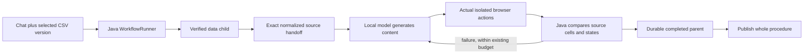
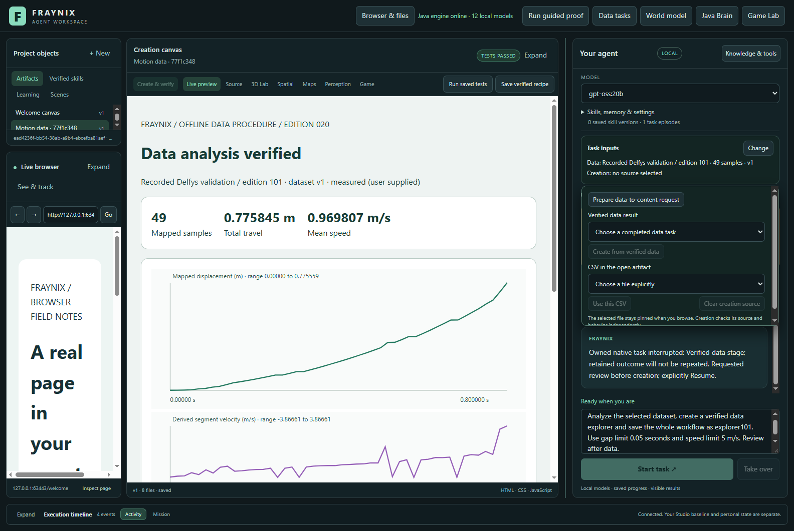
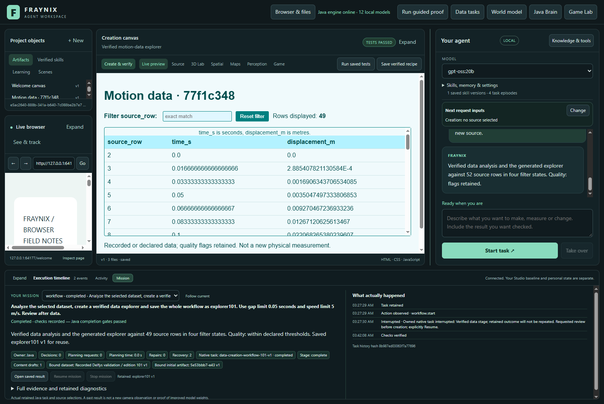
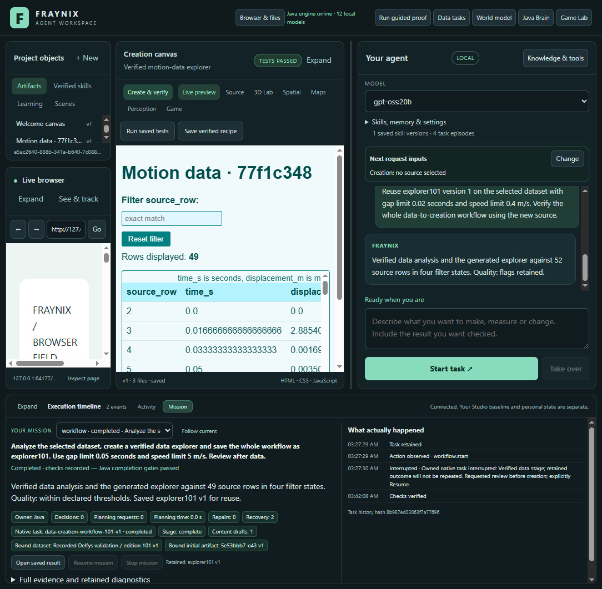
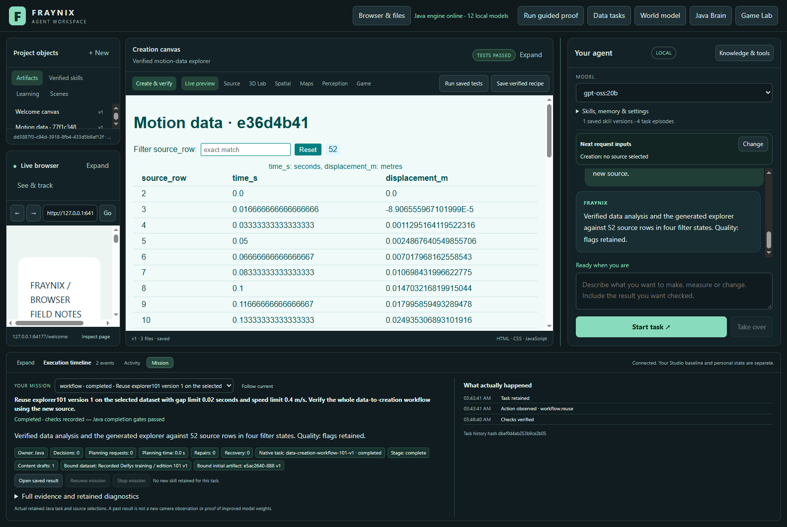

# Edition 101 — one request, verified data, working content

[Previous edition100](README-100.md) · [Offline interactive guide](docs/readmes/101/index.html) · [Edition history](docs/readmes/INDEX.md) · [Contributor direction](README-CONTRIBUTORS.md)

Edition101 joins the existing data analysis and creation capabilities into one durable Java-owned workflow. A supported chat request analyzes explicitly selected motion data, builds a working explorer with the installed local model, checks the actual result and saves the whole procedure. Restart keeps the verified analysis; reuse binds fresh input and performs new verification. The application remains one integrated workspace.

## What you can do now

Select a motion CSV in Data tasks, then open Task inputs → Change and choose **Prepare data-to-content request**. This fills the composer without sending. Read or edit the request, choose the installed model and send. The supported request is deliberately concrete: a filterable motion-data explorer with original row identifiers, seconds, displacement in metres, reset, row count, source scope and quality labels. It is not unrestricted pipeline synthesis.

Example: “Analyze the selected dataset, create a verified data explorer and save the whole workflow as my-explorer. Use gap limit 0.05 seconds and speed limit 5 m/s.” Java registers two stages: data and creation. No unrelated simulation is inserted. The first stage checks the original source, mapping, derived data and actual rendered analysis. The second stage binds that exact normalized output and asks the real local model to implement HTML, CSS and JavaScript. It cannot silently substitute whichever artifact is visible.

Add “review after data” to pause at the stage boundary. Review Mission, then Resume to continue the same parent and owned child identities. Normal requests advance automatically. Stop cancels owned unfinished work and does not promote a success. A saved whole procedure appears in Skills only after durable parent completion; choosing it prepares a new chat request. Select fresh data before sending the reuse request.

## Responsibilities stay clear



The existing Java supervisor owns intentions, stage ordering, source identity, progress, recovery and completion. The browser host supplies actual observations. The model writes the content implementation; it does not author this workflow's verifier or decide that its output passed. The original Game Lab, world model, persistent worlds, browser, creation canvas, tools and earlier procedure families remain available. This release extends the system without replacing its design.

The final review labels planning requests separately from content drafts, so a Java-routed task with zero planning-model calls does not imply that no model generated its content. The input chooser is labelled **Next request inputs**; the completed workflow’s frozen source is shown in Mission evidence. Those two presentation changes were checked after the model cohort with all installed JARs and other runtime inputs unchanged.

The fixed production audit observes four states: all original rows; one exact source-row match; an impossible match with zero rows; and reset to the full ordered table. Every cell must equal its normalized original string. Column order, headers, filter value, count, source scope and quality label must agree. A counter alone cannot prove the table filtered. Wrong values or units cannot be relabelled as success. Generated content runs in the existing isolated surface; imported instructions do not gain host privileges.

## Actual recorded-data demonstration

The cohort uses installed **gpt-oss:20b**, digest `f38aa0c53da5f8c49d08c43a99df24ff53167fe68e24664a7777288e7656fdfe`, with the existing CPU-only/four-thread generation policy. Inputs are the unchanged edition013 Delfys validation and training CSVs. They are recorded observations, not a fresh webcam measurement, new model training or proof of physical causality.

| Recorded input | Rows | Complete elapsed time | Generated drafts | Gap flags | Speed flags |
|---|---:|---:|---:|---:|---:|
| validation | 49 | 881.81 s | 1 | 0 | 0 |
| training | 52 | 181.31 s | 1 | 0 | 37 |

The first single chat request pauses after its analysis. The test terminates the owned Java process, reopens the same isolated project and explicitly resumes. The completed data child retains its identity and is not duplicated. The local model generates actual content; the normal checks and independent four-state audit run in Chromium. The entire procedure is retained only after verification.

A further cold restart confirms the skill remains. A second single chat request reuses that whole procedure on the other recorded dataset, with tighter gap and speed limits. It creates and verifies fresh content against the new source. Quality flags stay visible. No manual handoff or second creation request is inserted between these stages. The first retry of the UI test read task state before its asynchronous Resume action was acknowledged. A later retry then encountered the creation child that had already been durably started. The harness now waits for the acknowledged resume and reconciles up to two owned children, while requiring exactly one data child and the original parent identity. Those original harness failures are archived. After the first workflow completed, an incorrect POST in the harness for the GET-only state endpoint also failed; it was corrected before continuing the fresh-input trial. No runtime verifier was changed for these harness fixes. The test harness imports the declared datasets, selects the model, sends chat and performs explicit resume; it does not supply implementation code or passing host receipts to these model trials.

Complete elapsed time includes interruption, restart and harness interaction. These two tasks are functional demonstrations, not a speed comparison, a statistically powered benchmark or proof of generality. Deterministic Java routing may use zero router-model calls; content generation is independently evidenced by the actual model jobs. No weights are updated.

## What outside review found

An independent agent reviewed the baseline and new implementation read-only. Its findings were useful precisely because they challenged success paths. The new audit initially submitted browser actions without the assertion required by Surface.test; this was corrected before the actual cohort. It also highlighted cross-store publication and receipt-cache ordering risks. See the full [review record](docs/INDEPENDENT_REVIEW_101.md).

New skills are first retained as pending and unavailable. Java durably completes the parent and records the exact skill link before exposure. A pending marker remains until cleanup is committed, allowing idempotent reconciliation on restart. A later logging failure cannot downgrade a durably completed parent while leaving its skill advertised. If publication itself fails, the interface says publication is pending and explains restart recovery; execution need not be replayed. Reuse rechecks the completed parent and original contract, then binds fresh input.

The expanded restart test exposed another actual defect: after an independent audit rejected a draft, resume could reuse the older passing behavior receipt and skip the requested repair. A persisted independent-repair marker now blocks that shortcut. Pending-file recovery still comes first; after a replacement is committed, its normal tests and the independent audit run. The original three-draft limit remains. The failing test invocation is archived, followed by the corrected checks; this is not presented as a clean first run. The first real restart also exposed a chat guard that blocked its own paused workflow reservation. The corrected guard admits only that trusted owned interruption while still blocking unrelated work. Stopping an interrupted chat task now cancels its owned workflow. A test-fixture setup error and one compile error were also corrected and retained; these were not successful executions.

The artifact receipt cache now updates only after the receipt file is written successfully. A forced write failure checks both the in-memory state and reopened state against the prior receipt. These are small implementation changes with substantial consequences for truthful completion.

## Evidence and its limits

The final focused Java suite has 60 methods with no failures. Seven typed-graph regression methods also passed in the earlier expanded invocation, which had one new repair-restart failure. Existing desktop checks:135. Selection and new audit controls:7. Five explicit adversarial fixtures exercise the actual Chromium Surface independently of the model cohort. They are labelled fixtures and are not presented as model output.

The independent inspector reconstructs source arithmetic from the original recorded CSV, checks derived travel and quality counts, confirms exact handoff lineage, compares all four observed table states and verifies model compute receipts. Eight altered-evidence controls must be refused. The report, originals and test details are linked in [verification](docs/readmes/101/verification.json), [analysis](docs/readmes/101/analysis.json) and the [lossless original archive index](docs/readmes/101/original-evidence.json).

Visibility checks use positive DOM rectangles and ancestor display, visibility and opacity. They do not prove pixel visibility through all overlays, clipping or deceptive contrast. The screenshots below receive a separate visual review. Generic legacy creation procedures and older three-stage workflows do not automatically acquire the new fixed audit. Existing limits remain:20 workflows,64 goals and32 saved skills. They prevent unbounded accumulation; archive/index scaling is future work.

Parent CI run42604303817 was `in_progress` with conclusion `None` at the recorded check. Local test results are not a substitute for a completed remote run. The publication receipt records the actual push and fetched Git objects separately; no pending CI is called successful.

## Actual application screenshots

Captured2026-11-09 from the isolated edition101 app, showing generated content and actual task state, not design mockups. Private live projects, personal footage and credentials are not part of these images.



Actual app paused after verified analysis, before content generation.



Actual local-model explorer after interrupted restart and full verification.



Same actual explorer and chat at 1100-pixel app width.



Saved whole workflow reused with new 52-row recorded input; quality flags retained.

## Where to inspect the implementation

```text
workspace-engine/.../Domain044.java       chat routing and fresh bindings
workspace-engine/.../WorkflowRunner.java  durable parent, recovery, publication
workspace-engine/.../GoalRunner.java      owned children, repair and receipt checks
workspace-engine/.../DataCreation101.java fixed source-derived contract and audit
workspace-desktop/data-creation101.cjs    actual isolated-browser observations
workspace-desktop/renderer/inputs100.js   prepare request in existing input chooser
scripts/Inspect-DataCreation101.cjs       independent original/outcome inspection
```

The [canonical file inventory](docs/readmes/101/file-inventory.json), offline guide and Obsidian map retain links to the actual code. Follow existing README launch instructions for Java21, the repository Gradle wrapper and desktop dependencies. Use a separate project directory for review and testing; do not point a new checkout at a live private database. Keep model weights and credentials outside Git. This release uses the installed local model and does not require a cloud provider or Docker/WSL.

## Direction and next acceptance gates

1. Measure complete task costs over several datasets, restarts and failed drafts. Separate model generation time, verification time and recovery overhead before claiming efficiency.
2. Add a small number of additional registered data/content procedures with explicit schemas, exact source checks and useful output contracts. Keep arbitrary code execution out of imported procedure text.
3. Improve visible-content checks against clipping and overlays, then add keyboard/accessibility controls. Demonstrate refusal with adversarial real pages before strengthening visibility claims.
4. Introduce bounded active indexes and archived histories so useful memory can grow without repeatedly loading every old task. Preserve provenance and reopen tests.
5. Evaluate whether a saved procedure actually saves work on changed tasks. Successful reuse establishes functionality; matched comparisons establish value.

The larger destination remains a local agent that can observe, act, simulate, create, remember and verify within one coherent world and workspace. This edition establishes a concrete part of that destination: one persisted request can turn observed data into working content and a reusable procedure, while keeping its evidence attached. It does not establish consciousness, unrestricted self-improvement or universal task competence.
