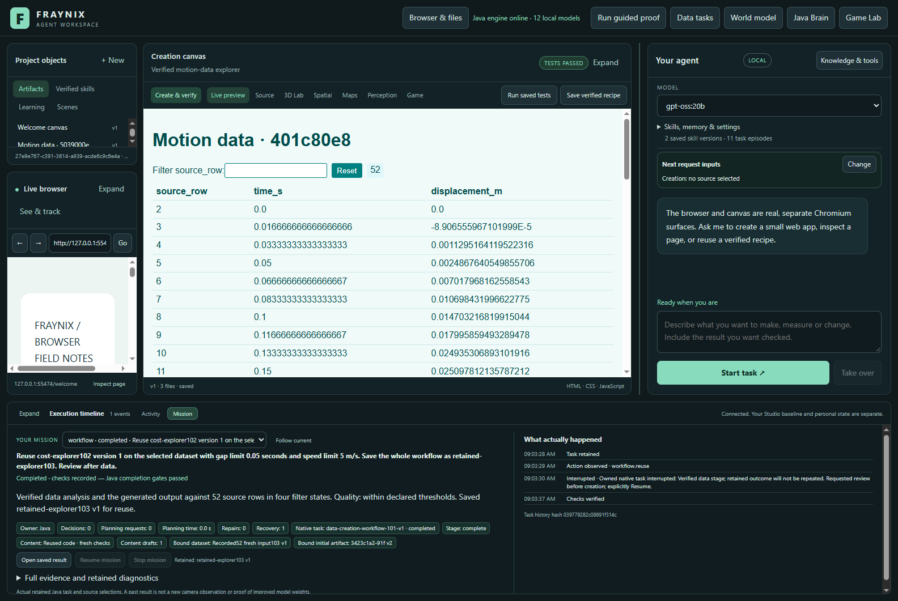
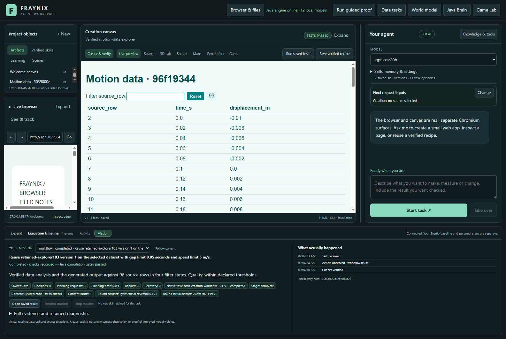
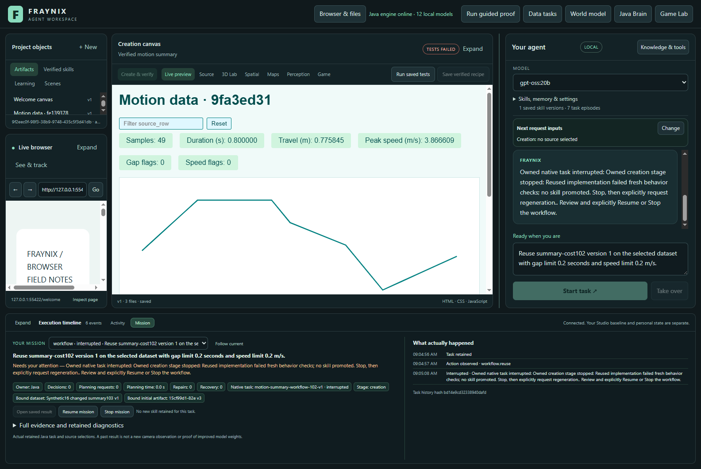
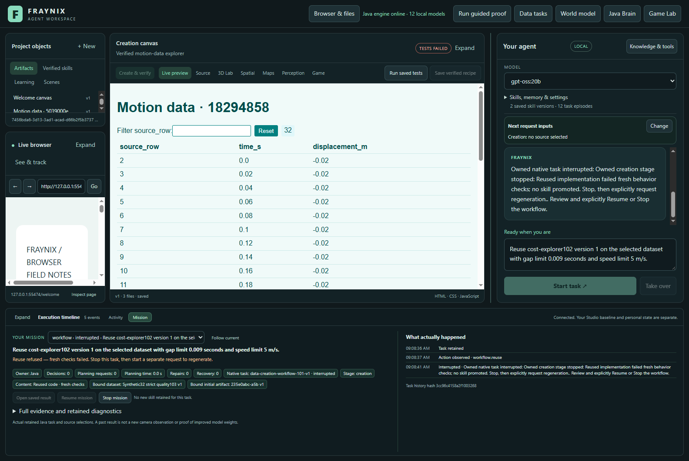
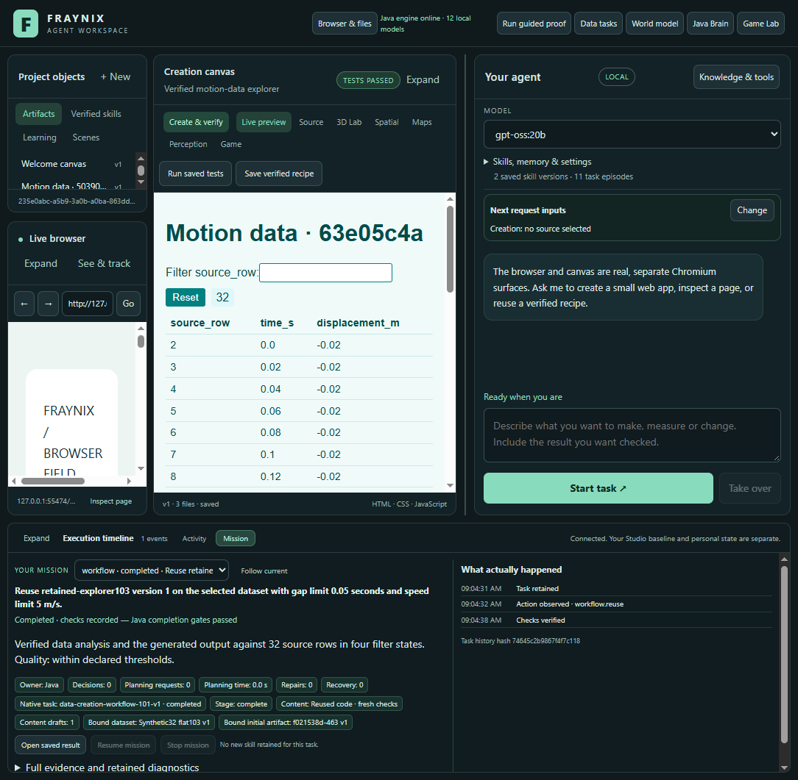

# Fraynix Agent Workspace — edition 103

## Verified code, fresh data, fresh evidence

Edition 103 lets a durable chat request reuse the **exact implementation** of a published data-to-creation procedure. Java analyzes the newly selected dataset, binds new input files, creates a separate artifact, runs the original browser checks and independently verifies the rendered outcome. It does not copy the old passing verdict.

The measured result is **three completed requests and three correctly refused candidates**. All six used retained local-model code without a new content-generation call. One successful request survived an abrupt Java process interruption between stages, and its saved procedure was reused after a cold restart. This is useful procedural memory; it is not model-weight training or a demonstration of general autonomous learning.

[Previous edition102](README-102.md) · [Interactive offline guide](docs/readmes/103/index.html) · [Full measurements](docs/readmes/103/analysis.json) · [Validation and build identity](docs/readmes/103/verification.json) · [Contributor direction](README-CONTRIBUTORS.md)

## Why this edition exists

Edition 102 showed both a useful workflow and an expensive limitation. It could analyze data, generate an interactive report, check it, save the procedure and recover an interrupted task. However, invoking a saved procedure regenerated its code. The changed-input summary request exhausted three drafts and three resumes while still confusing travel with range. That request remains a failure in the frozen102 record;103 does not reopen it or extend its limits.

Fresh inspection also found that the successful 49-row summary hardcoded its six summary values. Its chart and table read the source, but its summary did not generalize. A verified artifact is evidence for the inputs and contract it actually passed. Reuse needs another full check. Edition 103 tests this directly instead of assuming that a saved artifact will work on every new dataset.

## What the application now does

The existing local workspace still combines chat, a browser, a creation canvas, Game Lab, spatial worlds, data tools, physics and persistent procedures. Java owns the durable task state and verification boundaries. The desktop presents the work and supplies actual browser observations. This release changes the data-to-creation reuse path; it does not replace the game or physics runtime, introduce another window as the agent’s brain, or change the older world controllers.

For a saved source explorer or motion summary, chat now selects implementation reuse by default. The Mission panel identifies **Reused code · fresh checks**. An explicit request containing “regenerate” selects the previous generation path. Direct API callers retain the old default unless they pass the boolean `reuseImplementation103: true`; this avoids silently changing older automation. The new option applies only to the registered 101/102 data workflows, not arbitrary programs, general tool handlers or every skill family.

### The complete execution path

1. Select a dataset and name a published procedure and version.
2. Java checks the original parent completion, published skill linkage, source data, verified normalized handoff, artifact version/hash, behavior receipt and independent outcome audit.
3. Java freezes a separate 103 implementation binding: original workflow and child, skill reference, verifier identity, exact implementation hash, model provenance and current reuse protocol identity.
4. The fresh data child checks the selected dataset and quality criteria. Its normalized report is verified before creation.
5. The content child copies the original non-input files byte-for-byte. Only the reserved `inputs/source.csv` and `inputs/source.json` are replaced with the fresh Java-owned handoff. The result receives its own artifact identity and no inherited browser receipt.
6. The actual canvas performs the frozen behavior checks. The independent audit then reads all rows, exact filtering, no-match filtering and reset. A summary must additionally pass all six numeric outputs, every SVG point, coordinate system, units and visibility checks.
7. Completion and skill publication follow durable parent completion. A saved descendant retains its ancestry. Recovery reuses the same child intent and checks the original and new bindings again.

The implementation ancestry is bounded to eight links. Source, artifact, protocol or lineage changes refuse continuation. This is conservative compatibility handling: historical evidence is retained rather than relabelled under changed code.

## Measured outcomes and complete costs

These are actual Electron/Java runs on isolated projects restored from the published102 archive. Sources comprise one unchanged recorded Delfys sequence and explicitly synthetic arithmetic sequences. Synthetic inputs are test data, not new camera measurements or simulated physical experiments.

All costs are seconds. Total is the complete caller interval from submission through completion or refusal. Browser spans are unioned; nested reads are not added twice. Restart includes the deliberate interruption and reopening. Other includes Java source verification, analysis, persistence, scheduling and harness polling. Initial startup/import and work between requests sit outside these request intervals and remain in the original cohort timestamps. Skill saving is inside the first request. Cold reopening of its saved skill is recorded separately.

| Request | Rows | Outcome | Total s | Browser s | Restart s | Other s |
|---|---:|---|---:|---:|---:|---:|
| recorded52-restarted | 52 | completed | 8.877 | 1.168 | 3.178 | 4.531 |
| synthetic96-descendant | 96 | completed | 7.502 | 1.355 | 0.000 | 6.147 |
| synthetic32-flat | 32 | completed | 7.113 | 1.266 | 0.000 | 5.847 |
| quality-refused | 32 | interrupted | 6.140 | 1.649 | 0.000 | 4.491 |
| display-fault-refused | 32 | interrupted | 5.434 | 1.261 | 0.000 | 4.173 |
| summary16-refused | 16 | interrupted | 11.680 | 7.872 | 0.000 | 3.808 |

There were **zero new content-generation calls** for these six requests. The original model provenance remains attached to the copied code. These timings are not a controlled speedup comparison with 102: the inputs, paths, restart conditions and outcomes differ. No replacement generation was hidden outside the measured request. Refused candidates consumed work and are included.

### Three completed requests

The recorded 52-row request reused the 49-row source explorer with fresh data under the declared 0.05-second gap and 5 m/s speed limits. It paused after verified data, underwent deliberate process termination and resumed through the actual Mission control. The original data child and implementation binding survived. Its complete procedure was saved as `retained-explorer103`.

After a cold application restart, that descendant handled a 96-row synthetic reversal sequence. A separate32-row flat sequence also passed. Both retained the exact implementation bytes while changing input bytes, artifact identity and observations. Every source row and all four table states were checked again.

### Three refused candidates

The explorer’s quality label is fixed in the original code. A stricter 0.01-second gap criterion produces real quality flags in the fresh analysis, while the old page still says it is within limits. The unchanged behavior check rejects that mismatch.

The display-fault control deliberately changes one actual displayed cell after behavior checks and before the independent source audit. The audit rejects the altered value. This is a labelled injected fault, not a spontaneous model mistake or an edited source file.

The16-row summary control reuses the exact hardcoded 49-row implementation. It correctly refuses its stale numbers. The new data has 0.310000 m total travel; the old page still contains 0.775845 m from its original source. No code patch, new model draft or substitute result is inserted to turn this refusal into success.

A reused candidate receives one checked attempt. A failed behavior or independent audit is retained and interrupts the request. Resume cannot recycle its earlier passing behavior receipt or trigger silent regeneration. Stop the refused task, then explicitly start a separate regeneration request if wanted. The original successful artifact and skill remain unchanged.

The original refusal screenshots above preserve the measured cohort before a later presentation correction. Their enabled Resume button and generic recovery wording did not bypass the Java refusal, but were misleading. The current Mission view now disables Resume for refused reuse and clearly offers Stop followed by a separate regeneration request. The completed-result screenshots were reopened with the current presentation, and this additional stricter-quality UI check confirms the corrected controls. All compiled Java artifacts remain byte-identical; this review is separate from the six timed requests.

## Try it in the application

Use a published data procedure in your own project; the test procedure names below exist in the restored review project, not automatically in unrelated private worlds.

1. Open Inputs, import or select a motion CSV and confirm its column/unit mapping.
2. Choose the saved procedure/version and enter: “Reuse cost-explorer102 version 1 on the selected dataset with gap limit 0.05 seconds and speed limit 5 m/s.”
3. Open Mission. Confirm the selected source, reuse indicator, data stage, content stage and final verification status. Open the actual result when completed.
4. To retain the whole successful procedure, add “Save the whole workflow as retained-explorer103.” Reopen the app and reuse that exact version with another selected dataset.
5. To review recovery, add “Review after data.” Resume from Mission after the pause. Do not assume a closed window means the task completed.
6. For a separate regenerated implementation, use “Reuse cost-explorer102 version 1 on the selected dataset and regenerate the implementation.” Generation still has the existing budgets and full checks.103 does not claim a new successful regenerated summary.

## Reproduce and inspect

The repository keeps the Java 21/Gradle and existing desktop dependencies. No new external package is introduced for this feature. Build the workspace engine before launching; the ordinary launcher remains `Launch-Agent-Workspace.bat`. Use a separate project location for experiments so private worlds and databases are preserved.

`node scripts/Prepare-Implementation103.cjs` restores original102 evidence into a new `build/reuse103` folder and refuses an existing destination. It verifies both compressed and decompressed bytes against the frozen archive. It never launches the old live projects. The integration harness is `workspace-desktop/test/implementation103-integration.cjs`; it uses the real app and existing model catalog, without a new content inference. The recorded102 model artifacts are inputs, not invented model responses.

`scripts/Inspect-Implementation103.cjs` independently recomputes original source arithmetic, quality flags, normalized rows, exact implementation and artifact hashes, handoff lineage, actual browser assertions, four table states, refusal causes and complete cost accounting. Sixteen altered evidence records are refused. It checks the actual generation journal for omitted calls. The initial test harness mistakes are archived as failures: it first omitted the required data report host check, then expected one narrower exception class than the legitimate file validator returned. Those were corrected without weakening production checks. The first app launch also caught an invalid text encoding in the new status label. That production text was corrected; the original failure log is retained, and the subsequent 56-file source integrity check and real browser trials passed. After the first request completed, the integration harness used POST for the GET-only state endpoint. The method was corrected and the remaining trials continued; the completed request was not repeated. This assistance is outside the six request intervals and remains in the full cohort timestamps and original failure record.

The final focused Java suite contains 88 methods. Existing desktop tests and actual legacy/summary/diagnostic browser controls also pass. The source comparison confirms that the 101/102 verifier class bytes are unchanged. Full originals, failures and receipts are retained in the [lossless evidence manifest](docs/readmes/103/original-evidence.json). The source inventory and all frozen editions are checked before publication. Remote CI is reported separately in the publication receipt; local validation is not described as CI success.

## Limits and next steps

This release proves bounded implementation reuse for registered data workflows. It does not make every generated artifact reusable. Both retained implementations have fixed quality labels, and the retained summary has fixed metrics. The guard catches those limitations; it does not fix the implementation automatically. Browser checks cover declared behaviors and inspected DOM/SVG visibility, not universal visual correctness, arbitrary occlusion or every interpretation of a request.

The next useful step is a genuinely input-driven summary implementation, with a separately defined input contract for quality criteria and source-derived metrics. Verify it across reversal, flat, gap and changed-unit cases before retaining it. Keep old artifacts and checks unchanged. After that, measure when a cheap reuse attempt is worthwhile versus explicit regeneration, including refusal cost and growing ancestry. A bounded compatibility descriptor could prevent obviously unsuitable reuse, but it must never replace fresh outcome checks.

The direction remains a local agent that remembers useful verified work, acts through owned tools, observes the result and keeps its evidence across restarts. Edition 103 makes that practical for existing creation code. It contributes persistent procedural competence without claiming that changing weights, general intelligence or reliable self-improvement have already been demonstrated.
