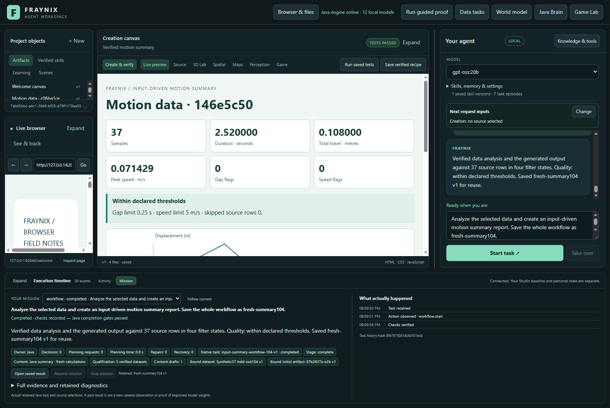
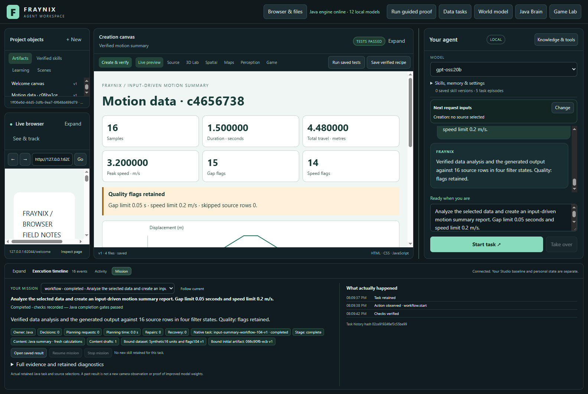
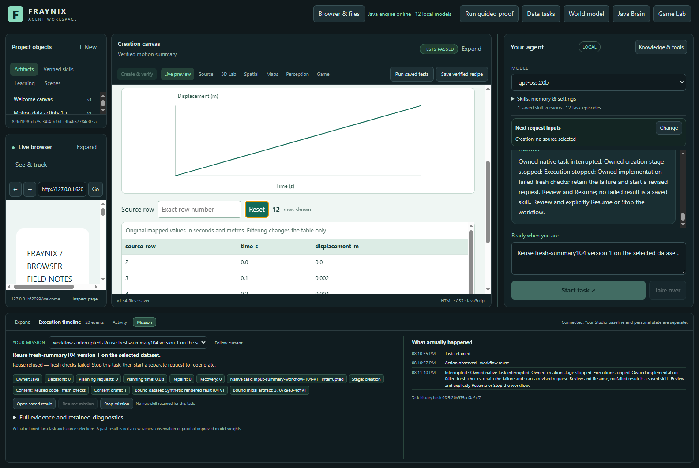
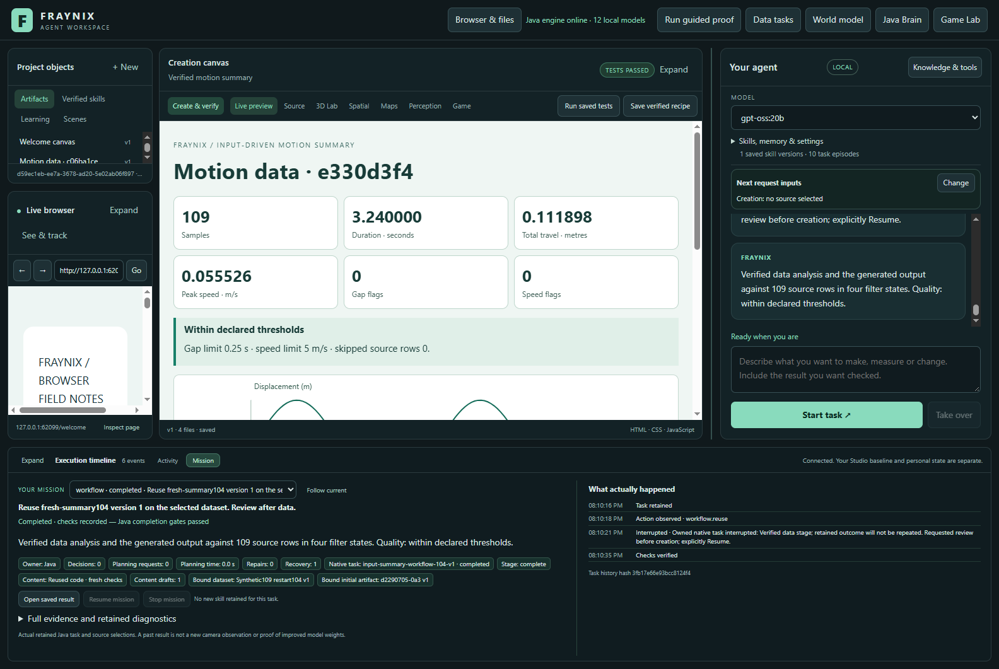
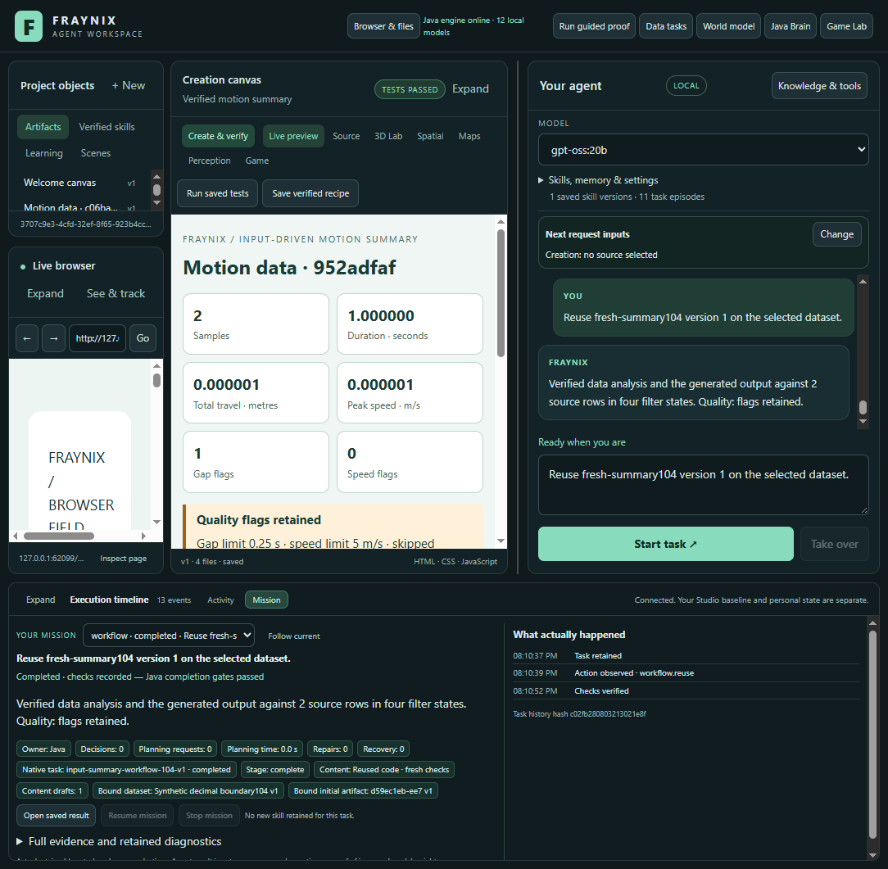

# Fraynix Agent Workspace — edition 104

## Calculate the new input; qualify before remembering

Edition 104 adds an **input-driven motion summary owned by Java**. The shipped browser implementation calculates all six summary values, the quality label and every chart point from fresh normalized rows and the current thresholds. Java independently verifies what the actual browser displayed. Saving the procedure additionally requires varied, linked verification examples.

The actual result is **nine completed requests**, **one refused premature retention** and **one correctly refused displayed corruption**. All eleven used the authored implementation with zero new content-generation calls. The saved procedure survived cold restart and calculated new mapped data; another request recovered from abrupt Java interruption without repeating its verified data stage.

[Previous edition 103](README-103.md) · [Interactive offline guide](docs/readmes/104/index.html) · [Complete measurements](docs/readmes/104/analysis.json) · [Validation and build identity](docs/readmes/104/verification.json) · [Contributor direction](README-CONTRIBUTORS.md)

## What changed, and why

Edition 103 established exact implementation reuse with fresh checks. It also exposed the limit of the older model-generated summary: its six summary values were fixed constants. Changing the data changed the table and trace, but the report retained old numbers and was correctly refused. That older artifact and its failure remain unchanged in the previous edition.

This release adds a separate `input-summary-workflow-104-v1` procedure. Java loads the repository’s owned implementation and writes a new artifact with fresh reserved inputs. The embedded browser code performs the presentation calculations; the Java data engine and independent verifier calculate the expected outcomes from the original source. No new external library, remote service or content model is involved in this path. This is hand-authored application capability, not a newly trained model or a claimed autonomous code discovery.

The existing generative motion-summary procedure remains available. Chat chooses the new procedure when the request explicitly says **input-driven** motion summary. Named retained procedures still use their exact recorded family. A saved 104 implementation is copied exactly for reuse and checked against its source and current identity.

## Fresh values, defined calculations

Java first checks the raw CSV, explicit unit mapping, time order, missing-row policy and declared quality limits. It preserves the original file and produces normalized seconds/metres. The new creation input contains those exact source strings plus freshly bound gap and speed thresholds and the source’s verified skipped-row count. Expected summary answers are not supplied to the renderer.

| Display | Calculation from the current full source |
|---|---|
| Samples | Number of mapped rows |
| Duration | Last timestamp minus first timestamp |
| Total travel | Sum of absolute displacement changes between adjacent rows |
| Peak speed | Largest absolute adjacent displacement change divided by its time interval |
| Gap flags | Count of time intervals above the current gap threshold |
| Speed flags | Count of adjacent speeds above the current speed threshold |

Travel includes reversals; it is not the displacement range. Flat motion has zero travel and speed. Threshold comparisons preserve the existing strict greater-than rule. Missing rows remain declared source facts: even if the remaining intervals pass, skipped rows keep the quality warning visible. The shipped formatter follows the existing Java six-decimal display convention, including the tested half-micro boundary.

The chart retains every normalized source point in order with the same fixed coordinate contract as edition 102. It does not smooth or invent points. Filtering changes only the source table. Summary values and the full trace remain unchanged across all rows, an exact row match, no match and reset.

## Qualification before skill retention

A single passing dataset does not qualify the implementation for a reusable skill. Before saving a 104 procedure, Java requires at least four distinct, already completed 104 datasets collectively covering:

- Monotonic motion.
- Reversal.
- Flat motion.
- Both gap and speed flags.
- Explicit nonidentity units.

Java reconstructs and verifies each original source, implementation, behavior receipt and independent audit. It saves exact links to those proofs, then requires the current save request to pass independently. The actual cohort retained five prior examples, including an additional skipped-row case, before saving the 37-row held-out result.

The qualification is part of the saved procedure’s lineage. Reuse and publication recheck the linked originals. Changed source files, code, evidence or qualification identity are refused. A later saved descendant still needs valid qualification. This is bounded empirical coverage in the current project, not a guarantee for every possible dataset. A new private project does not silently inherit these trial proofs.

## Verification stays independent

`Creation`, `MotionData`, `DataCreation101` and `DataSummary102` retain their previous compiled bytes. The 104 wrapper routes the new procedure through the same complete source-table, summary and SVG checks. The authored producer has a separate identity that includes its Java adapter and shipped HTML/JavaScript. The goal runner checks exact code and fresh criteria throughout execution and recovery.

A successful behavior check does not bypass the independent source audit. In the deliberate corruption trial, the displayed travel value was changed after behavior tests. The independent audit rejected it, the request retained its failed evidence and Resume could not silently treat the earlier receipt as success. No failed procedure was saved.

## Actual trials and full costs

These requests ran through the real local chat, Java runner and Electron canvas in an isolated fresh project. One unchanged Delfys recording is reused as recorded data. All other sequences are explicitly synthetic arithmetic fixtures, not new camera observations. The original project, requests, artifacts, source strings and observations are in the lossless evidence archive.

Times below are seconds. Total is the full caller interval from submission to collected completion or refusal. Browser intervals are unioned to avoid double counting. Restart includes deliberate interruption and reopening, plus the explicitly labelled harness recovery below. Other includes Java computation, persistence, original evidence checks, qualification, scheduling and harness polling. Startup and gaps between requests remain in the full cohort timestamps. Skill qualification and retention are charged inside their request.

| Request | Rows | Outcome | Total s | Browser s | Restart s | Other s |
|---|---:|---|---:|---:|---:|---:|
| early-retention-refused | 7 | interrupted | 4.656 | 1.224 | 0.000 | 3.432 |
| recorded52 | 52 | completed | 5.261 | 1.244 | 0.000 | 4.017 |
| reversal96 | 96 | completed | 142.440 | 1.262 | 101.855 | 39.323 |
| flat32 | 32 | completed | 5.221 | 1.256 | 0.000 | 3.965 |
| units-flags16 | 16 | completed | 5.342 | 1.238 | 0.000 | 4.104 |
| skipped-input | 3 | completed | 5.975 | 1.232 | 0.000 | 4.743 |
| heldout37-saved | 37 | completed | 6.288 | 1.243 | 0.000 | 5.045 |
| reused27-mapped | 27 | completed | 14.582 | 1.233 | 0.000 | 13.349 |
| reused109-restarted | 109 | completed | 20.349 | 1.340 | 3.372 | 15.637 |
| precision2 | 2 | completed | 16.023 | 1.255 | 0.000 | 14.768 |
| rendered-fault-refused | 12 | interrupted | 16.135 | 1.239 | 0.000 | 14.896 |

The first harness run failed while collecting the already completed 96-row reversal request: it compared an untrimmed prompt against the application's trimmed text. The harness alone was corrected, and the same completed task was collected after reopening; neither its runtime nor its result was regenerated. Its full 142.440-second caller interval includes 101.855 seconds of developer-assisted harness recovery and the earlier failed polling. Original failure records and screenshots are retained alongside the continuation. This is distinct from the deliberate 109-row Java restart test and is not an autonomous recovery claim.

These are complete observed costs, not a matched speedup comparison with previous model-generation runs. Zero content inference here means the authored implementation did the calculation; it does not show improved model weights. Reuse still pays for source, ancestry and outcome checks.

The initial save attempt produced a correctly verified report but was refused at the retention gate because varied-data proof was missing. After the separate qualification examples, the held-out report saved `fresh-summary104`. A cold-reopened reuse changed units, origin, direction and thresholds. Another reuse handled 109 rows after an abrupt Java process interruption at the verified-data boundary. Its original data child remained unchanged.

## Try it in the app

1. Import or select a motion CSV in Inputs, with explicit time and distance units.
2. Ask: “Analyze the selected data and create an input-driven motion summary report.” Optional gap and speed limits are read from the request.
3. Review the actual cards, quality warning, source rows and full trace. Mission identifies the Java-owned calculation and records verification.
4. Before saving, run distinct examples covering monotonic, reversal, flat, flagged and changed-unit inputs. These must complete in the same project. The current release does not automatically invent qualification data inside a user’s request.
5. Select another dataset and ask: “Analyze the selected data and create an input-driven motion summary report. Save the whole workflow as fresh-summary104.” Java rechecks the linked qualification before publication.
6. After saving, ask: “Reuse fresh-summary104 version 1 on the selected dataset.” New thresholds and data are bound afresh. Add “Review after data” for an explicit pause; Resume reconciles the saved child and input.

If retention is refused for missing coverage, Stop that request, complete the missing examples without saving, then start a fresh save request. A corrupted or incompatible result remains a refusal; the runtime does not rewrite its evidence to pass.

## Validation, evidence and compatibility

The focused Java suite contains 93 methods, including qualification, cold reuse, changed original evidence, forbidden public injection, independent failure and legacy behavior. All 141 desktop checks and 23 legacy/summary/diagnostic actual Chromium controls pass. Twenty altered-record controls are independently refused by the source and timing inspector. Unit host receipts are explicitly software fixtures; the eleven app requests supply actual browser observations. Screenshots were reviewed at 1600 and 1100 pixels. The refusal capture shows the actual failed task with Resume disabled; its cards are above the visible table scroll position.

The source identity comparison preserves the original verifier classes. Older 103 implementation bindings include the runner identity and remain conservatively refused if that identity changes after upgrading; they are not relabelled as 104 proof. Start a new reviewed 104 procedure rather than modifying an old checkpoint. Existing private worlds and frozen editions remain untouched.

Build with Java 21 and the checked-in Gradle wrapper, then use `Launch-Agent-Workspace.bat` with a separate review project. The actual cohort harness is `workspace-desktop/test/summary104-integration.cjs`; it refuses an existing output folder. `scripts/Inspect-Summary104.cjs` recomputes raw input mapping, source arithmetic, every displayed metric and point, qualification links and complete cost accounting. [Original evidence](docs/readmes/104/original-evidence.json) retains the original artifacts and results. Remote CI is reported separately from local checks.

## Next steps

Measure how qualification and ancestry verification costs grow with more retained procedures. Test wider numeric ranges, additional missing-data patterns and threshold boundary cases before widening the input contract. Then add an explicit workflow that prepares and runs qualification examples with clear provenance, so a user can request qualification without manually selecting each case. Each new creation family should have its own input contract and independent outcome checks.

This advances the original direction: a local agent can choose a useful procedure, calculate from current reality-linked data, observe the rendered result and retain verified ways of working across sessions. The verified capability here is reusable motion-data reporting; it is not general scientific reasoning or an unrestricted self-improvement system. One UI wording limitation remains: inherited completion text calls the output “generated”; the new producer chip identifies it as a Java summary. A missing-qualification refusal still exposes the generic Resume control, but its verification gate continues to refuse; follow the stated Stop-and-start-fresh instructions.
