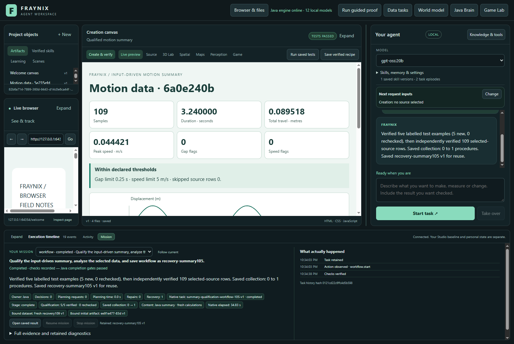
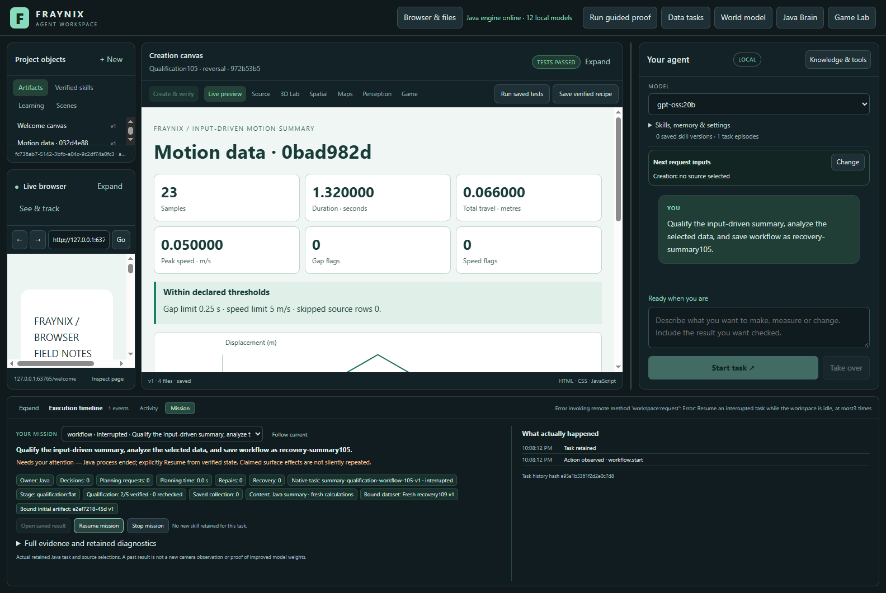
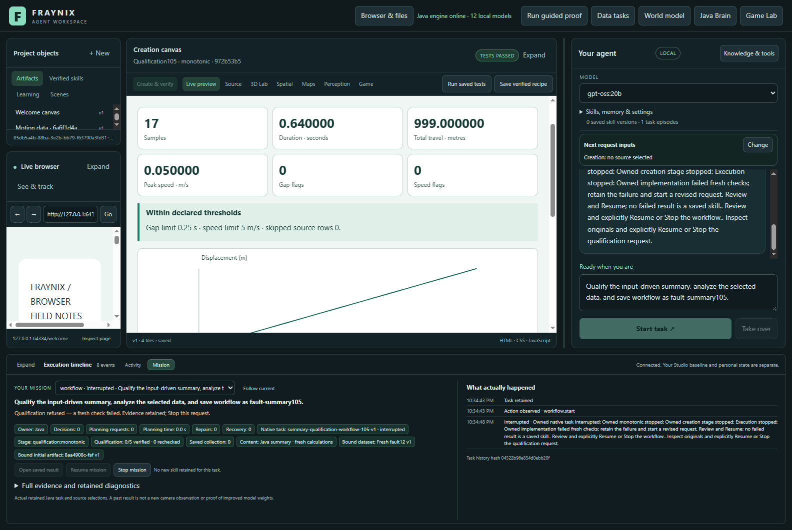

# Fraynix Agent Workspace — edition 105

## Automatic qualification with measured collection costs

One explicit chat request now runs five labelled qualification examples, independently verifies the selected dataset and saves its successful input-driven summary procedure. Java owns the sequence, durable progress, recovery, source checks and publication. Later requests reuse completed examples only after rechecking their originals.

**Actual study: 15 completed requests and two required refusals.** Eight real published procedures build the collection. Six cold-copy probes compare the same fresh source at collections of 0, 4 and 8 procedures. A separate request recovers after abrupt Java interruption. A corrupted displayed example and an altered retained proof each refuse publication.

[Previous edition 104](README-104.md) · [Interactive offline guide](docs/readmes/105/index.html) · [Complete measurements](docs/readmes/105/analysis.json) · [Validation and build identity](docs/readmes/105/verification.json) · [Contributor direction](README-CONTRIBUTORS.md)


## What changed

Edition 104 required separate qualification requests before a summary could be retained. Edition 105 gives that work a durable Java supervisor. Every executable child still uses the original 104 workflow. The five examples have exact inputs, mappings, thresholds, missing-row policies and code identities. They are synthetic software tests, explicitly labelled in the application and evidence.

The selected dataset is frozen separately at admission. Qualification does not overwrite that selection. Each example must verify its original source, normalized data, fresh calculations, behavior receipt, displayed values, chart geometry and four filter states. Only then does the supervisor run the selected-data child. That child publishes through the unchanged 104 qualification gate.

| Example | Input | Purpose |
| --- | --- | --- |
| Monotonic | 17 rows, seconds/metres | Increasing displacement, travel and speed |
| Reversal | 23 rows, seconds/metres | Travel differs from endpoint displacement |
| Flat | 11 rows | Zero travel/speed and stable plotting |
| Changed units and flags | 9 rows, milliseconds/centimetres | SI conversion plus explicit gap and speed flags |
| Skipped row | 6 raw rows, 5 accepted | Missing-row accounting remains visible |

No expected summary answers are sent to the browser. The authored report calculates all six values and the trace from fresh normalized rows. Java independently checks the actual rendered result. This is owned executable logic and procedural evidence, not a content-generation or model-training claim.

## Use it

1. Start an isolated review project with Java 21 and the checked-in Gradle wrapper, then `Launch-Agent-Workspace.bat`. Keep private live projects separate from tests and upgrades.
2. Import and select the motion CSV in Data tasks. Choose the time and displacement columns, units and missing-row policy explicitly.
3. Send: **“Qualify the input-driven summary, analyze the selected data, and save workflow as my-qualified-summary.”** Use a new lowercase name with letters, digits or hyphens.
4. Mission shows verified example progress, whether examples are newly created or rechecked, and the published collection count. The selected-source report opens in the existing canvas.
5. After interruption, use the same request's **Resume** control. Completed examples keep their identities. Stop releases ownership. A failed original or independent audit remains a refusal; Resume cannot turn it into passing evidence.
6. A later explicit qualification request rechecks matching original examples. To reuse a published report implementation on fresh data, the established **“Reuse my-qualified-summary version 1 on the selected dataset”** path remains available with all original checks.

“Review after qualification” requests an explicit pause after the five examples and before the selected-source report. It retains ownership until Resume or Stop. Imported text cannot install handlers or fabricate passing evidence.

For a separate Windows review project, run from the repository root with Java 21 and Node.js installed:

```powershell
$env:FRAYNIX_WORKSPACE_PROJECT = Join-Path $env:USERPROFILE '.fraynix-agent-workspace/projects/review-105'
.\Launch-Agent-Workspace.bat
```

Choose a different project folder if that name already contains work you intend to preserve separately. The launcher prepares the Java engine and verifies desktop dependencies. Initial dependency preparation may require a connection; after preparation, `Launch-Agent-Workspace.bat -Offline` uses the matching cached dependencies. Reconnecting to a continuing Java owner preserves that owner's loaded installation; use the app's Stop Java control before upgrading it.

## Durable recovery and limits

Java persists each child intent before execution, uses stable child identifiers and reconciles an imported example that was saved immediately before interruption. The measured recovery ends the Java process after two verified examples; reopening and explicit Resume continue the same request with exactly six executable workflows and twelve native goals. No verified example is duplicated.

The supervisor preflights space for all missing examples, the selected request and publication. Existing limits remain: **20 executable workflows, 64 native goals, 32 procedures and 8 versions per procedure name**. The new administrative supervisor history is separately bounded at 16. It has a retained 1,200-second awake budget and at most three resumes; wall-clock interruption time remains included in the external measured cost. Supervisors are not saved skills and do not count as invented procedure growth.

Original proof changes cause refusal rather than replacement. The generated case identity includes its own implementation, runner and 104 producer identity. Older runner-bound implementations are not relabelled after upgrades. Preserve and inspect their originals, then start a newly reviewed request if their identity is no longer supported.



## Failure found and corrected before release

The first cohort completed 14 requests, then its abrupt-restart test could not resume. The interrupted child still held the workspace reservation, while host admission only recognized its parent. This was an application defect, not a successful recovery. Java retained the original two completed examples and published no procedure for the blocked request.

The fix maps the interrupted parent to its exact owned child reservation. All other busy-state, ownership, source and outcome checks remain. A new Java regression test checks the original failure and rejects a foreign child. The final17-request cohort below is fresh and separate; no old failure is relabelled.

The preliminary cohort cost **321.620 seconds**, including **256.190 seconds** in requests and **26.608 seconds** in the failed recovery. Both cohorts, build identities and original files remain archived. Six additional altered-record controls reject erased failure costs or invented success/resume. Development and rebuild time between cohorts is not included in either measured cohort.



## Measured cost as the collection grows

The collection grows through eight actual successful publication requests on varied inputs. No procedure records are inserted to pad the counts. The first uses the unchanged published Delfys013 recording; the other preparation inputs and held-out probe are declared synthetic arithmetic sequences. None is represented as new camera footage.

Each checkpoint is copied into a fresh project and reopened cold. Cold means a restarted application/Java process, not a flushed operating-system cache or restarted Ollama service. Two probes per checkpoint use the same 37-row held-out dataset and identical chat prompt. The empty checkpoint creates its five examples; collections of four and eight recheck their originals. Collection size also changes task history and provenance volume, so this is a first-use/recheck and collection-growth observation, not a pure causal estimate of bank size.

| Published procedures | Mean complete request (s) | Observed range (s) | Mean admission (s) | Mean final verification (s) |
| --- | --- | --- | --- | --- |
| 0 | 32.801 | 32.672–32.930 | 0.009 | 0.566 |
| 4 | 11.201 | 11.194–11.208 | 0.358 | 0.699 |
| 8 | 14.726 | 14.692–14.759 | 0.397 | 0.793 |

Eight preparation requests cost **111.293 seconds** in total. All 17 request intervals cost **272.664 seconds**; the complete cohort spans **357.229 seconds**, retaining another **84.565 seconds** for startup, imports, copying, captures, inspection and shutdown outside requests. Preparation is not omitted from the result.

Browser intervals are unioned, so nested checks are not double-counted. Restart includes process interruption and reopening. Other includes Java computation, persisted checkpoints, original proof checks, scheduling and harness polling. Native phase wall intervals overlap these categories and are not added again. Admission/final verification use monotonic timers; complete request timing starts before chat submission and ends at the collected outcome.

| Request | Role | Initial collection | Outcome | Total (s) | Browser (s) | Restart (s) | Other (s) |
| --- | --- | --- | --- | --- | --- | --- | --- |
| qualified105-1 | preparation | 0 | completed | 33.663 | 7.384 | 0.000 | 26.279 |
| qualified105-2 | preparation | 1 | completed | 8.830 | 1.226 | 0.000 | 7.604 |
| qualified105-3 | preparation | 2 | completed | 9.453 | 1.237 | 0.000 | 8.216 |
| qualified105-4 | preparation | 3 | completed | 10.137 | 1.272 | 0.000 | 8.865 |
| qualified105-5 | preparation | 4 | completed | 11.235 | 1.307 | 0.000 | 9.928 |
| qualified105-6 | preparation | 5 | completed | 11.962 | 1.246 | 0.000 | 10.716 |
| qualified105-7 | preparation | 6 | completed | 12.811 | 1.272 | 0.000 | 11.539 |
| qualified105-8 | preparation | 7 | completed | 13.202 | 1.219 | 0.000 | 11.983 |
| growth-probe105 | probe | 0 | completed | 32.930 | 7.320 | 0.000 | 25.610 |
| growth-probe105 | probe | 0 | completed | 32.672 | 7.320 | 0.000 | 25.352 |
| growth-probe105 | probe | 4 | completed | 11.208 | 1.269 | 0.000 | 9.939 |
| growth-probe105 | probe | 4 | completed | 11.194 | 1.255 | 0.000 | 9.939 |
| growth-probe105 | probe | 8 | completed | 14.759 | 1.259 | 0.000 | 13.500 |
| growth-probe105 | probe | 8 | completed | 14.692 | 1.220 | 0.000 | 13.472 |
| recovery-summary105 | recovery | 0 | completed | 35.875 | 7.466 | 3.335 | 25.074 |
| fault-summary105 | rendered-refusal | 0 | interrupted | 5.906 | 1.206 | 0.000 | 4.700 |
| altered-proof105 | source-refusal | 8 | interrupted | 2.135 | 0.000 | 0.000 | 2.135 |


## Verification and adversarial checks

- **102 Java tests** pass: all 93 focused prior checks plus nine new lifecycle, recovery, ownership, capacity, changed-source and failed-example checks.
- **148 desktop checks** pass: existing routing/transport/selection/accounting checks and new nested audit delegation, parent progress, paused-parent and late-result handling.
- **23 actual browser controls** pass: legacy data, summary/trace and diagnostics fixtures. These are explicitly handcrafted controls, separate from the actual chat study.
- **30 final altered-evidence inspections plus six prior-failure controls** refuse changed sources, mappings, criteria, skipped rows, authored code, normalized inputs, displayed values/points, visibility, filter state, proof links, ownership, padded/unpublished procedures, missing preparation, changed recovery identities and omitted costs.
- The compiled `Creation`, `MotionData`, `DataCreation101`, `DataSummary102` and `DataSummary104` classes match edition 104 byte for byte; the authored summary resources match the parent Git bytes.
- Actual application screenshots are reviewed at 1600 and 1100 pixels; the offline guide is checked at 1440 and 390 pixels. Initial Java compile syntax and desktop test-fixture mistakes are preserved in development logs. The first measured cohort also exposed a real host recovery-admission defect; its complete evidence and cost remain separate from the fresh final cohort.

The original source/outcome checks remain active on every request. Browser behavior passing alone is insufficient: the injected displayed travel of 999 is refused by the independent audit, and a revised saved example is refused before starting new executable work. Neither control adds a procedure.

**Known reporting limitation:** the altered-original control first records the exact source rejection, then the existing repair path makes one failed planner call (82.1544 ms). Chat finally displays “Invalid tool grammar,” obscuring the useful original reason, which remains in the activity history. The request stays interrupted, creates no workflow and publishes nothing. That call and its cost are retained; all 15 completed qualification requests have zero planner calls. The inspector checks the source-rejection event before the failed call, rather than treating the final grammar error as proof of source verification. Clear terminal refusal reporting without unnecessary fallback is an explicit next fix.



## Reproduce and inspect

The actual cohort is `workspace-desktop/test/qualification105-integration.cjs`. It refuses an existing output directory. Build the engine, record the installed inputs/JARs with `scripts/Study-Build095.cjs --stamp`, then run the cohort with an isolated project. Production runtime files must stay unchanged during measurement. The test requires the actual local model catalogue to contain `gpt-oss:20b`; the authored summary uses zero content-generation calls. App limits are 512 MiB Java heap and two processors; the focused test JVM uses the established 1,024 MiB/four-processor limit, serially.

`scripts/Inspect-Qualification105.cjs` independently rebuilds all values from the original CSV, validates actual browser observations, checks genuine publication ancestry and recomputes exclusive timing. [Lossless originals](docs/readmes/105/original-evidence.json) retain preparation, checkpoint copies, all requests, authored artifacts, failed controls, journals, timings and screenshots. The [source inventory](docs/readmes/105/file-inventory.json) records canonical bytes; the [system map](docs/readmes/105/system-map.json) links responsibilities to source. Remote CI status is recorded separately from local validation.

## Direction and next steps

This closes a practical autonomy gap: the user requests one complete task while Java carries out a known qualification procedure, checks it, resumes interruptions and remembers the verified result. The existing world, physics, browser, canvas and Game Lab remain the foundation. Procedural memory records evidence and executable behavior rather than asserting that activity alone is learning.

Next, make source-verification refusals terminal and show their original reason directly, with a regression test for the unnecessary fallback above. Then expand numerical and mapping coverage: sign reversals, time offsets, direction inversion, precision boundaries, extreme but valid scales and threshold boundaries. Then measure which qualification evidence must be refreshed when an implementation changes. Any selective refresh needs explicit dependency identities and must retain every source/outcome check. Larger collections need a measured archival/retention design before the current history limits are raised.

Five authored examples do not establish arbitrary-data correctness, general intelligence or model-weight improvement. Two timings per checkpoint are a small sequential sample on this machine. Initial14 successes and one blocked recovery are separately retained; final results do not erase them. Preserve these limits in later comparisons and document failures with the same care as successes.
