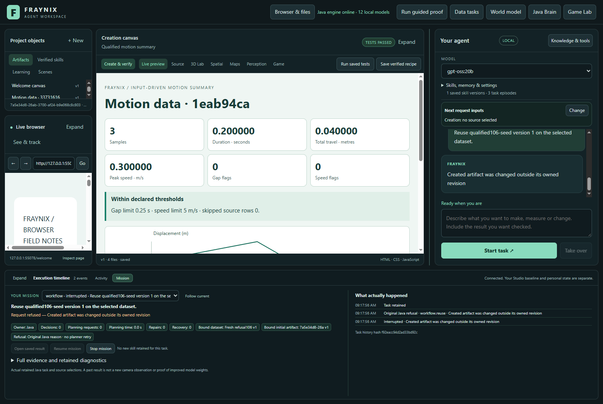
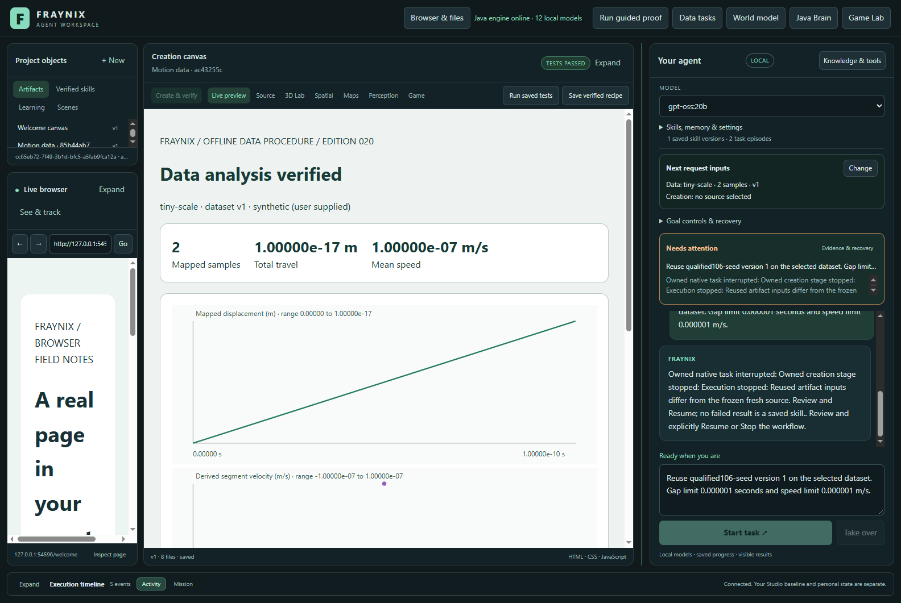

# Fraynix Agent Workspace — edition 106

## Original refusals, fresh numerical evidence

Chat now preserves Java's original workflow-admission refusal without asking the planner to retry it. A changed retained artifact produces **“Request refused — Created artifact was changed outside its owned revision.”** The same reason survives restart; Resume stays disabled. Stop and a separate reviewed request remain available.

This edition also tests ten numerical cases using a genuinely qualified saved procedure and fresh input. Every accepted report still passes source validation, native analysis, behavior checks and independent checks of its displayed values and chart. No verifier was relaxed to admit an edge case.

[Previous edition 105](README-105.md) · [Interactive offline guide](docs/readmes/106/index.html) · [Complete measurements](docs/readmes/106/analysis.json) · [Validation](docs/readmes/106/verification.json) · [Contributor direction](README-CONTRIBUTORS.md)

## What the application does

Fraynix is a local visual agent workspace. Java owns durable tasks, tools, policies, world state, verification, recovery and procedural memory. The desktop presents chat, browser, canvas, spatial views and Game Lab. Physical experiments, recorded observations and reusable creation procedures share that owned execution structure. A tool performs an action; a skill completes a task with checks and recovery.

Here the demonstrated task is a data-to-content procedure: import original motion CSV, normalize explicit units and coordinates, calculate motion/quality, produce a working HTML summary and trace, inspect the actual browser result, and retain or reuse the verified procedure. Edition105 automates five labelled qualification examples before retention. Edition106 preserves that path and strengthens how failures are reported.

The report implementation is authored Java/browser logic. The selected local model remains available, but these recognized requests require **zero planner calls and zero content-generation calls**. This is evidence-backed procedural reuse, not model-weight training or proof of general intelligence.

## Original refusal ownership

1. The server first checks the authenticated interface, current Java task, claimed effect and matching workflow operation.
2. If that native admission fails, Java journals its original reason, route, effect identity, argument hash, claim hash, session and generation.
3. The request becomes terminally interrupted. It cannot silently retry, replace its source or be resumed around the refusal.
4. An exact late host receipt is harmless: it cannot replace the reason, context or result. Foreign and stale receipts are rejected.
5. Chat shows the native reason directly. Restart retains it. A user may stop the task, examine the evidence and start a separate request.

Only Java's own failure at this boundary can establish a native refusal. Matching browser error text, forged fields and unrelated transport failures cannot manufacture that authority. Successful admission clears the refusal boundary before sending its response, so a later response failure is not relabelled as an admission refusal. Ordinary recovery remains available for valid interrupted work.

Edition105 retained an altered-proof refusal but then attempted one failed planner fallback, obscuring the reason. Its original evidence and cost remain frozen in the previous edition. This edition tests the corrected path separately, with no fallback calls.

## A real edge failure found and corrected

The first cohort completed seven requests, then refused tiny-scale creation. Thresholds were written as `1.0E-6` in reserved input, while durable JSON parsing represented the same number as `0.000001`. The exact-input verifier correctly rejected the different bytes.

GoalRunner now freezes sourceData through the checkpoint-compatible JSON representation before generating reserved files. It changes neither values nor the verifier. A new native-checkpoint regression covers small and large exponent thresholds. The entire cohort is rerun in a fresh directory after rebuilding. The earlier failed request remains **6.228s**, with a **127.982s** preliminary cohort; none of that cost disappears into the final successes.

This legitimate producer change updates the implementation runtime identity. An actual binding from the earlier build is refused by the original protocol guard. The standalone source/outcome verifier identities remain unchanged; existing original reports still require their original checks. No stored binding is overwritten with a newer identity.

## Numerical coverage

| Case | What is checked |
| --- | --- |
| Mapped inversion | Milliseconds/millimetres, negative raw times, time offset, nonzero origin and reversed direction |
| Negative reversal | Positive and negative positions, travel versus displacement, exact speed boundary; abrupt restart after data |
| Half / below / above rounding | Six-decimal half-up presentation around 0.0000005 |
| Flat signed zero | Zero travel/speed without a fabricated trend |
| Tiny scale | Valid sub-microsecond and sub-micrometre input; rounded zero remains distinct from the original nonzero data |
| Large valid scale | Full accepted time/coordinate range and finite derived speed |
| Large origin, small motion | Small displacement relative to a large raw coordinate origin |
| Just-over thresholds | Full-precision gap/speed flags remain even when six-decimal text rounds to the boundary |

The [declared cases](workspace-engine/src/test/resources/numerical106/cases.json) contain expected values for tests only. Those answers are never supplied to the report. An independent inspector reconstructs every normalized row, travel, speed, flag, summary value and SVG point from the original CSV and mapping, then checks all four actual filter states.

Five invalid imports are refused: duplicate times, NaN, infinity, time outside the accepted range and distance outside the accepted range. A finite-input sequence whose derived velocity overflows is also refused before a report or new skill can be retained. Inputs are not silently clamped or repaired.

## Measured results

**11 completed requests, three required request refusals and five invalid-import refusals.** Preparation runs five original qualification examples and the selected-source report, publishing one actual procedure. Ten fresh numerical requests use that same retained implementation through cold project copies. One recovers from an abrupt Java interruption while preserving its verified data child. The overflow request stops, and two altered-proof requests refuse admission through `/api/workflows/start` qualification and `/api/workflows/reuse` saved-implementation admission. A further cold restart retains the latter refusal.

| Request | Outcome | Complete s | Browser s | Restart s | Other s |
| --- | --- | ---: | ---: | ---: | ---: |
| qualified106-seed | completed | 33.031 | 7.391 | 0.000 | 25.640 |
| mapped-inversion | completed | 9.997 | 1.239 | 0.000 | 8.758 |
| negative-reversal | completed | 13.155 | 1.252 | 2.851 | 9.052 |
| rounding-half | completed | 9.652 | 1.225 | 0.000 | 8.427 |
| rounding-below | completed | 9.761 | 1.237 | 0.000 | 8.524 |
| rounding-above | completed | 9.946 | 1.224 | 0.000 | 8.722 |
| flat-signed-zero | completed | 9.764 | 1.246 | 0.000 | 8.518 |
| tiny-scale | completed | 10.174 | 1.229 | 0.000 | 8.945 |
| large-valid-scale | completed | 9.846 | 1.243 | 0.000 | 8.603 |
| large-origin-small-motion | completed | 10.025 | 1.208 | 0.000 | 8.817 |
| threshold-just-over | completed | 9.854 | 1.237 | 0.000 | 8.617 |
| derived-overflow | interrupted | 2.554 | 0.000 | 0.000 | 2.554 |
| altered-proof106 | interrupted | 0.474 | 0.000 | 0.000 | 0.474 |
| altered-reuse106 | interrupted | 0.781 | 0.000 | 0.000 | 0.781 |

Complete request time includes coordination, Java persistence, verification and any recorded recovery pause. Categories partition each caller interval; none are subtracted to advertise speed. The full cohort lasts **190.114s**, including **51.100s** outside request intervals for app launches, imports, copying, captures and shutdown. These are sequential measurements on this machine, not a matched performance comparison.

## Verification and reproducibility

- 110 focused Java test methods pass, including authentic/stale/foreign refusal authority, forged browser fields, unchanged transport repair, cold restart and numeric boundaries.
- 148 desktop checks and 23 actual browser fixture controls pass.
- The actual Electron/Java cohort passes all declared expectations; browser receipts and captures are retained.
- Independent source/outcome reconstruction passes, with 26 altered-record controls rejected, plus six checks that reject erasure or alteration of the preliminary failure evidence.
- Eight compiled producer/verifier/runner classes and summary104 resources remain byte-identical to edition105. GoalRunner changes only the pre-write serialization boundary; its changed implementation identity is recorded. A genuine old binding is rejected by the unchanged protocol check. Original proofs are not relabelled as new evidence.
- Actual app captures are reviewed at 1600 and 1100 pixels. The offline guide is checked at 1440 and 390 pixels.

[Lossless original records](docs/readmes/106/original-evidence.json) include source CSV, mappings, authored files, native child states, browser receipts, refused attempts, restart records, complete timings and logs. [Canonical source inventory](docs/readmes/106/file-inventory.json) identifies the reviewed source. Historical editions and private live worlds remain separate.

## Run and review

Use Java21 and the repository's existing desktop dependencies. From the repository root, build the installed Java runtime with `gradlew.bat :workspace-engine:installDist`. In `workspace-desktop`, run `npm ci` for a fresh checkout and `npm start`. Keep an isolated project for validation; do not point two running copies at the same private project. Existing dependency junctions should be preserved in the development workspace.

Import CSV with explicit columns, units, origin, direction and thresholds. Select the data, then request: “Qualify the input-driven summary, analyze the selected data, and save workflow as my-summary.” Once it completes, import fresh data and request: “Reuse my-summary version 1 on the selected dataset.” Review the resulting data report, canvas and task history. This route performs the original checks on every execution.

For the fixed study, run `node workspace-desktop/test/numerical106-integration.cjs` only after building, committing the tested runtime and stamping `node scripts/Study-Build095.cjs --stamp`. It requires the existing local model catalogue entry `gpt-oss:20b`, but this cohort makes no inference calls. Each output directory must be new; a rerun must preserve prior originals. Inspect with `node scripts/Inspect-Numerical106.cjs`. The declared cases are software tests, not footage or new camera measurements.

## Next steps and limits

Next, expand persisted-input representation cases across exponent thresholds and restart boundaries, then measure qualification maintenance when a procedure's implementation changes. Identify the exact dependencies of each proof, distinguish an unchanged original from an invalidated one, and measure the cost of fresh qualification before considering any selective reuse. Every source and outcome check must remain. Add independent raw-source revision and stale-claim integration cases beyond the current artifact revision tests.

Broader decimal/exponent combinations, missing-row interactions and imported CSV dialects remain useful numerical targets. Very small values may display as zero at six decimals; the originals and full-precision verification remain authoritative. Large coordinate offsets can still lose precision before normalization; no arbitrary numerical-accuracy claim is made.

The long-term direction remains one local system that observes, predicts, acts, verifies and remembers. This release removes a misleading retry and extends measured reliability. It does not claim unbounded autonomy, arbitrary-task correctness, consciousness or learned model weights.
