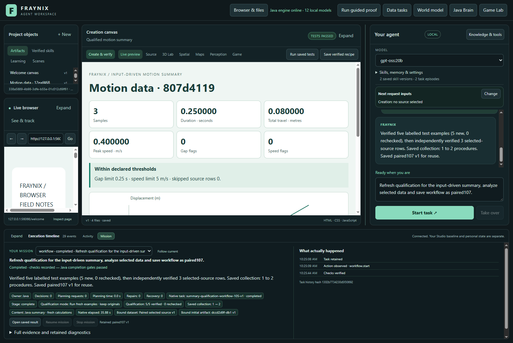
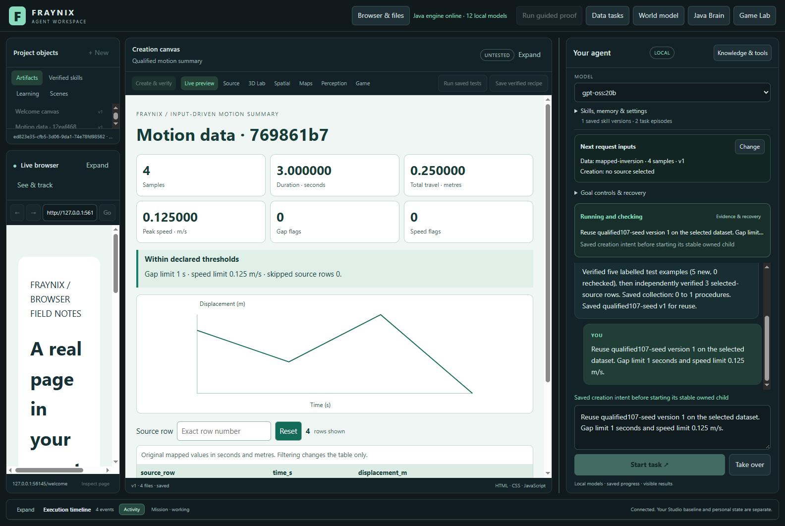
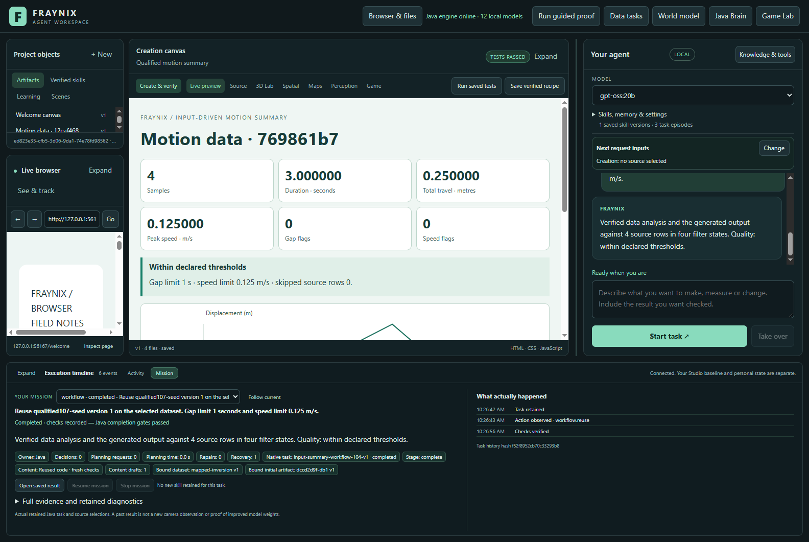
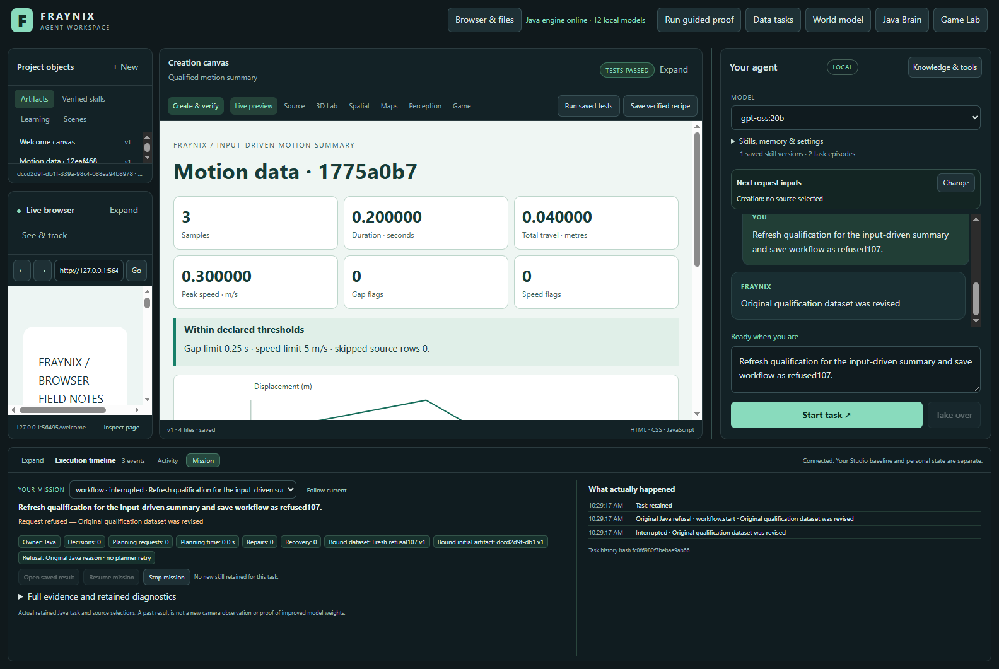

# Fraynix Agent Workspace — edition 107

## Exact recovery and measured qualification refresh

Java now supports an explicit request to refresh summary qualification. It verifies existing proofs, freezes their references and code dependencies, executes five fresh examples, verifies selected data, and retains the new procedure through the existing publication gate. Ordinary qualification continues to recheck the retained examples. Every original source and outcome check remains.

Eight numerical tasks survive abrupt Java interruption after their report inputs are saved. Recovery preserves the source, both child identities, report revision and exact reserved input bytes. Fresh browser checks then verify all six summary values, every chart point and four filter states.

[Previous edition106](README-106.md) · [Interactive offline guide](docs/readmes/107/index.html) · [Measurements](docs/readmes/107/analysis.json) · [Validation](docs/readmes/107/verification.json) · [Contributor direction](README-CONTRIBUTORS.md)

## The application and its direction

Fraynix is a local visual agent workspace. Java owns durable tasks, tools, policies, world state, verification, recovery and procedural memory. Chat, browser, canvas, spatial views and Game Lab present the same execution system. A tool performs an action; a skill completes a task using actions, checks and recovery.

The demonstrated creation procedure imports original motion CSV, applies explicit units and coordinates, calculates motion and quality, creates a working HTML report, checks the actual browser result, and saves or reuses the verified implementation. It calculates from each fresh input. The renderer receives no expected metric answers.

These recognized requests use Java-authored logic with **zero planner calls and zero content-generation calls**. A local model remains selectable for other tasks. This is retained procedural knowledge, not model-weight training or evidence of general intelligence.

## Refresh is an actual operation

1. Select fresh data and explicitly ask to refresh summary qualification.
2. Java verifies matching old examples before admitting new work. A changed report or revised original dataset refuses admission immediately.
3. The request retains its mode, code dependencies and original proof references, bound to a hash.
4. Refresh runs five new example workflows with fresh identities. The original five remain untouched. Ordinary recheck uses the original workflows after re-verification.
5. Java rechecks the original references before selected-source verification, completion and recovery. It checks every fresh example too.
6. The original retention gate verifies the old and new example reports: ten qualifying example proofs after refresh, five after ordinary recheck.
7. Only the independently verified selected-source child publishes the new procedure. Original workflow, native-goal, skill, version, time and resume limits remain.

Mission names the chosen mode. Detailed dependencies, source references and costs remain in workflow evidence. A changed original cannot be replaced with a convenient fresh success. The refusal retains its original Java reason without a planner retry; Resume cannot bypass it.

Changed implementations remain conservatively incompatible. This edition measures full refresh of current code, **not** automatic migration or selective refresh after arbitrary code changes. Old proofs are never relabelled as new evidence.

## Eight numerical process-interruption cases

| Case | Deliberate boundary |
| --- | --- |
| Mapped inversion | Milliseconds/millimetres, origin and direction conversion |
| Tiny scale | Exponent thresholds; values displayed as zero at six decimals |
| Large valid scale | Full accepted time/distance range and large speed criterion |
| Just-over threshold | Gap and speed flags from original full-precision values |
| Exponent threshold | Scientific CSV notation and a small threshold |
| Large exponent criterion | Ten-million-metre-per-second criterion; software stress case |
| Mapped skipped gap | Missing row, converted units, inverted direction and a gap flag |
| Negative large origin | Small motion relative to a large negative coordinate origin |

Each runs in a cold copy of the same genuinely published bank. The harness holds a real browser operation before execution, then terminates Java abruptly. Four stop before behavior checks; four stop before independent audit. No passing observation is supplied at interruption. The same project reopens, Resume is explicitly selected, and the remaining real checks run.

Source, mapping, normalized input, child IDs, artifact ID/version, authored files and exact reserved JSON bytes are compared before interruption, after reopen and after completion. Recovery does not repair or rewrite inputs. All eight finish with the original identities.

Very small values may display zero at six decimals; full-precision observations and thresholds remain authoritative. Large offsets can lose floating-point precision before normalization. These cases do not establish arbitrary precision or physical measurement accuracy. They are labelled synthetic software tests.

## Complete refresh costs

Each pair starts from a cold copy of the same bank containing one real published procedure and five verified examples. Fresh selected CSV and limits are identical. Pair1 runs recheck then refresh; pair2 reverses the order. Recheck creates one fresh selected report; refresh creates five fresh examples plus that report. Both retain every original check. No artificial bank padding or successful-result shortcut is used.

| Pair | Recheck seconds | Full refresh seconds | Extra refresh seconds |
| --- | ---: | ---: | ---: |
| 1 | 9.361 | 36.649 | 27.288 |
| 2 | 9.149 | 36.422 | 27.273 |

These two repetitions measure the price of explicitly acquiring fresh evidence on this machine. They do not show that refresh improves an unchanged implementation or establish a universal speed ratio. Admission and final-verification durations, phase intervals and full caller costs are retained. Phase durations overlap caller time and are not added twice.

| Request | Outcome | Total seconds | Browser | Restart | Other |
| --- | --- | ---: | ---: | ---: | ---: |
| qualified107-seed | completed | 32.931 | 7.392 | 0.000 | 25.539 |
| pair-1-recheck | completed | 9.361 | 1.226 | 0.000 | 8.135 |
| pair-1-refresh | completed | 36.649 | 7.382 | 0.000 | 29.267 |
| pair-2-refresh | completed | 36.422 | 7.487 | 0.000 | 28.935 |
| pair-2-recheck | completed | 9.149 | 1.250 | 0.000 | 7.899 |
| mapped-inversion | completed | 14.754 | 1.155 | 3.433 | 10.166 |
| tiny-scale | completed | 14.538 | 1.315 | 3.211 | 10.012 |
| large-valid-scale | completed | 15.138 | 1.201 | 3.425 | 10.512 |
| threshold-just-over | completed | 14.788 | 1.336 | 3.238 | 10.214 |
| exponent-threshold | completed | 14.705 | 1.231 | 3.610 | 9.864 |
| large-exponent-criterion | completed | 14.532 | 1.303 | 3.334 | 9.895 |
| mapped-skipped-gap | completed | 15.853 | 1.274 | 3.850 | 10.729 |
| negative-large-origin | completed | 15.991 | 1.331 | 3.369 | 11.291 |
| altered-artifact107 | interrupted | 0.568 | 0.000 | 0.000 | 0.568 |
| altered-dataset107 | interrupted | 0.498 | 0.000 | 0.000 | 0.498 |

Full cohort: **302.615s**. All request intervals: **245.877s**. Setup, imports, cold copies, captures and shutdown outside requests: **56.738s**. Preparation and refused requests remain included.

## Verification and limits

Before the measured cohort, the unchanged UTF-8 startup guard rejected an incorrectly encoded character in the new mode label. The encoding was corrected and the actual browser checks ran in a fresh project. Original refusal logs are archived. The outer command took2.018s including a test-count check; individual startup time was not separately measured. This is separate from the workflow cohort, and no request result was discarded.

Two deliberate controls refuse an explicit refresh before creating a workflow or skill. One changes a retained report revision; the other revises a raw qualification dataset even with identical CSV. Chat preserves the original reason, makes no planner retries and refuses Resume. An older canvas may remain visible as history; it is not a new result for the refused request.

- 118 focused Java methods, including eight new refresh, dependency, source-revision and numerical restart tests.
- 148 desktop checks and23 actual Chromium controls.
- 13 actual completions, including eight abrupt recoveries, and two required source refusals.
- Independent original-CSV reconstruction, mappings, exact inputs, six displayed values, every chart point, four filter states, lineage and costs;30 altered-record controls rejected.
- Seven existing compiled producer/verifier/runner classes and summary104 resources byte-identical to106. WorkflowRunner and Domain044 change explicitly; Qualification107 is new. Suite/runtime identity changes are recorded, never hidden.
- Actual screenshots reviewed at1600 and1100 pixels; offline guide checked at1440 and390 pixels.

[Lossless originals](docs/readmes/107/original-evidence.json) retain sources, receipts, restart states, refused attempts and logs. [Canonical inventory](docs/readmes/107/file-inventory.json) identifies the reviewed code. Private live worlds and frozen editions001–106 remain separate. Parent106 CI was checked first; its observed status is retained in validation. Running remote CI is never claimed as passed.

## Run and review

Use Java21. From the root, build `gradlew.bat :workspace-engine:installDist`. In `workspace-desktop`, use existing dependencies and `npm start`; a fresh checkout requires `npm ci`. Preserve existing development dependency junctions. Use a separate validation project rather than opening the same private database twice.

Import CSV with explicit units, origin and direction. Select the data, then request:

> Qualify the input-driven summary, analyze the selected data, and save workflow as my-summary.

For full refresh:

> Refresh qualification for the input-driven summary, analyze the selected data, and save workflow as refreshed-summary.

For fresh data using retained code:

> Reuse my-summary version 1 on the selected dataset.

Inspect Mission, the resulting canvas and original evidence. Investigate invalid sources; refresh cannot bypass a refusal.

To reproduce the study, build and commit the runtime, stamp `node scripts/Study-Build095.cjs --stamp`, run `node workspace-desktop/test/restart107-integration.cjs`, then `node scripts/Inspect-Restart107.cjs`. The existing catalogue entry `gpt-oss:20b` is required but these requests make no inference calls. Every run needs a fresh output directory. Preserve earlier failures and costs. The study uses isolated application projects, not footage or private live worlds.

## Next steps

Define an explicit qualification transition for changed implementations: retain the old identity, identify which dependencies changed, and run fresh required cases before reuse. Measure the cost before considering selective refresh. Extend interrupted qualification across several stages and test capacity refusal with larger genuine banks.

Further numerical work can cover CSV dialects, offset/scale combinations and repeatable uncertain measurements. The wider direction remains one local system that observes, predicts, acts, verifies and remembers. This edition strengthens continuity and measured maintenance; it does not claim unrestricted autonomy, consciousness or learned model weights.
