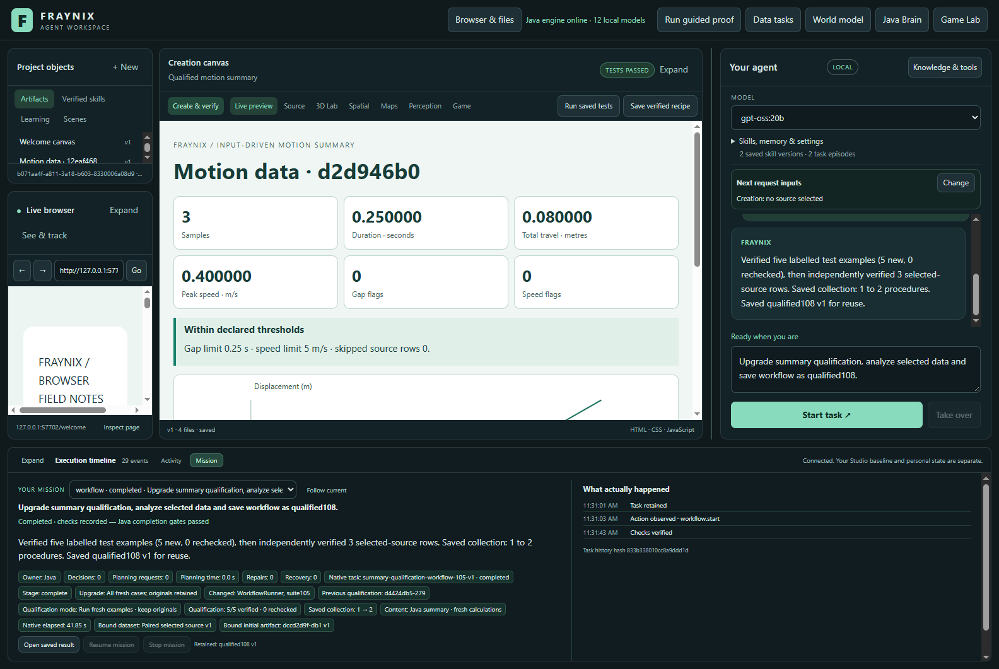
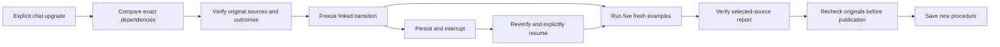
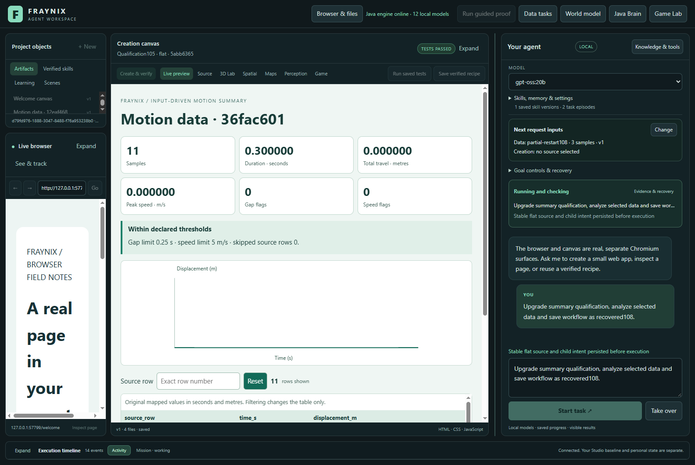
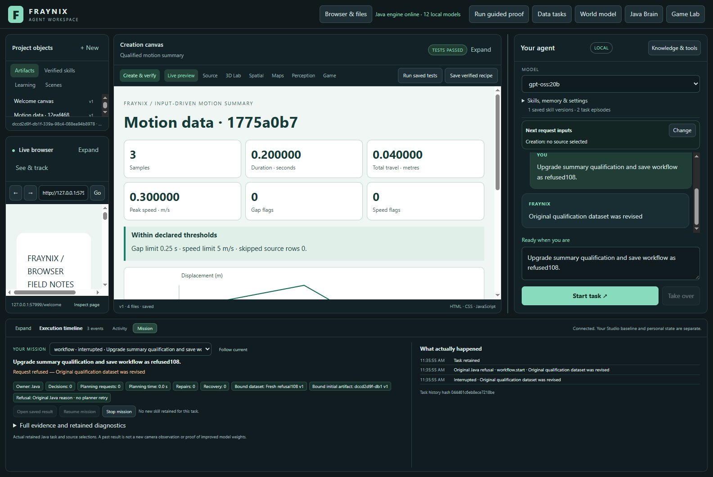

# Fraynix Agent Workspace - edition 108

## Upgrade the procedure without rewriting its evidence

An explicit chat request can now move a qualified summary procedure across a change in Java task coordination. It identifies the old qualification, checks exactly which dependencies changed, rechecks every original source and outcome, runs all five fresh examples, verifies the selected data and saves a new procedure through the existing publication gate.

This first transition supports **coordination changes only**. The numerical producer, report implementation, goal runner and verification dependencies must remain identical. Changes to them are refused. Nothing automatically declares old evidence valid for new code.

[Previous edition107](README-107.md) | [Interactive offline guide](docs/readmes/108/index.html) | [Measurements](docs/readmes/108/analysis.json) | [Validation](docs/readmes/108/verification.json) | [Contributor direction](README-CONTRIBUTORS.md)



## What the application is becoming

Fraynix remains one local visual agent workspace. Java owns durable goals, task coordination, tools, world state, policies, verification, recovery and procedural memory. The desktop hosts chat, browser and canvas surfaces, spatial views and Game Lab. A tool performs an action; a skill completes a task using actions, checks and recovery.

The demonstrated workflow imports motion CSV with declared units and coordinates, calculates motion and quality, creates an interactive HTML report, observes the actual browser output, checks every required value and retains a procedure. The report calculates from fresh inputs, including after a restart. Expected answers are never injected into its renderer.

Phase108 strengthens continuity through software upgrades. Retaining a procedure is useful only if the system can say which implementation earned its evidence, whether its dependencies remain compatible, and what needs fresh testing. All demonstrated requests here use owned Java logic with **zero planner calls and zero content-generation calls**. Local models remain available for other tasks. This is verified procedural knowledge, not model-weight training, arbitrary self-modification or evidence of general intelligence.

## The explicit transition

1. Select a fresh dataset and ask to upgrade summary qualification, with a new save name.
2. Java chooses the latest completed qualification under an earlier coordination identity. Mission shows its identifier and changed dependencies.
3. The transition accepts only the `WorkflowRunner` and derived `suite105` identity changes. All other recorded dependency keys and hashes must match. Unknown or changed verifier dependencies refuse admission.
4. Java checks the original supervisor intent, five case identities, raw source revisions, criteria, report revisions, numerical results, actual browser observations, selected-source audit and published skill lineage.
5. It freezes the complete old supervisor hash, source proof references, before/after dependencies and transition code identity. That record is itself hashed.
6. All five examples run with new child identities. The older examples remain in place. The new selected report then passes every original source and outcome check.
7. Old evidence is checked again on recovery, before the selected-source handoff, before saving and before final completion. An edit during the request cannot be hidden by a fresh success.
8. The new skill is exposed only after its completed child and original publication gate pass. Ordinary qualification and direct reuse of an older qualified procedure refuse until an explicit upgrade has completed.

The older procedure remains historical. Use the newly saved procedure name for the new coordination version. Existing earlier implementation-reuse receipts retain their original identities and can still refuse as incompatible. This does not rewrite or promote them.



The UI identifies an upgrade as **All fresh cases; originals retained**. Detailed dependency hashes and lineage remain inspectable in Mission evidence. Plain refresh cannot stand in for an upgrade. Example progress counts refer to the new five-case suite: old baseline verification is mandatory and separate from the reused-example count.

## Genuine earlier evidence, fresh execution

The test restores108 files from the published edition107 bank containing one actually published procedure. Each compressed archive and restored original is hash-checked. The original checkpoint is independently parsed and its checksum verified; old runtime identities are never fabricated. Existing107 browser observations are rechecked, then each new108 result is observed in Chromium.

Two cold pairs compare the same selected CSV and criteria. One request starts with no saved bank and performs clean qualification. The other starts with the genuine107 bank and performs a full upgrade. Both run five examples plus the selected report; upgrade also checks and retains the older evidence. The order reverses in the second pair.

| Pair | Clean qualification seconds | Full upgrade seconds | Extra upgrade seconds |
| --- | ---: | ---: | ---: |
| 1 | 31.649 | 42.618 | 10.969 |
| 2 | 33.288 | 43.548 | 10.260 |

These are two measurements on this machine, with different historical evidence burdens. They are not a claim of equal-bank causal speedup, generalized performance, or a benefit from upgrading unchanged report code. The comparison makes the cost of preserving continuity visible. Native admission/final-check times, browser spans, interruptions, refused requests, restoration and setup are retained.

## Recovery and refusal results

Seven requests complete. Two deliberately terminate Java abruptly: one before the third example's actual browser audit, with two fresh examples complete; the other before the selected-source audit, with all five examples complete. No passing observation is supplied at interruption. Reopening preserves the transition, old supervisor, completed child IDs, active child, artifact versions, report bytes and exact reserved inputs. Explicit Resume completes the remaining real checks. A new dataset then successfully reuses the newly qualified procedure.



Five requests correctly refuse: ordinary qualification against the older identity, ordinary refresh, direct reuse of the old saved procedure, a changed original report and a revised original dataset with unchanged CSV. Each retains its original Java reason, makes zero planner retries, saves no new skill and refuses Resume. An earlier canvas may remain visible as history; it is not evidence that the refused request produced a new result.



Additional Java tests check unsupported dependency changes, manifest edits, an old source changed while the new selected report awaits audit, an old source revised after upgrade and before later reuse, strict arguments and admission at the original capacity limit. Lifecycle unit replies are labelled fixtures; actual displayed outcomes come from the separate Electron cohort.

| Request | Outcome | Total seconds | Browser | Restart | Other |
| --- | --- | ---: | ---: | ---: | ---: |
| pair-1-clean | completed | 31.649 | 7.282 | 0.000 | 24.367 |
| pair-1-transition | completed | 42.618 | 7.469 | 0.000 | 35.149 |
| pair-2-transition | completed | 43.548 | 7.353 | 0.000 | 36.195 |
| pair-2-clean | completed | 33.288 | 7.401 | 0.000 | 25.887 |
| partial-restart108 | completed | 50.861 | 7.519 | 5.037 | 38.305 |
| selected-restart108 | completed | 48.118 | 7.402 | 3.621 | 37.095 |
| fresh-reuse108 | completed | 31.843 | 1.229 | 0.000 | 30.614 |
| refused-silent108 | interrupted | 0.721 | 0.000 | 0.000 | 0.721 |
| refused-refresh108 | interrupted | 0.868 | 0.000 | 0.000 | 0.868 |
| refused-old-reuse108 | interrupted | 0.753 | 0.000 | 0.000 | 0.753 |
| refused-artifact108 | interrupted | 0.602 | 0.000 | 0.000 | 0.602 |
| refused-dataset108 | interrupted | 0.808 | 0.000 | 0.000 | 0.808 |

Full cohort: **335.224s**. Request intervals: **285.677s**. Restoration, cold copies, imports, captures, launch and shutdown outside requests: **49.547s**. The earlier107 qualification preparation remains linked historical evidence, not a new108 cost measurement. Component intervals are not added twice.

## Original recorder attempt retained

The initial recorder counted browser frames and interrupted the first and second examples, rather than the declared third example and selected-source audit. The independent contract check refused those boundaries. Its twelve requests and full **331.632s** cohort cost (**280.610s** in requests) remain in the [prior integrity analysis](docs/readmes/108/prior-analysis.json) and lossless originals. Those early recoveries are additional evidence, not substitutes for the required tests.

The recorder was corrected to use Java's actual completed-example count and immediately assert the exact boundary. The full twelve-request study then ran again in fresh projects with unchanged application inputs and JARs. The final results above belong to that separate trial. Preparation, rejected timing, restart and refusal costs were not discarded. Twenty-eight altered-record controls also check the separately labelled prior analysis.

## Verification and honest boundaries

The first regression invocation placed its test filter after the packaging task; Gradle refused the command before running tests. The argument order was corrected and the full126-method regression passed. Three final lineage guards then bound the old selected-source handoff and preserved original checks during later reuse. All22 affected transition, refresh and implementation-reuse methods were rerun on that final runtime; the other341 compiled production classes were unchanged. Both original test runs and the command refusal are retained. This is not a claim of one126-method invocation on the final bytecode.

- 126 distinct focused Java methods across20 classes, including eight new transition cases;22 affected methods rerun after the final lineage guards.
- 148 desktop checks and23 actual browser controls.
- Seven final actual workflow completions, including two declared abrupt recoveries, and five required refusals. The earlier mistimed trial and its costs are retained separately.
- Independent reconstruction from original CSV, every required summary value and SVG point, four filter states, exact lineage and complete cost partitions;28 deliberately altered evidence records rejected.
- Eight existing compiled producer/verifier/helper classes and both summary104 resources remain byte-identical to107. WorkflowRunner and Domain044 change explicitly; Qualification108 is new. The derived suite identity changes legitimately.
- Real application captures at1600 and1100 pixels; the offline guide checked at1440 and390 pixels.

Every original capacity and ownership limit remains:20 executable workflows,64 native goals,32 saved procedures, eight versions,16 qualification supervisors,1200 awake seconds and at most three resumes. No artificial bank padding, skip-check mode or successful-result shortcut was added.

This supports an initial107-to108 coordination transition. A prior transition chain requires separate review. A changed numerical verifier, producer, resource or dependency set is refused. Selective refresh, arbitrary code migration, automatic retirement of history and automatic upgrade of an in-flight request remain unsupported. Hashes establish integrity and identity under the existing local trust model; they are not signatures or protection against an administrator rewriting every record and trust anchor.

[Lossless originals](docs/readmes/108/original-evidence.json), [source inventory](docs/readmes/108/file-inventory.json) and [system map](docs/readmes/108/system-map.json) retain the concrete evidence. Private live worlds and frozen001-107 editions remain separate. Edition107 CI was checked first and its observed status is retained; remote CI is reported separately from local validation.

## Run it and review

Use Java21, build `gradlew.bat :workspace-engine:installDist`, then run `npm start` in `workspace-desktop`. A fresh checkout requires `npm ci`; preserve existing dependency junctions. Use a distinct project for validation, never two owners of the same private database.

Select a fresh dataset and enter:

> Upgrade summary qualification, analyze selected data and save workflow as upgraded-summary.

For a project without earlier qualification:

> Qualify the input-driven summary, analyze selected data and save workflow as my-summary.

After the upgrade completes, import/select different data:

> Reuse upgraded-summary version 1 on the selected dataset.

Inspect Mission for changed dependencies, old qualification ID, fresh case progress, actual report and saved skill. Investigate refused sources; an upgrade does not repair or bypass them.

```text
workspace-engine/src/main/java/fraymus/workspace/
  Qualification108.java       transition identity and supported dependency changes
  WorkflowRunner.java         old evidence, fresh cases, recovery and publication
  Domain044.java              explicit chat intent
workspace-desktop/
  renderer/agency043.js        readable upgrade facts in Mission
  test/transition108-integration.cjs
scripts/
  Restore-Qualification107.cjs checked historical evidence restoration
  Inspect-Transition108.cjs    independent outcome and cost reconstruction
  Document-Transition108.py    evidence-linked documentation
```

To reproduce, build and commit the runtime, stamp `node scripts/Study-Build095.cjs --stamp`, run `node workspace-desktop/test/transition108-integration.cjs`, then `node scripts/Inspect-Transition108.cjs`. The existing local catalogue entry `gpt-oss:20b` is required; these recognized requests make no inference calls. Use a fresh output directory and retain failed attempts.

## Next steps

Measure maintenance as genuine banks approach capacity, including interrupted upgrades and decisions to retain or retire historical procedures. Before supporting changed report or numerical code, define a versioned transition contract that can verify old evidence with its original semantics and acquire wholly fresh evidence for the new implementation. Test incompatible changes and transitions spanning more than one earlier version before enabling them.

The larger direction remains a local agent that observes, predicts, acts, checks and remembers in one integrated environment. This edition supplies a concrete piece of that continuity: knowing which evidence belongs to which code, and paying for fresh verification when coordination changes.
