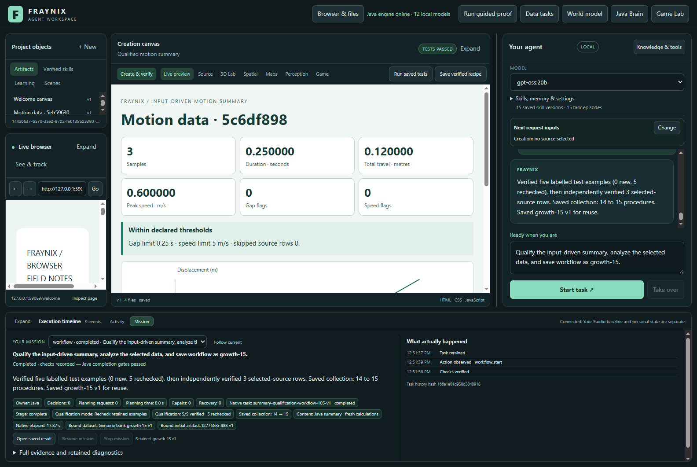
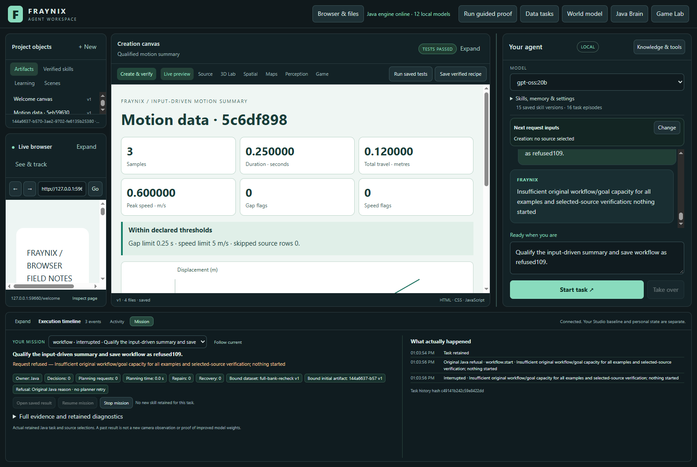
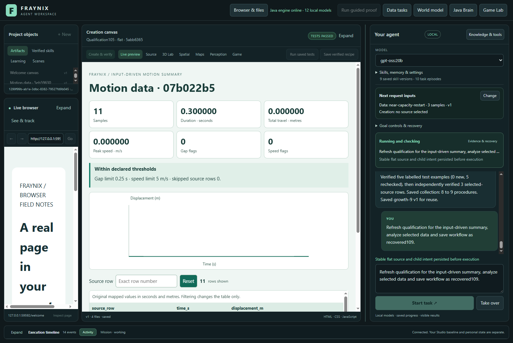

# Fraynix Agent Workspace - edition 109

## What it costs to maintain a real growing memory bank

Edition 109 measures the existing Java agent as its saved-procedure bank grows through successful work, not inserted records. Thirty actual chat workflows complete, including one abruptly interrupted refresh. Six requests correctly refuse original capacity or changed evidence. Fifteen saved procedures are backed by completed source-to-report workflows and actual browser verification.

**The first limit is workflow history, not the advertised procedure slots.** Five retained qualification examples plus fifteen selected-source workflows fill the original twenty-workflow capacity. The 32-procedure limit remains unchanged and is not reached in this task family. A full five-example refresh needs six workflow slots; a recheck needs one. Knowing that difference is a practical result, not a reason to discard evidence.

[Previous edition 108](README-108.md) | [Interactive offline guide](docs/readmes/109/index.html) | [Measurements](docs/readmes/109/analysis.json) | [Validation](docs/readmes/109/verification.json) | [Contributor direction](README-CONTRIBUTORS.md)



## The application and this edition's role

Fraynix remains one local visual agent workspace. Java owns durable goals, tools, physics and world state, verification, recovery and procedural memory. The desktop hosts chat, browser and canvas surfaces, spatial views and Game Lab. A tool performs an action; a skill completes a task through actions, checks and recovery.

The measured task imports motion CSV with explicit units and coordinates, calculates motion and quality, creates an interactive report from fresh input, observes its actual browser output, checks required values and saves a verified procedure. Qualification covers monotonic motion, reversal, a stationary source, unit conversion and quality flags, and explicitly skipped missing observations. All original numerical, ownership, source, browser, dependency and publication checks remain.

This is a measurement and diagnostic edition. All 342 compiled Java engine classes and both report resources are byte-identical to the measured final edition 108 runtime. Application source and limits are unchanged. New code supplies a real integration study, independent inspection and an interactive cost/capacity guide. It does not manufacture a faster result by changing the implementation under comparison.

The fifteen saved entries have different selected datasets and genuine verified publications, but share the same summary procedure family. They are not fifteen different reasoning algorithms or demonstrations of model training. These native chat requests use zero planner calls and zero content-generation calls. Other local-model workflows remain available; this study does not evaluate them.

## How the bank was grown

1. Start a distinct empty project; keep private live worlds separate.
2. Use chat to qualify an input-driven summary and save a procedure. The first request runs all five examples and its selected dataset.
3. For each next entry, select distinct CSV data and save under a new name. Java rechecks every matching original example, verifies the new selected report and publishes only its completed child's procedure.
4. Close the project and freeze copies at banks 1,8,9,14 and15. Every copied file is compared byte-for-byte and recorded with its hash. No passing proof or saved record is injected.
5. Run each comparison in a separate cold copy of exactly the same bank. Preserve preparation time and every request, including refusals.

The fifteen growth requests cost **231.880 seconds**, included in the complete cohort. The five reusable examples were executed once during initial growth; later qualification rechecks them rather than treating their presence as sufficient evidence.

## Recheck versus full refresh

At banks 1,8,9 and14, two repetitions compare ordinary qualification with explicit full refresh. The second pair reverses order. Both members use identical selected CSV and criteria and the same closed original bank. Full refresh rechecks the baseline, then runs all five examples anew and verifies the selected source. Recheck verifies each original and then completes the selected-source workflow. The UI example counter describes reused case workflows: a refresh shows zero reused/rechecked examples, while its separate baseline proof verification still runs. That counter is not a count of all original-source checks.

| Starting bank | Repetition | Recheck seconds | Refresh seconds | Refresh outcome |
| ---: | ---: | ---: | ---: | --- |
| 1 | 1 | 9.902 | 36.618 | completed |
| 1 | 2 | 10.179 | 37.244 | completed |
| 8 | 1 | 14.857 | 58.183 | completed |
| 8 | 2 | 14.782 | 58.527 | completed |
| 9 | 1 | 14.985 | 61.648 | completed |
| 9 | 2 | 15.076 | 63.223 | completed |
| 14 | 1 | 22.499 | 3.032 | capacity refusal |
| 14 | 2 | 22.175 | 3.582 | capacity refusal |

Every session reports a512 MiB maximum Java heap and two available Java processors; the recorder asserts those actual values. Requests run sequentially. Cold means a newly launched application on a closed project copy, not an emptied operating-system disk cache.

Across the completed paired requests, recheck took **9.902-22.499s**, while full refresh took **36.618-63.223s**. Both retained every original check and completed the selected report where capacity allowed. This study demonstrates the cost difference; it does not demonstrate improved success from rerunning unchanged examples.

These two observations per point describe this machine and workload. They do not establish a universal latency curve, a confidence interval, a causal effect of procedure count alone, or an equal-work speedup. Bank size grows together with history, stored proofs and data. Full refresh performs more work. Refused refreshes are reported as refusals, never as fast successful maintenance.

The offline chart plots only completed requests and explicitly identifies capacity refusals. Detailed evidence includes request wall time, actual browser spans, recovery pauses, Java admission and final-verification times, retained store bytes and all workflow/goal/supervisor counts. A missing admission/final time for a refused request is null, not a measured zero. Native qualification wall time is also reconstructed from Java admission and completion timestamps, and bounded inside the full caller interval. Their difference includes chat/bootstrap, recorder persistence and caller observation latency. The instrumented caller times therefore describe this complete test path, not a pure Java microbenchmark; the native spans and admission/final-check timings remain available separately. These nested native spans are alternative views of the same request, not extra time to add to the browser/restart/other partition.

## Capacity is a combined budget

| Original bound | Value | What this study establishes |
| --- | ---: | --- |
| Executable workflow history |20| First binding limit, reached with five examples plus fifteen selected-source workflows |
| Saved procedures |32| Unchanged; not reached in this qualification workload |
| Native goals |64| Counted on every request; preserved through recovery |
| Qualification supervisors |16| Counted independently from executable children |
| Versions per procedure |8| Unchanged; study uses distinct names and first versions |
| Awake time per qualification |1200 seconds| Unchanged and retained across restart |
| Explicit resumes |3| Unchanged; recovery study uses one |

A bank 9 project has fourteen executable workflows. Full refresh can consume the remaining six and complete. At bank 14, nineteen workflows exist: recheck can use the last slot, but refresh refuses before starting. At bank 15, both requests refuse. The saved bank, original workflow file, native-goal count and workflow count remain unchanged after each refused admission. The chat retains the original Java reason, makes no planner retry and refuses Resume.



An earlier report may remain visible on the canvas when a request refuses. It is retained history, not a new successful result. Existing limits deliberately prevent unbounded retained execution. This edition neither raises them nor silently deletes old tasks.

## Recovery and changed-source controls

The near-capacity test starts a full refresh from bank 9. The recorder waits for Java to report two completed fresh examples and holds the third example's actual independent browser audit before execution. It abruptly terminates the Java process without supplying a passing observation. Reopening restores the same supervisor, baseline, children, original sources, artifact versions, reserved input bytes and completed stages. Explicit Resume performs the remaining real checks and saves the procedure, finishing at twenty executable workflows.



Two additional bank 14 tests change an original report or revise the original dataset without changing its CSV. Both refuse the original source/ownership check before creating a replacement workflow or procedure. The original reason remains visible and cannot be converted to success by planner retries or Resume.

Independent inspection recomputes each required metric, every SVG point and all four filter states from the original CSV and actual browser observations. It verifies all saved entries against their producing workflows, exact code and dependency identities, growth continuity, source revisions, publication checks, restart identity and measured cost partitions. Thirty deliberately altered records must fail inspection, including padded skill lineage, missing old proofs, changed limits, hidden cost, altered restart inputs and mutated refusal history.

## Complete measured costs

| Request | Starting bank | Outcome | Total seconds | Browser | Restart | Other |
| --- | ---: | --- | ---: | ---: | ---: | ---: |
| growth-1 | 0 | completed | 33.230 | 7.408 | 0.000 | 25.822 |
| growth-2 | 1 | completed | 10.107 | 1.240 | 0.000 | 8.867 |
| growth-3 | 2 | completed | 9.377 | 1.208 | 0.000 | 8.169 |
| growth-4 | 3 | completed | 9.720 | 1.222 | 0.000 | 8.498 |
| growth-5 | 4 | completed | 10.585 | 1.205 | 0.000 | 9.380 |
| growth-6 | 5 | completed | 10.975 | 1.235 | 0.000 | 9.740 |
| growth-7 | 6 | completed | 11.167 | 1.201 | 0.000 | 9.966 |
| growth-8 | 7 | completed | 12.294 | 1.249 | 0.000 | 11.045 |
| growth-9 | 8 | completed | 13.627 | 1.259 | 0.000 | 12.368 |
| growth-10 | 9 | completed | 15.847 | 1.221 | 0.000 | 14.626 |
| growth-11 | 10 | completed | 16.384 | 1.257 | 0.000 | 15.127 |
| growth-12 | 11 | completed | 18.767 | 1.309 | 0.000 | 17.458 |
| growth-13 | 12 | completed | 18.853 | 1.230 | 0.000 | 17.623 |
| growth-14 | 13 | completed | 19.678 | 1.268 | 0.000 | 18.410 |
| growth-15 | 14 | completed | 21.269 | 1.252 | 0.000 | 20.017 |
| bank-1-pair-1-recheck | 1 | completed | 9.902 | 1.256 | 0.000 | 8.646 |
| bank-1-pair-1-refresh | 1 | completed | 36.618 | 7.309 | 0.000 | 29.309 |
| bank-1-pair-2-refresh | 1 | completed | 37.244 | 7.376 | 0.000 | 29.868 |
| bank-1-pair-2-recheck | 1 | completed | 10.179 | 1.283 | 0.000 | 8.896 |
| bank-8-pair-1-recheck | 8 | completed | 14.857 | 1.295 | 0.000 | 13.562 |
| bank-8-pair-1-refresh | 8 | completed | 58.183 | 7.398 | 0.000 | 50.785 |
| bank-8-pair-2-refresh | 8 | completed | 58.527 | 7.415 | 0.000 | 51.112 |
| bank-8-pair-2-recheck | 8 | completed | 14.782 | 1.232 | 0.000 | 13.550 |
| bank-9-pair-1-recheck | 9 | completed | 14.985 | 1.374 | 0.000 | 13.611 |
| bank-9-pair-1-refresh | 9 | completed | 61.648 | 7.436 | 0.000 | 54.212 |
| bank-9-pair-2-refresh | 9 | completed | 63.223 | 7.806 | 0.000 | 55.417 |
| bank-9-pair-2-recheck | 9 | completed | 15.076 | 1.259 | 0.000 | 13.817 |
| bank-14-pair-1-recheck | 14 | completed | 22.499 | 1.267 | 0.000 | 21.232 |
| bank-14-pair-1-refresh | 14 | interrupted | 3.032 | 0.000 | 0.000 | 3.032 |
| bank-14-pair-2-refresh | 14 | interrupted | 3.582 | 0.000 | 0.000 | 3.582 |
| bank-14-pair-2-recheck | 14 | completed | 22.175 | 1.241 | 0.000 | 20.934 |
| near-capacity-restart | 9 | completed | 75.121 | 7.458 | 6.570 | 61.093 |
| full-bank-recheck | 15 | interrupted | 3.502 | 0.000 | 0.000 | 3.502 |
| full-bank-refresh | 15 | interrupted | 3.442 | 0.000 | 0.000 | 3.442 |
| refused-artifact | 14 | interrupted | 3.159 | 0.000 | 0.000 | 3.159 |
| refused-dataset | 14 | interrupted | 3.044 | 0.000 | 0.000 | 3.044 |

Complete cohort: **1090.757s**. All request intervals: **766.660s**. Cold launch, copies, imports, inspection collection, captures and shutdown between requests: **324.097s**. Growth preparation is included in the requests total. Component intervals are not double-counted. Build/regression and documentation checks occur outside the cohort and have separate original logs; these are application-workflow timings, not total developer effort.

## Verification and boundaries

The initial regression found a timing error in a lifecycle test: its polling driver acknowledged the selected-source audit before noticing the intended stop point, returning completed instead of running. The test had not yet revised the source. The driver now checks its stop condition and claims the audit under the same runner lock; the original test also asserts the exact stage before mutation. No production rule changed. All 23 methods in the three suites using this helper were rerun. The initial126-method run, its one failure, final results and exact test-only difference are preserved.

- 126 distinct Java methods across 20 classes are covered on unchanged production bytecode:125 passed initially; all 23 affected methods passed after correcting the test driver. The original timing failure and correction are retained.
- 148 desktop checks pass.
- Thirty actual complete chat workflows, six required refusals and one abrupt recovery pass.
- Thirty altered-record controls refuse; every saved entry has checked original lineage.
- All 342 engine classes and both report resources match edition 108 exactly; no production verification or limit was relaxed.
- Actual application screenshots at 1600 and1100 pixels; the offline guide is checked at 1440 and390 pixels, including all 36 selections, exact cost displays, chart points and local links.

[Lossless originals](docs/readmes/109/original-evidence.json), [source inventory](docs/readmes/109/file-inventory.json) and [system map](docs/readmes/109/system-map.json) retain the evidence. Inputs are declared synthetic software-test data, not new measurements from the physical world. No claim of automatic retirement, selective refresh, broader model intelligence or weight training is made. Private live data and frozen editions001-108 are preserved. Parent CI was checked first; remote CI is reported separately from local validation.

## Run and inspect

Use Java21 and the repository's Gradle wrapper. Build `gradlew.bat :workspace-engine:installDist`, install desktop dependencies with `npm ci` if needed, then run `npm start` in `workspace-desktop`. Use a separate project for a study and never two owners of the same private database.

Select fresh CSV data and ask:

> Qualify the input-driven summary, analyze selected data and save workflow as measured-summary.

To explicitly run all five examples again:

> Refresh qualification for the input-driven summary, analyze selected data and save workflow as refreshed-summary.

Inspect Mission for example progress, the actual report, original reasons and saved procedure. At capacity, preserve the project and inspect its history. There is no implemented archive command that safely frees these workflow slots yet.

To reproduce the full study, build the unchanged runtime, commit the source state, stamp `node scripts/Study-Build095.cjs --stamp`, run `node workspace-desktop/test/maintenance109-integration.cjs`, then `node scripts/Inspect-Maintenance109.cjs`. Keep the `gpt-oss:20b` catalogue entry available; these recognized native requests make no inference calls. The harness refuses an existing output directory. Preserve failed attempts and use a fresh directory rather than overwriting evidence.

```text
workspace-engine/src/main/java/fraymus/workspace/
  WorkflowRunner.java       unchanged source/outcome checks and capacity admission
  Qualification105.java    unchanged five software examples
  Qualification107.java    unchanged recheck/refresh intent and dependencies
  GoalRunner.java          unchanged durable children and procedure publication
workspace-desktop/test/
  maintenance109-integration.cjs  actual growth, cold copies, recovery and refusals
scripts/
  Inspect-Maintenance109.cjs      independent data, lineage, capacity and cost checks
  Document-Maintenance109.py      evidence-linked README and retained originals
  maintenance109-guide.html      interactive real-cost and capacity guide
```

## Next: an explicit archival lifecycle

The next useful improvement is a bounded active history whose immutable source and outcome evidence remains addressable. First define which completed records can leave active scheduling, how their proofs and dependencies stay reachable, and how old child ownership and saved-procedure references survive. Then test fresh verification, restart, corrupted archives and missing records before allowing archived workflows to release capacity. Keep the current limits and original trust boundaries until this is implemented.

After that, measure maintenance again on genuinely larger banks, test whether archival/retrieval earns its cost, and consider selective refresh only with a versioned contract and fresh outcome evidence. The larger direction remains a Java-owned agent that observes, acts, checks, remembers and recovers; scaling its memory requires preserving what made that memory trustworthy.
