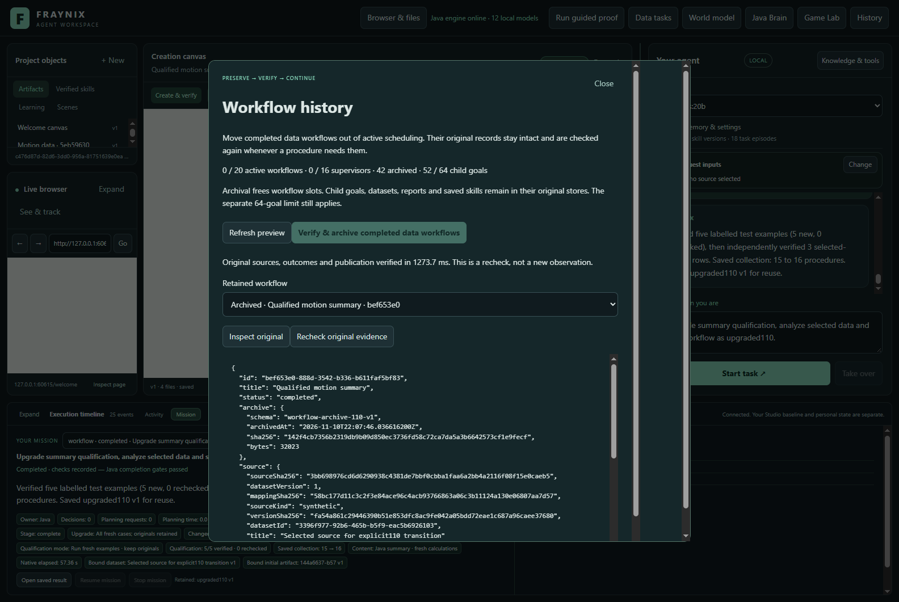
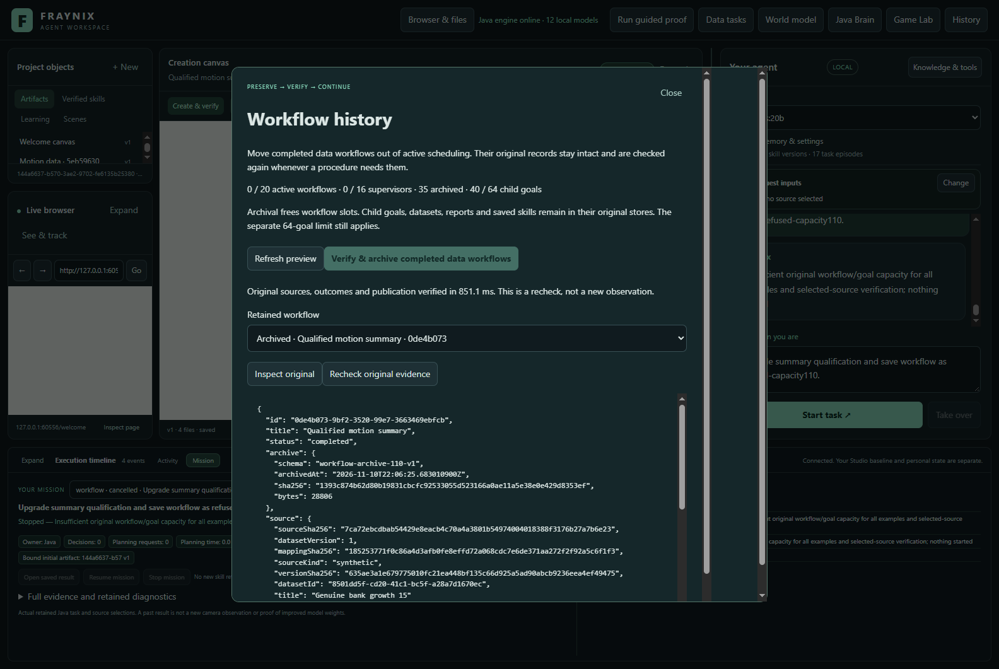
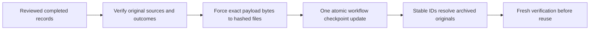
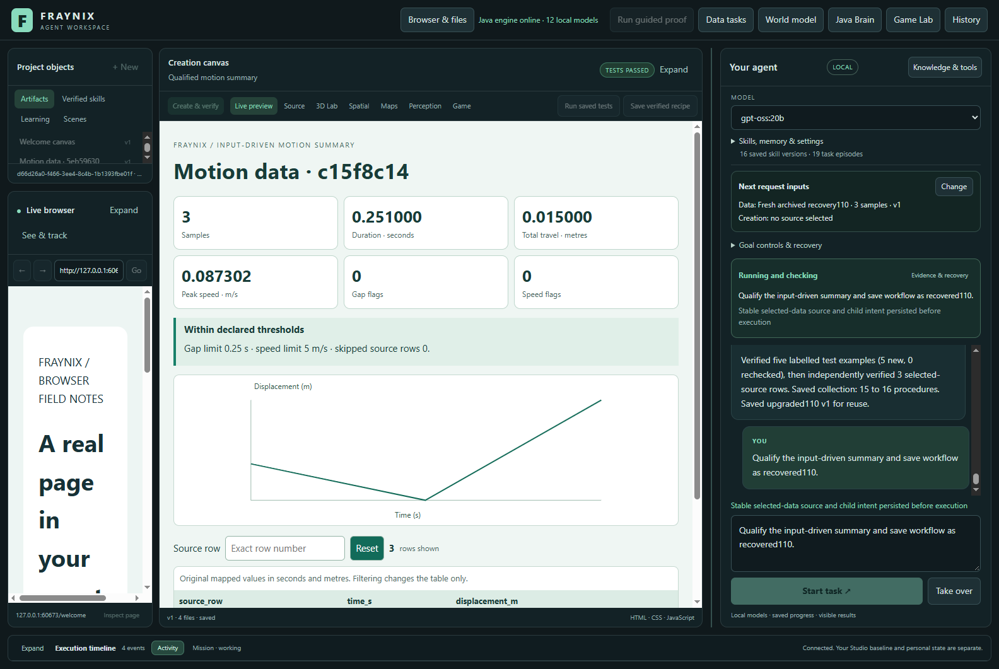
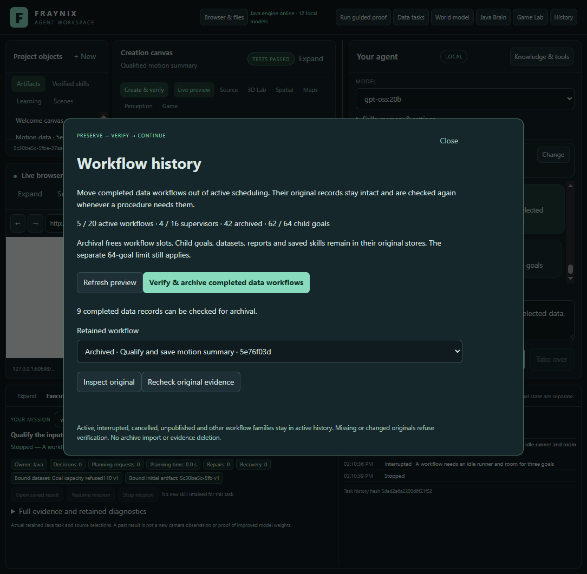

# Fraynix Agent Workspace — edition 110

## Archive completed work without losing its evidence

Edition 110 adds an explicit Java-owned archival lifecycle for completed data/creation workflows and qualification supervisors. Original record bytes stay intact under SHA-256 addresses. One atomic checkpoint update replaces active records with references. The agent can still retrieve those records by the same IDs and recheck their sources, owned stages, outcomes and saved-procedure publication.

The actual application archived **42 original records**, continued from edition 109's full bank, retained **21 genuine procedures**, completed **six fresh requests** and recovered one abruptly interrupted task. Five requests correctly refused changed runtime identity, insufficient capacity or changed original evidence. The remaining child-goal limit is visible and unchanged.

[Previous edition 109](README-109.md) | [Interactive offline guide](docs/readmes/110/index.html) | [Measurements](docs/readmes/110/analysis.json) | [Validation](docs/readmes/110/verification.json) | [Contributor direction](README-CONTRIBUTORS.md)

## Why this belongs in the Java brain

Fraynix remains a local agent workspace in which Java owns durable goals, actions, physics and world state, procedural memory, verification and recovery. The desktop presents chat, browser and creation surfaces, spatial views and Game Lab. A tool performs an action; a skill completes a task through actions, checks and recovery. Memory must retain what actually happened and the conditions under which a procedure worked.

Edition 109 found a concrete bottleneck: five retained qualification examples and fifteen selected-source workflows filled the twenty-workflow history before reaching the thirty-two saved-procedure slots. Removing completed records would have broken the references that made saved procedures verifiable. Raising the bound would have postponed the problem while retaining more active history. Edition 110 gives completed records an explicit storage lifecycle while preserving their identity and evidence.

This is implemented archival, not a memory summary or model-training operation. The exact original record is retained, including its frozen source binding, stage ownership, actual browser audit, report reference, qualification dependencies, recorded costs and saved-skill linkage. The archive does not invent new evidence or turn an older runtime proof into a newer one.

## What changes in the app

Use **History** in the main toolbar. It shows active workflow and supervisor counts, archived records and the retained child-goal count. Refresh the preview, then choose **Verify & archive completed data workflows**. Java rechecks the selected originals before committing the archive. The preview is bound to the current history; a changed preview refuses and must be refreshed.

Choose a retained record to inspect its original identity, source, report, saved skill and stage references. **Recheck original evidence** performs fresh checks against the current original stores. This is verification of retained observations, not a new camera capture or browser observation. The current workflow list contains active records; archived records remain available through History and stable-ID reads.

Active, interrupted, cancelled and unpublished work cannot be archived. This phase supports data/creation workflows and qualification supervisors, whose original visible outcomes can be reconstructed through the existing verifier. Physics workflow and typed-graph histories remain in active storage. The UI states this scope; no unsupported archive action is presented as working.

## The storage transaction

Each record's exact stored UTF-8 payload is written beneath `workflows/archive110/`. Its filename is the SHA-256 digest of those bytes. The existing checked workflow checkpoint retains the record ID, original creation time, archive schema, byte length, digest and archival timestamp. There is no separate mutable archive index to reconcile.

All archive files are written, forced and checked before the checkpoint changes. Until that commit, the original active records remain authoritative. A failed checkpoint write leaves those records active; prepared archive bytes remain available for a later checked retry. After a successful commit, reopening resolves the same original records. No original source, artifact, child goal or saved procedure is removed.

Reads validate the bounded reference, file type, exact length, hash, record ID, original creation time and completed state. Missing, changed or substituted bytes refuse. There is no fallback that silently replaces missing archived evidence with a different proof. Archived records cannot be edited or resumed as active work. New work produces a new verified workflow.

These hashes detect changes relative to the checked local references; they are not signatures from an independent authority. The existing checkpoint format retains its own checked prior generation. Private project ownership and backups remain important. This edition does not add archive import, remote trust, encryption or deletion.

## Every original check still applies

An unchanged archive file does not guarantee that its referenced evidence is still valid. A user can later revise a dataset or report in its original store. Accordingly, archive admission and subsequent reuse still check original source mapping and versions, goal ownership, numerical results, every required displayed value and chart point, qualification lineage and saved-procedure publication.

The test deliberately changed an archived example's report and separately revised its original dataset without changing the CSV. Both requests refused. Separate same-length corruption and missing-file controls refused archive reads and verification; restoring the exact original bytes restored verification. No planner retry converted those refusals into success.

Java's workflow implementation changes in this edition, so old qualification identity remains old. The study first demonstrates that ordinary reuse refuses an edition109 qualification. It then archives the original full bank and explicitly asks to **upgrade summary qualification**. The existing transition rechecks original evidence and runs all five fresh cases plus the selected source. The original runtime receipts remain intact and linked; they are never relabelled.

The data producer, numerical/browser verifier, goal runner, report resources and qualification-transition implementation remain unchanged. The source-identity receipt records exact compared class hashes. Runtime policy changes are confined to workflow storage/scheduling and the archive endpoints; the desktop adds History access.

## Actual end-to-end study

The study begins with a closed, byte-compared copy of edition109's genuinely grown fifteen-procedure bank. It retains all fifteen source-to-report publications, five original qualification cases and fifteen supervisors. It does not pad the bank or inject successful browser observations.

1. Ordinary qualification refuses the changed runtime identity. An explicit upgrade also refuses while the original active history is full.
2. Archive the thirty-five original records. Confirm the same saved procedures and forty child goals remain; close and reopen the project.
3. Explicitly upgrade qualification with five fresh examples and a new selected-source report. Real Chromium checks every required outcome before saving the sixteenth procedure.
4. Use the actual History button to archive the seven newly completed workflow records. Keep all forty-two archived originals and fifty-two child goals.
5. Begin another chat task using archived qualification. Hold the selected-source audit before it runs, abruptly terminate Java, reopen, explicitly Resume and complete the remaining real checks. Original child IDs and source/report bytes remain stable.
6. Reuse the archived verified implementation on new input, then complete three more qualification requests with fresh sources. Every successful request keeps all original checks.
7. Confirm the remaining child-goal capacity refuses the next request. Test changed archived sources in separate closed copies.

The successful collection reaches twenty-one procedures. They belong to the same input-driven summary family with distinct actual sources and publications; they are not twenty-one general reasoning algorithms. These recognized native chat workflows make zero model-planning or content-generation calls. Other local-model features remain available, but this study does not evaluate their intelligence or train model weights.

## Measured costs and the remaining limit

| Archive operation | Exact records | Active executable workflows | Caller seconds |
| --- | ---: | ---: | ---: |
| original109-archived | 35 | 20 → 0 | 38.283 |
| current110-archived | 7 | 6 → 0 | 9.376 |

| Request | Outcome | Saved procedures afterward | Retained child goals | Caller seconds |
| --- | --- | ---: | ---: | ---: |
| old-runtime-refusal | interrupted | 15 | 40 | 2.279 |
| full-history-refusal | interrupted | 15 | 40 | 4.404 |
| upgraded110 | completed | 16 | 52 | 60.077 |
| recovered110 | completed | 17 | 54 | 22.284 |
| reused110 | completed | 18 | 56 | 49.589 |
| continued-0 | completed | 19 | 58 | 19.248 |
| continued-1 | completed | 20 | 60 | 21.327 |
| continued-2 | completed | 21 | 62 | 23.132 |
| goal-capacity-refusal | interrupted | 21 | 62 | 3.796 |
| changed-artifact | interrupted | 16 | 52 | 2.470 |
| changed-dataset | interrupted | 16 | 52 | 2.290 |

Complete cohort: **358.910s**. Requests: **210.896s**. Archive operations: **47.659s**. Setup, checked copies, inspection, captures and between-request work: **100.355s**. Preparation, refusal and recovery costs are retained. The categories are disjoint; repeated verifications outside the archive call remain in setup/between time.

The study uses a measured 512 MiB Java heap and two available Java processors, serial work and CPU-only planning settings. Cold sessions mean new application processes on closed project copies, not cleared operating-system caches. Timings describe this instrumented host and these tasks. They establish working archival and continuation, not a universal speedup or isolated causal effect of archive size.

Original bounds remain: twenty active executable workflows, sixteen active qualification supervisors, sixty-four child goals, thirty-two procedures, eight versions per procedure, a retained1200-second qualification budget and three resumes. Archive storage has separate bounds of256 records,128MiB total and8MiB per record. Existing unsupported or incomplete records still consume their original active slots.

At sixty-two child goals, admission correctly refuses another workflow because the existing check reserves room for three goals. This workload normally executes two. Archival has released workflow slots, but it deliberately has not erased or migrated the original child-goal evidence. The app displays that distinction.

## Validation and reproducibility

The 134 Java regression methods cover archive lifecycle and corruption plus existing workflow, qualification, recovery, ownership, creation, numerical and typed-graph behavior. The 148 desktop checks pass. The actual study supplies real Electron/Chromium outcome checks, UI archival and inspection, eleven chat requests, six completions, five required refusals and one abrupt recovery. Independent inspection reconstructs all source values and charts, exact archive bytes and original checkpoint records; twenty deliberately altered evidence controls must fail.

The archive tests force a checkpoint-write failure after preparing files, verify that every original active payload remains, reopen and retry. They also test stale previews, duplicate/foreign IDs, unsupported arguments, incomplete work, immutable archived controls, fresh implementation reuse, changed sources and missing/corrupt archives. The initial compile typo and correction are retained in the build logs; passing checks refer to the final implementation.

Use Java21, the repository Gradle wrapper and existing desktop dependencies. Build `gradlew.bat :workspace-engine:installDist`, then `npm start` in `workspace-desktop`. Use a distinct project for experiments; do not open two Java owners on the same private data. The app provides History after its normal workspace has loaded.

For this isolated study, build and commit the source, stamp `node scripts/Study-Build095.cjs --stamp`, then run `node workspace-desktop/test/archive110-integration.cjs` and `node scripts/Inspect-Archive110.cjs`. Set `EDITION110_BANK109` to a closed genuine edition109 bank15 copy. The recorder refuses an existing output directory so failed evidence is not overwritten. The installed model catalogue must contain the selected model, but these native requests perform no inference.

[Lossless originals](docs/readmes/110/original-evidence.json), [source inventory](docs/readmes/110/file-inventory.json) and [implementation map](docs/readmes/110/system-map.json) accompany this edition. App captures are real and dated by the recorder; the offline guide is checked at desktop and narrow widths. Frozen editions001–109 and private live worlds remain preserved. GitHub CI is reported separately from local validation.

## Next: the child-goal lifecycle

Extend archival to eligible completed child goals without breaking stable workflow ownership, saved-procedure references or runtime identity. Make that a separately versioned transaction with original-source checks, crash/restart tests, corruption refusals and measured retrieval costs. The current64-goal bound should stay until that evidence-preserving lifecycle works.

Then measure how archive verification scales, decide whether selective loading earns its cost, and broaden archival to physical and graph task families only when their original outcome checks remain complete. The destination is a continuing Java agent that can act, check, remember and recover without forgetting what made its memories trustworthy.
