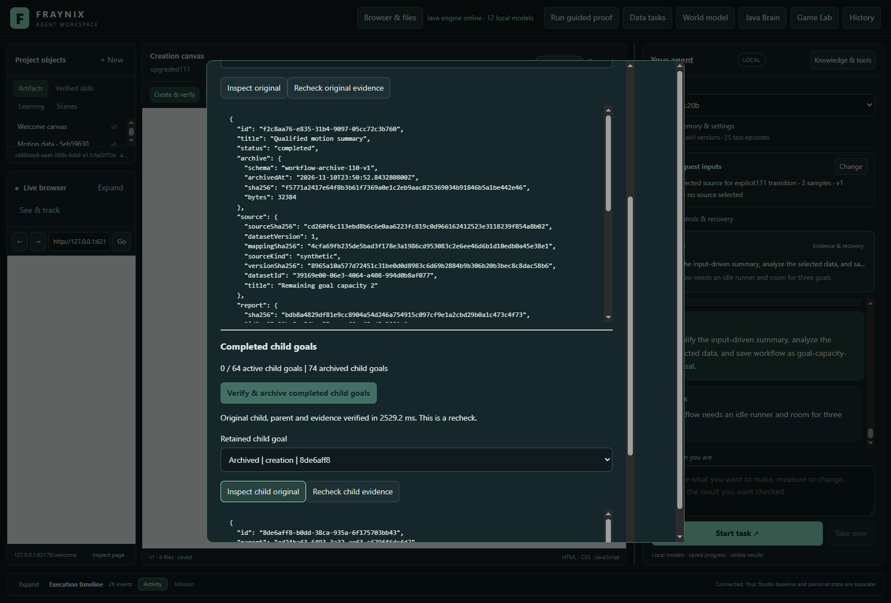
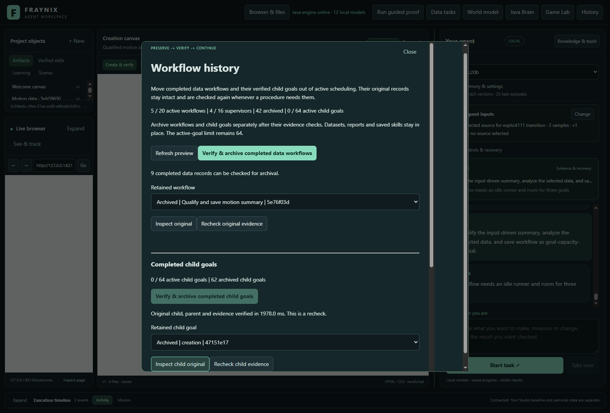
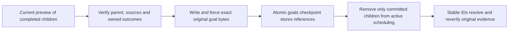
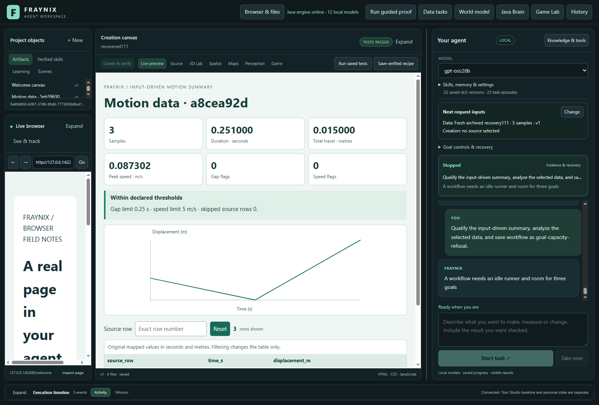
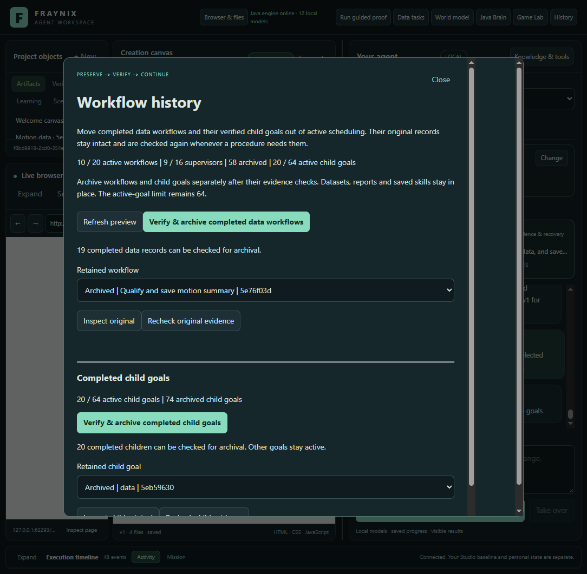

# Fraynix Agent Workspace — edition 111

## Archive completed child goals and keep their evidence

Edition 111 extends the Java brain's durable memory lifecycle to **completed, owned data/creation child goals**. It stores their exact original payloads under checked content addresses and replaces active records through one atomic goals checkpoint. Original IDs, parent ownership, sources, reports, audits and saved-procedure references remain intact.

The **64-active-goal limit is unchanged**. The actual application archived **74 child goals**, retained **58 archived workflow records**, completed **11 fresh native workflow requests**, recovered one abrupt interruption and reached **32 genuinely published procedures**. Six requests correctly refused capacity, changed runtime identity or revised original evidence. The final growing project held 20 active children and 74 archived children. Archive integrity and original evidence validity were checked separately.

[Previous edition 110](README-110.md) · [Offline interactive guide](docs/readmes/111/index.html) · [Measurements](docs/readmes/111/analysis.json) · [Validation](docs/readmes/111/verification.json) · [Contributor direction](README-CONTRIBUTORS.md)

## The problem and the continuing design

Fraynix is a local agent workspace. Java owns durable tasks, tools, physical state, observations, verification, procedural memory and recovery. The desktop hosts chat, browser and creation surfaces, spatial views and Game Lab. A tool performs an action; a skill completes a task with actions, checks and recovery. Continued operation needs both bounded active work and retrievable evidence of what worked.

Edition110 released completed workflow slots while retaining their original child goals. Its real trial reached 62 retained goals. The next request refused because the existing admission check reserves three slots under the 64-goal ceiling, even though these data workflows normally execute two. Raising the ceiling or deleting evidence would not provide the requested lifecycle. This edition moves eligible completed children outside active scheduling while keeping their original evidence available to the same verification paths.

The archive is exact retained history. It is not a generated summary, a new training example automatically accepted as truth, or an LLM weight update. Nothing about moving bytes proves that their referenced sources remain valid. Fresh verification still checks those sources and the actual outcomes.

## Using the app

Open **History** from the main toolbar. The existing workflow archive controls remain, followed by the child-goal section. It shows active and archived child counts, eligible records and the unchanged active limit. Refresh the preview, then use **Verify & archive completed child goals**. Java checks the parent and each owned stage before committing.

Select an archived child to inspect its original record or recheck its evidence. Stable-ID lookup resolves the same goal after restart. The active goal list no longer schedules it, but workflows and saved procedures retain their original references. Archive view metadata is separate from the retained original payload.

Only completed data and creation children whose completed parent passes all original checks qualify. Active, interrupted, cancelled, unpublished, standalone, physical and graph goals stay in their existing active lifecycle. Archive operations require an idle runner and a current preview; stale plans, foreign or duplicate IDs and unsupported arguments refuse. There is no hidden deletion or automatic evidence substitution.

## Atomic storage, stable identity

Child payloads live beneath `goals/archive111/`, named by their SHA-256 digest. A bounded checkpoint reference records the original ID and creation time, schema, byte count, digest and archival time. Reads validate the reference, regular-file type, length, hash, identity and completion state. Missing, changed or substituted files refuse. Archived records cannot be edited as active goals.

Files are prepared and forced before the checked checkpoint is saved. Before that commit, original active records remain authoritative. If the checkpoint write fails, every original active payload remains; prepared files stay available for a checked retry. The tests reopen after such a failure and retry successfully. After commit, the in-memory world and active index change together. The parent-workflow checkpoint and procedure records are not rewritten by child archival.

Active goals remain bounded at 64. Child archives have separate bounds of 512 records, 128 MiB total and 8 MiB per payload. Prepared files count against the byte budget. Existing workflow archives retain their 256-record/128 MiB bounds. Active executable workflows 20, qualification supervisors 16, saved procedures 32 and versions 8 are unchanged. Capacity is explicit rather than unlimited.

These hashes detect changes relative to checked local records; they are not independent signatures. The edition does not add archive import, deletion, encryption or external trust. Retaining the surrounding source and artifact stores is necessary because archives preserve references as well as values.

## Old evidence remains old

Goal lifecycle changes affect runtime identity. A narrowly scoped Java adapter recognizes the exact published 107, 109 and 110 dependency sets for completed historical inspection. It checks that original numerical, source and browser-outcome verifier classes remain unchanged, then rechecks the original workflow, qualification lineage and publication. Unknown dependency sets and unsupported changes refuse.

Ordinary qualification against an old runtime still refuses. An explicit **upgrade summary qualification** request rechecks the original proofs, records the old record hash and both dependency sets, then executes all five fresh examples plus the selected fresh source. The new transition binds those observations to111. It never edits an old proof to claim it came from this runtime.

The chat card in the report screenshot retains the previous edition's task history. The new workflow is shown in the creation canvas; its live status and restart evidence come from the native workflow records. Some task captures retain the open History dialog while the native canvas preview overlaps it. Those captures show the actual session, not a separate on-screen refusal confirmation; the request outcome is established by the linked native records. The dedicated History captures show the archive controls and counts clearly.

The same distinction applies to implementation reuse. Known old implementation receipts can be inspected as completed history, but cannot authorize current execution or resume. The trial demonstrates this refusal. Fresh reuse of a current verified implementation succeeds with new input and all original source and visible-outcome checks.

Of344 compiled engine classes,337 are unchanged from110. Five changed classes own goal/workflow orchestration, server routes and explicit runtime identities; two new helpers implement archival and historical review. The source-identity receipt enumerates every comparison. Numerical verification, original data checks and both input-driven report resources remain byte-identical.

## Actual application study

The trial starts from a closed, byte-compared copy of 110's genuine 21-procedure project, with 62 native child goals and 51 retained workflows,42 already archived. It uses real Electron/Chromium checks, existing desktop native workflow controls and actual History buttons, not inserted successful audit receipts. User-private worlds remain untouched.

The initial chat attempt correctly refused the separate 24-task chat-history limit. Its recorder expected a new admission and timed out; the entire 121.319-second attempt and screenshot are retained. The corrected cohort starts from another exact copy, preserves that full journal byte-for-byte and sends structured requests through the existing Java workflow controls. It does not clear chat history, raise its limit or claim chat can continue on this full project. A separate admission check confirms that boundary.

A second68.082-second trial archived62 children, then stopped because the recorder compared the public compact display with a full payload. The recorder now compares the full child-read record and exact archive bytes, with separate display-field checks. That stopped trial, both checkpoints and all62 exact payloads are independently checked and retained; the full final cohort starts fresh. Runtime code is unchanged across these attempts.

1. Confirm that another request refuses at 62 goals under the existing reservation policy.
2. Verify and archive all 62 original children. Confirm the workflow checkpoint is unchanged; reopen and resolve every child.
3. Demonstrate old-runtime refusal, then archive the nine remaining completed workflows and explicitly upgrade qualification with five fresh cases and a selected report.
4. Use the visible History controls to archive the 12 new children and seven new workflow records. The project now retains 74 child archives and 58 workflow archives.
5. Begin a fresh native workflow request using archived current proofs. Interrupt Java before its selected-source independent audit; reopen and explicitly Resume. Child IDs and source/report bytes remain stable and the remaining real checks complete.
6. Reuse the archived current implementation with fresh data, then complete eight more requests. The bank reaches 32 genuine procedures, where the unchanged saved-procedure capacity refuses another publication. Only 20 active child goals remain.
7. In separate checked copies, refuse execution from the old implementation protocol, corrupt and remove an archived child file, revise an original report, and revise an original dataset. Restoring exact archived bytes restores its verification; revised original evidence remains invalid.

The 32 procedures belong to the same input-driven summary family, with distinct sources and verified publications. They are not 32 general reasoning algorithms. The measured requests use existing native Java workflow controls and make no model-planning or content-generation calls. The unchanged 24-task chat history is full, so this cohort does not claim new chat admission. Local model features remain available; this experiment does not measure their intelligence or train model weights.

## Measurements, with complete costs

| Child archive operation | Exact records | Active children | Caller seconds |
| --- | ---: | ---: | ---: |
| original110-children | 62 | 62 → 0 | 45.982 |
| current111-children | 12 | 12 → 0 | 11.246 |

| Request | Outcome | Saved procedures | Active / archived children | Caller seconds |
| --- | --- | ---: | ---: | ---: |
| goal-capacity-refusal | refused | 21 | 62 / 0 | 0.147 |
| old-runtime-refusal | refused | 21 | 0 / 62 | 0.254 |
| upgraded111 | completed | 22 | 12 / 62 | 55.448 |
| recovered111 | completed | 23 | 2 / 74 | 19.519 |
| reused111 | completed | 24 | 4 / 74 | 59.186 |
| continued-0 | completed | 25 | 6 / 74 | 13.789 |
| continued-1 | completed | 26 | 8 / 74 | 14.983 |
| continued-2 | completed | 27 | 10 / 74 | 16.290 |
| continued-3 | completed | 28 | 12 / 74 | 18.225 |
| continued-4 | completed | 29 | 14 / 74 | 19.602 |
| continued-5 | completed | 30 | 16 / 74 | 21.725 |
| continued-6 | completed | 31 | 18 / 74 | 22.198 |
| continued-7 | completed | 32 | 20 / 74 | 23.993 |
| procedure-capacity-refusal | refused | 32 | 20 / 74 | 1.168 |
| old-protocol-refusal | refused | 22 | 0 / 74 | 0.369 |
| changed-artifact | refused | 22 | 0 / 74 | 0.468 |
| changed-dataset | refused | 22 | 0 / 74 | 0.445 |

Complete cohort: **581.346s**. Requests: **287.809s**. Child archival: **57.228s**. Workflow archival: **35.784s**. Setup, checked copies, captures, inspection and between-request work: **200.525s**. These categories are disjoint; preparation, failed requests and recovery costs remain included. The two prior stopped trials add **189.401s**; all attempts together take **770.747s**. Their costs and evidence are retained separately from the corrected cohort.

The observed process uses a 512 MiB Java heap and two Java processors, serial work and CPU-only planning settings. Cold sessions mean newly opened application processes on closed copies, not cleared OS caches. Timings describe this instrumented host and workload. They establish working archival and continuation; they do not establish a universal speedup or an isolated effect of archive size.

## Verification and reproduction

All 150 relevant Java regression methods are covered and 148 desktop checks pass. The initial broad run passed 145 and found five edition107 upgrade failures. After adding that exact published identity to the explicit review path and restoring display punctuation, all 24 affected Java methods pass. The original failures, source correction and final rechecks are retained separately. The 11 new Java methods cover exact bytes, cold lookup, full original verification, changed source/report refusals, corrupt/missing/non-file substitution, stale plans, ownership, active/cancelled refusal, failed checkpoint recovery, current reuse and unchanged 64-goal admission. The capacity test creates real standalone goals through the API and confirms they remain active; it does not pad the measured application bank.

The 17-request native-workflow application study provides 11 completions, six required refusals and one abrupt recovery. A separate inspector decodes the original checked checkpoints, matches exact archived payloads, reconstructs every summary value and chart point from source CSV, checks qualification and publication lineage, verifies current dependency identities and accounts for every timing category. Twenty-four deliberately altered evidence records were rejected. The inspector initially needed its string canonicalization corrected to match the established JSON-java encoding of HTML and typographic characters in the untouched chat journal. The initial inspector, failure log and correction receipt are retained; application runtime and original evidence were unchanged.

Build with Java 21 and the repository Gradle wrapper: `gradlew.bat :workspace-engine:installDist`, then `npm start` in `workspace-desktop`. Use a distinct project directory for experiments; never start two Java owners against the same private data. Existing desktop dependencies are unchanged.

For the recorded study, commit the built runtime, stamp `node scripts/Study-Build095.cjs --stamp`, run `node workspace-desktop/test/archive111-integration.cjs`, then `node scripts/Inspect-GoalArchive111.cjs`. Supply a closed genuine110 project through `EDITION111_BANK110`; the recorder refuses an existing output directory. Verify the installed input/artifact stamp before and after measurement. The selected model must exist in the local catalogue, although these native requests do not invoke it.

[Lossless original evidence](docs/readmes/111/original-evidence.json), [source inventory](docs/readmes/111/file-inventory.json) and [implementation map](docs/readmes/111/system-map.json) accompany the measurements. Real dated screenshots and an offline guide checked at 1440 and 390 pixels are included. Frozen editions 001–110 remain unchanged. GitHub CI status is reported separately from these local results.

## Next steps and acceptance gates

First, give the separate 24-task chat journal an explicit evidence-preserving archival lifecycle. It is already full in this project. Keep its bound and task chains, outcomes, source references and recovery evidence intact, then demonstrate a fresh chat request after reopening. Child-goal archival alone does not solve that admission limit.

Measure cold reopen, history inspection, archive retrieval and repeated verification as the archive grows. Separate unavoidable original-source checks from repeated file reads, and retain all source and outcome validation before accepting an optimization. Include interrupted tasks and revised or missing evidence at each bank size.

The next capacity boundary is the 32-procedure bank. Define a separate, explicit saved-procedure lifecycle before expanding long sequences; do not silently evict procedures or raise limits. Later, extend archival to physical and typed-graph task families only when their original motion, forecast, ownership and outcome evidence can be checked in full. Preserve the existing integrated Java app throughout.

The destination remains an agent that can act, observe, verify, retain useful procedures and recover across sessions. This edition advances continuity by keeping evidence available while freeing active scheduling slots. It makes no claim of unlimited memory, consciousness or general self-training.
