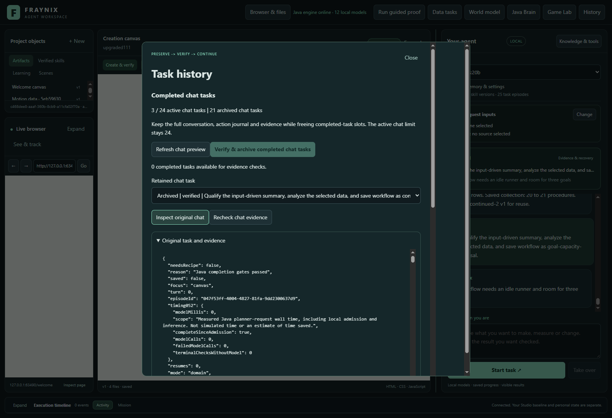
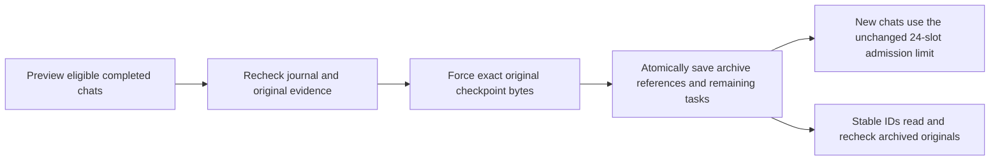
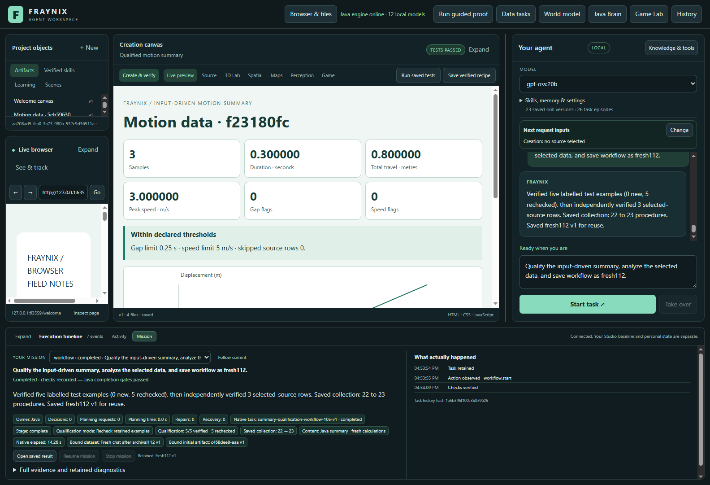
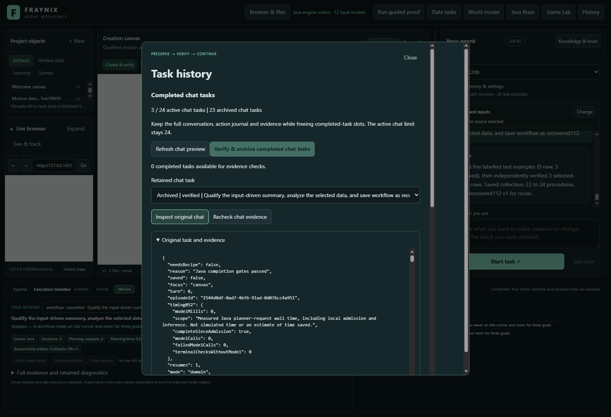
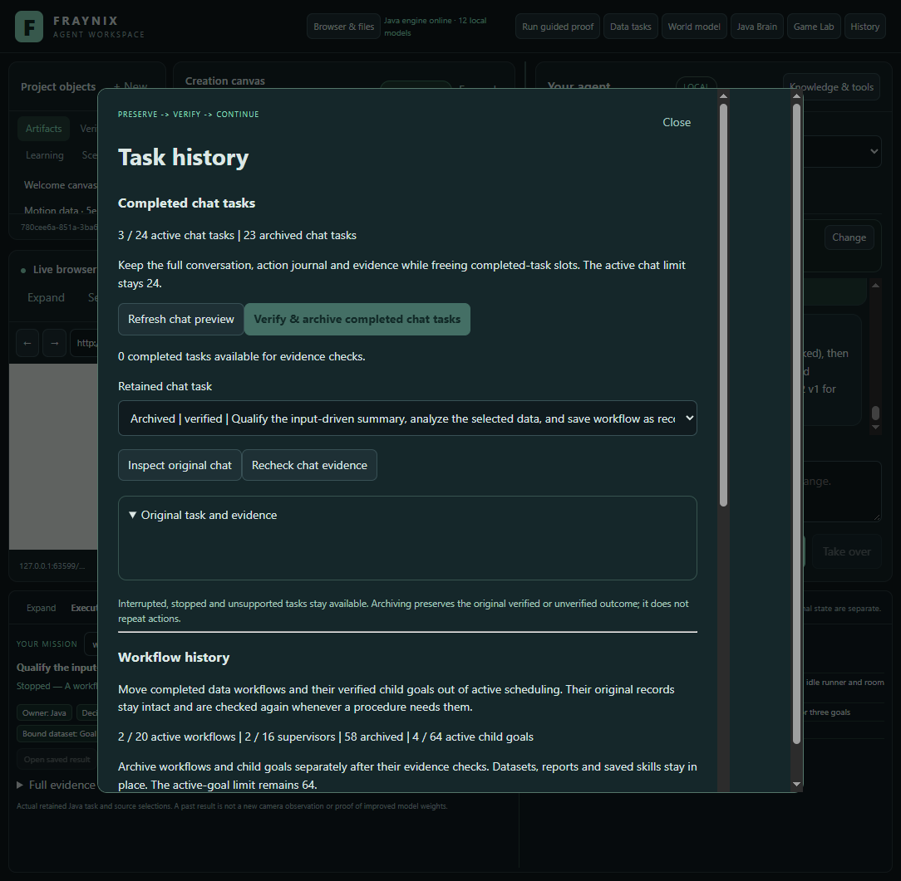

# Fraynix Agent Workspace — edition 112

## Completed chat history remains available; new work can continue

Edition 112 adds explicit archival for completed chat tasks. Java preserves the **exact original checked checkpoint**, every task's complete action journal, its outcome and its links to the original evidence. An atomic checkpoint change releases eligible completed tasks from active scheduling. Their IDs continue to resolve after restart.

**The 24-active-chat-task limit is unchanged.** The actual trial began with 24 real tasks, archived 21 completed chats and retained all three cancelled tasks. Two fresh requests then completed through the visible chat interface, including one recovery after an abrupt Java interruption. Archiving those two brought the retained archive to **23 chats**, with the same three cancelled tasks still active. The separate 64-goal limit and all other execution budgets remain unchanged.

[Previous edition 111](README-111.md) · [Offline interactive guide](docs/readmes/112/index.html) · [Measured results](docs/readmes/112/analysis.json) · [Validation](docs/readmes/112/verification.json) · [Contributor direction](README-CONTRIBUTORS.md)

## Why this change matters

Fraynix keeps the environment, goals, tools, verification, memory and recovery in its Java runtime. Chat is connected to those functions: a supported request can start a native workflow, retain its source bindings, create a report, check the actual browser result and save a procedure. The desktop presents that work alongside browser, canvas, spatial views and Game Lab.

Edition 111 freed completed child-goal slots, but exposed a separate boundary. Its original project already held 24 chat tasks. The next chat request correctly refused admission even though native workflow capacity was available. Deleting the journal or raising the limit would lose the intended bounded, evidence-preserving lifecycle.

This edition preserves that complete history and frees only eligible completed chat slots. It does not convert old receipts into current execution authority, change model weights or silently repeat a prior action.

## Use the History window

1. Open **History** in the main toolbar. The completed-chat section appears first, with active and archived counts.
2. Use **Refresh chat preview** to see which completed tasks can be checked.
3. Select **Verify & archive completed chat tasks**. Java verifies the original journal, closed episode and supported outcome before committing the archive.
4. Choose a retained task to **Inspect original chat** or **Recheck chat evidence**. The original record remains readable by its stable ID.
5. Close History and start a new chat request. Interrupted tasks keep their existing explicit Resume behavior.

Cancelled, interrupted, queued and running tasks are not archived. Supported outcomes are completed data/creation workflows and qualifications, workbench artifacts/recipes, native visual inspection reports and completed unverified conversations. Other native task families remain active until their complete archival checks are defined. A revised or missing original refuses verification; its historical task remains available for inspection.

An unverified conversation retains the explicit `completed-unverified` outcome. Successful archive integrity checks do not promote it to verified task success.

## Exact snapshots and atomic commitment

Snapshots live under `agency-043/archive112/`, addressed by the SHA-256 of the exact original `tasks.json` bytes. Several tasks archived together share that single original snapshot. Each reference binds the task ID, creation time, original outcome, snapshot length/hash, task index, complete task hash and verified evidence hash. The original checkpoint envelope and every retained task journal are checked when read.

The archive file is written and forced before the active checkpoint changes. Only after the atomic checkpoint save succeeds does the live scheduler adopt the remaining task list. Prepared files without a committed reference leave tasks active and are available for checked retry. The unit recovery check exercises this preparation-without-commit boundary; the app study separately exercises an abrupt interruption during a real workflow.

Storage is bounded at **512 archived task references**, **128 MiB of snapshot files**, and **4 MB per original checkpoint**. Prepared files count toward that byte budget. The existing active checkpoint size budget, 24-task admission limit and four-task queue remain in place. The archive is not unlimited, and no automatic eviction is introduced.

A history operation rereads and hashes each distinct snapshot once during that operation, then checks each referenced task individually. It does not reuse a timestamp-based validity claim between operations. This avoids repeatedly parsing one shared file while preserving a fresh check on the next operation.

## Evidence remains separate from authority

Archived tasks cannot resume, cancel, acquire host claims or receive stale acknowledgements. A separate new request is required to execute work. Existing unfinished tasks keep their original state and recovery controls.

Java checks the original objective and hash-linked journal, closing outcome and learning episode. It rechecks stored screenshots against their original metadata and bytes. Workbench reports must still match their exact artifact version, contents and witnessed test receipt; requested recipe bindings must remain unchanged. Workflow chats invoke the existing original-source, owned-stage, outcome and publication verifier, then compare the retained completion binding. Rechecking an old report is not a fresh observation of the real world.

All **342 other existing production classes** remain byte-identical to edition 111. Only the existing Agency043 and WorkspaceServer classes changed, alongside the new archive helper. Original goal/workflow/qualification/numerical verifiers, historical runtime identities and summary resources remain unchanged. No qualification proof is relabelled.

## Actual application trial

The trial uses a closed exact copy of edition 111's genuine project, retaining its 22 published procedures, 74 archived child goals, 58 archived workflows and all 24 chat records. The original running review projects and private camera data are not used or changed.

The first new chat request correctly refused the 24-task limit. The actual History controls then archived the 21 completed chats, preserving the exact checked snapshot and the three cancelled records. A cold reopen recovered all archived IDs and full journals. The next two requests were submitted through the visible chat field and Start button:

> Qualify the input-driven summary, analyze the selected data, and save workflow as fresh112.

The second request was interrupted immediately before the selected-source browser audit, after its five examples had been checked. After restart, the same chat and native workflow were resumed explicitly. Original child IDs, report contents and source bindings were retained. Both requests completed with fresh browser and independent numeric/geometry checks, growing the procedure bank from 22 to 24.

The local model remains selectable, but these supported summary requests follow the existing deterministic Java route and invoke **zero model-planning calls**. The result demonstrates actual chat-to-workflow continuity, not a new measure of LLM intelligence or training.

Separate copies test same-length snapshot corruption, a missing snapshot, a revised original report and a new version of an original dataset. Corrupt or missing snapshots and revised reports refuse. A new dataset version preserves immutable version 1: the original source bytes and proof still match; restoring the exact snapshot restores verification. Historical task journals remain unchanged. Archived Resume and Cancel requests refuse. No passing browser observations are supplied by the recorder.

## Complete measured costs

| Archive operation | Chats archived | Active tasks | Caller seconds |
| --- | ---: | ---: | ---: |
| original111-chats | 21 | 24 → 3 | 25.415 |
| current112-chats | 2 | 5 → 3 | 7.572 |

| Chat request | Saved procedures | Caller seconds |
| --- | ---: | ---: |
| fresh112 | 22 → 23 | 15.846 |
| recovered112 | 23 → 24 | 28.098 |

The final complete cohort took **224.093 seconds**: requests **43.944 s**, archival **32.987 s**, and setup, copies, restart preparation, rechecks, refusals, screenshots and other work **147.162 s**. Request measurements include their actual browser checks and recovery pauses. Categories do not overlap. These measurements describe this host and workload; they do not establish a universal speedup.

The first app attempt took **146.783 seconds**, preserved 21 chats and completed one fresh request. Its recovery recorder then requested a protected child endpoint while the live chat owned execution; Java correctly refused. Only the recorder changed, using the existing passive goal read to retain boundary IDs and report contents. The next attempt took **217.462 seconds** and completed both chats and recovery. Its final test incorrectly expected dataset version 2 to invalidate the unchanged, immutable version 1. The original verifier correctly passed version 1. The final test explicitly checks that original source and proof, while confirming version 2 exists. Screenshot review also corrected History selection: refresh preserves the chosen record, changing selection clears old details, and late reads only render for the same selected record. The final cohort started from another fresh copy. All three attempts total **588.338 seconds**; both earlier attempts and all their files remain in the evidence.

The Java process uses a 512 MiB heap and two reported processors. Heavy work is serial. Cold reopen means a new app process on a closed project, not a cleared operating-system cache.

## Tests and reproduction

**127 relevant Java tests**, **148 desktop checks** and **20 independent altered-evidence controls** pass. The first 36-test run passed 35 and exposed a missing-test-receipt exception when the original report was revised. The code now returns an explicit refusal; the test was not weakened. Its original XML/log/source and the final corrected results are retained.

Tests cover exact snapshots, cold lookup, full journals, preserved unverified outcomes, the unchanged 24-task boundary, unchanged cancelled/interrupted records, explicit recovery, stale previews, duplicate/foreign IDs, missing/corrupt/non-file archives, revised reports and screenshots, prepared-but-uncommitted snapshots and refusal of archived action authority. The independent inspector reconstructs actual summary values and chart points from original CSV, verifies archive envelopes, journals, evidence bindings, cold reads and recovery identity, and accounts for the entire cohort cost.

Build the Java runtime with Java 21 and `gradlew.bat :workspace-engine:installDist`; start `npm start` in `workspace-desktop`. Use a distinct project directory for experiments. Never open two Java owners against the same project or replace the installed JARs of a running private review app.

For this study, commit the built inputs, run `node scripts/Study-Build095.cjs --stamp`, then `node workspace-desktop/test/archive112-integration.cjs` and `node scripts/Inspect-ChatArchive112.cjs`. Set `EDITION112_BANK111` to a closed genuine edition111 project; choose a fresh output directory with `EDITION112_OUTPUT` for every rerun. The recorder refuses overwriting an earlier trial. The guide is checked at 1440 and 390 pixels; application captures use 1600 and 1100 pixel windows.

[Lossless originals](docs/readmes/112/original-evidence.json), [source inventory](docs/readmes/112/file-inventory.json) and [implementation map](docs/readmes/112/system-map.json) accompany this edition. Earlier editions 001–111 remain frozen. GitHub CI is reported separately from local tests and fetched publication verification.

## Next steps

Measure cold-open, archive lookup and repeated evidence verification costs as chat, workflow and child-goal histories grow together. Keep the original checks and account for complete task cost before optimizing repeated reads. Test mixed interrupted/completed histories and revised evidence at each size.

The saved-procedure bank still has its separate 32-procedure limit. Define a deliberate, evidence-preserving procedure lifecycle before expanding long-running workloads. Extend chat archival to other native task families only after their original motion, ownership, source and outcome checks have equivalent coverage.

The destination remains a local agent that can act, observe, verify, retain useful procedures and recover across sessions. This edition removes a demonstrated continuity limit without deleting the evidence that makes the system accountable.
