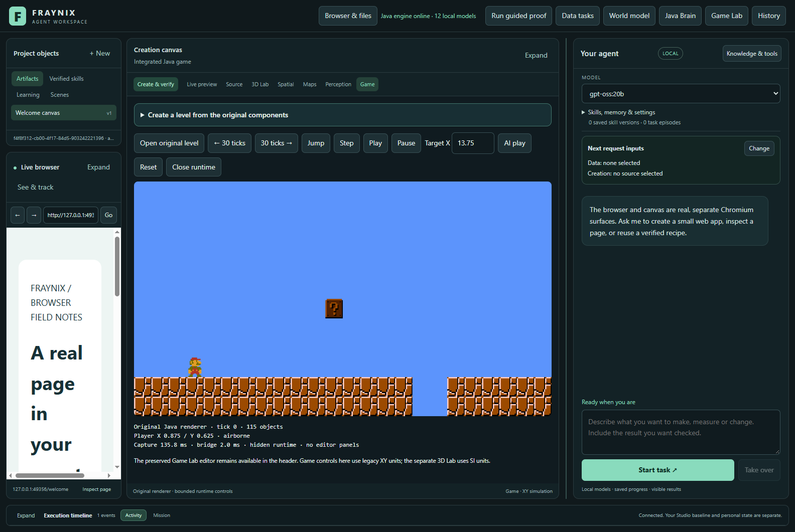
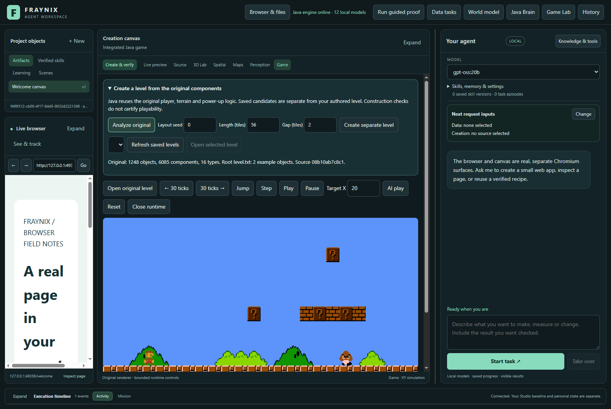
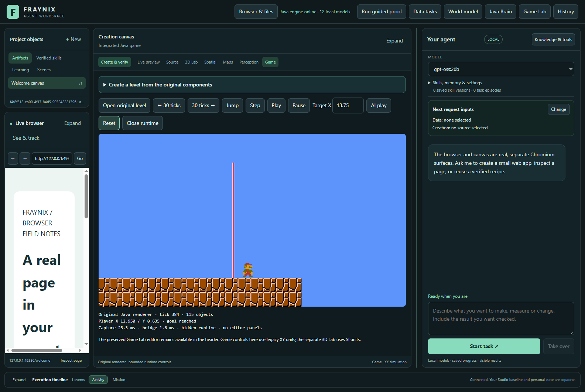
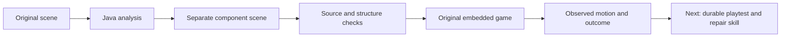

# Fraynix Agent Workspace — edition 114

## Create a separate level, then test what actually happens

Edition 114 gives the existing Game Lab a source-based level constructor written in Java. It reads the full Mario scene, reuses working components and saves a new candidate without overwriting the original or the user's authored world. The candidate opens inside the workspace using the original renderer and physics.

The actual desktop trial created **114 objects**, moved the player through real controls, crossed two gaps and observed **finish contact**. Closing and reopening restored the same candidate/player identity at its starting position in a new runtime session. This is a bounded demonstrated level, not a claim that every parameter combination is playable.

[Previous edition 113](README-113.md) · [Full outline and phases](docs/PLAYABLE_LEVEL_CREATION_PLAN.md) · [Prospective contract](docs/EDITION_114_CONTRACT.md) · [Offline guide](docs/readmes/114/index.html) · [Actual desktop evidence](docs/readmes/114/actual-ui.json) · [Actual runtime evidence](docs/readmes/114/actual-runtime.json)

## Why this matters for the agent

The game is an executable environment: the same system can construct objects, apply controls and inspect what happened. A structured level preserves positions, components, collision bodies, sprite references and player state definitions. Java gives those components behavior. This creates a useful route from a request to a visible, testable artifact.

A tool creates or opens a scene. A skill must complete the task through actions, checks and recovery. This edition implements the first working construction/runtime slice. The next phase connects it to a durable chat skill, bounded playtests and repairs. It does not yet claim arbitrary text-to-level generation, screenshot recognition, autonomous repair, new neural training or a generally intelligent designer. The demonstrated generator and controller make **zero model calls**.

## What the source really contains

The full source is `levels/mario-original.json`: **1,248 objects, 6,085 components and 16 component types**. It contains the complete player animation states, terrain, collision bodies, coins, supported power-ups, enemies, pipes and finish components. Root `level.txt` is only a two-object transform example; it is not the playable Mario scene.

The constructor copies only a declared subset: terrain, the full player, a Powerup question block and finish segments. It retains sprite/animation definitions and assigns fresh object/component identities. Existing unfinished invincibility behavior is excluded. The generated finish uses stationary sensor bodies, so actual player contact triggers the existing finish behavior. The player is moved through game input, not repositioned by the test controller.

## Use it step by step

1. Start the existing workspace with a deliberately chosen project. Java21 and the existing desktop/game dependencies are required; no new dependency was added.
2. Open **Game**. Expand **Create a level from the original components**.
3. Click **Analyze original** to see the actual object/component counts and source identity.
4. Choose a layout seed from0–9999, length48–72 tiles and gap width1–2 tiles. These are explicit construction bounds, not a promise that all combinations have been playtested.
5. Click **Create separate level**. The app saves a level and manifest in the project's `game-levels114` collection and reports that playtesting is still required.
6. Click **Open selected level**. The current owned game runtime is replaced with an isolated candidate session. The user's authored scene and original source are preserved. The construction controls fold away so the game remains visible.
7. Use the directional/jump/step controls or existing **AI play**. Watch actual position, airborne/ground state, death and goal state. Existing AI may fail; a failed controller run is not proof of impossible geometry.
8. Use **Reset** for a fresh starting state or **Refresh saved levels** after reopening the app. **Open original level** opens the original game path. Invalid candidates remain listed with their refusal reason.

Candidate capacity is32 and separate from the unchanged32 saved-procedure slots. This phase does not implement candidate deletion/retirement or automatically promote anything into the procedure bank. The full-bank lifecycle remains a planned prerequisite for broad skill retention.

## Checks before execution

Each candidate records its source hash, parameters, object count, source-object lineage, gaps, finish position, asset hashes and exact level hash. Opening it reconstructs the declared recipe and compares the saved object graph, metadata, source and assets. Altering a candidate and merely updating its file hash does not make it match the declared recipe. Installed game assets must also match.

The private game process receives an exact candidate file hash. The original scene loader checks the actual bytes, and the existing component/physics/asset/round-trip validator runs before startup. Generated sessions use a separate runtime directory and do not silently load an older authored scene. The original default path remains available. Construction records are not completion certificates; actual runtime observations are retained separately.

## Measured demonstration and limitations

The standalone original-runtime trial took **5.059 seconds** including launch, bounded controls and reopening. The complete desktop trial took **13.452 seconds** including app starts, original analysis, construction, controls, screenshots, reopen and refusal checks. These are host-specific complete trial times, not model latency or a universal performance claim.

A simple gap-aware controller sent12-tick movement commands through the existing bridge. The final desktop observation was tick **384**, X **12.950**, with the player's actual `won` flag set by finish contact. The complete input-derived state trace is retained. This does not certify mushroom collection, optimal routes, difficulty or enjoyment; the trial's goal was structural correctness, real motion and completion of this declared course.

The saved candidate was reopened in a new process/session. Its player identity and starting position were retained, with the win flag clear. Changed candidate bytes, unsupported gap width and path traversal were refused through the actual desktop host. Java tests separately cover source/asset changes, reconstructed-content mismatch, parameter bounds and fresh identities across varied construction seeds. Varied construction is not the same as varied completed playtests.

## Validation and provenance

The final relevant checks passed: **38 Java methods**, **155 desktop regression checks**, and **10 additional data/workflow checks**. Actual embedded runtime and desktop trials also passed. The first desktop attempt was correctly refused by the UTF-8 startup guard; three invalid separator bytes were repaired. The first passing screenshots exposed crowded construction controls, which now fold after launch. Original refusal and intermediate passing trials are retained separately; they are not counted as additional independent task cases.

[Validation record](docs/readmes/114/verification.json) lists the exact Java methods represented in the final test reports. The actual desktop and runtime trials are separate from unit tests. [Source inventory](docs/readmes/114/file-inventory.json) binds the implementation and retained source files. [Candidate JSON](docs/readmes/114/candidate-level.json) and [manifest](docs/readmes/114/candidate-manifest.json) preserve the generated input used in the desktop trial. Original logs/reports are retained under this edition's `originals` directory, including failed attempts where applicable.

The original data, history, chat, workflow and saved-procedure verifiers were not weakened. Existing capacities remain. Earlier edition evidence is still historical evidence, not a new114 result. Remote CI status is reported separately from local results. Private live projects and frozen editions001–113 were preserved.

## Design and next phases

The [full outline](docs/PLAYABLE_LEVEL_CREATION_PLAN.md) explains the architecture, acceptance gates, costs and boundaries:

- **114:** source analysis, separate construction and integrated runtime access.
- **115:** one durable chat-driven construction/playtest/repair task, with interruption recovery and honest failure reporting. Implement explicit procedure lifecycle before retaining additional skills into a full bank.
- **116:** known-sprite reference-image reconstruction, grid/crop estimation, uncertainty overlays and held-out matching tests. Hidden/off-screen behavior remains unknown without declared rules.
- **117:** broader terrain, supported enemies and routes; compare completion and complete cost on unfamiliar layouts and against simple control.
- **118:** reuse the checked task pattern for native3D and calibrated observations, with explicit domain units, scene exports and tested replay formats.

The prior two-source data-report proposal is deferred in favor of this user-requested creation task. Real-model routing, measured observation-to-artifact work and procedure lifecycle remain part of the destination. New views and more stored records alone do not establish learning: better checked outcomes on unfamiliar tasks do.

## Implementation map

| Source | Responsibility |
| --- | --- |
| `GameLevels114.java` | Source analysis, bounded construction, saved candidates and identity checks |
| `EmbeddedGameClient.java` | Private owned candidate runtime, original game controls and lifecycle |
| `Main.java` / `Scene.java` | Preserve explicit level selection and check candidate bytes before use |
| `WorkspaceServer.java` | Existing Java capability/ownership path for candidate operations |
| `brain-game.js` / `brain-game.css` | Controls inside the current Game Lab |
| `game-level114.cjs` | Actual desktop trial, observed states, screenshots and refusals |

[Obsidian note](docs/obsidian/122-playable-level-creation.md) · [Canvas map](docs/obsidian/122-playable-level-creation.canvas)
