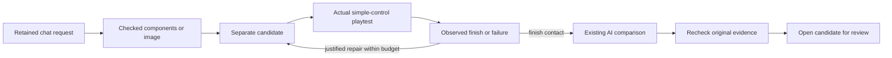
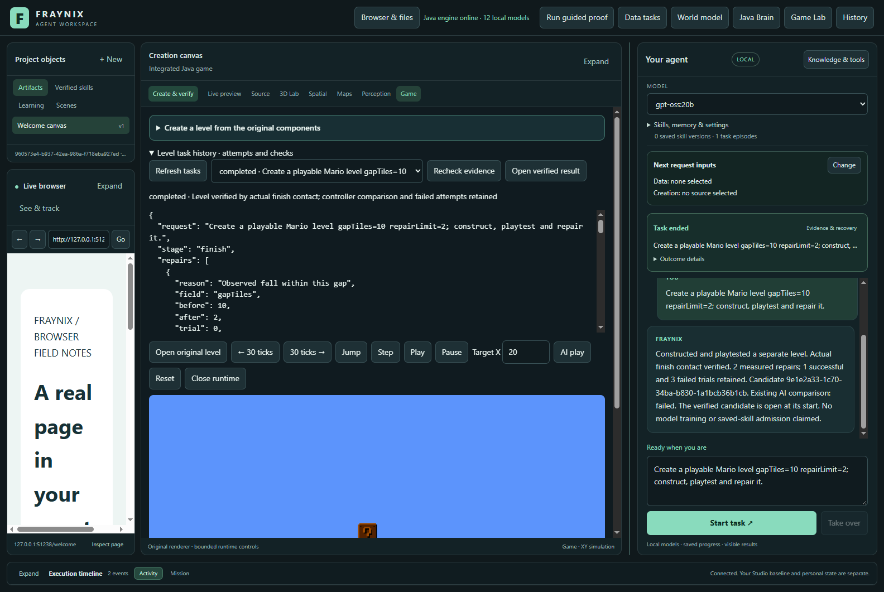
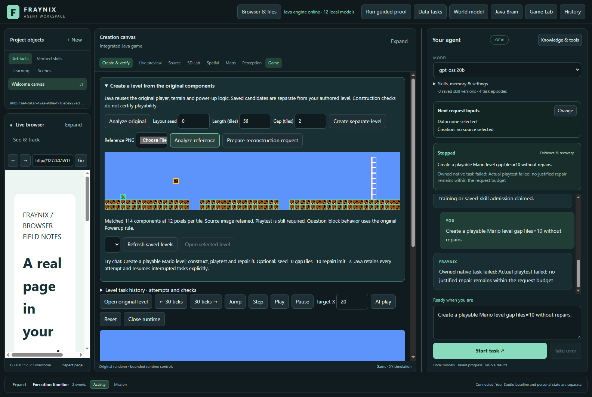
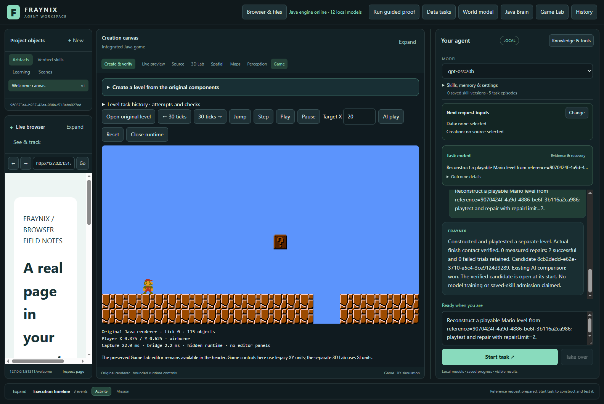

# Fraynix Agent Workspace — edition 115

## One request, a real level, retained evidence

Edition115 connects the existing Game Lab to the durable Java chat scheduler. A request constructs a separate component-based level, runs real physics, inspects the result, makes at most two justified gap repairs and checks the outcome again. A new reference-image importer reconstructs a supported course from its original sprite appearances and sends it through the same playtests.

**The completion gate is actual finish contact.** Files, screenshots and a target-X crossing do not substitute for a successful trial. Failed candidates and unfinished sessions remain available. The final candidate opens at its starting point for review; its earlier playtest results remain separate.

[Previous edition114](README-114.md) · [Full phased plan](docs/PLAYABLE_LEVEL_CREATION_PLAN.md) · [Acceptance contract](docs/EDITION_115_CONTRACT.md) · [Interactive offline guide](docs/readmes/115/index.html) · [Complete actual chat results](docs/readmes/115/actual-ui.json)


## Try it

1. Prepare and start the workspace with the commands below. Use a closed, deliberately selected project when upgrading. Java 21 and Node.js are required; existing game dependencies remain.
2. Open **Game Lab**. In chat, enter: `Create a playable Mario level gapTiles=10 repairLimit=2; construct, playtest and repair it.`
3. Watch the real game and task progress. **Mission** provides Stop and explicit Resume. Each trial has its own session and original trace.
4. Open **Level task history** to inspect the attempts, **Recheck evidence** to repeat source/outcome checks, or **Open verified result** to load its original starting state.
5. For an image, download the [actual native overview](docs/readmes/115/actual-reference.png), expand **Create a level**, select that PNG and choose **Analyze reference**. Review the outlines, then choose **Prepare reconstruction request** and **Start task**.

For a new or updated checkout, prepare both Java runtimes before launching. Stop that checkout’s Java owner through the app first; a closed desktop alone does not mean Java has stopped. These commands run from the repository root:

```powershell
.\gradlew.bat prepareGameRuntime115 :workspace-engine:installDist
.\scripts\Start-Agent-Workspace.ps1
```

The [launcher](scripts/Start-Agent-Workspace.ps1) uses the existing project-selection settings; it does not migrate another project’s private data.

Supported request fields are `seed=0..9999`, `lengthTiles=48..72`, `gapTiles=1..10`, `secondGapTiles=1..10`, and `repairLimit=0..2`. Defaults are seed0, length56, two gaps of width2 and two permitted repairs. `without repairs` sets the repair limit to zero. These fields configure the declared two-gap recipe; this is not arbitrary natural-language level design. Explicit image references cannot be mixed with manual geometry overrides.

## What Java owns



The existing chat task remains the parent. Java advances one bounded stage at a time, maintains the candidate lineage and retains all input chunks, observations, source/asset/engine identities and trial images. Each control chunk is 12 game ticks; a trial is limited to 180 chunks. The simple controller uses the known gap positions and ordinary movement/jump inputs. The existing AI uses its original game logic through a new bounded stepping port. Neither controller teleports the actor to make a test pass.

A repair is allowed only after an observed fall in a specific gap. It narrows that gap to two tiles, preserves the failed candidate and creates a fresh candidate. A failure outside that rule or after the repair budget is exhausted stops with the original reason. A construction check alone is never called a playability certificate.

After an abrupt interruption, the original unfinished trace remains marked interrupted. Explicit Resume rechecks the same source and engine, then starts that trial in a new native session. Completed trials remain unchanged. Sessions are never stitched together to create a false completion.



## Reference-image reconstruction

The owned Java matcher reads a bounded PNG, estimates its tile grid and matches original terrain, player, question-block and finish sprites. It models the renderer's actual alpha blending, pixel-boundary sampling, and bounded nearest-neighbor resize hypotheses. Match error and background contrast are measurements, not probabilities of correctness. The interface draws Java's detected component boxes over a cropped preview; the complete original PNG and hash are retained.

The first supported domain is the source-derived **two-gap course**: 48–72 visible columns, two complete floor rows, the original player, one question block and a visible finish. Tiles must occupy 8–32 even pixels. PNG size is capped at 3 MB and 1536×864 pixels. Sixteen references can be retained. Unexplained foreground, missing actors, incomplete terrain and unsupported geometry refuse reconstruction. An image cannot reveal the hidden contents of a question block: this recipe explicitly uses the original **Powerup** behavior. It does not invent offscreen geometry or import arbitrary executable components.

The recognizer returns a canonical matching layout seed, not evidence of the author's original seed. Any later repair is recorded as a change from the image-derived layout. A recognized picture still requires an actual constructed-scene playtest.



## Measured results

The final visible desktop trial used four fresh chat requests. It includes a forced Java-process interruption and explicit recovery, a refusal when repairs are forbidden, and fresh reconstruction from a native overview. Total request elapsed times include orchestration, file checks, rendering, repairs, controller comparison and recovery; they are not just inference timings.

| Actual request | Complete elapsed | Simple control | Existing AI | Repairs |
| --- | ---: | --- | --- | ---: |
| Two measured gap repairs | 54.542 s | won | failed | 2 |
| Abrupt restart and resume | 43.553 s | won | won | 0 |
| Repairs disabled | 10.003 s | failed | not run | 0 |
| Image reconstruction | 40.415 s | won | won | 0 |

The existing AI fails on the repaired seed0 course and succeeds on seed3. That counterexample is retained. The successful simple-control trial proves this candidate can be completed under the tested controls; it does not establish general AI mastery. The UI explicitly reports both outcomes.

Validation: **79 Java test methods**, **165 desktop regression checks**, actual Electron/Java/native-game trials, and source/candidate/image/checkpoint refusal tests. The image suite accepts a native overview, its resized version and a sky-only crop; it rejects an occluded player and an added foreground object. A separately constructed image-derived level reaches the finish. The original renderer and game tests remain included.

**Zero planner/model calls** were needed for these bounded requests. A selected local model remains available for other tasks, but these results come from Java routing, image algorithms and actual simulation. No new model training, consciousness, universal visual recognition or autonomous procedure promotion is claimed. Remote GitHub CI is reported separately from passed local checks.



## Preserved architecture and limits

The original `levels/mario-original.json` has 1,248 objects; root `level.txt` is a two-object example. Full original component and player animation definitions remain the construction source. Candidate JSON is data; the behavior lives in Java. Source hashes, exact generated structure, assets and installed game assets are checked before use.

Existing 24 chat-task and 32 candidate limits remain. The dedicated level-task history is also bounded at 24; recovery is limited to three explicit resumes. The active procedure bank remains 32 slots. Level task records and reconstruction evidence **do not automatically become saved skills**. Explicit retirement/reactivation with original provenance is still required before admitting more procedures into a full bank.

Native tests now prepare the actual game code and assets without repeatedly copying 16 GB of historical documentation. The full release distribution rule still includes that history. The initial packaging attempts and all image-matching failures are retained in the [original evidence index](docs/readmes/115/original-evidence.json). The corrected matcher models the actual blend/sampling behavior; no successful observation was substituted for a failed one. An earlier recovery screenshot was captured before the first game frame loaded; that attempt remains retained. The final UI trial waits for a decoded frame showing the reopened level at tick zero before taking its screenshots.

## Implementation map

```text
src/main/java/runtime/             original renderer and physics bridge
workspace-engine/src/main/java/    Java task, candidate and image logic
workspace-engine/src/test/java/    native and refusal checks
workspace-desktop/renderer/        existing chat and integrated Game Lab
workspace-desktop/test/            actual application trials
levels/                           preserved original component source
README-115.md                     this frozen edition
docs/readmes/115/                 screenshots, measurements and original evidence
docs/publication115/              documentation and publication checks
```

| Source | Responsibility |
| --- | --- |
| `GameTask115.java` | Durable stages, input budgets, failure-specific repairs, continuity and outcome audit |
| `GameReference115.java` | Original PNG retention, known-sprite grid matching, confidence measurements and refusals |
| `GameLevels114.java` | Source-derived candidates, independent gap parameters, deterministic task identity |
| `Domain044.java` / `ChatPolicy044.java` | Connect the existing chat owner to the native child task |
| `EmbeddedGameRuntime.java` | Original renderer/physics, bounded existing-AI input, paused overview capture |
| `brain-game.js` | Import, component outlines, task history and checked result opening |
| `game115-integration.cjs` | Actual UI requests, abrupt recovery, screenshots and complete costs |

## Next phases

1. **Broader image reconstruction:** separately validated grids/layouts, missing-content review, supported additional components, new images and measured false accept/refusal rates. Keep appearance, declared behavior and unknown content separate.
2. **Improve the game AI against the retained failure:** compare obstacle and power-up choices against simple control on unfamiliar seeds. Measure success and complete cost before retaining a new policy.
3. **Procedure lifecycle:** retire/reactivate saved procedures with their exact original evidence under the unchanged 32 active slots; then expose qualified level procedures for reuse.
4. **Broader worlds:** transfer the same request→observation→action→verification pattern to supported 3D components and calibrated observations. Preserve units, uncertainty and source identities.

The direction is one integrated system that can create an environment, act within it, see the measured result and retain what actually happened. The next improvement should be earned through new outcomes, not a larger capability claim.

[Project memory](docs/PROJECT_MEMORY.md) · [Development log](docs/DEVELOPMENT_LOG.md) · [Obsidian map](docs/obsidian/123-durable-level-tasks.md) · [All editions](docs/readmes/INDEX.md)
