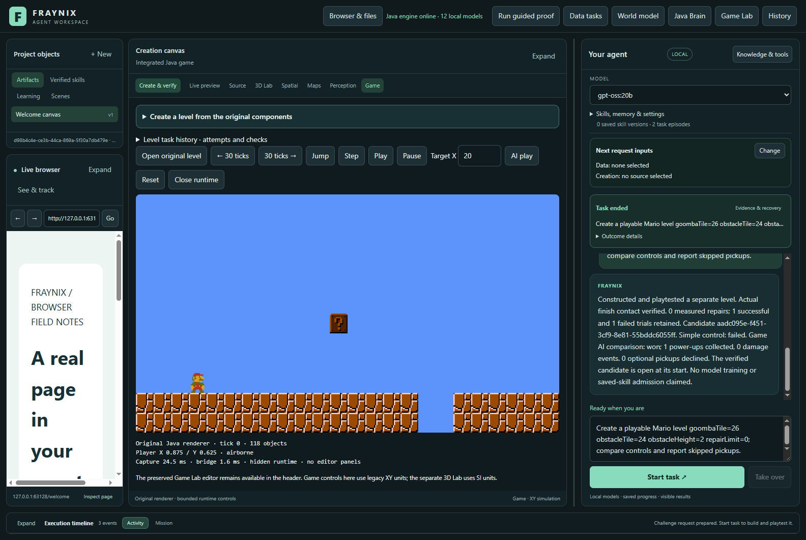
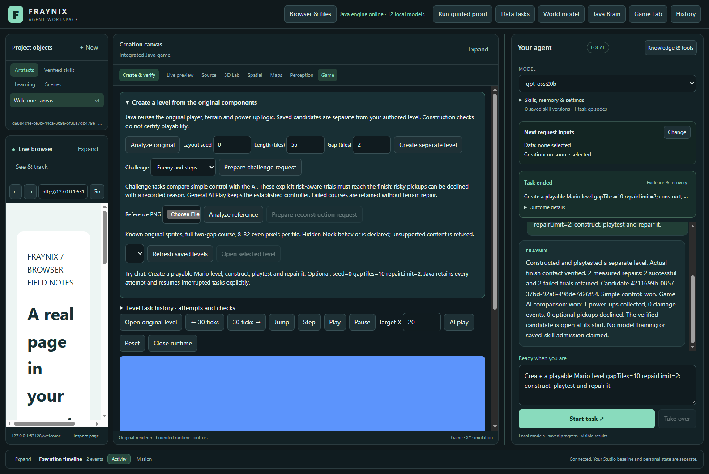
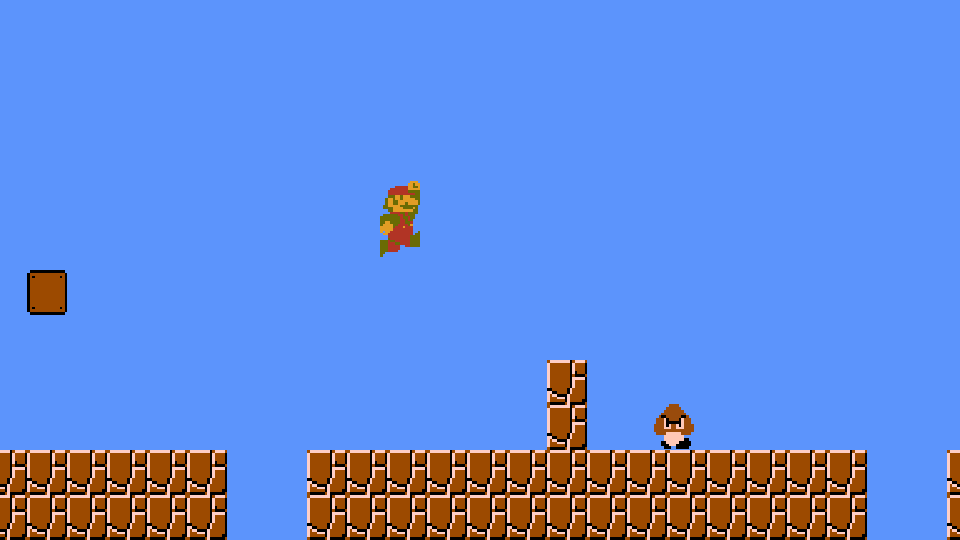
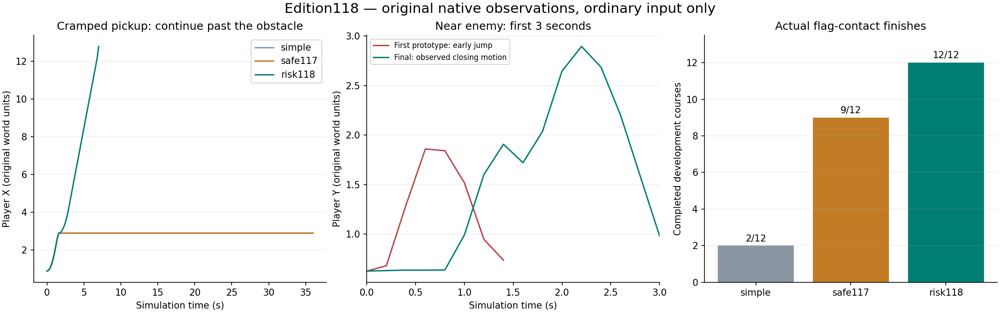
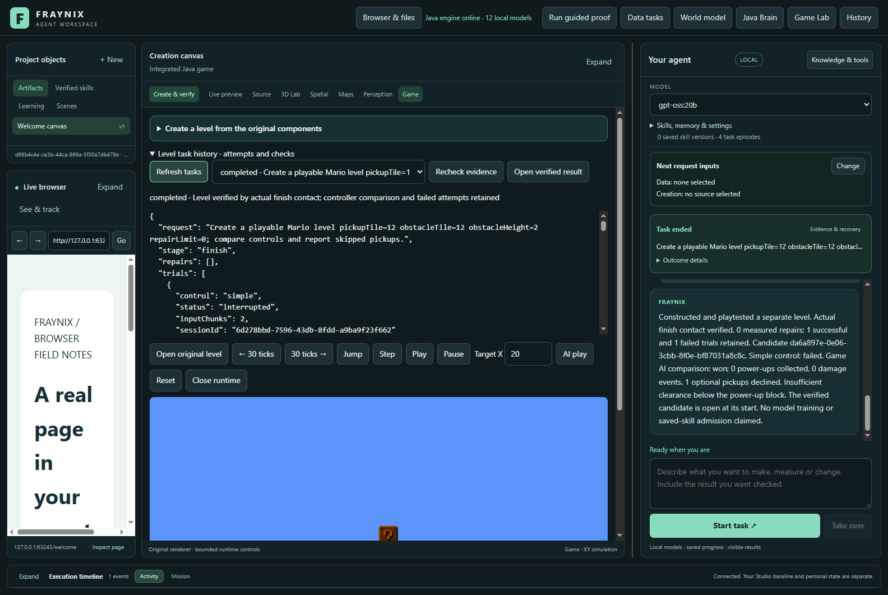

# Fraynix Agent Workspace — edition 118

## Enemies, obstacles, and knowing when to pass up a pickup

The Game Lab now constructs declared challenges using the original Goomba, Turtle, terrain and power-up components. The owned Java controller examines ground support, clearance, an obstructed approach and nearby enemy motion before pursuing an optional pickup. It uses ordinary direction and jump inputs; original physics still decides contact, damage and completion.

**Development comparison: risk118 finishes 12/12, safe117 finishes 9/12, simple gap-aware control finishes 2/12.** The new controller collects five power-ups, declines seven optional targets and records zero damage events on these twelve courses. The previous controller collects seven and records zero damage, but fails three courses. These are measured tradeoffs, not a universal safety claim. The original twenty-four courses still require all finishes, twenty-four pickups and zero damage. **The reserved result is worse for risk118 (4/6 versus 5/6); it is therefore not promoted as the general AI Play default.** General play and existing tasks retain safe117. Explicit challenge tasks use risk118, retain every failure, and require a real AI finish before completion.

[Previous edition117](README-117.md) · [Full phased plan](docs/PLAYABLE_LEVEL_CREATION_PLAN.md) · [Declared contract](docs/EDITION_118_CONTRACT.md) · [Offline interactive guide](docs/readmes/118/index.html) · [Validation](docs/readmes/118/verification.json)



## Use it in the existing app

1. Open **Game Lab → Create a level from the original components**.
2. Choose **Enemy and steps**, **Cramped power-up**, or **Pickup above a gap**.
3. Click **Prepare challenge request**, then **Start task** in chat.
4. Java constructs a separate candidate, runs a fresh simple-controller comparison, then runs the AI in another fresh session.
5. A challenge completes only when the AI actually reaches the flag. A simple-controller failure stays visible. Challenge geometry is not repaired to manufacture a successful result.
6. Read the summary for pickups, damage, and reasons for declining optional targets. Open **Level task history → Recheck evidence** to verify the retained trials and original images.
7. If interrupted, use **Mission → Resume**. Completed trials remain; the unfinished simulation restarts from its checked initial state in a new native session. The final review level opens at tick zero, separately from its recorded finish.

Example requests:

```text
Create a playable Mario level goombaTile=26 obstacleTile=24 obstacleHeight=2 repairLimit=0.
Create a playable Mario level pickupTile=12 obstacleTile=12 obstacleHeight=2.
Create a playable Mario level pickupTile=17 goombaTile=27 obstacleTile=24 obstacleHeight=2.
```

The presets prepare real requests; they do not replace playtesting with scripted outcomes. A request that merely asks for unspecified enemies is refused with the supported fields and examples, rather than silently omitting them.



### Construction fields and limits

| Field | Accepted values / meaning |
| --- | --- |
| `seed` | 0–9999; controls the original two gap positions |
| `lengthTiles` | 48–72 |
| `gapTiles`, `secondGapTiles` | 1–10; one tile is 0.25 original world units |
| `goombaTile`, `turtleTile` | 0 disables; otherwise 6 through length minus 8; original floor required |
| `obstacleTile`, `obstacleHeight` | Both zero, or a supported tile with height 1–3 original terrain cells |
| `pickupTile` | 0 preserves the original position; otherwise a declared tile. The original block height remains 1.375 |
| `repairLimit` | Challenge requests require 0. Existing non-challenge requests retain their 0–2 measured-gap repair allowance |

Initial enemy and obstacle bodies cannot overlap or start over a gap. The optional block may deliberately sit over a gap to test refusal. Candidates preserve original component behavior, assets and identity lineage. Every launch reconstructs and compares the declared scene. Manually changing a candidate and updating its hash still fails reconstruction verification.

Existing known-sprite PNG reconstruction remains available. This edition does **not** add image recognition for enemies, arbitrary pictures or new components. Reference-derived geometry cannot be combined with manual challenge fields. Unsupported images remain refused.

## Run the app

Use Java 21 and Node.js with the repository's existing dependencies:

```powershell
.\gradlew.bat prepareGameRuntime115 :workspace-engine:installDist
.\scripts\Start-Agent-Workspace.ps1
```

Use a separate saved project for evaluation. Preserve the existing private project and its Java owner when switching installations. The older `prepareGameRuntime115` task name prepares the current native game runtime and assets. It avoids recopying the entire historical documentation archive for each test.

New logic in this edition is owned Java. The project still uses its established JBox2D, LWJGL/OpenGL and desktop dependencies; this is not a claim of a dependency-free engine. No new model download, paid API or neural training is needed for these Java-routed tasks.

## What changed in the controller

The first risk prototype declined unsafe approaches but jumped too early when an approaching enemy was still distant. It fixed the obstructed pickups and regressed two previously successful encounters. Those trials are retained. The second prototype finished all twelve courses but took damage once.

The final controller times small-player enemy jumps using observed separation and relative closing speed, bounded to a 0.7–1.7-unit trigger distance. Powered-up players retain the existing behavior because their collision dimensions differ. Nearby threats are observed from actual native bodies, not inferred from a name in the prompt. Original enemy activation remains camera-dependent. Four reserved trial/enemy records show no movement of the distant turtle before the player dies; those are retained as stationary observations, not counted as moving enemies. Each enemy trial still contains an actually moving enemy.

Before an optional pursuit, ground rays and enemy observations check:

- Is there observed terrain below the approach?
- Is there enough clearance below the block?
- Does a structural obstacle block the approach?
- Does an enemy's bounded 0.75-second motion projection intersect it?

A declined opportunity is skipped for the current run. A separate bookkeeping check prevents an unrelated later item failure from being attributed to that declined block. It is **not** entered into persistent motor-failure learning. At most four candidates are assessed per tick; an unassessed candidate is not pursued when that budget is exhausted. At most sixteen decision details are retained, while the total counter remains explicit. The original edge, landing, collision, timeout and control-budget checks continue.



This is a conservative controller for declared game geometry. A ray or forecast can justify caution; only the real simulation can establish a finish. It does not prove general intelligence, real-world safety or a learned policy improvement. Requested body velocity can differ from actual displacement; contact normals and positions remain available in the traces.

## Architecture and verification


The new challenge gate requires a completed simple comparison **and an AI finish** without repairs. Existing recipes keep their original gate: a simple-controller finish plus a bounded AI comparison. Neither gate is replaced by a predicted success. Engine implementation, source scene, asset, candidate, session, input sequence, player identity, tick budget, repair lineage, final contact and image-hash checks remain. Old runtime proofs are refused when their engine identity changes.

```text
src/main/java/agent/
  GameInput.java             normal input controller and bounded decision log
  PickupObserver118.java    read-only native rays and moving enemy bodies
  PickupSafety118.java      support, clearance, obstruction and threat decisions
  EnemyApproach118.java     small-player jump timing
  GameThreat118.java        bounded native enemy observations
workspace-engine/src/main/java/fraymus/workspace/
  GameChallenge118.java     declared source-component construction
  GameTask115.java          durable ownership, recovery and completion gates
  GameSummary118.java       concise reports from verified outcomes
workspace-desktop/renderer/brain-game.js
  existing integrated Game Lab, challenge presets and visible decisions
```

See the complete [source inventory](docs/readmes/118/file-inventory.json), [system map](docs/readmes/118/system-map.json), and [Obsidian map](docs/obsidian/126-risk-aware-game-control.md).

## Measurements, including limitations

The twelve development and six reserved challenge layouts were declared before tuning. The policy was fixed before the reserved layouts ran. Reserved software rendering repeats those same six layouts; it is a portability check, not six additional unfamiliar cases. The previous twenty-four layouts are regressions, not new development cases.

| Partition | Controller | Finishes | Pickups | Damage | Deaths | Falls below course | Declined | Median trial time |
| --- | --- | --- | --- | --- | --- | --- | --- | --- |
| development | risk118 | 12/12 | 5 | 0 | 0 | 0 | 7 | 2.953 s |
| development | safe117 | 9/12 | 7 | 0 | 1 | 0 | 0 | 3.057 s |
| development | simple | 2/12 | n/a | n/a | 4 | 0 | n/a | 5.405 s |
| reserved | risk118 | 4/6 | 2 | 0 | 1 | 0 | 4 | 3.402 s |
| reserved | safe117 | 5/6 | 4 | 0 | 0 | 0 | 0 | 3.394 s |
| reserved | simple | 0/6 | n/a | n/a | 3 | 0 | n/a | 5.006 s |
| software-reserved | risk118 | 4/6 | 2 | 0 | 1 | 0 | 4 | 3.407 s |
| software-reserved | safe117 | 5/6 | 4 | 0 | 0 | 0 | 0 | 3.538 s |
| software-reserved | simple | 0/6 | n/a | n/a | 3 | 0 | n/a | 4.974 s |
| old-regression | risk118 | 12/12 | 12 | 0 | 0 | 0 | 0 | 3.037 s |
| old-regression | safe117 | 12/12 | 12 | 0 | 0 | 0 | 0 | 3.136 s |
| old-wider | risk118 | 6/6 | 6 | 0 | 0 | 0 | 0 | 2.989 s |
| old-wider | safe117 | 6/6 | 6 | 0 | 0 | 0 | 0 | 3.044 s |
| old-reserved | risk118 | 6/6 | 6 | 0 | 0 | 0 | 0 | 3.309 s |
| old-reserved | safe117 | 6/6 | 6 | 0 | 0 | 0 | 0 | 3.145 s |

Reserved hardware: risk118 finishes 4/6 with 0 damage events and 1 death; safe117 finishes 5/6. Software repeat: risk118 4/6 with 0 damage events. Retained new-controller failures: reserved-step-enemy, reserved-two-enemies.

Simple-control pickup and damage callbacks are not instrumented, so those values are **n/a**, rather than being reported as zero. Its actual death, fall and finish observations are still retained. AI collision counters come from the original callbacks. Trial time measures fresh native launch through the final observation, including communication and rendering. Decision time measures only the added risk checks. These single trials are scoped observations, not repeated performance benchmarks.

Across twelve development trials, the added risk checks ran 687 times and used 37.492 ms total; complete risk118 trials had median 2.953 s. These are separate scopes and must not be treated as whole-app speedups.



Complete visible chat requests include construction, native trials, checks, saving and reopening:

| Request | Wall time | Simple | AI | Repairs |
| --- | --- | --- | --- | --- |
| Existing two-gap repair | 64.358 s | won | won | 2 |
| Enemy and steps | 121.216 s | failed | won | 0 |
| Cramped pickup with abrupt restart | 119.843 s | failed | won | 0 |
| Unfinishable challenge | 19.694 s | failed | failed | 0 |

**154 distinct Java test methods and 165 desktop checks passed.** New checks cover invalid and overlapping placements, retained original component behavior, altered candidates, fresh-session recovery, refusal of an actual AI failure, and forged completion rejection. Prior source/asset/image/action checks remain. Six transformed known-sprite references and four unsupported references are tested per renderer. An actual desktop process interruption, visible Resume, task-history decisions and 1100-pixel app view are retained. The offline guide is checked at 1440 and 390 pixels.



[Validation](docs/readmes/118/verification.json) · [Measurements](docs/readmes/118/measurements.json) · [Actual UI records](docs/readmes/118/actual-ui.json) · [Exact original evidence](docs/readmes/118/original-evidence.json)

The first desktop walkthrough completed its tasks but exposed a blank live view after restart: it tried to open a runtime before the task owner was ready. The view now waits and attaches through read-only state/frame calls. The complete walkthrough was repeated with an assertion for a decoded visible frame and the actual skip reason. Ownership checks were not relaxed. [Original display gap](docs/readmes/118/first-recovery-display-gap.png).

The original baseline, both prototypes, failed test-import compilation, final measurements and native trial files are archived with compressed and raw SHA-256 hashes. Private projects, credentials, model weights and Java/Mesa binaries are excluded. CI was checked first; the prior edition's jobs were still running. Local checks and fetched publication do not establish remote CI success; the publication receipt reports it separately.

## Expectations and next steps

This advances the unified local agent by connecting observations, optional goals, actions, physical outcomes, explanations and durable recovery inside the existing app. It broadens one bounded game task, while leaving the world model, browser, canvas, data workflows, persistent memory and Java coordination intact.

1. **Next119: recover the measured gap-to-step stall.** Reserved seed8 reaches an obstacle around X5.885/Y0.870 after a four-tile gap and stops making progress. Both controllers fail. The separate reserved seed23 two-enemy course kills the new controller after it declines a pickup, while safe117 finishes. Investigate that regression as well. Use contact normals and actual displacement to detect the lodged state, then test bounded back-off/jump alternatives without changing geometry. Keep these results frozen; use new reserved cases for the next change.
2. **Fresh observations and broader challenge coverage.** Reconsider a deferred pickup only after a moving threat leaves, with a retry budget and measured benefit over permanent skipping. Vary enemy motion, multiple obstacles, high/low passages and conflicting safe landing options. Hold out cases and measure collection, damage, failure and total work. Already-wedged recovery remains a distinct problem.
3. **Explicit image components.** Add only declared enemy/obstacle visual support, unknown-region review and false-accept/refusal tests before claiming broader reconstruction.
4. **Procedure lifecycle.** Preserve provenance while retiring/reactivating and qualifying reusable level procedures. No level procedure is admitted to the existing 32-slot bank by this release; the 24-task history and three-restart limits remain.
5. **Cross-domain continuity.** Transfer verified procedure structure to manipulation and creation only after fresh source/outcome checks in those domains. The game result alone is not proof of real-world capability.

The LLM can request and explain; Java owns execution and evidence. These four tested chat requests make zero model calls. This edition improves hand-written control; it does not silently claim model self-training, consciousness or universal playability.
