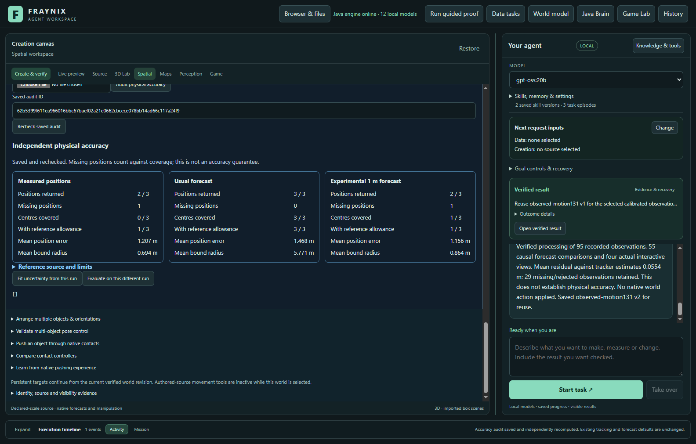
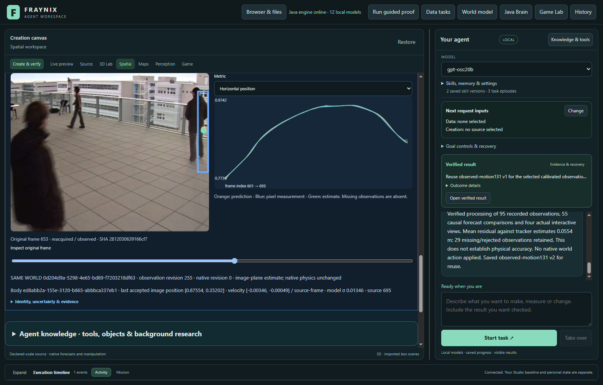
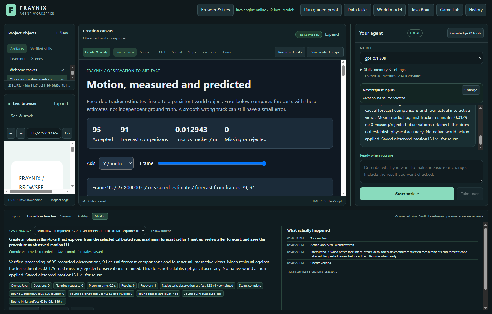

# Fraynix Agent Workspace — Edition 131

**Collapsed tracking boxes are withheld safely. An explicit Java candidate renews features and attempts bounded, two-image recovery. Existing tracking and forecasting defaults stay intact.**

2026-11-12 · Local Java agent · Persistent world, browser, creation and observation

[Previous edition](README-130.md) · [All editions](docs/readmes/INDEX.md) · [Illustrated offline guide](docs/readmes/131/index.html) · [Acceptance contract](docs/EDITION_131_CONTRACT.md) · [Locked experiment](docs/OBSERVATION_131_LOCK.json)

This is an actual application screenshot from the recorded public footage study. It is not a new webcam recording. The table below reports the entire comparison, including missing observations.

## What this application is becoming

Fraynix joins **observe → choose → act → verify → retain → evaluate reuse** in one local workspace. Java owns continuing worlds, tasks, typed actions, memory, procedure evidence, recovery and interpretation of observations. Chat, browser, the creation canvas, Game Lab and 3D physics are connected working surfaces. The system can construct and test proposals in its own world, create working artifacts from observed data, and retain successful procedures with their original evidence.

The current goal is useful continuity with independently checked outcomes. Neural computation, simulated success, smooth tracking and narrow prediction intervals do not by themselves prove reliable physical understanding. This edition improves the perception boundary while preserving the integrated application. It does not claim consciousness, unrestricted intelligence, semantic person identification or native hardware actuation.

## What changed

**A real collapsed-box fault is fixed at its source.** A legal coarse appearance box could shrink below the minimum during local refinement. Flow trackers could also produce boxes too small for downstream consumers. The consumers correctly refused them, but the inconsistent producer contract aborted an entire run. Refinement now respects the minimum. Every affected tracker emits a current box only if its actual serialized endpoints satisfy the existing finite, normalized, minimum-extent checks. Invalid candidates are withheld; no fake expansion or coordinates are introduced. The strict parser and observation filter remain unchanged. Flow evidence includes invalid-box rejection.

**Lost feature support has an explicit experimental repair.** The old object-feature tracker accepted eight inliers but only replenished twelve or more. Accepted tracks with eight to eleven features could therefore exhaust themselves. The new `renewing-flow-131` candidate replenishes from eight supported features, retains seed/context colour evidence, and keeps the forward/backward and patch checks.

When normal flow fails, it can try at most 24 appearance searches per run. A proposal requires a strong match and bounded movement/size. It remains unmeasured until another image supplies at least eight consistent motion inliers and overlaps the proposal. Duplicate ambiguity and unsupported observations are withheld. The budget does not guarantee recovery after arbitrary motion, occlusion, deformation or identity confusion. This is handcrafted Java processing; it adds no runtime package or model dependency.

Choose **Experimental131 · feature renewal & bounded recovery** explicitly for a new recorded run. `legacy-flow` stays the default. Ordinary adjacent-point forecasting stays the default. Earlier experimental choices remain available; implementation identity changes require fresh runs rather than relabelling historical evidence.

## Development evidence

The already exposed edition130 confirmation windows were used for diagnosis. Patched default flow now completes the previously crashing 2400 window and returns all three scored references, with mean accepted error about 1.037 m. Completion is a software fix, not a claim of precise physical measurement. Feature renewal keeps the exposed 4600 sequence tracked for all 95 updates instead of losing it after its initial update. Other difficult losses remain. The later 4800 sequence approaches the image edge; no out-of-camera position is invented.

The first two-image test used an appearance match below the threshold and was correctly refused. Its failure and diagnostic sweep are retained. A supported large return demonstrates actual two-image confirmation; weak matches, full disappearance and duplicates remain refusals. The threshold was not relaxed to satisfy that test. These are generated engineering cases using a public photograph, not physical validation. The bounded fallback did not improve reference availability in the five exposed development windows; that negative result remains in the archive.

## Fresh camera comparison

Before opening new pixels, production, preparation and study sources were committed and hashed. Five fixed 96-frame windows at 600, 1600, 2600, 3600 and 4600 use **EPFL Terrace camera1**, not the previously used camera0. They show the same recorded event and people from another viewpoint: new pixels, **not independent trajectories or a new population**.

The first eligible fully in-frame ground-grid subject seeds the tracker, with declared 1750 mm height and 500 mm width assumptions. Later 250 mm-grid references are opened only after all predictions exist. No window is substituted, and no algorithm tuning follows the results. The original130 binary is also replayed separately; it is not silently rebuilt with the fixes.

| Method | Available / references | Within 1 m | Over 2 m | Mean accepted error / m |
| --- | ---: | ---: | ---: | ---: |
| original130-flow | 14 / 15 | 8 | 2 | 0.945 |
| flow | 14 / 15 | 8 | 2 | 0.945 |
| fixed | 2 / 15 | 2 | 0 | 0.434 |
| renewing-flow | 9 / 15 | 7 | 0 | 0.628 |

**The locked gate failed.** Candidate availability 9/15, default 14/15; within 1 m 7 versus 8. Checks: availability: False, meanError: True, withinOneMetre: False, severeErrors: True, allSeeds: True. Both defaults remain unchanged. This cohort does not resolve general physical accuracy. On the nine shared references, candidate mean error is 0.628 m versus 0.675 m for default; the lower overall accepted-only mean must not hide six missing positions. All 20 executions completed.

The locked gate requires at least incumbent availability, at least 15% lower mean accepted error, strictly more references within 1 m, no additional errors over 2 m, all seeds and complete executions. A lower error on fewer surviving measurements is not enough. The original130 binary is a diagnostic control; the candidate gate compares against patched default flow. Every missing reference remains in the denominator. Timing covers actual work and is reported separately from quality.

| Method | Complete process time, five runs / s | Tracking stage, completed runs / ms |
| --- | ---: | ---: |
| original130-flow | 8.764 | 7087.6 |
| flow | 9.172 | 7560.4 |
| fixed | 6.797 | 5235.6 |
| renewing-flow | 13.749 | 12049.8 |

These are one serial pass on this computer, not a stable speed benchmark. Full-process time includes startup, loading, tracking and scoring; tracking time covers only that stage.

| Tracker / policy | Available / references | Covered centres | With reference allowance | Mean radius / m |
| --- | ---: | ---: | ---: | ---: |
| original130-flow/measurement | 14 / 15 | 6 / 15 | 6 / 15 | 0.607 |
| original130-flow/legacy-adjacent | 14 / 15 | 13 / 15 | 13 / 15 | 1.832 |
| original130-flow/explicit-budget-1m | 12 / 15 | 5 / 15 | 6 / 15 | 0.709 |
| flow/measurement | 14 / 15 | 6 / 15 | 6 / 15 | 0.607 |
| flow/legacy-adjacent | 14 / 15 | 13 / 15 | 13 / 15 | 1.832 |
| flow/explicit-budget-1m | 12 / 15 | 5 / 15 | 6 / 15 | 0.709 |
| fixed/measurement | 2 / 15 | 1 / 15 | 2 / 15 | 0.668 |
| fixed/legacy-adjacent | 11 / 15 | 8 / 15 | 9 / 15 | 6.061 |
| fixed/explicit-budget-1m | 2 / 15 | 1 / 15 | 1 / 15 | 0.733 |
| renewing-flow/measurement | 9 / 15 | 5 / 15 | 7 / 15 | 0.515 |
| renewing-flow/legacy-adjacent | 10 / 15 | 10 / 15 | 10 / 15 | 2.712 |
| renewing-flow/explicit-budget-1m | 9 / 15 | 7 / 15 | 7 / 15 | 0.653 |

These uncalibrated engineering bounds are checked only at sparse later reference timestamps, not at every full 0.6-second future horizon. Reference allowance is shown separately and never widens the predicted radius. Assumed body geometry, association, ground-contact location, planar calibration, grid quantisation, camera movement and out-of-view targets remain limitations. Edition129's 28/30→16/30 coverage regression and edition130's failed promotion/provenance correction remain unchanged in their frozen records.

The app replay shows the recorded return at ordinal 53/source frame 653. It reuses the already evaluated pixels and is not an extra held test. Every one of the patched default estimates and reference scores matches the original130 binary on these five healthy windows.

## Try it

1. Start the prepared workspace using [Start-Agent-Workspace.ps1](scripts/Start-Agent-Workspace.ps1), Java21 and the existing desktop dependencies. See [setup and architecture](docs/ARCHITECTURE.md). This edition needs no new model or paid service.
2. In Spatial, select a persistent world and import timestamped footage. Confirm the seed rectangle and stable body binding. Leave **Existing flow tracker** selected, or explicitly choose Experimental131 for a comparison.
3. Run tracking. Inspect accepted measurements, missing intervals and motion evidence together. A last-known or predicted point is not a current measurement.
4. In Measured world, select the matching fixed-camera planar calibration and measure the completed run. Keep source clock, camera identity, scale and units intact.
5. Under Independent references, import JSON with a declared `source` and later `references` containing `ordinal` and `positionM: [x,y]`. Declare reference uncertainty separately. Audit physical accuracy and read missing counts, error and coverage together.
6. Prepare an observation-to-artifact chat request. Java retains the source and forecast, creates a working explorer, independently verifies the source cells and plotted output, then saves the procedure. The prepared experimental request includes an explicit radius limit; ordinary chat does not silently adopt it.
7. Copy the audit ID and recheck after restart. Reuse a saved procedure on fresh input, or inspect, retire and reactivate it after the original evidence passes again. Changed source bytes or incompatible proofs refuse.

## Verification and delivery

Local checks passed: 202 distinct Java test methods, 161 desktop checks, executable kernel harnesses, the actual agency regression, isolated offline preparation and package verification. The actual app verifies cold recovery, new-source reuse, original procedure evidence and immutable physical audits. No verification condition was weakened.

- held-600: original pixels tracked into the same body identity without native motion
- One visible chat request survives owned-Java termination at the forecast boundary, preserves identity and forecast, independently checks its real artifact and only then saves the procedure.
- held-2600: original pixels tracked into the same body identity without native motion
- Explicit experimental choice persists in the second source. Reuse retains the chosen 1m precision limit; every available forecast respects it and any wider forecast is withheld. This does not certify the measured positions.
- Working explorer has no document overflow at1100px app width; all rows remain in its scrollable table.
- Both completed requests reverified after reference-format refusal; original task identities, outcomes and timing052 unchanged.
- Supported reference-file import matches separately retained research scores, including the missing reference; original audit rechecks after abrupt Java termination and cold restart. No fit, metadata relaxation or default change.
- Saved observed-motion procedure retains original-evidence inspection, retirement refusal and checked reactivation.

An initial agency test started before this fresh checkout had its installed engine package and could not open its window. The original failure is retained. After isolated offline preparation/package, the same agency checks pass; no verification was removed.

The first reference-file import also refused research-only projected-image metadata. A supported export retained the original ground positions, and continuation reverified both completed tasks without rerunning or changing their clocks. The visual driver then selected the saved world and waited for the rendered frame; its earlier blank-context/stale-capture attempts are retained. Production checks were not relaxed.

The actual app uses already evaluated footage to test the interface and durable workflow; those runs are not additional held results. It performs a real chat request, an abrupt termination of its owned Java process, cold recovery of the same task, independently checked artifact creation, fresh-input reuse, procedure retirement/reactivation and a saved physical audit rechecked after another restart. Observation and audit do not move the native verified world. Screenshots are captured from the app at normal and expanded widths.

[Validation](docs/readmes/131/verification.json) · [App checks](docs/readmes/131/observation-study.json) · [Comparison](docs/readmes/131/decision.json) · [Coverage](docs/readmes/131/coverage.json) · [Original evidence](docs/readmes/131/original-evidence.json) · [Source inventory](docs/readmes/131/file-inventory.json)

CI was checked before changes and remains a separate status from local tests. Pending hosted runs are never counted as passes. Publication is only claimed after main, edition131 and its annotated tag are actually pushed and fetched, with source and evidence hashes checked. Private projects, raw video/frame packs, browser profiles and dependency junctions are excluded. Limited public footage screenshots are attributed to [EPFL CVLab POM](https://www.epfl.ch/labs/cvlab/data/data-pom-index-php/); original research-use media stays local.

## Next steps

1. Use the new-view results to distinguish association drift, contact-anchor error and legitimate out-of-view loss. Reserve genuinely independent recorded trajectories before revising a tracker again.
2. Add independent occlusion/identity labels and measure false reacquisition as well as regained availability. Appearance and motion agreement alone cannot certify identity.
3. Fit anchor/association uncertainty on separate training data, then evaluate useful width and coverage at fixed future horizons. Do not tighten bounds merely for appearance.
4. Connect supported physical tolerances to Java goals: request another observation or refuse an action when evidence cannot support it. Then return to the unified daily-use mission/source/skills layout.

The destination stays one continuing local Java agent with measurable perception, useful creation and verified actions.
