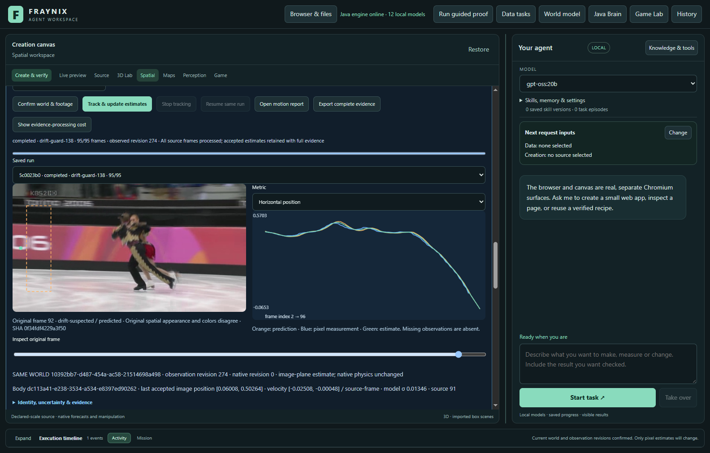
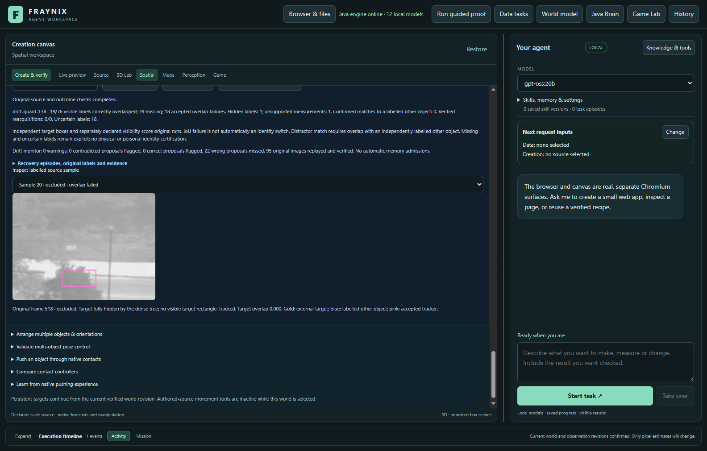
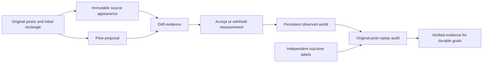

# Fraynix Agent Workspace — Edition 138

**Detect suspect motion before the tracker reports loss.** Fraynix is a local Java agent workspace connecting durable chat goals, observed and simulated worlds, browser interaction, creation tools, verified skills and retained evidence. This edition adds an optional appearance check to the observation path. It keeps the existing tracker as the default.

[Previous edition](README-137.md) · [All editions](docs/readmes/INDEX.md) · [Interactive offline guide](docs/readmes/138/index.html) · [Integrated roadmap](docs/INTEGRATED_AGENT_ROADMAP.md) · [Contributor handoff](README-CONTRIBUTORS.md)



## The problem and the change

An optical-flow tracker can follow locally consistent motion from background pixels or another object. A box may therefore be wrong while its status still says tracked. Waiting for complete loss misses that failure mode.

The explicit **drift-guard-138** candidate checks each proposed measurement against immutable initial pixels: color distribution, spatial appearance, foreground/background separation, scale and competing appearances. A suspect proposal is preserved in the trace but withheld from the observation filter. Its orange dashed outline remains inspectable in the actual app. The warning explains which evidence disagreed; it does not claim semantic recognition or calibrated confidence.

After suspicion or loss, a strong, unique match to the original source must agree across two consecutive images before recovery. The original appearance never changes. Neither accepted nor rejected target predictions can teach this anchor.

The **monitor-only-138** control computes the same warnings while leaving every incumbent tracker and filter output unchanged. The unchanged **legacy-flow** is the default and comparison baseline. Existing edition 137 verified-reference sets and earlier experimental methods remain available with their original verification requirements; this new guard uses its original seed, not an automatically growing appearance bank.

## Measured results

Fresh guard: **122/332 correct visible/partial observations**, versus **122/332** for the default. Accepted wrong overlaps: **130 versus 132**. Missing observations: **80 versus 78**. Confirmed labelled-other matches: **0 versus 0**. Hidden outputs: **1/1 versus 1/1**. These measured tradeoffs do not qualify a default promotion; the candidate remains explicit.

| Method / source | Correct / visible | Missing | Wrong overlaps | Other-object matches | Hidden outputs |
| --- | ---: | ---: | ---: | ---: | ---: |
| legacy-flow / skating2-1-1 | 26/93 | 3 | 64 | 0 | 0/0 |
| monitor-only-138 / skating2-1-1 | 26/93 | 3 | 64 | 0 | 0/0 |
| drift-guard-138 / skating2-1-1 | 26/93 | 5 | 62 | 0 | 0/0 |
| legacy-flow / skating2-2-1 | 45/95 | 0 | 50 | 0 | 0/0 |
| monitor-only-138 / skating2-2-1 | 45/95 | 0 | 50 | 0 | 0/0 |
| drift-guard-138 / skating2-2-1 | 45/95 | 0 | 50 | 0 | 0/0 |
| legacy-flow / suv-1-498 | 19/76 | 39 | 18 | 0 | 1/1 |
| monitor-only-138 / suv-1-498 | 19/76 | 39 | 18 | 0 | 1/1 |
| drift-guard-138 / suv-1-498 | 19/76 | 39 | 18 | 0 | 1/1 |
| legacy-flow / liquor-1-276 | 32/68 | 36 | 0 | 0 | 0/0 |
| monitor-only-138 / liquor-1-276 | 32/68 | 36 | 0 | 0 | 0/0 |
| drift-guard-138 / liquor-1-276 | 32/68 | 36 | 0 | 0 | 0/0 |


| Method / source | Useful warnings | False warnings | Missed wrong proposals |
| --- | ---: | ---: | ---: |
| monitor-only-138 / skating2-1-1 | 2 | 0 | 62 |
| drift-guard-138 / skating2-1-1 | 2 | 0 | 62 |
| monitor-only-138 / skating2-2-1 | 0 | 0 | 50 |
| drift-guard-138 / skating2-2-1 | 0 | 0 | 50 |
| monitor-only-138 / suv-1-498 | 0 | 0 | 22 |
| drift-guard-138 / suv-1-498 | 0 | 0 | 22 |
| monitor-only-138 / liquor-1-276 | 0 | 0 | 0 |
| drift-guard-138 / liquor-1-276 | 0 | 0 | 0 |

First wrong visible proposal / first warning (later-frame ordinals, monitor control): skating2-1-1 12 / 91; skating2-2-1 12 / None; suv-1-498 21 / None; liquor-1-276 None / None. This descriptive timing is not advance prediction of drift; warnings can arrive after an error already exists.


Warnings, withholding and useful tracking are different quantities. A useful warning flags an already wrong or hidden proposal. A false warning flags a correct visible proposal. Missing observations remain in the denominator; a guard that simply refuses every image does not earn an accuracy claim. A low target overlap alone is not proof of switching objects: a confirmed other-object match requires independent distractor geometry.

## What was tested

| Recording / target | Original frames | Stride | Visible or partial | Hidden | Uncertain | Distractor-labelled samples |
| --- | --- | ---: | ---: | ---: | ---: | ---: |
| Skating2 / 1 | 1–96 | 1 | 93 | 0 | 2 | 95 |
| Skating2 / 2 | 1–96 | 1 | 95 | 0 | 0 | 93 |
| Suv / 1 | 498–593 | 1 | 76 | 1 | 18 | 0 |
| Liquor / 1 | 276–486 | 3 | 68 | 0 | 2 | 10 |


These are original public [Visual Tracker Benchmark recordings](https://rvlab.snu.ac.kr/research/tracker_benchmark), not rendered camera substitutes. Tracking and scoring code were frozen before opening the new recordings. Source-only inspection fixed all windows and labels before predictions. The two skaters share a recording; they do not constitute two independent videos.

Skating2 tests overlapping people with different clothing. Liquor tests similar-shaped bottles with different labels. The separate synthetic control contains identical twins. These are different difficulty levels and should not be conflated. The first 96 Skating2 images were retained as a crossing/partial-cover test through the source-only clarification in [the source note](docs/EDITION_138_SOURCE_NOTE.md). No outcome-driven source replacement or threshold tuning occurred.

Original benchmark target boxes and reciprocal skater boxes are independent of Fraynix tracking. Visibility is source-only AI review, without independent human adjudication. Two bottle distractors have coarse manually reviewed AI boxes on 10 later sampled images, about 5 source pixels allowance; other bottle frames lack independent distractor boxes. Zero confirmed matches on those unlabelled frames cannot prove switch-free tracking. Suv has one confidently fully hidden sample; ambiguous tree-covered images remain uncertain. Liquor uses stride 3 because its first cap-cover/return interval exceeds 96 original images; intervening images are not scored.



### Previously exposed development footage

Tiger2 and Box windows already used in edition 137 were development controls, not fresh evaluation. On Tiger2, the guard retained 25 correct observations and withheld 70 wrong overlaps. On Box, 75 correct and 20 wrong overlaps remained unchanged. Across these 190 visible samples the number of correct observations stayed 100; wrong accepted overlaps fell 90→20, with 70 additional missing measurements. The monitor control preserved all 190 incumbent tracker/filter outputs exactly. These results motivated testing; they are not a substitute for the fresh comparison above.

## Verification and recovery

Local checks passed: 293 distinct Java tests, 161 desktop checks, kernel integration, actual agency regression and isolated offline/package preparation. Twelve actual-app fresh comparisons use 1065 later-frame outcomes. Exact monitor equivalence, original-pixel audit replay, independent host arithmetic, export, stop/resume and abrupt-process cold restart are verified.

- Twelve actual-app fresh comparisons: four fixed target windows, three methods, identical source pixels. Independent host overlap/distractor/warning arithmetic agrees with Java. Monitor-only preserves every incumbent tracker/filter output. No automatic anchor admissions; defaults unchanged.
- Explicit method selection, warning explanation, original-proposal overlay, independent audit UI, complete bounded export and exact stopped-prefix resume passed. Native physical world unchanged.
- Owned-process crash and cold reopen preserve exact completed-state bytes/timestamp and zero observation writes. All12 runs/audits reverified, including original-pixel decision replay. Source modification refuses audit/export; original restoration revalidates.

The new audit replays the complete selected tracker from original image bytes and the original seed before scoring warning usefulness. Every recorded decision must match. Downstream independent labels then score both accepted and withheld proposals. Existing source-image hashes, dataset/run identities, current-code checks, observation histories, world bindings and outcome checks remain in place. Changed sources or altered decision traces are refused. Reopening a completed history still performs no rewrite; active interrupted work still requires explicit resume.

No default change, automatic memory admission, physical actuation, model-weight training, person recognition, new runtime library or capacity increase is introduced. Current run limits and the desktop’s 20 MB export bound remain unchanged. An export must contain its complete evidence within the existing limit; evidence is not discarded to fit it.

## Complete workflow costs

| Actual task | Tracking / ms | Audit with replay / ms |
| --- | ---: | ---: |
| legacy-flow / skating2-1-1 | 7678.1 | 225.2 |
| monitor-only-138 / skating2-1-1 | 14524.9 | 3603.7 |
| drift-guard-138 / skating2-1-1 | 23485.8 | 3452.8 |
| legacy-flow / skating2-2-1 | 28206.4 | 211.9 |
| monitor-only-138 / skating2-2-1 | 36161.3 | 2771.3 |
| drift-guard-138 / skating2-2-1 | 44860.3 | 2702.5 |
| legacy-flow / suv-1-498 | 54433.3 | 203.7 |
| monitor-only-138 / suv-1-498 | 64227.6 | 13912.1 |
| drift-guard-138 / suv-1-498 | 69419.1 | 13736.4 |
| legacy-flow / liquor-1-276 | 52337.4 | 237.0 |
| monitor-only-138 / liquor-1-276 | 57461.4 | 9866.1 |
| drift-guard-138 / liquor-1-276 | 59313.0 | 10006.5 |


These timings include real durable processing and a separate audit stage. Audits for edition 138 replay original pixels, so their verification cost is real and explicitly reported. Tasks differ in content, retained history and method; the table is not a controlled claim of constant-time scaling or live camera speed. Edition137's earlier persistence improvements remain in place. This study runs in an isolated J: checkout; its timings must not be presented as a same-drive speed comparison with earlier D:/S: studies.

## Review the app

Use JDK 21 and the existing desktop dependencies. From the checkout, open a separate review project:

```powershell
$env:FRAYNIX_WORKSPACE_PROJECT = Join-Path $env:LOCALAPPDATA 'Fraynix-Review-138'
.\scripts\Start-Agent-Workspace.ps1
```

After dependencies have been prepared, add `-Offline` to require local caches. Preserve your existing project path and stop its Java owner through its app before rebuilding that owner's installation.

1. Open **Spatial → Real footage · observed world**. Select a saved world, import footage and define the initial object rectangle.
2. Leave **Existing flow tracker** selected for the baseline. Confirm world and footage, then start tracking.
3. Explicitly choose **Experimental138 · detect drift before loss** for the candidate, or **Control138 · monitor without changing flow** for comparison.
4. Inspect the frame and its explanation. Blue is an accepted tracker box; a dashed orange box is a withheld proposal. Prediction and filtered estimate remain separate. A withheld observation does not move the native physical world.
5. Import independently prepared identity/visibility labels under **Object identity · occlusion & recovery**. Run the audit and inspect useful warnings, false warnings, missed wrong proposals, hidden outputs and original source overlays.
6. Stop and resume the same run, reopen the project and recheck the retained audit. Source or code changes must refuse stale evidence rather than silently relabel it.
7. Export complete evidence within existing bounds. Keep the original project when a full export exceeds a limit.

## Architecture and the larger goal



Java owns observation processing, persistent state, decision validation, recovery and audit. The desktop presents the evidence and hosts interaction. The Game Lab, 3D world, browser, canvas and creation tools remain parts of one local system. Improving perception supports durable chat-driven tasks; it does not replace them with a standalone tracker demo.

## Next steps

1. Detect gradual foreground drift that preserves similar colors. Develop spatial-part and foreground/background motion checks against the now-exposed138 failures, freeze the candidate, then evaluate on genuinely new footage. This study removed only two wrong overlaps and added no correct observations; it does not justify broader autonomous use or a default change.
2. Collect independently reviewed complete occlusion/return and similar-object crossings. Keep uncertain visibility explicit, report missing observations, and measure warning delay, false alarms and correct recovery. One confidently hidden sample and sparse bottle distractor labels are insufficient for general recovery claims.
3. Profile complete tracking, persistence and original-pixel audit costs. Reuse only immutable, source-bound evidence where every source and outcome check remains intact. Then connect qualified observations and supported appearance memories back to durable Java world/browser/creation goals.


## Evidence, attempts and handoff

The first targeted-test attempt stopped at a compile-time test-variable typo; the unchanged test assertions passed after correction. Its original failure log is retained. Before fresh predictions, source-only review added Liquor for similar-shaped distractors and clarified Skating2 as a crossing/partial-cover test. Original evaluated CRLF annotation and method-lock bytes were explicitly preserved in Git before running the new footage. No thresholds, algorithm, scorer or defaults were tuned on fresh outcomes.

A prepublication README encoding check caught garbled punctuation introduced by a Windows-default text read. The owned documentation check was interrupted, the new template was repaired using explicit UTF-8, and documentation verification was rerun. Production, frozen tracking/scoring code, labels and completed app tests were unchanged.


Hosted CI is reported separately from local verification and fetched publication. Raw footage, source-image archives and private projects are not committed. Exact source hashes, original annotations, provenance, selected labels, run traces, failures, tests and limited attributed app screenshots are preserved.

[Validation](docs/readmes/138/verification.json) · [Original evidence](docs/readmes/138/original-evidence.json) · [Fresh comparison](docs/readmes/138/comparison.json) · [Source manifest](docs/publication138/source138.json) · [Method lock](docs/OBSERVATION_138_LOCK.json) · [Contract](docs/EDITION_138_CONTRACT.md)

[Immutable appearance](workspace-engine/src/main/java/fraymus/workspace/AppearanceEvidence138.java) · [Guard](workspace-engine/src/main/java/fraymus/workspace/DriftGuard138.java) · [Pixel replay audit](workspace-engine/src/main/java/fraymus/workspace/DriftAudit138.java) · [Actual-app test](workspace-desktop/test/drift138-integration.cjs) · [Source inventory](docs/readmes/138/file-inventory.json) · [Project memory](docs/PROJECT_MEMORY.md)

Preserve frozen editions, exact annotation bytes, original failed comparisons and private data. Do not promote a candidate, increase action authority or claim a publication without supporting measurements and a fetched Git audit. See [AGENTS.md](AGENTS.md).
