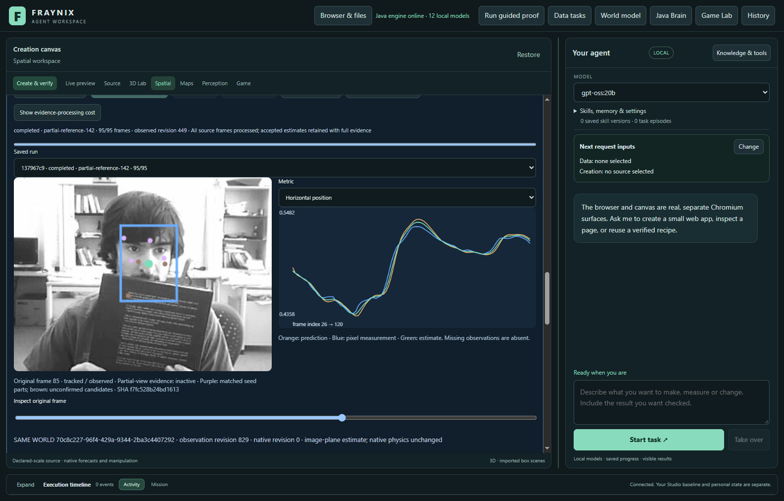
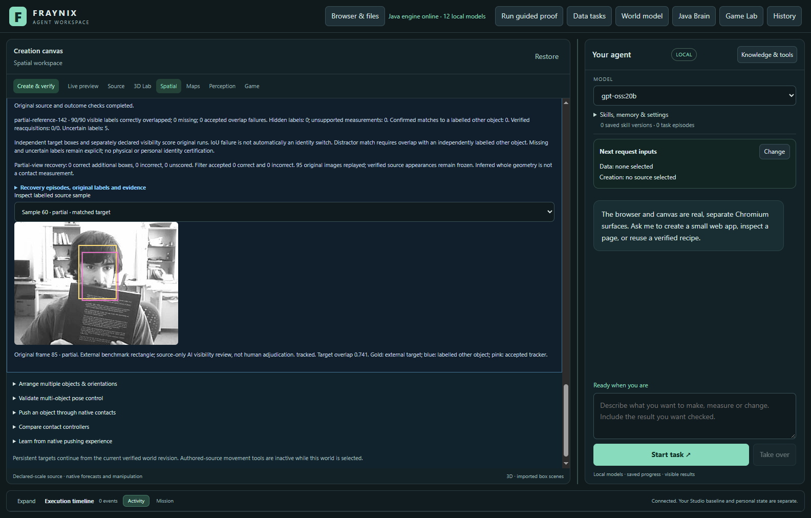
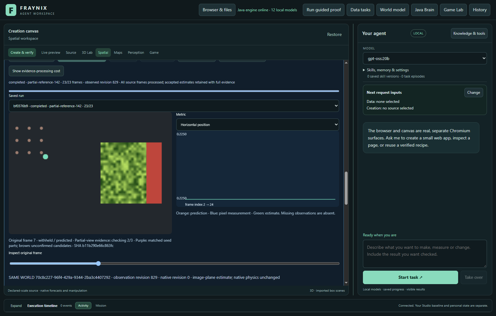
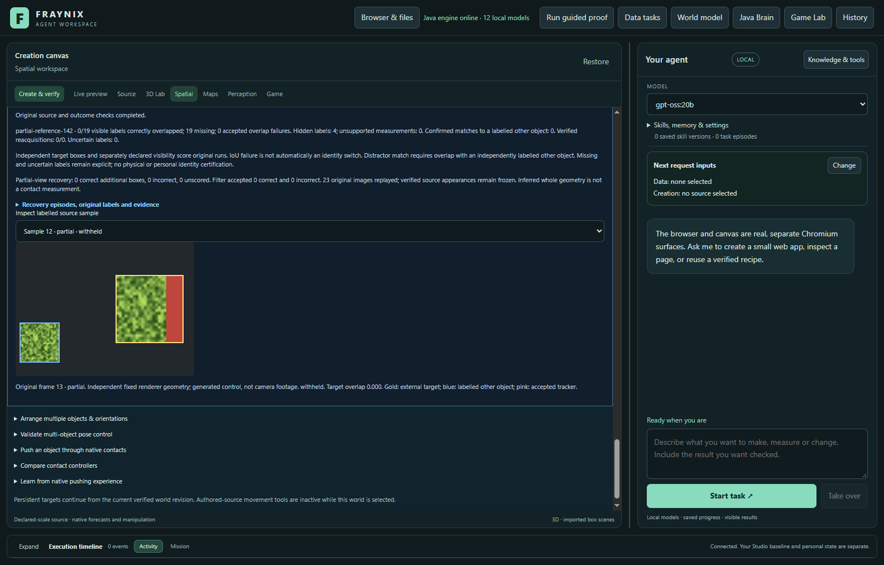

# Fraynix Agent Workspace — Edition 142

**Partial views from verified appearances.** Fraynix connects durable chat goals with a Java brain, simulation, observed worlds, browser interaction, data processing, creation tools and reusable verified procedures. This edition develops one perception mechanism within that connected application.

[Previous edition](README-141.md) · [All editions](docs/readmes/INDEX.md) · [Offline guide](docs/readmes/142/index.html) · [Integrated roadmap](docs/INTEGRATED_AGENT_ROADMAP.md) · [Contributor handoff](README-CONTRIBUTORS.md)

## What changed

The optional **partial-reference-142** method preserves every accepted proposal from foreground guard139. Only actual underlying flow loss enables supplemental recovery; warning-only withholding cannot bypass the guard. The baseline is never reset or retrained.

The Java search retains the immutable initial appearance and up to six independently verified full-view examples. The existing reference store rechecks donor images, annotations, tracker implementation and outcomes before reuse. Descriptors are rebuilt from independent reference rectangles. Partial, uncertain and incorrect donor observations remain excluded. Donor and evaluation datasets cannot share image bytes. An operator must declare why they show the same object; this is not semantic identity proof.

Each appearance is compared using its full region and four fixed masks retaining 75% of that region. Grayscale texture/correlation, RGB error, bounded scale/location search and competing-location rejection qualify a candidate. Three consecutive matches from the same appearance also need coherent adjacent-image optical flow. Missing, ambiguous or discontinuous evidence resets confirmation. The interface distinguishes matching **visible support** from **inferred whole-object geometry**. Neither establishes depth, metric scale or physical contact.

**partial-monitor-142** computes the same search but preserves guard139 tracker and filter outputs. **partial-seed-142** uses the same checked source bundle while disabling imported descriptors, measuring the value of references. Every additional raw box and filter-accepted result is scored separately. Earlier methods remain available; **legacy-flow remains the default**.

No evaluation prediction enters appearance memory. No new weights, external vision runtime, capacity increase, action authority or default change.

## Measured results

**Real footage:** candidate 185/185 correct, 0 missing, 0 wrong overlaps and 0 hidden outputs; guard139 185 correct, 0 missing, 0 wrong and 0 hidden outputs. Seed-only control: 185 correct, 0 wrong. Additional raw recoveries: 0 correct, 0 incorrect, 0 unscored. There are 0 confirmed absent and 5 uncertain reference samples per method. This real cohort does not establish a recovery gain without added errors.

**Generated controls:** candidate 0/38 correct, 0 wrong, 0 hidden outputs and 0 labelled-other matches. Guard139: 0 correct; seed-only: 0 correct. Additional raw boxes: {'returned': 0, 'correct': 0, 'incorrect': 0, 'unknown': 0}. Generated controls do not establish camera reliability. **Defaults remain unchanged; no promotion.**

| Method / source | Correct / visible | Missing | Wrong overlaps | Other-object matches | Hidden outputs |
| --- | ---: | ---: | ---: | ---: | ---: |
| real-camera / foreground-guard-139 / faceocc2-25 | 90/90 | 0 | 0 | 0 | 0/0 |
| real-camera / partial-monitor-142 / faceocc2-25 | 90/90 | 0 | 0 | 0 | 0/0 |
| real-camera / partial-seed-142 / faceocc2-25 | 90/90 | 0 | 0 | 0 | 0/0 |
| real-camera / partial-reference-142 / faceocc2-25 | 90/90 | 0 | 0 | 0 | 0/0 |
| real-camera / foreground-guard-139 / walking2-25 | 95/95 | 0 | 0 | 0 | 0/0 |
| real-camera / partial-monitor-142 / walking2-25 | 95/95 | 0 | 0 | 0 | 0/0 |
| real-camera / partial-seed-142 / walking2-25 | 95/95 | 0 | 0 | 0 | 0/0 |
| real-camera / partial-reference-142 / walking2-25 | 95/95 | 0 | 0 | 0 | 0/0 |
| generated-control / foreground-guard-139 / generated-partial | 0/19 | 19 | 0 | 0 | 0/4 |
| generated-control / partial-monitor-142 / generated-partial | 0/19 | 19 | 0 | 0 | 0/4 |
| generated-control / partial-seed-142 / generated-partial | 0/19 | 19 | 0 | 0 | 0/4 |
| generated-control / partial-reference-142 / generated-partial | 0/19 | 19 | 0 | 0 | 0/4 |
| generated-control / foreground-guard-139 / generated-twin | 0/19 | 19 | 0 | 0 | 0/4 |
| generated-control / partial-monitor-142 / generated-twin | 0/19 | 19 | 0 | 0 | 0/4 |
| generated-control / partial-seed-142 / generated-twin | 0/19 | 19 | 0 | 0 | 0/4 |
| generated-control / partial-reference-142 / generated-twin | 0/19 | 19 | 0 | 0 | 0/4 |
| generated-control / foreground-guard-139 / generated-covered | 0/0 | 0 | 0 | 0 | 0/23 |
| generated-control / partial-monitor-142 / generated-covered | 0/0 | 0 | 0 | 0 | 0/23 |
| generated-control / partial-seed-142 / generated-covered | 0/0 | 0 | 0 | 0 | 0/23 |
| generated-control / partial-reference-142 / generated-covered | 0/0 | 0 | 0 | 0 | 0/23 |

Real footage and generated controls are separate. Missing measurements remain in the denominator. Low target overlap is an inaccurate box, not automatically an identity switch. A confirmed other-object match requires a separately labelled competitor. Uncertain labels cannot establish success.

“Correct” means an accepted estimate has at least 0.5 intersection-over-union with the independent target rectangle. This is an image-box criterion, not precise geometry or real-world accuracy. A confirmed competitor match needs at least 0.5 overlap with its labelled box and less than 0.2 target overlap (or an independently absent target).

The fresh generated partial-return case exposes a limitation: strong unique matches alternate between verified reference keys, resetting the required three-frame confirmation. It produces no extra recovery. The positive development fixture still establishes an executable recovery path, but does not qualify this new condition. No criteria were relaxed after viewing this result.

| Source / method | Additional boxes: correct / incorrect / unknown | Filter accepted: correct / incorrect / unknown |
| --- | ---: | ---: |
| faceocc2-25 / partial-monitor-142 | 0 / 0 / 0 | 0 / 0 / 0 |
| faceocc2-25 / partial-seed-142 | 0 / 0 / 0 | 0 / 0 / 0 |
| faceocc2-25 / partial-reference-142 | 0 / 0 / 0 | 0 / 0 / 0 |
| walking2-25 / partial-monitor-142 | 0 / 0 / 0 | 0 / 0 / 0 |
| walking2-25 / partial-seed-142 | 0 / 0 / 0 | 0 / 0 / 0 |
| walking2-25 / partial-reference-142 | 0 / 0 / 0 | 0 / 0 / 0 |
| generated-partial / partial-monitor-142 | 0 / 0 / 0 | 0 / 0 / 0 |
| generated-partial / partial-seed-142 | 0 / 0 / 0 | 0 / 0 / 0 |
| generated-partial / partial-reference-142 | 0 / 0 / 0 | 0 / 0 / 0 |
| generated-twin / partial-monitor-142 | 0 / 0 / 0 | 0 / 0 / 0 |
| generated-twin / partial-seed-142 | 0 / 0 / 0 | 0 / 0 / 0 |
| generated-twin / partial-reference-142 | 0 / 0 / 0 | 0 / 0 / 0 |
| generated-covered / partial-monitor-142 | 0 / 0 / 0 | 0 / 0 / 0 |
| generated-covered / partial-seed-142 | 0 / 0 / 0 | 0 / 0 / 0 |
| generated-covered / partial-reference-142 | 0 / 0 / 0 | 0 / 0 / 0 |

Additional raw boxes include measurements the filter later refuses. Supplemental measurements can influence later filter estimates; preserving baseline tracker proposals does not imply identical candidate filter history. The monitor must preserve both.

## Sources and experimental design

All 240 selected original images were reviewed before predictions on ten numbered contact sheets. Twelve full-resolution images checked: FaceOcc2 77–80 and 88–91; Walking2 26,60,96,120. FaceOcc2: the face remains visible, with a book covering its lower portion during81–89; small boundary contact77–80 and90 is uncertain. No full disappearance occurs in the fixed120-image source interval. Walking2: the foreground target remains unobstructed while receding in a corridor with other people. Two independently source-marked competitor rectangles are supplied at four evaluation frames26,60,96,120 only; no interpolation, exhaustive distractor labelling or named-person identity claim. Source rectangles come from OTB; visibility and competitor rectangles are separate AI source-only review, not independent human adjudication. Generated controls supply separate exact occlusion/copy geometry. No complete-camera-occlusion qualification or source replacement is claimed.

| Recording / target | Original frames | Stride | Visible or partial | Hidden | Uncertain | Distractor-labelled samples |
| --- | --- | ---: | ---: | ---: | ---: | ---: |
| real-camera / reference-source / faceocc2-1 | 1–24 | 1 | 23 | 0 | 0 | 0 |
| real-camera / evaluation / faceocc2-25 | 25–120 | 1 | 90 | 0 | 5 | 0 |
| real-camera / reference-source / walking2-1 | 1–24 | 1 | 23 | 0 | 0 | 0 |
| real-camera / evaluation / walking2-25 | 25–120 | 1 | 95 | 0 | 0 | 4 |
| generated-control / reference-source / generated-reference | 1–24 | 1 | 23 | 0 | 0 | 0 |
| generated-control / evaluation / generated-partial | 1–24 | 1 | 19 | 4 | 0 | 0 |
| generated-control / evaluation / generated-twin | 1–24 | 1 | 19 | 4 | 0 | 19 |
| generated-control / evaluation / generated-covered | 1–24 | 1 | 0 | 23 | 0 | 0 |

[OTB source: SNU Robot Vision Lab](https://rvlab.snu.ac.kr/research/tracker_benchmark/). FaceOcc2 and Walking2 were fixed before source access. Frames 1–24 supply separate reference windows; frames 25–120 are the fixed real-footage evaluation windows. Original JPEGs and annotation bytes are unchanged; archive digests and ZIP integrity checks are retained. External benchmark geometry and AI source-only visibility/competitor labels are attributed separately. No independent human adjudication is claimed.

The image-freshness check compares exact JPEG hashes with earlier source and label manifests. Its `frames` counts are distinct hashes, so repeated identical JPEGs count once there; the tracking tables retain every frame. This check does not detect differently encoded copies.

Generated tests use new fixed textures, renderer-derived rectangles, full covers and a competing copy. They use the same donor audit, retention, durable tracking and outcome checks as footage. They establish controlled software behavior, not general camera reliability.

Implementation, thresholds, source selection, scorer and app harness were frozen before new annotations/pixels. Labels were committed before evaluation. No tuning on fresh outcomes. Bounded windows are not a complete benchmark. Severe occlusion, arbitrary pose change, off-image whole geometry, identity ambiguity and physical accuracy remain limitations.

Illustrative frame 85 from the completed FaceOcc2 evaluation: the underlying tracker still has the target. This is not an extra recovery.

These generated controls are separate from the real camera results. Selected frames illustrate completed evidence; the full tables include every scored frame.

## Verification and recovery

Local checks passed: 333 distinct Java tests, 161 desktop checks, kernel integration, actual agency regression and isolated offline/package preparation. Three separate donor runs and 20 evaluation runs use 1036 evaluation-frame outcomes; donor outcomes are counted separately. Exact monitor equivalence, original-pixel audit replay, independent host arithmetic, export, stop/resume and abrupt-process cold restart are verified.

- Separate verified donor runs precede all fixed evaluation windows, compared with four methods and identical pixels. Real footage and generated occlusion/copy controls are reported separately. Independent host overlap/distractor/supplemental-outcome arithmetic agrees with Java. Monitor preserves every139 tracker/filter output; candidate preserves every accepted139 tracker proposal. No automatic anchor admissions; defaults unchanged.
- Explicit method selection, recovery explanation, original-source overlay, independent audit UI, complete bounded export and exact stopped-prefix resume passed. Native physical world unchanged.
- Owned-process crash and cold reopen preserve exact completed-state bytes/timestamp and zero observation writes. All recorded runs/audits reverified, including original-pixel decision replay. Donor and evaluation source modification independently refuse audit/export; original restoration revalidates.

Focused checks exercise alternate partially covered appearance recovery, seed-only ablation, competing copies, absent texture, three-image confirmation, interrupted confirmation, warning-only refusal, monitor equivalence, invalid descriptors, contradictory outcome labels, forged trace refusal and donor-source tampering. Every candidate decision is replayed from original pixels before independent scoring.

The first focused attempt passed the search, recovery, monitor, interruption and durable-provenance cases, but its invalid-number test inserted NaN before the expected exception assertion. JSON correctly refused that insertion. The fixture was corrected to test both JSON non-finite refusal and changed/out-of-range descriptors. The second attempt passed all eight focused tests, including independent contradictory-label scoring and forged replay evidence. Both original reports are retained. No fresh footage or held texture outputs were viewed during this correction.

Hosted CI is separate from local validation and fetched publication. Historical receipts retain their original implementation identity.

## Processing costs

| Measured run phase | Tracking / ms | Audit with replay / ms |
| --- | ---: | ---: |
| real-camera / foreground-guard-139 / faceocc2-25 | 21616.3 | 8977.5 |
| real-camera / partial-monitor-142 / faceocc2-25 | 39863.4 | 9448.5 |
| real-camera / partial-seed-142 / faceocc2-25 | 62265.3 | 9986.2 |
| real-camera / partial-reference-142 / faceocc2-25 | 90081.4 | 10233.0 |
| real-camera / foreground-guard-139 / walking2-25 | 98834.8 | 12992.1 |
| real-camera / partial-monitor-142 / walking2-25 | 119772.9 | 13581.1 |
| real-camera / partial-seed-142 / walking2-25 | 136747.7 | 14235.2 |
| real-camera / partial-reference-142 / walking2-25 | 161218.8 | 14266.7 |
| generated-control / foreground-guard-139 / generated-partial | 42590.7 | 6849.0 |
| generated-control / partial-monitor-142 / generated-partial | 53219.4 | 21771.8 |
| generated-control / partial-seed-142 / generated-partial | 49714.1 | 13868.1 |
| generated-control / partial-reference-142 / generated-partial | 55154.9 | 21670.3 |
| generated-control / foreground-guard-139 / generated-twin | 46377.3 | 6596.6 |
| generated-control / partial-monitor-142 / generated-twin | 54206.4 | 21810.0 |
| generated-control / partial-seed-142 / generated-twin | 52305.6 | 13977.0 |
| generated-control / partial-reference-142 / generated-twin | 56973.8 | 21736.6 |
| generated-control / foreground-guard-139 / generated-covered | 49489.8 | 5653.9 |
| generated-control / partial-monitor-142 / generated-covered | 55219.9 | 13707.6 |
| generated-control / partial-seed-142 / generated-covered | 54440.4 | 9992.1 |
| generated-control / partial-reference-142 / generated-covered | 57822.0 | 13470.0 |
| verified donor / faceocc2-1 | 1642.0 | 276.7 |
| verified donor / walking2-1 | 1988.4 | 281.6 |
| verified donor / generated-reference | 2811.4 | 193.6 |

The entire actual-app harness took 1917.8 seconds (32.0 minutes), including imports, UI inspection, repeated verified reads, export, captures, stop/resume, crash/reopen and tamper checks. The phase intervals above are subsets of this elapsed time, not additional costs to add to it. Regression/build/documentation work is separate.

| Source | Searches after loss | Qualified unique candidates | Highest recorded similarity | Max confirmations / adjacent reference switches | Position evaluations / descriptor-region comparisons |
| --- | ---: | ---: | ---: | ---: | ---: |
| faceocc2-25 | 0 | 0 | — | 0 / 0 | 0 / 0 |
| walking2-25 | 0 | 0 | — | 0 / 0 | 0 / 0 |
| generated-partial | 23 | 19 | 0.997 | 2 / 12 | 1,499,386 / 22,490,790 |
| generated-twin | 23 | 0 | 0.997 | 0 / 0 | 1,499,386 / 22,490,790 |
| generated-covered | 23 | 0 | -1.000 | 0 / 0 | 770,983 / 11,564,745 |

These are descriptive post-run diagnostics, not new qualification criteria. Similarity is not a probability. Recorded evaluations exclude repeated work from resume and audit replay.

Recorded search counts exclude repeated replay/restart work. Similarity is not probability. Future optimization must retain every source/outcome check and measure complete workflows.

Methods run in a fixed order while the evidence collection grows. These are elapsed workflow measurements, not an isolated or randomized speed comparison between algorithms. Later runs can pay for more accumulated state and repeated verification. No responsiveness improvement is claimed.

## Review in the app

1. Start with `scripts/Start-Agent-Workspace.ps1` using Java 21. `-PrepareOnly -Offline` checks local preparation. Keep private projects separate from evaluation projects.
2. Open **3D / World**, choose a saved world and import source footage. Import independent labels in **Object identity · occlusion & recovery**.
3. Audit a completed appearance-continuity run and retain its supported full-view appearances.
4. Import separate evaluation footage. Under **Verified reference appearances**, choose the set and explain the shared-object relationship.
5. Explicitly select the partial-view candidate or control, confirm the world/footage binding and start. Inspect visible support, inferred rectangle, independent audit and complete export.
6. Missing or changed evidence, source overlap, incompatible code and ambiguous matches must refuse or withhold. Keep these checks intact.

## Application direction

The goal remains a local agent that observes, plans, acts, verifies and retains useful procedures across interruption. Java owns durable goals, world state and verification. Browser, canvas, data and creation tools turn those goals into working artifacts. Perception improvements must earn their role through measured task outcomes.

# Next steps

1. **Maintain confirmation for verified reference hypotheses.** The new partial-return control finds strong unique matches, but alternating best reference keys reset confirmation at two frames. Test bounded per-reference continuity without treating a reference switch as identity proof or relaxing competitor rejection. This exposed cohort becomes development evidence; freeze the next change before new evaluation sources. Keep the original anchor and provenance, and never let predictions certify themselves.
2. **Expand independently labelled occlusion and lookalike evidence.** Include true disappearance, re-entry, moving covers and similar objects with separately reviewed target/competitor geometry. Do not treat generated controls or an unknown visibility boundary as camera-level success.
3. **Make useful references earn their processing cost.** Measure donor verification, search, persistence, repeated audit, restart and export together. Reuse exact source/code-bound computation only while preserving every check; compare complete tasks rather than a single matching call.
4. **Return qualified observations to durable goals.** World, browser and creation tasks must distinguish observed support, inferred geometry and unknown identity. Improved tracking should demonstrably improve a complete task before it becomes a default or authorizes an action.

## Evidence and implementation

[Verification](docs/readmes/142/verification.json) · [Actual app study](docs/readmes/142/app-study.json) · [Comparisons and timings](docs/readmes/142/comparison.json) · [Original evidence](docs/readmes/142/original-evidence.json) · [Source inventory](docs/readmes/142/file-inventory.json) · [Frozen protocol](docs/EDITION_142_CONTRACT.md) · [Source review](docs/publication142/source142.json)

[Partial search](workspace-engine/src/main/java/fraymus/workspace/PartialSearch142.java) · [Recovery controller](workspace-engine/src/main/java/fraymus/workspace/PartialRecovery142.java) · [Pixel replay and scoring](workspace-engine/src/main/java/fraymus/workspace/PartialAudit142.java) · [Verified reference resolver](workspace-engine/src/main/java/fraymus/workspace/ReferenceMemory137.java). Earlier edition snapshots remain immutable.
