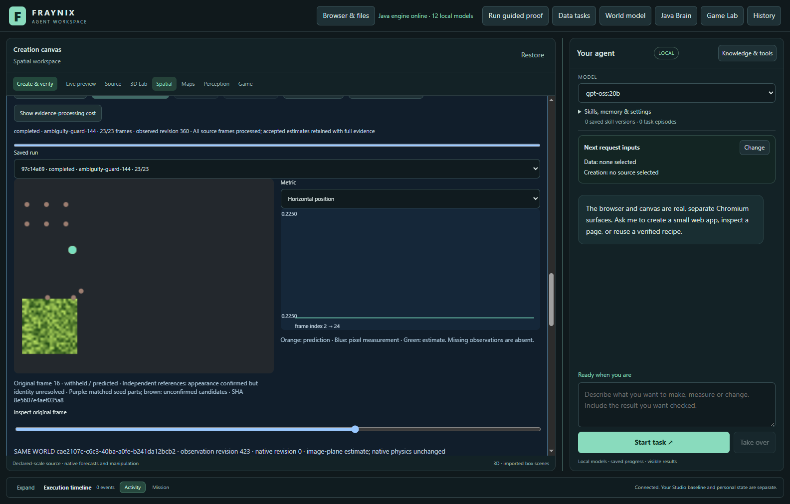
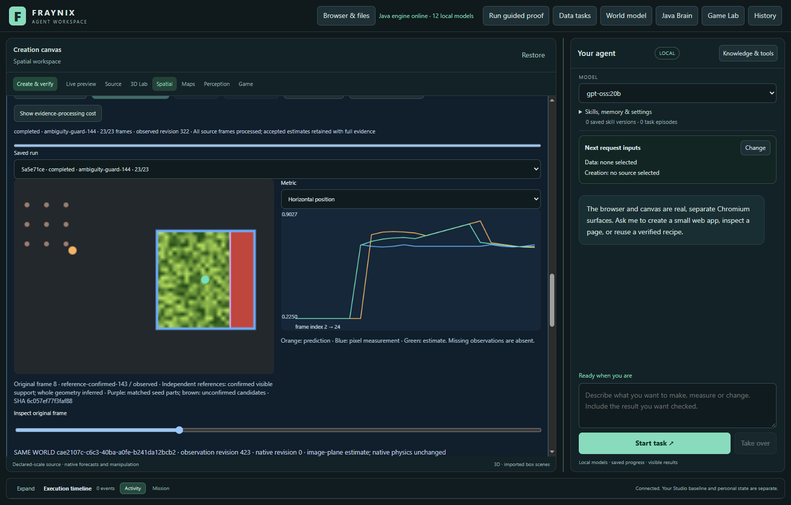
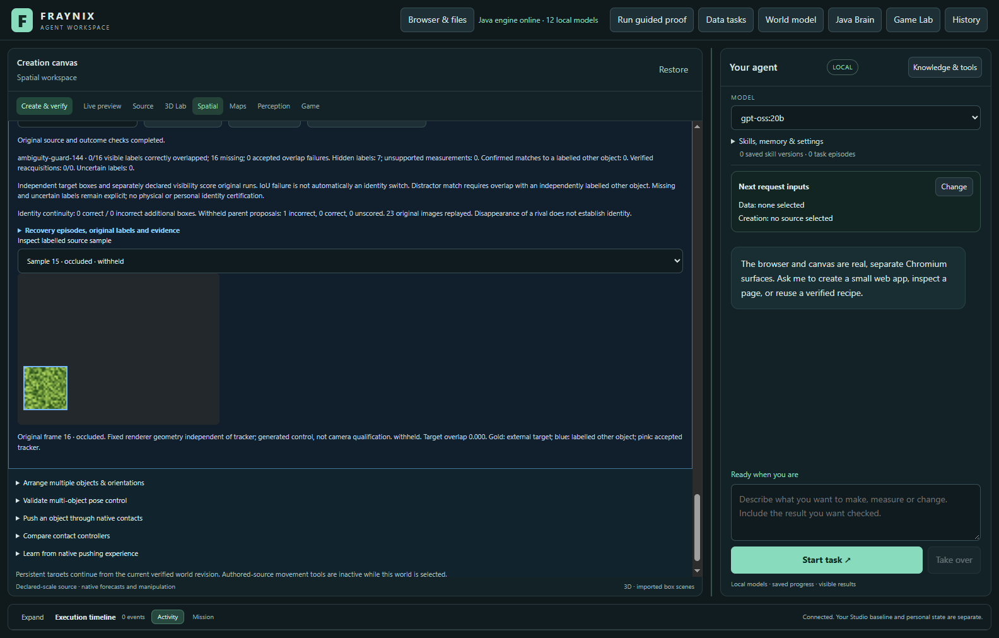
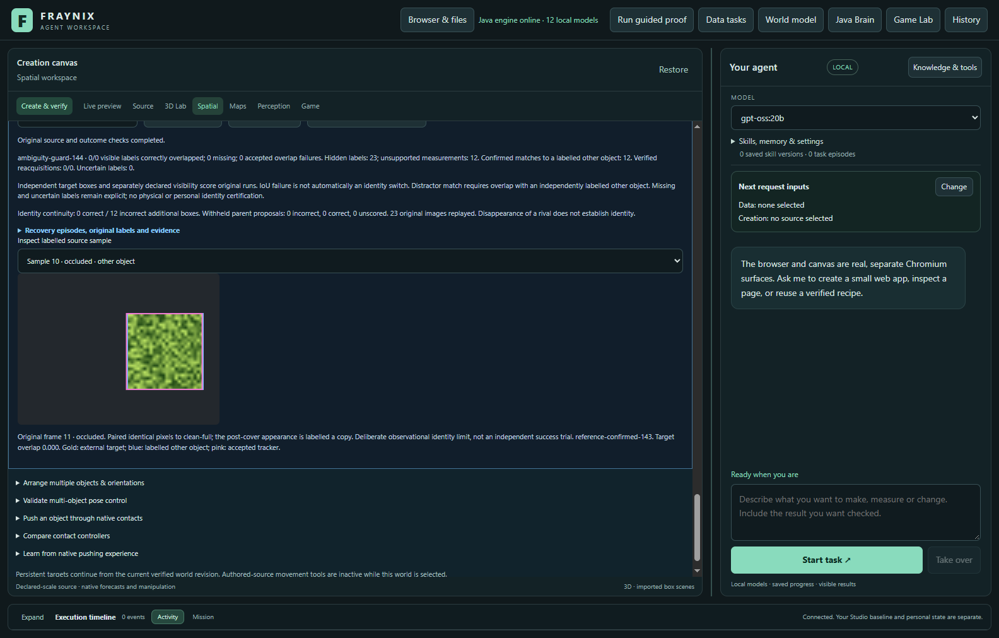

# Fraynix Agent Workspace — edition 144

**Remember competing objects through tracking loss.** A copy should not become confirmed merely because the object beside it disappears. Edition 144 adds an explicit Java ambiguity guard around the unchanged edition 143 confirmation engine, with source replay and independent outcome checks.

[Previous edition143](README-143.md) · [Offline interactive guide](docs/readmes/144/index.html) · [Edition history](docs/readmes/INDEX.md) · [Contributor handoff](README-CONTRIBUTORS.md) · [Architecture](docs/ARCHITECTURE.md) · [Integrated roadmap](docs/INTEGRATED_AGENT_ROADMAP.md)

This is a generated control viewed in the actual application. It is not camera qualification. Full outcomes below include every scored frame, including failures and missing measurements.

## What the application is

Fraynix is a local Java agent workspace connecting durable chat goals, a persistent physics world, Game Lab, browser observations, data processing and verified creation procedures. Java maintains execution state, source evidence, recovery and outcome checks; the desktop presents those capabilities. Local models choose and explain actions through bounded tools. The long-term aim remains one observable, persistent system that can create, test and improve useful procedures from measured outcomes.

Tracking contributes observations to that system; an appearance match does not establish semantic identity, depth, calibrated physical contact or consciousness. This edition does not expand action authority, invent training gains or replace the unified application with a tracking demo. Existing defaults, native world state, capacities and private projects stay intact.

## What changed

1. **Retain ambiguity during a loss episode.** When an existing 143 appearance hypothesis has a strong match and a comparably strong competing location, record that ambiguity. Keep it when the competing location disappears, the frame becomes empty or the strongest reference changes.
2. **Preserve existing confirmation.** Every immutable reference still earns its own three adjacent unique, motion-supported confirmations. Counts do not move between references. The original seed and up to six independently verified reference appearances are unchanged.
3. **Separate appearance from identity continuity.** While ambiguity is retained, guard 144 withholds supplemental143 boxes. It keeps the original hypotheses and confirmation records so the refusal is inspectable. No arbitrary timeout turns absence into proof.
4. **Restore through the existing baseline.** An accepted 139 baseline proposal clears the guard. Every accepted 139 proposal is preserved. This is inherited continuity, not new semantic identity certification; inherited baseline mistakes are outside this guard's guarantee.
5. **Measure the cost of refusing.** The audit independently scores blocked parent proposals as correct, incorrect or unknown. Blocking a correct return is reported as lost useful recovery, not counted as a success.

The explicit choices are `reference-confirmation-143` (comparison), `ambiguity-monitor-144` (same143 tracker/filter output plus diagnostics), and `ambiguity-guard-144` (withhold ambiguous supplemental returns). The default remains `legacy-flow`.

## Measured result

Known-copy control: previous143 accepted 1 measurements while the target was hidden; guard144 accepted 0. The guard blocked 1 independently contradicted parent proposals and 0 correct proposals on that case.

Clean partial/full returns: guard144 24 correct versus143 24. Legitimate return after earlier competition: 6 correct parent proposals withheld, 0 incorrect proposals withheld. This conservative cost is part of the result.

Established baseline return cleared ambiguity at samples [14]; later accepted supplemental returns at [21, 22, 23]. This sequence retained 5/19 correct observations, with 0 wrong overlaps and 0 hidden outputs.

Identical-pixel limit: 12 measurements while the target was hidden in unseen-copy, with 12 labelled-copy matches. These frames are exactly the clean-full pixels with a different declared identity; this is an observability limit, not an independent statistical trial. No claim of universal copy rejection.

Reused FaceOcc1 regression: 77/92 correct, 15 missing, 0 wrong overlaps, 0 hidden outputs. This source was exposed in143; it is not fresh camera qualification. Defaults remain unchanged and no method is promoted.

| Source / method | Correct / visible | Missing | Wrong overlaps | Hidden outputs | Other-object matches |
| --- | ---: | ---: | ---: | ---: | ---: |
| real-camera-regression / faceocc1-25 / reference-confirmation-143 | 77/92 | 15 | 0 | 0/0 | 0 |
| real-camera-regression / faceocc1-25 / ambiguity-monitor-144 | 77/92 | 15 | 0 | 0/0 | 0 |
| real-camera-regression / faceocc1-25 / ambiguity-guard-144 | 77/92 | 15 | 0 | 0/0 | 0 |
| generated-control / clean-partial / reference-confirmation-143 | 12/16 | 4 | 0 | 0/7 | 0 |
| generated-control / clean-partial / ambiguity-monitor-144 | 12/16 | 4 | 0 | 0/7 | 0 |
| generated-control / clean-partial / ambiguity-guard-144 | 12/16 | 4 | 0 | 0/7 | 0 |
| generated-control / clean-full / reference-confirmation-143 | 12/16 | 4 | 0 | 0/7 | 0 |
| generated-control / clean-full / ambiguity-monitor-144 | 12/16 | 4 | 0 | 0/7 | 0 |
| generated-control / clean-full / ambiguity-guard-144 | 12/16 | 4 | 0 | 0/7 | 0 |
| generated-control / copy-only / reference-confirmation-143 | 0/16 | 16 | 0 | 1/7 | 1 |
| generated-control / copy-only / ambiguity-monitor-144 | 0/16 | 16 | 0 | 1/7 | 1 |
| generated-control / copy-only / ambiguity-guard-144 | 0/16 | 16 | 0 | 0/7 | 0 |
| generated-control / legitimate-after-rival / reference-confirmation-143 | 6/16 | 10 | 0 | 0/7 | 0 |
| generated-control / legitimate-after-rival / ambiguity-monitor-144 | 6/16 | 10 | 0 | 0/7 | 0 |
| generated-control / legitimate-after-rival / ambiguity-guard-144 | 0/16 | 16 | 0 | 0/7 | 0 |
| generated-control / baseline-reset / reference-confirmation-143 | 5/19 | 14 | 0 | 0/4 | 0 |
| generated-control / baseline-reset / ambiguity-monitor-144 | 5/19 | 14 | 0 | 0/4 | 0 |
| generated-control / baseline-reset / ambiguity-guard-144 | 5/19 | 14 | 0 | 0/4 | 0 |
| identity-limit / unseen-copy / reference-confirmation-143 | 0/0 | 0 | 0 | 12/23 | 12 |
| identity-limit / unseen-copy / ambiguity-monitor-144 | 0/0 | 0 | 0 | 12/23 | 12 |
| identity-limit / unseen-copy / ambiguity-guard-144 | 0/0 | 0 | 0 | 12/23 | 12 |

“Correct” requires an accepted estimate and at least 0.5 overlap with the independently labelled visible target. Hidden outputs are accepted estimates when labels say the target is absent. Low overlap alone does not prove an identity switch; labelled competing objects are reported separately. Missing measurements remain in the denominator. Full [comparison](docs/readmes/144/comparison.json) and [app records](docs/readmes/144/app-study.json) retain each run.

## Recovery benefit and refusal cost

| Source / method | Additional correct / incorrect / unknown | Withheld correct / incorrect / unknown | Filter accepted correct / incorrect |
| --- | ---: | ---: | ---: |
| faceocc1-25 / reference-confirmation-143 | 0 / 0 / 0 | 0 / 0 / 0 | 0 / 0 |
| faceocc1-25 / ambiguity-monitor-144 | 0 / 0 / 0 | 0 / 0 / 0 | 0 / 0 |
| faceocc1-25 / ambiguity-guard-144 | 0 / 0 / 0 | 0 / 0 / 0 | 0 / 0 |
| clean-partial / reference-confirmation-143 | 12 / 0 / 0 | 0 / 0 / 0 | 12 / 0 |
| clean-partial / ambiguity-monitor-144 | 12 / 0 / 0 | 0 / 0 / 0 | 12 / 0 |
| clean-partial / ambiguity-guard-144 | 12 / 0 / 0 | 0 / 0 / 0 | 12 / 0 |
| clean-full / reference-confirmation-143 | 12 / 0 / 0 | 0 / 0 / 0 | 12 / 0 |
| clean-full / ambiguity-monitor-144 | 12 / 0 / 0 | 0 / 0 / 0 | 12 / 0 |
| clean-full / ambiguity-guard-144 | 12 / 0 / 0 | 0 / 0 / 0 | 12 / 0 |
| copy-only / reference-confirmation-143 | 0 / 1 / 0 | 0 / 0 / 0 | 0 / 1 |
| copy-only / ambiguity-monitor-144 | 0 / 1 / 0 | 0 / 0 / 0 | 0 / 1 |
| copy-only / ambiguity-guard-144 | 0 / 0 / 0 | 0 / 1 / 0 | 0 / 0 |
| legitimate-after-rival / reference-confirmation-143 | 6 / 0 / 0 | 0 / 0 / 0 | 6 / 0 |
| legitimate-after-rival / ambiguity-monitor-144 | 6 / 0 / 0 | 0 / 0 / 0 | 6 / 0 |
| legitimate-after-rival / ambiguity-guard-144 | 0 / 0 / 0 | 6 / 0 / 0 | 0 / 0 |
| baseline-reset / reference-confirmation-143 | 3 / 0 / 0 | 0 / 0 / 0 | 0 / 0 |
| baseline-reset / ambiguity-monitor-144 | 3 / 0 / 0 | 0 / 0 / 0 | 0 / 0 |
| baseline-reset / ambiguity-guard-144 | 3 / 0 / 0 | 0 / 0 / 0 | 0 / 0 |
| unseen-copy / reference-confirmation-143 | 0 / 12 / 0 | 0 / 0 / 0 | 0 / 12 |
| unseen-copy / ambiguity-monitor-144 | 0 / 12 / 0 | 0 / 0 / 0 | 0 / 12 |
| unseen-copy / ambiguity-guard-144 | 0 / 12 / 0 | 0 / 0 / 0 | 0 / 12 |

These are supplemental raw boxes and their downstream filter acceptance, separate from the final tracking totals. Candidate supplemental measurements can change later filter estimates. Monitor144 must match143's complete tracker/filter trace exactly. Source labels never guide the tracker or clear the guard.

The last control uses exactly the clean-full pixels but declares the post-cover appearance a previously unseen copy. Its two labels describe different hidden histories. A pixel-only observer receives the same evidence in both; successful appearance confirmation cannot distinguish them. This paired demonstration is excluded from any claim of independent statistical replication.

## Source design and freeze

Method, scorer, UI, fixture generator, source protocol and actual-app harness were frozen at `bd2f83f0` before fresh 144 generated pixels or labels. Development used the exposed 143 failure. The [contract](docs/EDITION_144_CONTRACT.md), [method lock](docs/OBSERVATION_144_LOCK.json) and [source manifest](docs/publication144/source144.json) retain the exact choices and hashes.

Before any evaluation predictions, the actual app rejected two newly inserted interface middle-dot characters encoded as single CP1252 bytes. Commit `c581f36f` converts only those two characters to valid UTF-8. The [encoding amendment](docs/publication144/ui-encoding144.json), original lock, original UI bytes and pre-amendment source manifest are retained. All tracking logic, thresholds, labels, source pixels and scoring remain unchanged. The source labels were committed at `58d78ef6` before evaluation.

| Source | Role | Domain | Frames | Visible/partial | Hidden | Uncertain |
| --- | --- | --- | ---: | ---: | ---: | ---: |
| faceocc1-1 | reference-source | real-camera-regression | 24 | 22 | 0 | 1 |
| faceocc1-25 | evaluation | real-camera-regression | 96 | 92 | 0 | 3 |
| generated-reference | reference-source | generated-control | 24 | 23 | 0 | 0 |
| clean-partial | evaluation | generated-control | 24 | 16 | 7 | 0 |
| clean-full | evaluation | generated-control | 24 | 16 | 7 | 0 |
| copy-only | evaluation | generated-control | 24 | 16 | 7 | 0 |
| legitimate-after-rival | evaluation | generated-control | 24 | 16 | 7 | 0 |
| baseline-reset | evaluation | generated-control | 24 | 19 | 4 | 0 |
| unseen-copy | evaluation | identity-limit | 24 | 0 | 23 | 0 |

FaceOcc1 is reused from edition 143, with the original benchmark rectangles and attributed source-only AI visibility review. Its144 labels explicitly declare prior exposure. It is a real-camera regression, not new footage or human-adjudicated qualification. Fresh generated controls use fixed renderer geometry and new textures; no outcome-driven source replacement or method tuning. The clean-full/unseen-copy pair intentionally shares evaluation pixels. Donor and evaluation image bytes remain separate, checked before every use.

Source reference: [OTB tracking benchmark](https://rvlab.snu.ac.kr/research/tracker_benchmark/). Original camera frames remain local; public documentation retains hashes, original annotations, provenance and illustrative app captures. No private webcam recording is published.

## Review it in the app

1. From this checkout, run `Launch-Agent-Workspace.bat` with the repository's Java21 and desktop prerequisites. The launcher prepares the Java runtime; isolated validation uses `scripts/Start-Agent-Workspace.ps1 -PrepareOnly -Offline`.
2. Use an isolated project for experiments; preserve your existing project's data. In the spatial workspace, open saved-world observations and import a frame pack.
3. Retain an appearance set from an independently labelled, successfully audited donor run. A run with no supported examples is refused; a correct track alone does not guarantee an admissible appearance.
4. Select separate evaluation footage and an explicit method. Choose the verified reference set and declare why it is the same object. The declaration is not identity proof.
5. Track and inspect the original frame, then open the independent outcome audit. A blocked parent confirmation is labelled “appearance confirmed but identity unresolved”; the audit reports correct and incorrect proposals withheld, with the retained ambiguity details in its evidence.
6. Export the complete evidence. Stop/resume or cold reopen uses retained state and verifies original source/code/outcome evidence; changed proofs are refused rather than relabelled.

The [offline guide](docs/readmes/144/index.html) lets you compare methods, inspect screenshots and follow source modules without launching a tracking job.

## Verification

350 distinct Java checks, 161 desktop checks, kernel integration, agency regression, offline preparation and package/build verification passed. Actual app: 23 comparison/donor runs plus one separately reported active-ambiguity interruption check; original source/outcome verification, replay, monitor equality, baseline preservation, stopped-prefix resume, abrupt restart, complete export and tamper refusal.

- Separate donor runs precede all fixed evaluation windows. Retention with zero eligible examples is refused and recorded; reference-dependent cases remain unavailable without replacement. Eligible cases compare three methods on identical pixels. Reused real footage, fresh generated cases and the paired identical-pixel identity limit are reported separately. Independent host overlap/distractor/supplemental-outcome arithmetic agrees with Java. Monitor preserves every143 tracker/filter output; candidate preserves every accepted139 tracker proposal. No automatic anchor admissions; defaults unchanged.
- Explicit method selection, recovery explanation, original-source overlay, independent audit UI, complete bounded export and exact stopped-prefix resume passed. Native physical world unchanged.
- Owned-process crash and cold reopen preserve exact completed-state bytes/timestamp and zero observation writes. All recorded runs/audits reverified, including original-pixel decision replay. Donor and evaluation source modification independently refuse audit/export; original restoration revalidates.
- Killed only the owned Java process while ambiguity was latched and the run was unfinished
- Cold reopen retained the exact committed prefix and interrupted status
- Resume reconstructed the ambiguity state from original pixels before continuing
- Complete trace and independent outcome audit exactly match the uninterrupted run
- Native world unchanged; 24th observation run uses the existing capacity without expansion

Seven focused development tests cover the published copy-only failure, clean recovery preservation, exact monitor/filter equivalence, deterministic replay, persistent ambiguity/no timeout, baseline clearing, warning-only behavior, independent refusal-cost scoring, forged-decision rejection and source tampering. They passed on the first test run. Broader historical regressions keep durable goals, skills, browser outcomes, creation and observation checks in scope.

The [supplemental interruption protocol](docs/EDITION_144_RESTART_CHECK.md) uses the 24th run slot after the fixed comparison, on its exposed copy-only source. It kills only the owned Java process while ambiguity is retained, cold-reopens the interrupted run, resumes from original pixels and compares the full trace/audit with the uninterrupted execution. Its [receipt](docs/readmes/144/restart-check.json) is separate from fresh-case results. [Diagnostics](docs/readmes/144/diagnostics.json) also compare the identical-pixel pair after excluding only their different target-provenance digest; every original digest still passes independent audit verification.

Focused Java tests passed on the first run, and all350 broad Java checks passed. The first agency app launch refused two invalid UTF-8 interface characters before any tracking evaluation. The failed attempt and original source bytes/lock are retained. Encoding-only amendmentc581f36f repairs those characters;161 desktop checks and10 actual agency checks then passed. Source images, labels, tracker, thresholds, scorer and harness did not change. The final app study and any subsequent attempts are retained in their original records.

CI was checked before implementation. Hosted CI and local validation are distinct; consult the publication receipt and [GitHub Actions](https://github.com/eyeoverthink/Fraynix-Agent-Workspace/actions) for actual hosted status. A successful local suite is not a claim that a queued hosted job passed.

## Complete processing costs

| Source / method | Tracking ms | Audit/replay ms |
| --- | ---: | ---: |
| faceocc1-25 / reference-confirmation-143 | 31076.5 | 12012.1 |
| faceocc1-25 / ambiguity-monitor-144 | 50531.0 | 12283.4 |
| faceocc1-25 / ambiguity-guard-144 | 81390.8 | 12488.9 |
| clean-partial / reference-confirmation-143 | 33131.7 | 24029.3 |
| clean-partial / ambiguity-monitor-144 | 34445.7 | 24440.1 |
| clean-partial / ambiguity-guard-144 | 35199.0 | 23926.3 |
| clean-full / reference-confirmation-143 | 36791.7 | 23946.8 |
| clean-full / ambiguity-monitor-144 | 37303.6 | 23965.6 |
| clean-full / ambiguity-guard-144 | 39133.7 | 24113.1 |
| copy-only / reference-confirmation-143 | 40088.7 | 24661.2 |
| copy-only / ambiguity-monitor-144 | 41716.2 | 24505.4 |
| copy-only / ambiguity-guard-144 | 42348.0 | 24391.0 |
| legitimate-after-rival / reference-confirmation-143 | 43335.2 | 24169.1 |
| legitimate-after-rival / ambiguity-monitor-144 | 44236.1 | 23846.5 |
| legitimate-after-rival / ambiguity-guard-144 | 45840.2 | 23903.1 |
| baseline-reset / reference-confirmation-143 | 43970.6 | 19907.7 |
| baseline-reset / ambiguity-monitor-144 | 45615.5 | 19798.0 |
| baseline-reset / ambiguity-guard-144 | 46482.0 | 20001.8 |
| unseen-copy / reference-confirmation-143 | 50494.9 | 24318.9 |
| unseen-copy / ambiguity-monitor-144 | 52584.9 | 24268.1 |
| unseen-copy / ambiguity-guard-144 | 52831.7 | 24475.0 |

Complete app interval: 1833.9 seconds, including imports, source verification, UI reads, exports, screenshots, stop/resume, restart and tamper checks. Includes any retained failed-attempt/resume gaps. Phase timings are subsets, not additive costs. Fixed-order measurements are not an isolated speed comparison.

Separate active-ambiguity interruption check: 96.5 seconds, outside the comparison interval above.

The guard adds a bounded state transition around the unchanged search. This edition does not claim an isolated speedup. Search, verified reference resolution, persistence and original-pixel replay still contribute to complete workflow cost. No source or outcome check is skipped to improve timing.

## Evidence and implementation

- [Java guard](workspace-engine/src/main/java/fraymus/workspace/AmbiguityGuard144.java) and [pixel replay/outcome audit](workspace-engine/src/main/java/fraymus/workspace/AmbiguityAudit144.java).
- [Unchanged143 confirmation](workspace-engine/src/main/java/fraymus/workspace/AppearanceConfirmation143.java) and [existing verified reference resolver](workspace-engine/src/main/java/fraymus/workspace/ReferenceMemory137.java).
- [Focused tests](workspace-engine/src/test/java/fraymus/workspace/AmbiguityGuard144Test.java), [fixed source generator](workspace-engine/src/test/java/fraymus/workspace/AmbiguityFixtures144.java), [actual-app harness](workspace-desktop/test/ambiguity144-integration.cjs).
- [Validation](docs/readmes/144/verification.json), [original evidence inventory](docs/readmes/144/original-evidence.json), [source inventory](docs/readmes/144/file-inventory.json), [linked system map](docs/obsidian/152-ambiguity-continuity.canvas).

Historical editions 001–143 and their evidence remain frozen. Publication targets `eyeoverthink/Fraynix-Agent-Workspace` main and edition144 with annotated `readme-144`, followed by a fetched-byte audit. No other repository is a publication target for this Java work.

## Next steps

1. **Recover useful returns after ambiguity with new evidence.** Use bounded, source-bound target and competitor trajectories to test whether a return continues the original object. Measure correct returns recovered against extra wrong-object acceptance. Neither a timer nor a missing rival is sufficient evidence. Develop on the now-exposed144 cases and freeze again before fresh evaluation.
2. **Qualify on genuinely new camera occlusions and lookalikes.** Independently label target and competitors before predictions, including disappearance, re-entry, changing partial views and an original-view return. Keep uncertain identity explicit; generated controls and the reused FaceOcc1 regression cannot establish camera reliability.
3. **Connect uncertainty to complete durable tasks and measure cost.** World, browser and creation goals should distinguish measured support, predicted state and unknown identity. Verify a useful end-to-end task before promoting an observation policy. Include source verification, search, replay, persistence and restart costs; reduce repeated work only with every source and outcome check intact.
