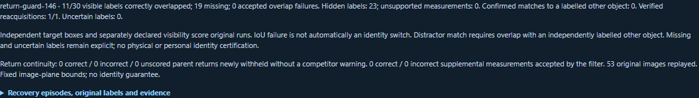
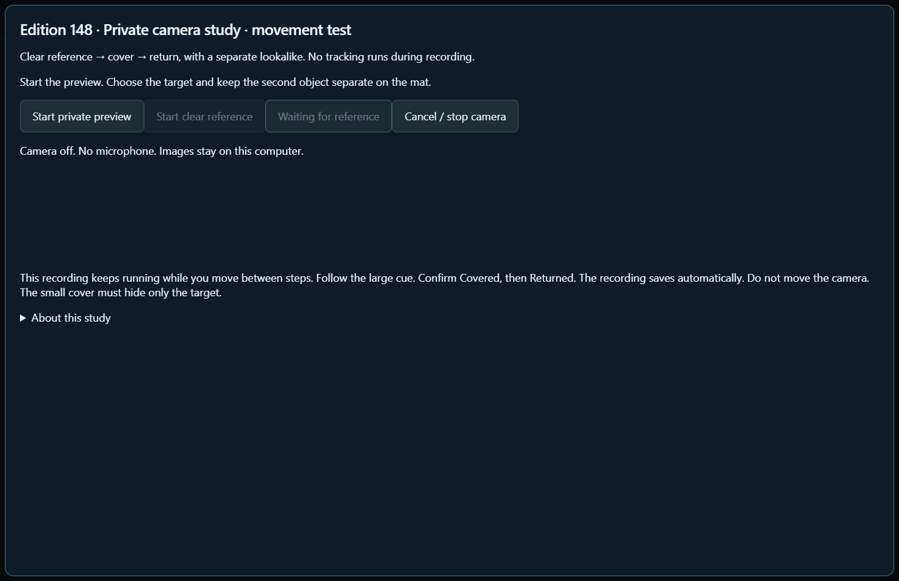

# Fraynix Agent Workspace — edition 148

**Confirm a returning object using measured motion, without forgetting competing regions.** Edition 148 adds an explicit Java experiment that lets each verified appearance accumulate confirmation only while the measured target and rival paths support it. The existing tracker remains the default.

**The new Java method passes controlled recovery checks, but adds no useful recovery on this fresh camera sequence. It is not promoted.** The clear donor produced 23/23 correct measurements and one verified appearance. Existing 146, monitor 148 and candidate 148 each produced **11/30 correct visible or partly visible measurements, 19 missing, 0/23 unsupported hidden measurements and 0 accepted matches to the labelled other objects**.

All methods have nine correct measurements before cover and two after return; none measures the lighter at its final new position (0/14). More precisely, one measurement is correct during the two original-position return samples, and one during the five partially obscured movement samples. The app's 1/1 verified reacquisition counts a brief return event, not sustained tracking through the rest of the sequence. The new candidate adds zero measurements. Its monitor preserves the existing result exactly, and the candidate preserves every existing accepted proposal.

The source qualifies as **full cover, return, then movement**: 23 completely hidden samples, first return at the original position, then about 30.6 pixels of visible displacement (0.639 initial target widths). It is not a displaced first return. Post-comparison traces report expired motion forecasts and insufficient new measured trajectory; later strong appearance hypotheses can fall on the tape-measure housing. These diagnoses do not justify relaxing identity checks or calling a prediction a measurement.

Generated controls separately demonstrate two additional correct returns alongside copy-only refusal. That is useful implementation evidence, not camera qualification. On this camera sequence the extra search costs more without improving outcomes: tracking takes about 38.0 seconds for 146, 56.5 seconds for monitor 148, and 66.1 seconds for candidate 148 (including one stop/resume). Independent replay/audit takes about 60.7, 84.0 and 84.1 seconds respectively. These are single-run workflow timings, not repeated performance estimates or real-time throughput guarantees.

The red lighter differs in color from the black target; the tape housing is a different object with similar dark partial structure. Labels were reviewed from original pixels before predictions, with physical actions confirmed by the user. This fixed-camera, approximately 1 Hz study does not establish identical-object discrimination, calibrated 3D identity or reliable tracking through long occlusion. The tracker uses sample steps; original camera timestamps remain in the private source, rather than establishing calibrated seconds or physical velocity in this method. Private camera pixels remain local; defaults and verification remain intact.

[Previous edition](README-147.md) · [Offline guide](docs/readmes/148/index.html) · [All editions](docs/readmes/INDEX.md) · [Contributor handoff](README-CONTRIBUTORS.md) · [Architecture](docs/ARCHITECTURE.md) · [Integrated roadmap](docs/INTEGRATED_AGENT_ROADMAP.md)

## One connected local application

Fraynix connects durable chat goals, a Java physics world, Game Lab, browser observations, data analysis and verified creation procedures. Java maintains state, execution, recovery and outcome checks. The desktop hosts the browser, canvas and controls. Local models choose and explain actions through installed tools. The goal remains one observable system that creates, tests and retains useful procedures from measured outcomes.

Camera tracking supplies evidence to that system. It must distinguish measured, predicted and unknown states; seeing similar pixels does not establish physical identity. A task should carry that uncertainty into its reports and actions. This edition changes an optional observation method, not the app's architecture, local-model requirements, action permissions or private worlds.

## What changed

- `path-confirmation-148` is an explicit experimental option in the observation panel. It preserves every accepted 146 proposal and may add a measurement where 146 withholds one.
- Each verified appearance keeps its own three-step confirmation history. Correlation, color, adjacent optical flow, target motion and rival separation must support it. Evidence is never pooled across references.
- Spatial search records the locations of competing matches, including scores that can violate the existing uniqueness margin. A similar patch can be excluded only through measured separation; a high match score alone cannot clear ambiguity.
- Original baseline measurements anchor the paths. Recovered estimates never become new anchors or appearance memory. Missing rivals remain retained; intersecting, uncertain, overflowing or expired paths refuse the additional return.
- `path-monitor-148` records the new reasoning while preserving all 146 tracker and filter outputs. The app audit replays the original pixels before independently scoring additional returns.
- The recorder checks fresh movement with a clear donor, full cover, return and a visible comparison object. Images remain local; published screenshots show the actual result interface with camera pixels hidden.

The twelve-sample forecast horizon, eight-rival limit, 96-frame import limit, 16 datasets, 24 runs and 20 MB export limit remain unchanged. There is no automatic reference admission or default promotion. No new library, transformer, image generator or cloud inference is required by this tracking change.

## Why this change

The exposed edition 147 footage contained strong target matches but no accepted return. New diagnostic geometry places the strongest rival region on the black tape-measure housing, using only part of the reference image. This suggested testing measured separation before accumulating confirmation. The same older recording also contains 19 hidden samples, beyond the unchanged twelve-sample forecast horizon. It is development evidence, not fresh qualification, and its long gap must not be made to pass by extending that horizon.

Generated controls test a moving target and a persistent similar copy. Positive recovery is required alongside wrong-object refusal; refusing everything is not useful recovery. These controls are separate from real footage.

## Fresh recording and source review

The [prospective protocol](docs/publication148/PROTOCOL_148.md), [implementation lock](docs/OBSERVATION_148_LOCK.json) and [camera lock](docs/publication148/webcam-lock148.json) were frozen before new camera pixels. The user chose the black lighter as the target and the red lighter as the comparison object. Their similar shape and different color do not establish performance against identical copies.

The source is continuous, approximately one sample per second, with actual camera times preserved. The causal donor contains 24 earlier, disjoint source images. Evaluation includes ten samples before complete cover and twenty samples after return. Source-only review requires at least half a target-width of visible movement and separately reports the first-return displacement. Stationary footage cannot qualify as a movement test. Cues and clicks record intended actions; original image review determines visibility.

The original timestamps remain in the private recording and source pack. This observation path uses a **sample-index clock**: its motion fit and twelve-sample horizon are not calibrated seconds, speed or acceleration. Variable capture gaps have not been silently retimed, but timestamp-aware physical prediction is a separate requirement.

| Source / role | Original samples | Visible / partial | Fully covered |
| --- | --- | ---: | ---: |
| black-lighter-movement-1 / reference-source | 1–24 | 23 / 0 | 0 |
| black-lighter-movement-27 / evaluation | 27–80 | 25 / 5 | 23 |

All selected frames are reviewed and labelled before predictions. These attributed AI source-only labels are independent of tracker predictions, but are not independently instrumented ground truth. The user confirms the physical objects and actions. Admission of a verified reference is a separate app check; unsupported donors remain unavailable, never replaced by a fabricated reference.

## Results, including failures

| Source / method | Correct / visible | Missing | Wrong overlap | Hidden outputs | Other-object matches |
| --- | ---: | ---: | ---: | ---: | ---: |
| black-lighter-movement-27 / return-guard-146 | 11/30 | 19 | 0 | 0/23 | 0 |
| black-lighter-movement-27 / path-monitor-148 | 11/30 | 19 | 0 | 0/23 | 0 |
| black-lighter-movement-27 / path-confirmation-148 | 11/30 | 19 | 0 | 0/23 | 0 |

Correct measurements overlap the source-labelled target by at least 0.5 IoU. Missing observations remain in every denominator. A low overlap alone is not proof of an identity switch; overlaps with the labelled comparison object are counted separately. Accepted measurements during complete cover are unsupported outputs.

| Source / method | Additional restored correct / incorrect | Accepted supplemental correct / incorrect |
| --- | ---: | ---: |
| black-lighter-movement-27 / return-guard-146 | 0 / 0 | 0 / 0 |
| black-lighter-movement-27 / path-monitor-148 | 0 / 0 | 0 / 0 |
| black-lighter-movement-27 / path-confirmation-148 | 0 / 0 | 0 / 0 |

Additional raw returns and measurements accepted by the shared filter are distinct. Monitor results are not applied measurements. Source eligibility, verified admission, completed execution and useful recovery are separate findings. The original 146 method is unchanged; this experiment does not correct errors that method already accepts.

The fixed motion envelope is an image-plane assumption, not a calibrated probability or a guarantee of physical identity. An unseen identical copy on the same path may be indistinguishable. Camera motion, long occlusion, abrupt movement and unresolved competing paths can still prevent recovery.

## Run and review

Use the existing Windows launcher with Java 21 and installed desktop dependencies; preserve private working projects. For the isolated camera review instrument, run `node workspace-desktop/test/webcam148-recorder.cjs` from the checkout. Camera access starts only through **Start private preview**.

1. Leave both lighters visible and hands away; click **Start clear reference**. Wait for COVER.
2. Cover only the black lighter; confirm when covered. The app cues UNCOVER after two more saved samples.
3. Uncover the same lighter and slide it about one grid square left. Keep the red lighter still. Confirm the return with the hand away.
4. Keep both objects visible until automatic save and camera shutoff. No final click is needed.
5. Review original frames, preserve hashes and source-only labels, and commit those inputs before running the frozen comparison. Never use predictions as reference labels.

The recorder is a review instrument inside an isolated actual app, not a new production camera mode. Its UI screenshot comes from the synthetic-device lifecycle check before preview; it is not physical tracking evidence. Private raw images, pixel-containing captures and project stores are excluded from Git. Public receipts verify hashes and outcomes; repeating original-pixel checks requires authorized access to the local source files.

## Verification and full cost

382 distinct Java checks and 161 desktop checks passed, plus kernel, agency, offline preparation and package verification. 4 actual app runs across 1 private study project(s), with separate unfinished-process recovery. Source eligibility and useful recovery remain distinct from execution checks. Hosted CI is reported separately.

- Separate donor runs precede all fixed evaluation windows. Retention with zero eligible examples is refused and recorded; reference-dependent cases remain unavailable without replacement. Eligible cases compare three methods on identical pixels. Fresh real footage and generated trajectory controls are reported separately; no-reference cases retain an explicit baseline run and unavailability records. Independent host overlap/distractor/supplemental-outcome arithmetic agrees with Java. Monitor148 preserves every146 tracker/filter output; candidate preserves every146 measurement and independently scores additional148 returns. Three per-reference motion and path confirmations are checked without using outcome labels. No automatic anchor admissions; defaults unchanged.
- Explicit method selection, recovery explanation, original-source overlay, independent audit UI, complete bounded export and exact stopped-prefix resume passed. Native physical world unchanged.
- Owned-process crash and cold reopen preserve exact completed-state bytes/timestamp and zero observation writes. All recorded runs/audits reverified, including original-pixel decision replay. Donor and evaluation source modification independently refuse audit/export; original restoration revalidates.
- Killed only the owned Java process during a labelled camera occlusion after observed loss and while unfinished
- Cold reopen retained the exact committed prefix and interrupted status
- Resume reconstructed pre-loss motion and return decisions from original pixels before continuing
- Complete trace and independent outcome audit exactly match the uninterrupted run
- Native world unchanged; Additional observation run uses the existing capacity without expansion

| Source / method | Tracking ms | Replay/audit ms |
| --- | ---: | ---: |
| black-lighter-movement-27 / return-guard-146 | 37957.5 | 60650.5 |
| black-lighter-movement-27 / path-monitor-148 | 56513.9 | 83994.0 |
| black-lighter-movement-27 / path-confirmation-148 | 66137.4 | 84057.4 |

Complete black-lighter-movement comparison workflow: 685.7s, 4 runs, 8040240 exported bytes. Includes checks, UI, source replay and retained retry intervals.

Separate interrupted-process check: 162.8s. Camera-free screenshot review: 232.2s.

- Both predecessor 147 CI runs, 43732193662 and 43732397988, completed successfully. Initial pending and later successful receipts are preserved separately.
- The method, scorer, UI, source protocol and comparison harness were frozen at 7d48191c before fresh camera pixels. No post-footage threshold changes were made.
- The first physical capture, attempt-b5TAjX, completed with 79 original frames and 6,003,331 image bytes. Source-only review found slight rotation and about 2.5 pixels of movement, below the predeclared 20-pixel minimum. It was rejected before any tracker prediction, preserved intact and never counted as a tracking result.
- The second physical capture, attempt-kOQd2t, completed with 95 original frames, 7,090,391 image bytes and 97.98 seconds of capture. All 95 source frames were reviewed; all 78 selected donor/evaluation frames also received native-pixel review. Donor 1–24 and evaluation 27–80 use disjoint original images. Visibility and other-object labels were committed at f6129073 before predictions.
- The first actual-app import refused an overlong object display label before any tracking run. Only that description was shortened to satisfy the existing limit, and revised pack hashes were committed at aa35463e before predictions. Original images, timestamps, boxes and visibility were unchanged. The failed receipt and original private packs are preserved; the limit was not loosened.
- The resumed study keeps the first failed attempt's `source` header (f6129073). A separate receipt at `docs/publication148/study-provenance148.json` binds the successful runs to aa35463e and the unchanged 7d48191c production build. It verifies that only the display label changed, every executed frame/object matches the revised pack, independent labels are unchanged, and the revised input commit precedes every successful import. The original receipt was not rewritten.
- The user confirmed covering the black lighter and leaving it at the new grid position. Pixel review independently distinguishes first return at the old position from subsequent movement. Partial whole-object boxes are manually inferred from visible body structure, not independently instrumented truth. Competitor boxes are omitted where the hand obscures them.
- Both physical recorders were closed after automatic save and camera shutdown. Synthetic lifecycle frames and the camera-off controls screenshot are UI evidence only. Private camera images and pixel-containing screenshots are excluded from Git.

- The separate interruption check stopped only its owned Java process after ten committed samples during labelled occlusion. Reopening retained that exact ten-sample prefix; resuming completed all 53 scored samples with the identical uninterrupted trace and independent outcome audit. The physical world remained unchanged.

[Successful-run input provenance](docs/publication148/study-provenance148.json) preserves the distinction between the original attempt header, corrected input revision and unchanged production build.

CI was checked before implementation. Hosted status is recorded separately from local checks and fetched publication. [GitHub Actions](https://github.com/eyeoverthink/Fraynix-Agent-Workspace/actions) and the publication receipt identify the pushed revision; a local commit is not a completed push.

## Next steps

1. **Recover movement without manufacturing new identity evidence.** Use this now-exposed failure for development: separate the long hidden interval, brief original-position return, hand-assisted movement and stable new position. Investigate how confirmed original observations can rebuild a valid motion history after return. After a long gap, test full-object structural evidence across several observed frames against retained lookalikes before authorizing a new motion anchor; do not describe that as renewal of an expired motion proof. Never use a restored guess as an anchor or appearance, extend a stale path until it fits, or erase a retained rival merely because it disappears.
2. **Test short and long occlusions separately.** Freeze the next change before new footage. Include legitimate movement inside the supported forecast horizon, longer gaps, same-color lookalikes, wrong-object-only returns and unchanged-view controls. Label original pixels first and retain missed returns in the denominator. Long-gap identity needs additional verified evidence, not wider bounds alone. The current movement source remains a regression after this edition. For physical timing, use the retained capture timestamps and test variable cadence separately; sample steps must not be reported as calibrated seconds or velocity.
3. **Make useful recovery worth its complete cost.** The 148 candidate spent more work for zero added camera measurements. Measure and remove duplicated spatial search or exact source-bound replay only when equivalent checks are demonstrated. Report full tracking, reference verification, save, restart, audit and export costs. Neither faster refusals nor successful generated fixtures alone justify promotion.
4. **Keep the connected application central.** Use qualified observations in a durable chat request that produces a verified observed-object report or working artifact. Carry measured, predicted and unknown states into the result; unresolved identity must block physical actions. Continue the shared Java world, browser, Game Lab and creation system rather than treating tracker experiments as the destination.

Keep the unified application central: qualified observations should support a durable chat request that produces a verified report or working artifact, carrying unresolved identity and measurement uncertainty through every stage.
