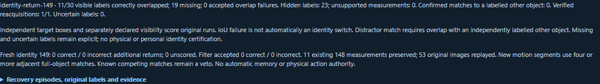
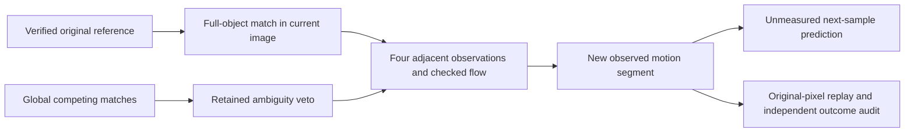

# Fraynix Agent Workspace — edition 149

**Recognize a returning object from fresh observations, then rebuild its motion history.** This edition adds an explicit Java experiment alongside the existing trackers. The default stays unchanged.

**Fresh identity confirmation and a new observed motion segment work on generated controls, but the recorded-camera recovery gap remains unresolved. The candidate is not promoted.**

The first frozen implementation added zero recoveries on nine reserved generated sequences. Those failures exposed periodic coarse-grid search misses. Revision 2 added one bounded recent-match search proposal per reference and enforced geometry bounds; it did not relax any identity, rival or flow threshold. On a separate reserved cohort, the revised method recovered **48 additional correct observations**, with **zero wrong-pattern or hidden-object outputs**. The now-exposed first cohort also gained 48 correct observations. Each cohort contains nine sequences: three textures, each tested for a long cover and return, a wrong-pattern-only return, and a second cover after recovery. The retained-copy, source-integrity, replay and monitor checks passed separately.

The exposed edition 148 real-camera regression remains **11/30 correct visible or partly visible measurements, 19 missing, 0/23 hidden measurements and zero accepted matches to labelled other objects**, for 148, monitor 149 and candidate 149 alike. The candidate adds zero observations and no new motion segment on this recording. The clear donor is 23/23 correct and yields one independently verified reference appearance. The earlier source is exposed regression material, not fresh footage or independently instrumented truth.

The new search obtains strong full-crop matches on the brief original-position return, but does not sustain confirmation through the hand-assisted move or final position. Later hypotheses near the tape-measure housing fail the stricter correlation and gradient checks. This is an appearance/search limitation, not a reason to extend an expired trajectory or count a forecast as a measurement. The full reference rectangle is not foreground segmentation or semantic object identity.

The monitor preserves every 148 tracker/filter output exactly. The candidate preserves accepted 148 proposals. Both add processing cost without improving the exposed 148 recorded-camera outcome. The default, existing limits and all source/outcome checks remain unchanged. No new physical action authority or automatic appearance admission is granted. Unseen identical substitutions remain unobservable from this image stream alone.

A newly recorded exploratory long-cover case exposes a separate admission gap. Its reference tracks 23/23 samples correctly, but novelty filtering refuses all 21 repeated appearances considered for admission; no learned donor set is retained. The 148/149 comparisons that require that set are therefore unavailable. The existing 139 fallback reaches 29/30 visible samples with 0/62 hidden outputs and no matches to labelled other objects. This is not evidence of 149 recovery. The source exceeds the primary cover ceiling by two samples and is explicitly exploratory; full footage and all three capture attempts are preserved. Next work should distinguish verified source evidence from newly learned appearances, while keeping original-source and independent-outcome checks.

[Previous edition](README-148.md) · [Offline guide](docs/readmes/149/index.html) · [All editions](docs/readmes/INDEX.md) · [Contributor handoff](README-CONTRIBUTORS.md) · [Architecture](docs/ARCHITECTURE.md) · [Integrated roadmap](docs/INTEGRATED_AGENT_ROADMAP.md)

## The connected application

Fraynix remains one local application connecting chat, a persistent Java physics world, Game Lab, browser observations, data analysis and verified creation procedures. Java maintains tasks, state, execution and recovery. The desktop presents the browser, canvas and controls; a local model can choose and explain installed actions. The destination is a system that observes, creates, tests and retains useful procedures from measured outcomes.

Tracking supplies evidence to that system. A similar-looking image is not sufficient authority to manipulate a physical object. Measured, predicted and unknown states must remain distinct in reports and action checks. This edition improves an optional observation path; it does not replace the app with a camera demo, add cloud inference, expand permissions or alter private worlds.

## What changed

- **Fresh full-object evidence:** verified original donor crops produce 16 × 16 spatial/color descriptors. The initial user-selected source crop also participates; its selected identity is an input assumption, not an independently certified identity. The full image region must match, including its quadrants and gradient structure. Partial matches cannot establish a new identity segment.
- **Separate confirmation for each reference:** four adjacent full matches and checked optical flow are required. Missing, ambiguous or incoherent frames reset that reference’s history. References cannot pool confirmations.
- **Retained ambiguity:** a known competing match remains a veto on added 149 measurements after it disappears. One surviving candidate does not erase evidence of a copy.
- **New observed motion:** after confirmation, fit the most recent four or five measured boxes. The segment records its source reference and sample ordinals. It carries no velocity across the long cover.
- **Honest forecasts:** the next-sample point is visibly marked as predicted. It never counts as an observation, appearance memory or identity confirmation. Fit residuals are not calibrated probability bounds.
- **Exact compatibility:** `identity-monitor-149` keeps all 148 tracker/filter outputs. `identity-return-149` preserves accepted 148 proposals and can add measurements where 148 withholds them. The inherited parent can still make mistakes; this compatibility promise does not correct those errors.

No new model, transformer, cloud service or production library is required. All source, code, label, outcome and export checks remain. Limits remain six reference examples, 96 frames per dataset, 16 datasets, 24 runs and 20 MB exports. The older twelve-sample path horizon and eight-rival limit remain unchanged. No automatic appearance admission, default promotion or physical action authority is added.

“Full object” here means the complete reference rectangle, rather than one of the older partial masks. It is not a foreground segmentation or semantic recognition of a lighter. Background pixels, rotation and changes in the visible shape can still prevent a match. A fresh motion segment cannot compensate for missing identity evidence.

A recent strong match can suggest one extra bounded search region. It does not confirm the current frame: all full-object and global-rival checks still run. The initial frozen implementation missed objects between coarse-grid positions and added zero returns on nine reserved sequences. That failed cohort is preserved; the revised search uses another reserved cohort. Geometry bounds are also enforced before refined candidates enter confirmation.

## Why a new motion segment

The forecast has no path back into reference admission or identity confirmation.

Edition 148’s camera recording exposed a long hidden interval, a brief return at the original location, hand-assisted movement and failure to follow the final position. The old forecast had expired, and two brief baseline observations could not rebuild its required trajectory. Extending that forecast until it happened to fit would manufacture confidence.

Edition149 instead asks a different, observable question: do several new full-object matches agree with the original selected crop or a verified donor appearance, without a known competitor? Only then does it form a new observed segment. The [fixed protocol](docs/publication149/PROTOCOL_149.md) and [implementation lock](docs/OBSERVATION_149_LOCK.json) precede reserved-control execution. The older recording is **exposed regression material**, not a fresh camera validation.

## Evidence and results

The original 148 webcam packs and committed source-only labels are reused unchanged as an exposed regression. Any new 149 capture is declared separately under the [fresh camera protocol](docs/publication149/CAMERA_PROTOCOL_149.md). Donor admission is repeated under the current implementation; old code-bound evidence is never relabelled. Original images and sampled RGB appearance arrays remain private. Published camera receipts are clearly marked derived views: they preserve measurements, decisions and source hashes, with hashes for omitted feature arrays and the complete unchanged private original. Public views cannot replace original evidence in the verifier. Their source-only labels were independent of the original predictions, but they are manual AI annotations, not instrumented ground truth.

| Source / role | Evidence domain | Original samples | Visible / partial | Fully covered |
| --- | --- | --- | ---: | ---: |
| black-lighter-movement-1 / reference-source | exposed-real-camera | 1–24 | 23 / 0 | 0 |
| black-lighter-movement-27 / evaluation | exposed-real-camera | 27–80 | 25 / 5 | 23 |
| black-lighter-long-cover-exploratory-1 / reference-source | exploratory-real-camera | 1–24 | 23 / 0 | 0 |
| black-lighter-long-cover-exploratory-32 / evaluation | exploratory-real-camera | 32–124 | 30 / 0 | 62 |

| Source / method | Correct / visible | Missing | Wrong overlap | Hidden outputs | Other-object matches |
| --- | ---: | ---: | ---: | ---: | ---: |
| black-lighter-long-cover-exploratory-32 / foreground-guard-139 | 29/30 | 1 | 0 | 0/62 | 0 |
| black-lighter-movement-27 / path-confirmation-148 | 11/30 | 19 | 0 | 0/23 | 0 |
| black-lighter-movement-27 / identity-monitor-149 | 11/30 | 19 | 0 | 0/23 | 0 |
| black-lighter-movement-27 / identity-return-149 | 11/30 | 19 | 0 | 0/23 | 0 |

Correct means at least 0.5 overlap with the independently labelled target. Missing observations stay in the denominator. Hidden outputs, bad overlap and labelled-other-object matches are reported separately. Unlabelled distractors cannot establish switch-free tracking.

| Source / method | Additional restored correct / incorrect | Accepted supplemental correct / incorrect |
| --- | ---: | ---: |
| black-lighter-long-cover-exploratory-32 / foreground-guard-139 | 0 / 0 | 0 / 0 |
| black-lighter-movement-27 / path-confirmation-148 | 0 / 0 | 0 / 0 |
| black-lighter-movement-27 / identity-monitor-149 | 0 / 0 | 0 / 0 |
| black-lighter-movement-27 / identity-return-149 | 0 / 0 | 0 / 0 |

| Reserved generated texture / case | Correct / visible | Hidden outputs | Additional149 |
| --- | ---: | ---: | ---: |
| 149401 / return | 14/17 | 0/18 | 10 |
| 149401 / wrong-pattern | 4/4 | 0/31 | 0 |
| 149401 / second-loss | 10/16 | 0/19 | 6 |
| 149509 / return | 14/17 | 0/18 | 10 |
| 149509 / wrong-pattern | 4/4 | 0/31 | 0 |
| 149509 / second-loss | 10/16 | 0/19 | 6 |
| 149601 / return | 14/17 | 0/18 | 10 |
| 149601 / wrong-pattern | 4/4 | 0/31 | 0 |
| 149601 / second-loss | 10/16 | 0/19 | 6 |

**New-segment next-frame prediction, checked after evaluation:**

| Source / case | New segments | Scored future centers | Mean / maximum error in pixels |
| --- | ---: | ---: | ---: |
| identity149-reserved-v2 / 149401 / return | 1 | 9 | 0.617 / 0.952 |
| identity149-reserved-v2 / 149401 / wrong-pattern | 0 | 0 | unavailable |
| identity149-reserved-v2 / 149401 / second-loss | 2 | 4 | 0.600 / 0.952 |
| identity149-reserved-v2 / 149509 / return | 1 | 9 | 0.617 / 0.952 |
| identity149-reserved-v2 / 149509 / wrong-pattern | 0 | 0 | unavailable |
| identity149-reserved-v2 / 149509 / second-loss | 2 | 4 | 0.600 / 0.952 |
| identity149-reserved-v2 / 149601 / return | 1 | 9 | 0.617 / 0.952 |
| identity149-reserved-v2 / 149601 / wrong-pattern | 0 | 0 | unavailable |
| identity149-reserved-v2 / 149601 / second-loss | 2 | 4 | 0.600 / 0.952 |
| black-lighter-movement-27 | 0 | 0 | unavailable |

The prediction is never used as an observation. Hidden or unavailable future labels are excluded and counted in [the full motion receipt](docs/readmes/149/motion.json). Generated geometry is exact at 320 × 240 pixels; camera boxes are manually labelled at 640 × 480 pixels. These pixel/sample results are not calibrated physical speed or probability bounds.

Raw supplemental boxes and measurements accepted by the shared filter are different results. Reserved generated cases test exact rendered geometry and repeatable logic; they cannot establish real-camera generalization. Fresh webcam confirmation remains a separate qualification requirement unless explicitly documented here.

## Fresh camera qualification

Three new private webcam recordings were completed and source-reviewed before tracker execution. All original images, times and failed attempts are retained locally.

- **Attempt 1:** 99 frames; complete 29-sample cover, but mostly rotation and about 2.9 pixels of center movement. Refused the predeclared movement minimum.
- **Attempt 2:** 188 frames; clear translation, but 108 hidden samples required a 139-frame event, beyond the existing 96-frame dataset capacity. Refused without truncation or retiming.
- **Attempt 3:** 134 frames; 62 hidden samples, two above the prospective 60-sample maximum. Primary eligibility remains false. The entire event, frames 32–124, fits in 93 frames, so it was declared as a **post-acquisition exploratory comparison** before predictions. Donor 1–24 and evaluation images are disjoint. All 134 original frames and all 117 selected native-pixel frames were reviewed. [Explicit deviation](docs/publication149/EXPLORATORY_CAMERA_149.md).

The user confirms moving the same black lighter under cover and revealing it. The red lighter remains a separate, similarly shaped but differently colored comparison. The tape and housing also moved during the cover; the background change is retained and disclosed. Manual image-plane boxes are independent of predictions but not instrumented physical truth.

The exploratory donor tracks **23/23** scored samples correctly, but admits **zero learned appearances**: 2 frames gather motion evidence and 21 say “appearance already represented.” The retention system therefore refuses to save a donor set. The frozen comparison records **148, monitor149 and candidate149 as unavailable** on this source; it does not invent references or replace the declared donor.

The prescribed **existing foreground-guard-139 fallback** reaches **29/30** visible samples, with **1 missing, 0 wrong-overlap observations, 0/62 hidden outputs and 0 matches to labelled other objects**. This result belongs to that fallback on this one exploratory recording; it is not a 149 improvement or a comparison against the unavailable methods.

The complete two-run workflow passed original-pixel replay, independent outcome arithmetic, original-source tamper refusal and restoration, export, and owned-process interruption/cold reopening of completed state. It does not prove interrupted positive149-segment recovery. No primary fresh149 recording qualified; no default is promoted. The first two ineligible sources were not tracked.

## Review in the app

Use the existing Windows launcher with Java 21 and the installed desktop dependencies. Preserve the private project path when switching checkouts. The edition 149 verification runs use isolated projects under `build`; they do not touch the active review world.

1. Open the spatial view and import an authorized observation pack. Review and freeze source-only labels before evaluating a new source.
2. Run and independently audit a separate clear donor; retain only supported fully visible appearances.
3. Select the evaluation footage and a verified donor set. Explain why they show the same object. This declaration is not itself identity proof.
4. Choose **Fresh identity monitor 149** to inspect decisions while retaining 148 outputs, or explicitly choose **Fresh full-object identity + new motion segment 149** for the candidate.
5. Review every missing and unsupported measurement in **Object identity · occlusion & recovery**. The source view shows the observed segment and a dashed predicted point. Stop/resume and evidence export preserve the original checks.

Public screenshots show the actual saved app results with camera pixels hidden. Reproducing the camera comparison requires authorized access to the original local files. The published hashes alone cannot reconstruct the recording.

## Verification and complete cost

393 distinct Java checks and 161 desktop checks passed, plus kernel, agency, offline preparation and package verification. 6 actual app runs across 2 private study project(s), with separate unfinished-process recovery. Source eligibility and useful recovery remain distinct from execution checks. Hosted CI is reported separately.

The exposed generated tracker/filter/audit control accepted 4 new correct measurements through the unchanged filter, reproduced the trace and filter after source reconstruction, and refused a forged motion segment. Changing one independent outcome label correctly produced one failed outcome without changing the tracker. [Original chain result](docs/readmes/149/filter-audit.json).

- Separate donor runs precede all fixed evaluation windows. Retention with zero eligible examples is refused and recorded; reference-dependent cases remain unavailable without replacement. Eligible cases compare three methods on identical pixels. Exposed real footage and generated controls are reported separately; no-reference cases retain an explicit baseline run and unavailability records. Independent host overlap/distractor/supplemental-outcome arithmetic agrees with Java. Monitor149 preserves every148 tracker/filter output; candidate preserves every148 measurement and independently scores additional149 returns. Four adjacent full-object per-reference confirmations and independent least-squares motion arithmetic are checked without using outcome labels. No automatic appearance admissions; defaults unchanged.
- Donor retention refusal preserved. Fixed baseline and its complete export checked; no claim of148 method selection, recovery or prefix-resume validation on this unavailable source.
- Owned-process crash and cold reopen preserve exact completed-state bytes/timestamp and zero observation writes. All recorded runs/audits reverified, including original-pixel decision replay. Donor and evaluation source modification independently refuse audit/export; original restoration revalidates.
- Explicit method selection, recovery explanation, original-source overlay, independent audit UI, complete bounded export and exact stopped-prefix resume passed. Native physical world unchanged.
- Killed only the owned Java process during a labelled camera occlusion after observed loss and while unfinished
- Cold reopen retained the exact committed prefix and interrupted status
- Resume reconstructed pre-loss motion and return decisions from original pixels before continuing
- Complete trace and independent outcome audit exactly match the uninterrupted run
- Native world unchanged; Additional observation run uses the existing capacity without expansion

A separate exposed generated control runs positive new returns through the unchanged observation filter, reconstructs the tracker/filter from original frames and checks the independent audit. Changing its outcome label changes the score without changing the tracker; forging a segment is refused. Its fixture memory is not a production admission proof. Real-app source admission and interruption are checked separately on the exposed edition 148 camera footage, which has no added149 return. That interruption check does not qualify recovery of a positive new segment across a native-app process interruption.

| Source / method | Tracking ms | Replay/audit ms |
| --- | ---: | ---: |
| black-lighter-long-cover-exploratory-32 / foreground-guard-139 | 31271.3 | 37454.0 |
| black-lighter-movement-27 / path-confirmation-148 | 50627.0 | 82786.6 |
| black-lighter-movement-27 / identity-monitor-149 | 122765.9 | 209386.2 |
| black-lighter-movement-27 / identity-return-149 | 142120.7 | 205556.5 |

Complete black-lighter-long-cover-exploratory comparison workflow: 124.2s, 2 runs, 11886372 exported bytes. Includes checks, UI, source replay and retained retry intervals.

Complete black-lighter-movement comparison workflow: 1408.8s, 4 runs, 8075356 exported bytes. Includes checks, UI, source replay and retained retry intervals.

Separate interrupted-process check: 376.1s. Camera-free screenshot review: 547.3s.

### Attempts retained in the evidence

- The initial implementation was frozen at `9e19970a` before its reserved generated tests. Seven functional checks passed, but the reserved test failed: nine sequences produced zero additional recoveries. Original failed XML, trace, source lock and protocol are preserved.
- Source review found periodic search-grid misses between strong matches. Revision 2 (`9090c62d`) adds a bounded recent-match search proposal and valid-box guards. Identity, optical-flow and competing-object thresholds are unchanged. Its production sources and comparison harness were frozen before a separate reserved cohort was executed.
- All ten focused checks passed. The first, now-exposed cohort and the separate reserved cohort each produced 48 additional correct observations, zero incorrect outputs and zero hidden outputs across nine generated sequences. These are rendered controls, not camera footage.
- Protocol wording clarification: its prose says return samples 23–32 and mentions exact-copy variants. The already-frozen reserved generator actually scores samples 1–35, with returns through 35, for the three listed cases: return, wrong-pattern and second-loss. All 35 samples are retained in the results. Known-copy refusal is a separate functional control using exposed fixture material, not a reserved new-copy cohort. The frozen files are preserved unchanged.
- The complete recorded-camera app comparison passed independent original-pixel replay, source/descriptor tamper refusal and restoration, evidence export, stop/resume, cold reopening and UI checks. Its four runs include the clear donor and three evaluation methods. All evaluation methods remain at 11/30 correct visible or partial samples; none follows the final moved position. Generated recovery must not be reported as camera recovery.
- Existing edition 148 camera packs and labels were reused unchanged. The user subsequently confirmed availability for a separately frozen fresh149 camera test. The original regression remains exposed; fresh capture status and results are reported separately. Private source pixels and screenshots containing them are excluded from publication.
- A supplementary generated tracker/filter/audit check was added at `aada9782` after the camera result exposed a coverage gap: the real app comparison has no positive new149 segment. It passed: four new correct measurements reached the unchanged filter; exact source reconstruction, changed-label scoring and forged-segment refusal were checked. It does not retrospectively turn the camera restart into a positive new-segment interruption test.
- All 148 defaults, existing capacities and frozen historical editions remain intact. No source proof is relabelled, and no model or external image-processing library was introduced.

- First fresh149 capture attempt-q4SwFz completed99 original samples. All originals and84 selected native-pixel frames reviewed before predictions. Fully hidden43–71 (29 samples), first return72. Black lighter mainly rotated; approximate center shift2.9px versus22px source threshold. Frozen preflight refused movement. User physical-action confirmation retained, but does not override source pixels. No tracker execution on this source; original capture preserved. Repeat uses unchanged recorder/method/eligibility.

- Second fresh149 capture attempt-5tOX5W completed188original samples. All reviewed before prediction, with full-resolution boundary checks. Target clearly translated under cover, but fully hidden46–153 (108samples/about113seconds) exceeded frozen60-sample maximum; full event139frames exceeds96-frame capacity. No trimming/retiming or tracker execution. User confirmation preserved. Clarified next recording guidance: when MOVE UNDER COVER appears, move AND reveal without waiting for another cue. Method and eligibility unchanged.

- Third capture attempt-rqrzd0 completed134samples. All134 originals and117 selected native-pixel frames reviewed before prediction. Full cover42–103 is62samples, two above the frozen primary60-sample maximum; primary preflight remains refused. The complete32–124 event is93frames, inside the unchanged96frame capacity. Source-only exploratory declaration, labels and hashes committed6fdcbd75 before running unchanged comparison. No trimming/retiming/threshold change. Tape and housing also moved; red remains separate. This is post-acquisition exploratory camera evidence, not primary fresh qualification. All three physical attempts are retained.
- Predecessor148 hosted runs43783077267 and43782824979 failed with runner communication loss; GitHub logs unavailable404, no particular assertion failure reported. Both failures retained, latestmain requested one retry. Hosted CI remains separate from passed local checks.

The implementation is pure Java image processing and bounded state. CPU search and original-pixel replay have real costs; successful execution is separate from useful recovery and from real-time throughput. Hosted CI status is separate from local verification and fetched publication.

## Limits and next work

An unseen pixel-identical substitution is not observable from this camera alone. Camera motion, rotation, changing light, small objects and partial returns can prevent confirmation. The new segment uses **image/sample units**, not calibrated seconds or physical velocity; original camera timestamps remain in private source data. Independent physical evidence is needed before claiming real-world identity or permitting physical action.

1. **Separate verified source evidence from novelty.** The new donor is correctly tracked but all repeated appearances are excluded as duplicates. Design and test an explicit source-seed verification/retention path, keeping its user-selected identity assumption visible. Do not call duplicate frames newly learned examples or bypass original-source/outcome checks. Compare verified-seed-only, learned-reference and simple-control paths on sources frozen before evaluation.
2. **Make camera tests easier to complete.** The recorder's “no rush” wording conflicts with the source event ceiling. Add clearly timed action cues and a predeclared capture window before the next recording; preserve actual times and all failures. Test complete cover, displaced return, same-color lookalikes and wrong-object-only intervals. The 62-sample exploratory case remains outside primary qualification.
3. **Qualify fresh real returns before promotion.** First demonstrate a positive new segment across an actual app process interruption using a clearly labelled generated source. Then keep the method frozen, record a genuinely new long cover and displaced return, and label the original images before predictions. Include a same-color lookalike and a wrong-object-only interval. Report missed returns and wrong matches together; neither generated controls nor reuse of the exposed 148 recording establishes fresh-camera performance.
4. **Separate search failures from identity failures.** After evaluation, compare scores at independently labelled target crops with the proposals the search actually found. That separates a missed search location from an appearance mismatch; account for manual box uncertainty. Also measure competing-object vetoes and lost adjacent-flow support. Keep these diagnostic labels out of live tracking. Preserve strong identity criteria; improve bounded search coverage or acquire independently verified appearances instead of teaching the tracker its own drift. Keep all failed cohorts visible.
5. **Measure the complete cost of useful recovery.** Compare the extra correct observations with global search, original-source verification, replay, save, restart and export time. Remove repeated work only when exact source/code/outcome equivalence is demonstrated. The current CPU experiment is not a real-time throughput guarantee.
6. **Use qualified observations in the connected agent.** Build a durable chat report or working artifact that includes observed segments, separately marked forecasts, unresolved identity and original evidence links. Keep physical actions blocked on unresolved correspondence. Maintain the same Java world, browser, creation and Game Lab architecture.
7. **Add independent evidence for stronger physical claims.** Use actual capture timestamps for time-based motion only after cadence tests. Calibrate scale and uncertainty against separately measured motion. An unseen identical swap needs additional observations or an independent witness; a high image-match score cannot resolve it by itself.

Maintain the unified Java world, browser, creation and durable-chat architecture. No stubs, invented outcomes, silent changes to defaults or overwritten historical evidence.
