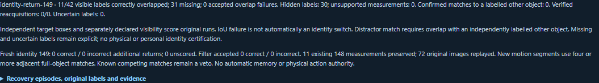
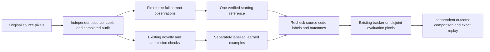
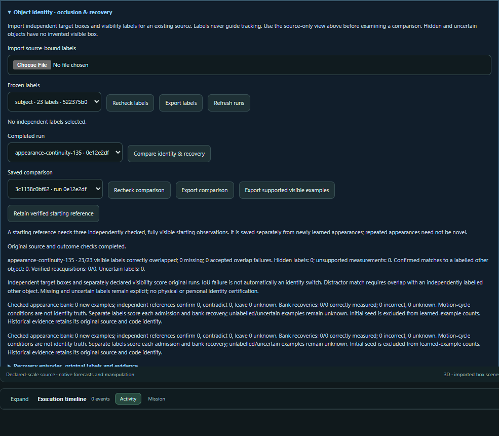
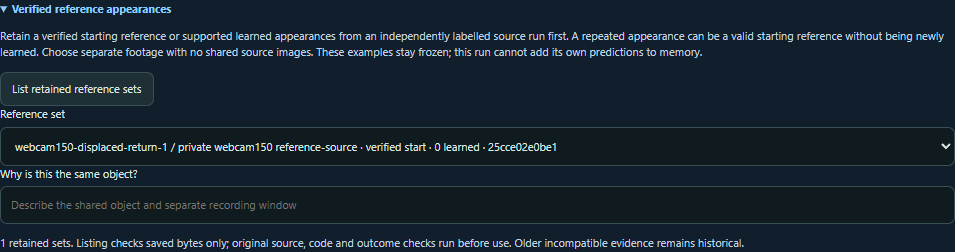

# Fraynix Agent Workspace — edition 150

**Keep a verified starting reference even when nothing new has been learned.** This edition separates source validity from appearance novelty, improves the private recorder's timing cues, and tests returns through the existing Java tracking and verification pipeline. Tracking defaults and identity thresholds stay unchanged.

**The verified starting-reference gap is fixed; physical return recovery remains unresolved. No tracker is promoted.**

On the new webcam recording, the donor is **23/23 correct** and contains **zero novel learned appearances**. The explicit edition 150 path retains one independently checked starting reference. Simple 139, parent 148, monitor 149 and candidate 149 each remain at **11/42 correct visible or partial observations, 31 missing, 0/30 hidden outputs and zero matches to the labelled red lighter**. Candidate 149 adds no recovered observations or new motion segment on this fresh camera sequence. Reference availability, software execution and useful physical recovery are separate outcomes.

The declared generated return control reaches **24/27 correct** with candidate 149, versus 4/27 for simple 139, parent 148 and monitor 149: **20 additional correct observations**, zero incorrect additions and 0/18 hidden outputs. The wrong-pattern-only control has 4/4 correct initial visible samples and 0/41 hidden or out-of-view outputs for every method. A separate actual process interruption after a positive generated segment reproduces the complete uninterrupted trace and independent audit after restart. These generated controls establish narrow software behavior and durability, not new camera accuracy.

The exposed edition 149 long-cover recording now supplies a verified starting reference despite zero learned novelty. All four evaluation methods reach **29/30 correct, one missing, 0/62 hidden outputs and zero matches to labelled other objects**. Candidate 149 adds no recovered observations. The simple control already achieved the same result. The complete five-run workflow passed source checks, export, cold reopening, source-corruption refusal and restoration in **2051.842 seconds**. Its 62-sample cover remains explicitly exploratory and is not relabelled as a fresh qualifying sequence.

The implementation supplies source evidence without changing existing tracker mathematics, identity thresholds, learned-example admission or defaults. There is no automatic appearance admission or physical action authority. A differently colored red lighter and rendered wrong-pattern controls do not establish identical-object discrimination; invisible identical substitution remains unresolved.

[Previous edition](README-149.md) · [Offline guide](docs/readmes/150/index.html) · [All editions](docs/readmes/INDEX.md) · [Contributor handoff](README-CONTRIBUTORS.md) · [Architecture](docs/ARCHITECTURE.md) · [Integrated roadmap](docs/INTEGRATED_AGENT_ROADMAP.md)



Actual app screenshots captured 2026-11-16 (UTC). Each linked screenshot has its original capture receipt and hash-bound visual review in this edition’s evidence. Private source imagery is hidden.

## The connected application and its destination

Fraynix remains one local application connecting chat, a persistent Java physics world, Game Lab, browser observations, data analysis and verified creation procedures. Java owns durable tasks, state, validation and recovery; the desktop hosts the browser, canvas and controls. A local language model can choose and explain installed actions. The destination is an agent that observes, builds, tests and retains useful procedures from measured outcomes.

The camera work supplies evidence to that architecture. It is not a replacement for the world, browser or creation tools. Observed, predicted and unknown states must remain distinguishable. Image similarity does not authorize physical manipulation, certify semantic identity or resolve an unseen identical substitution.

| Area | Existing application role | Evidence and scope |
| --- | --- | --- |
| Chat and durable tasks | A configured local model chooses installed actions; Java maintains task state, checks outcomes and resumes interrupted work. | [Connected task evaluation](README-126.md). This camera study makes no new language-model capability claim. |
| World and Game Lab | Persistent scene state, actual physics execution, construction, playable levels and controller experiments. | [Integrated roadmap](docs/INTEGRATED_AGENT_ROADMAP.md), [level creation plan](docs/PLAYABLE_LEVEL_CREATION_PLAN.md). A simulation result is not independent physical-world truth. |
| Data and creation | Analyze fresh input, build working artifacts, verify calculated values and retain qualified procedures. | [Fresh-input implementations](README-103.md), [numerical and restart checks](README-107.md). Retained code still needs fresh source/outcome checks. |
| Browser and observation | Use the hosted browser and installed observation tools; connect evidence to a durable task or artifact. | [Observation-to-artifact workflow](README-128.md). Tool access follows installed capabilities and policy. |
| Procedure history | Inspect, retire and reactivate saved procedures while preserving evidence; archive completed history within the existing active limits. | [Procedure lifecycle](README-127.md), [history architecture](README-113.md). Persistence does not itself establish improved performance. |
| Camera references | Separate a verified starting observation from newly learned appearances, then compare recovery on disjoint footage. | This edition's measured results and original-source checks below. No automatic appearance admission or default promotion. |

## Run the workspace locally

Use JDK 21, Node.js/npm and the repository's Gradle wrapper. The Windows launcher checks Java and Node, prepares the engine and verifies the locked desktop dependencies. A first preparation may need network access to obtain dependencies; `-Offline` uses an already prepared cache. Local-model chat additionally needs the chosen model/server available locally. Web browsing still needs access to the requested sites.

From a fresh checkout, choose a separate project for review:

```powershell
git clone https://github.com/eyeoverthink/Fraynix-Agent-Workspace.git
cd Fraynix-Agent-Workspace
$env:FRAYNIX_WORKSPACE_PROJECT = Join-Path $env:USERPROFILE '.fraynix-agent-workspace/projects/edition150-review'
.\scripts\Start-Agent-Workspace.ps1
```

For an already provisioned installation, prepare and validate without opening the interface:

```powershell
.\scripts\Start-Agent-Workspace.ps1 -PrepareOnly -Offline
```

Keep an existing private project's path explicit when continuing it. Use **Stop Java & close app** before rebuilding an installation it owns; closing only the desktop may leave the Java runtime active. The launcher checks ownership before rebuilding. The edition 150 tests use isolated project directories and preserve the existing review world. See [the launcher](scripts/Start-Agent-Workspace.ps1) for the actual preparation and ownership checks.

## The gap this edition addresses

In edition 149's exploratory recording, the donor tracked all 23 scored samples correctly, yet every considered new appearance was already represented. The learned-example path correctly rejected duplicates. Because no learned set existed, reference-dependent tracking was unavailable. The successful simple fallback was not a success of the new recovery method.

Edition 150 adds a separate explicit retention action. It does not lower novelty thresholds or pretend repeated frames are new learning. A valid, independently checked starting observation can supply a reference while the learned-example count remains zero.



## What changed

- **Explicit starting reference:** the first three scored source observations must be fully visible, accepted and independently correct, with target overlap at least 0.85 and labelled-other-object overlap below 0.2. A missing or unsuitable start refuses; later good samples cannot replace it.
- **Original pixels, independent box:** one descriptor is rebuilt from the first scored observation (ordinal 1) and its independent label. In these donor clips, that is original recording frame 2; original frame 1 is the unscored seed at ordinal 0. The seed is not independently certified. Saved evidence records one starting reference and zero newly learned appearances.
- **Durable and inspectable:** the new kind uses the existing atomic, content-addressed reference store. The UI distinguishes starting references from learned examples. Reopening and use repeat the original source, code, label, outcome and descriptor checks.
- **Unchanged recovery algorithms:** existing foreground139, parent148, monitor149 and candidate149 are compared. The new action supplies verified source evidence; it does not change their matching thresholds, learned admission rules or physical authority.
- **Clear recorder timing:** a visible countdown and explicit COVER / MOVE AND UNCOVER windows replace contradictory pacing. Completion saves automatically. A missed deadline preserves an incomplete attempt and releases the camera.

Limits remain six selected reference examples, 64 retained sets shared by both kinds, 96 frames per dataset, 16 datasets, 24 runs and 20 MB exports. Evaluation images cannot also be donor images. Same-object correspondence remains an operator declaration, not semantic proof. No model, cloud service or external production library was added. The default remains `legacy-flow`; no candidate is promoted.

## Review it in the app

1. Use an isolated project or preserve the current private project path. Start with the existing Windows launcher, Java 21 and installed desktop dependencies.
2. Import a clear source recording and independent source-only labels before tracking. Run **Continuity and checked appearances**, then compare it with the independent labels.
3. In **Object identity · occlusion & recovery**, open that verified comparison and click **Retain verified starting reference**. The UI reports one starting reference and zero new learned appearances. The existing learned-example export remains separate.
4. Choose disjoint evaluation footage. Open **Verified reference appearances**, refresh the list, select the entry marked **verified start · 0 learned**, and explain the same-object correspondence.
5. Explicitly select a reference-dependent experimental method. Review missing samples, wrong overlaps, labelled distractors, hidden outputs and the cost. Keep forecasts separate from measured observations.
6. Export the complete evidence or reopen the project. A public hash or derived publication view cannot replace original private images when the verifier rechecks the evidence.

## Recorder and fresh footage





The private study recorder starts camera access only when **Start private preview** is clicked. It records no microphone audio.

| Stage | Required action |
| --- | --- |
| 34 clear samples | Both lighters visible; hands away. |
| COVER · 12 seconds | Cover all of black, remove hand, click Covered. Keep red visible. |
| 18 covered samples | Hold black fully hidden. |
| MOVE AND UNCOVER · 15 seconds | Move the whole black lighter under cover, reveal immediately, remove hand, click Returned. Do not wait for another cue. |
| 24 return samples | Leave both objects still; automatic save and camera release. |

The source contract fixes donor frames 1–24 and every evaluation frame 25–end. All frames and actual timestamps remain. A brief partial reveal transition is retained and scored; no hidden interval is trimmed. Source eligibility is checked before predictions. See the [prospective camera contract](docs/publication150/CAMERA_PROTOCOL_150.md) and [method protocol](docs/publication150/PROTOCOL_150.md).

The first physical attempt (`attempt-XcWjK6`) stopped at the MOVE AND UNCOVER deadline. Its 74 original samples remain preserved. Source-only review found no returned interval; the attempt is incomplete, ineligible and was never tracked.

The second attempt (`attempt-DvCN5e`) saved automatically with 97 original samples over approximately 100.7 seconds. The user confirmed moving the same black lighter while covered and revealing it at the new position. Every original frame was reviewed before predictions. Frames 1–24 form the reference; every frame 25–97 forms the evaluation, with original timestamps and no stride, trimming or retiming. The scored evaluation has 41 fully visible samples, one partial sample and 30 fully hidden samples. The full return begins at source frame 68 and remains clear for 30 samples.

Manual source boxes give approximately **62.9 pixels of center displacement**, above the frozen 22-pixel minimum. This is an image-plane measurement with manual boundary uncertainty, not calibrated real-world distance. Black moved right toward red, away from the tape, contrary to the directional instruction, and rotated slightly. Those deviations are retained. The predeclared eligibility rule checks displacement magnitude; it was not changed. Red remains separately visible and labelled during cover and return; a differently colored red lighter does not establish identical-lookalike discrimination.

The prospective camera contract was committed at `bd8f33e3` before real preview. Source-only labels and hashes were committed at `2fb5140e` before any tracking. The first import refused an object-description label longer than the existing 80-character maximum. Only that display label was shortened at `85b5c02b` before retrying import; original rejected packs, failure receipts, pixels, timestamps, seed boxes, independent labels and eligibility remain preserved. No tracking result existed before that correction.

Passing source eligibility establishes that this is a usable test recording. Recovery accuracy, wrong-object rejection, verification and complete workflow cost are reported separately below. The default remains unchanged.

## Sources and outcomes

| Source / role | Evidence domain | Original samples | Visible / partial | Fully covered |
| --- | --- | --- | ---: | ---: |
| generated150-donor / reference-source | exposed-generated-control | 1–13 | 12 / 0 | 0 |
| generated150-return / evaluation | exposed-generated-control | 1–46 | 27 / 0 | 18 |
| generated150-wrong-pattern / evaluation | exposed-generated-control | 1–46 | 4 / 0 | 18 |
| black-lighter-long-cover-exploratory-1 / reference-source | exposed-real-camera | 1–24 | 23 / 0 | 0 |
| black-lighter-long-cover-exploratory-32 / evaluation | exposed-real-camera | 32–124 | 30 / 0 | 62 |
| webcam150-displaced-return-1 / reference-source | fresh-real-camera | 1–24 | 23 / 0 | 0 |
| webcam150-displaced-return-25 / evaluation | fresh-real-camera | 25–97 | 41 / 1 | 30 |


| Source / method | Correct / visible | Missing | Wrong overlap | Hidden outputs | Other-object matches |
| --- | ---: | ---: | ---: | ---: | ---: |
| black-lighter-long-cover-exploratory-32 / foreground-guard-139 | 29/30 | 1 | 0 | 0/62 | 0 |
| black-lighter-long-cover-exploratory-32 / path-confirmation-148 | 29/30 | 1 | 0 | 0/62 | 0 |
| black-lighter-long-cover-exploratory-32 / identity-monitor-149 | 29/30 | 1 | 0 | 0/62 | 0 |
| black-lighter-long-cover-exploratory-32 / identity-return-149 | 29/30 | 1 | 0 | 0/62 | 0 |
| generated150-return / foreground-guard-139 | 4/27 | 23 | 0 | 0/18 | 0 |
| generated150-return / path-confirmation-148 | 4/27 | 23 | 0 | 0/18 | 0 |
| generated150-return / identity-monitor-149 | 4/27 | 23 | 0 | 0/18 | 0 |
| generated150-return / identity-return-149 | 24/27 | 3 | 0 | 0/18 | 0 |
| generated150-wrong-pattern / foreground-guard-139 | 4/4 | 0 | 0 | 0/41 | 0 |
| generated150-wrong-pattern / path-confirmation-148 | 4/4 | 0 | 0 | 0/41 | 0 |
| generated150-wrong-pattern / identity-monitor-149 | 4/4 | 0 | 0 | 0/41 | 0 |
| generated150-wrong-pattern / identity-return-149 | 4/4 | 0 | 0 | 0/41 | 0 |
| webcam150-displaced-return-25 / foreground-guard-139 | 11/42 | 31 | 0 | 0/30 | 0 |
| webcam150-displaced-return-25 / path-confirmation-148 | 11/42 | 31 | 0 | 0/30 | 0 |
| webcam150-displaced-return-25 / identity-monitor-149 | 11/42 | 31 | 0 | 0/30 | 0 |
| webcam150-displaced-return-25 / identity-return-149 | 11/42 | 31 | 0 | 0/30 | 0 |


Correct means at least 0.5 overlap with the independently labelled target. Missing measurements remain in the denominator. Wrong overlap, hidden measurements and matches to labelled other objects are separate counts. Manual source-only camera labels are independent of predictions but are not externally instrumented truth. The differently colored red lighter does not establish identical-lookalike discrimination.

| Source / method | Additional correct / incorrect | Filter-accepted additional correct / incorrect |
| --- | ---: | ---: |
| black-lighter-long-cover-exploratory-32 / foreground-guard-139 | 0 / 0 | 0 / 0 |
| black-lighter-long-cover-exploratory-32 / path-confirmation-148 | 0 / 0 | 0 / 0 |
| black-lighter-long-cover-exploratory-32 / identity-monitor-149 | 0 / 0 | 0 / 0 |
| black-lighter-long-cover-exploratory-32 / identity-return-149 | 0 / 0 | 0 / 0 |
| generated150-return / foreground-guard-139 | 0 / 0 | 0 / 0 |
| generated150-return / path-confirmation-148 | 0 / 0 | 0 / 0 |
| generated150-return / identity-monitor-149 | 0 / 0 | 0 / 0 |
| generated150-return / identity-return-149 | 20 / 0 | 20 / 0 |
| generated150-wrong-pattern / foreground-guard-139 | 0 / 0 | 0 / 0 |
| generated150-wrong-pattern / path-confirmation-148 | 0 / 0 | 0 / 0 |
| generated150-wrong-pattern / identity-monitor-149 | 0 / 0 | 0 / 0 |
| generated150-wrong-pattern / identity-return-149 | 0 / 0 | 0 / 0 |
| webcam150-displaced-return-25 / foreground-guard-139 | 0 / 0 | 0 / 0 |
| webcam150-displaced-return-25 / path-confirmation-148 | 0 / 0 | 0 / 0 |
| webcam150-displaced-return-25 / identity-monitor-149 | 0 / 0 | 0 / 0 |
| webcam150-displaced-return-25 / identity-return-149 | 0 / 0 | 0 / 0 |


| Donor | Verified starting references | Newly learned examples available | Learned-only refusal |
| --- | ---: | ---: | --- |
| black-lighter-long-cover-exploratory-1 | 1 | 0 | No independently supported fully visible examples in this audit |
| generated150-donor | 1 | 0 | No independently supported fully visible examples in this audit |
| webcam150-displaced-return-1 | 1 | 0 | No independently supported fully visible examples in this audit |


Generated controls are exposed rendered examples, not fresh-camera evidence. Reusing an earlier recording is exposed regression. Availability of a retained reference, software correctness and useful camera recovery are separate findings. Unavailable or failed methods must remain explicit.

## Verification and restart

399 distinct Java checks and 164 desktop checks passed, plus kernel, agency, offline preparation and packaging. 19 actual app runs across 3 isolated study projects, plus a separate positive-segment process interruption. Source eligibility, reference availability and useful recovery are separate findings. Hosted CI is reported separately.

- Separate donor runs precede all fixed evaluation windows. Learned-only retention still refuses zero novelty; the explicit UI starting-reference path retains exactly one source reference after three independently verified full starting observations. Zero newly learned appearances is preserved. Compare simple139, parent148, monitor149 and candidate149 on identical pixels and the same starting-reference bank. Exposed real footage and generated controls are reported separately; no-reference cases retain an explicit baseline run and unavailability records. Independent host overlap/distractor/supplemental-outcome arithmetic agrees with Java. Monitor149 preserves every148 tracker/filter output; candidate preserves every148 measurement and independently scores additional149 returns. Four adjacent full-object per-reference confirmations and independent least-squares motion arithmetic are checked without using outcome labels. No automatic appearance admissions; defaults unchanged.
- Explicit method selection, recovery explanation, original-source overlay, independent audit UI, complete bounded export and exact stopped-prefix resume passed. Native physical world unchanged.
- Owned-process crash and cold reopen preserve exact completed-state bytes/timestamp and zero observation writes. All recorded runs/audits reverified, including original-pixel decision replay. Donor and evaluation source modification independently refuse audit/export; original restoration revalidates.
- Killed only the owned Java process after a confirmed new observed motion segment and while unfinished
- Cold reopen retained the exact committed prefix and interrupted status
- Resume reconstructed freshly observed motion and return decisions from original pixels before continuing
- Complete trace and independent outcome audit exactly match the uninterrupted run
- Native world unchanged; Additional observation run uses the existing capacity without expansion

The actual Java process was interrupted after a new measured motion segment on the generated control. Cold reopen retained that segment and the unfinished prefix. Resumption reproduced the complete uninterrupted trace and independent outcomes. This is a genuine process-recovery check on generated pixels, not a new physical-camera validation.

The initial reference, descriptors and forecasts do not train themselves. Independent labels remain downstream outcome evidence for evaluation footage. No predicted anchor or recovered estimate becomes a new source appearance automatically.

## Measured cost

| Source / method | Tracking ms | Replay/audit and retention ms |
| --- | ---: | ---: |
| black-lighter-long-cover-exploratory-32 / foreground-guard-139 | 28415.0 | 35974.6 |
| black-lighter-long-cover-exploratory-32 / path-confirmation-148 | 81200.1 | 103352.1 |
| black-lighter-long-cover-exploratory-32 / identity-monitor-149 | 201147.0 | 275112.5 |
| black-lighter-long-cover-exploratory-32 / identity-return-149 | 235835.2 | 274838.3 |
| generated150-return / foreground-guard-139 | 9387.5 | 10898.2 |
| generated150-return / path-confirmation-148 | 31922.4 | 49224.4 |
| generated150-return / identity-monitor-149 | 90789.2 | 148090.3 |
| generated150-return / identity-return-149 | 104322.6 | 148322.2 |
| generated150-wrong-pattern / foreground-guard-139 | 28131.8 | 11403.5 |
| generated150-wrong-pattern / path-confirmation-148 | 55242.2 | 49432.1 |
| generated150-wrong-pattern / identity-monitor-149 | 111820.4 | 147046.1 |
| generated150-wrong-pattern / identity-return-149 | 120218.7 | 145159.2 |
| webcam150-displaced-return-25 / foreground-guard-139 | 21839.6 | 30106.9 |
| webcam150-displaced-return-25 / path-confirmation-148 | 67235.3 | 98778.1 |
| webcam150-displaced-return-25 / identity-monitor-149 | 160145.7 | 246400.4 |
| webcam150-displaced-return-25 / identity-return-149 | 186735.8 | 245780.2 |

Complete black-lighter-long-cover-exploratory workflow: 2051.8s, 5 runs, 12380588 exported bytes, including checks, UI, source replay and retained retry intervals.

Complete generated150 workflow: 1941.8s, 9 runs, 1128939 exported bytes, including checks, UI, source replay and retained retry intervals.

Complete webcam150-displaced-return workflow: 1821.5s, 5 runs, 10094488 exported bytes, including checks, UI, source replay and retained retry intervals.

Positive-segment interrupted-process check: 312.6s. Camera-free screenshot checks: 996.7s.


Times include the actual local CPU workload and original-source replays. They are not a real-time throughput guarantee. Tracking time alone omits import, retention, verification, export, restart and UI costs. Faster execution must preserve every source and outcome check.

## Attempts, limitations and provenance

- The implementation and comparison inputs were frozen at `b851a1d8` before the generated app comparison. Existing 149 tracking thresholds and matching logic were preserved. The new starting-reference path is an explicit source-retention operation, not automatic learning or candidate promotion.
- Five new starting-reference Java checks and the existing retention and memory checks passed before the app study. The first focused log is preserved. A subsequent fixture-generator run replaced Gradle's current XML, so the final regression has a separate retained set of XML results.
- Recorder attempt `attempt-WbPr6k` failed its synthetic-camera self-test because inline script injection was blocked by the existing content-security policy. The timing script was loaded from the existing local app origin instead; the policy was not relaxed. The original failed attempt remains recorded.
- Synthetic-camera attempt `attempt-qndMSc` passed the full recorder lifecycle with 76 saved samples, but predates the final recorder hash. Its receipt remains historical; the separate final-hash self-test is recorded below. Attempt `attempt-l4Z7x5` tested a missed action deadline with 45 saved samples: it preserved an incomplete attempt and stopped camera access.
- The fresh camera contract fixes donor frames 1–24 and every evaluation frame 25–end. It permits up to five retained and separately scored partial-reveal frames before a fully visible return; it does not trim, retime or relax edition 149's prior refusals. Ten source-preflight checks passed before physical capture. Physical-action confirmation cannot override what the source pixels show.
- Source images, image descriptors and private projects remain local. Published views strip reconstructible appearance arrays, retain hashes of the unchanged private originals and cannot substitute for those originals in a verifier.
- The complete generated app comparison passed all nine runs, export integrity, exact monitor/parent preservation, zero-write cold reopening, altered donor/evaluation source refusal and restoration. It took 1941.82 seconds including all work; tracking alone was 553.11 seconds and audit/retention was 710.37 seconds. These are measured generated-control costs, not a live camera throughput claim.
- The separate actual process interruption occurred after a new, accepted 149 motion segment and before completion. Cold reopening retained the exact committed prefix. Resume reproduced the entire uninterrupted trace and independent audit, with no native-world change.
- Final recorder synthetic-camera attempt `attempt-Cj5oQl` passed with 76 saved samples under final recorder hash `2b4589e6...`. The earlier full-lifecycle receipt is preserved separately. The camera-off controls screenshot was actually viewed and hash-bound. Camera source protocol was frozen at `bd8f33e3` before any real preview; no physical footage is substituted by these synthetic lifecycle checks.
- First physical attempt `attempt-XcWjK6` saved 74 original samples and closed the camera at the 15-second MOVE AND UNCOVER deadline. The user reported a missed action. All 74 original images were reviewed before any predictions; black was partially covered at frame 38, fully covered at frames 39–74, with no returned interval. The attempt remains incomplete and ineligible; no tracking was run. The repeat retains the frozen recorder, source criteria and all originals.
- Second physical attempt `attempt-DvCN5e` completed 97 samples with 30 fully hidden and 30 clearly returned samples. Every original was reviewed before predictions; the user confirmed same-target movement. Black moved toward red rather than toward the tape and rotated slightly; the 62.9-pixel displacement passes the unchanged magnitude gate. The direction deviation is recorded. Source labels and hashes were committed at `2fb5140e` before tracking.
- The initial app import refused a description longer than 80 characters, before any tracking run existed. Correction `85b5c02b` shortened only the object display label to **Black target lighter**; original rejected packs and the failed project and receipt are retained. All source pixel bytes, actual timestamps, seed geometry, independent labels and criteria are unchanged. The complete fresh comparison uses a new isolated study project after that declared correction.
- Final regression passed **399 distinct Java checks** with no failures, errors or skipped cases, and **164 desktop checks** with no failures or skips. The selected Java suite took 3347.86 seconds. Kernel integration, actual agency integration, isolated offline launcher preparation, packaging and build-receipt verification also passed. This is a selected regression suite, not a claim that every historical test or every application capability was re-evaluated.
- The complete fresh-camera study passed all five runs and the execution, export, cold-reopen, source-corruption refusal and restoration checks in **1821.455 seconds**. These checks establish execution and evidence integrity; all four evaluation methods still miss the returned target. The original failed import and incomplete camera attempt remain separate evidence.

- Documentation uses the original full comparison receipts for every method. To avoid repeating expensive audits solely for duplicate screenshots, a separate read-only helper captures the fresh candidate and both generated candidate results, while the older-camera capture retains every method. Each displayed run still passes its original source, audit, unchanged-world and zero-write checks. The frozen comparison and original capture helpers are unchanged; the focused capture helper records its own hash. These are documentation selections, not omitted comparison runs.

- The exposed edition 149 long-cover recording now supplies a verified starting reference despite zero learned novelty. All four evaluation methods reach **29/30 correct, one missing, 0/62 hidden outputs and zero matches to labelled other objects**. Candidate 149 adds no recovered observations. The simple control already achieved the same result. The complete five-run workflow passed source checks, export, cold reopening, source-corruption refusal and restoration in **2051.842 seconds**. Its 62-sample cover remains explicitly exploratory and is not relabelled as a fresh qualifying sequence.

- The focused documentation helper uses the actual **Recheck comparison** UI action. That action calls `AssociationAudit134.readAudit`, whose evaluation reads and verifies the stored run, references, source pixels, labels and outcomes. It then compares the returned audit exactly with the completed study. Redundant direct audit calls are omitted only from this new documentation helper; production verification, the original comparison harness and the frozen capture helper are unchanged. The helper has a bounded 15-minute UI wait to accommodate the measured replay cost; it changes no tracker, identity or source-eligibility deadline.

Private camera pixels, sampled RGB descriptors and private project stores stay local. Publication includes camera-free app screenshots, source hashes, labels and clearly marked derived receipt views. Omitted arrays retain hashes and the complete private original's hash/length. Derived public views cannot substitute for original verifier inputs. Historical editions 001–149 retain their frozen bytes.

[Verification](docs/readmes/150/verification.json) · [Comparison data](docs/readmes/150/comparison.json) · [Original evidence inventory](docs/readmes/150/original-evidence.json) · [Source declaration](docs/publication150/source150.json) · [Implementation lock](docs/OBSERVATION_150_LOCK.json)

## Next steps

1. **Measure useful physical recovery.** Separate whether a valid reference is available from whether the tracker finds the returned target. Report complete cover, return, missing samples and wrong-object outcomes together. Keep candidate methods explicit until independent new footage supports a promotion.
2. **Diagnose search and appearance separately.** After evaluation, compare independently labelled target crops with actual bounded search proposals. Identify missed locations, changed scale, partial covers and rival vetoes without feeding evaluation labels into live tracking or retaining drift as memory.
3. **Strengthen identity tests.** Add a same-color, similarly shaped distractor and a wrong-object-only return interval under a separately frozen source contract. A red comparison lighter is useful negative evidence but does not establish discrimination between identical-looking objects. Keep invisible substitutions unresolved without an independent witness.
4. **Reduce cost only with equivalent checks.** Measure complete source validation, search, audit, export and cold restart costs. Reuse validated computations only when exact source, labels, code and outcome identities match; preserve corruption refusal and fresh reconstruction after restart. Show explicit audit and replay progress so a long verification step does not look like a stalled tracker.
5. **Return qualified observations to durable agent tasks.** Connect an observed motion segment to a chat-driven report or working artifact with original evidence links. Separate measured, predicted and unknown states; unresolved visual identity must not grant physical action authority. Keep the existing Java world, Game Lab, browser and creation tools central.
