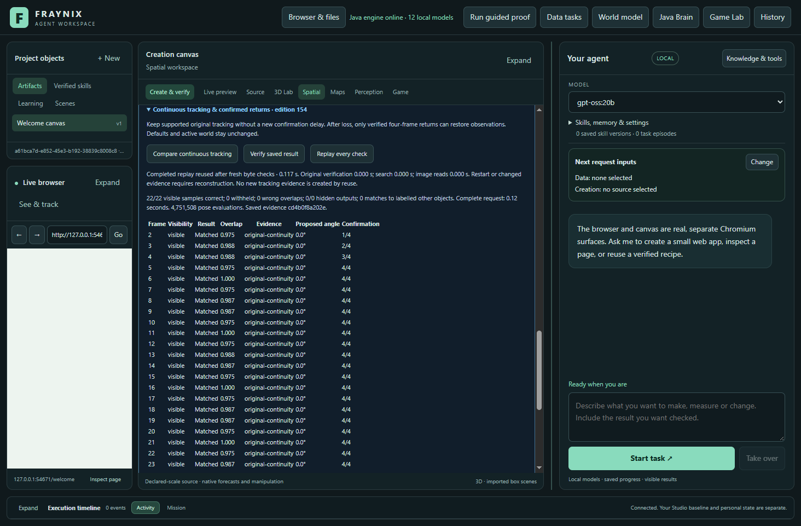
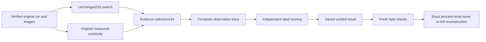

# Fraynix Agent Workspace — edition 154

**Keep a supported track. Confirm a return. Reuse only verified work.** 2026-11-17.

[Previous: edition 153](README-153.md) · [All editions](docs/readmes/INDEX.md) · [Offline interactive guide](docs/readmes/154/index.html) · [Verification](docs/readmes/154/verification.json)

The explicit Java comparison preserves supported original tracking and retains every confirmed 153 return. On the exposed camera recording it scores 34/42 correct visible/partial observations, versus 31/42 with 153; 8 remain withheld. There are 0 wrong overlaps, 0/30 hidden outputs and 0 matches to the labelled red object. All six new generated cases pass their declared outcome gates. Warm reopening takes 0.151 seconds median, with full byte checks; cold or forced verification still reconstructs. Defaults remain unchanged.

## The application and this step

Fraynix remains one local agent workspace with a Java runtime, persistent world, physics, Game Lab, browser, creation canvas, durable tasks and verified procedures. Perception supplies observations to that wider system; it does not replace it. A useful observation needs a source, a declared domain, an identity decision and an honest account of what remains unknown. This edition improves continuity and the cost of checking that evidence.

The user selected recorded tests only. The earlier camera sequence is exposed development and regression material, not new footage. Six separately rendered sources test new motion, disappearance, rotation and competing-object conditions. Existing tracking defaults, historical tracker identities, native world state and appearance memory remain unchanged. The new path is an explicit comparison that can be reviewed before it becomes an input to a wider agent task.

## Try the actual controls

Open **Spatial → Object identity → Continuous tracking & confirmed returns · edition 154**. Select an independently audited recording and choose **Compare continuous tracking**. The app verifies the original sources and outcomes, runs the unchanged edition 153 search, and decides which observations have sufficient continuity or return evidence. Progress remains visible while the calculation runs.

The table identifies each output as `original-continuity`, `confirmed-return-153`, or `withheld`. It also shows independent visibility labels, target overlap, proposed image angle and confirmation count. Original continuity can be accepted before the fourth new search confirmation because it already has an uninterrupted measured history and fresh corroboration. A newly returned object cannot use that shortcut.

**Verify saved result** checks the saved receipt and original evidence again. A completed replay can be reused only inside the current process when all relevant bytes still match. **Replay every check** explicitly reconstructs the original audit and the complete new comparison. Restarting also requires reconstruction. The interface distinguishes reuse from a fresh replay and displays the measured request, original-verification, image-reading and search costs.

A saved search receipt is not a new camera sample. Reopening it does not train the model, add an appearance, move a simulated body or authorize a physical action. Proposed angles remain image-search hypotheses rather than calibrated physical pose. The default tracker is still `legacy-flow`; the earlier 152 and 153 comparisons remain available.

## Why combining the two paths matters

Edition153 recovered 23 of 30 returned frames on the exposed recording, but its independent four-frame confirmation delayed the initial observations too. The existing tracker already had useful evidence at that point. Starting a fresh confirmation sequence on every comparison discarded three valid initial measurements. Simply taking whichever tracker supplied a box would introduce a different problem: an old track could jump to a lookalike after loss and bypass return verification.

Edition154 treats the original uninterrupted segment and a newly confirmed return as different evidence. It preserves the original measured box exactly while all of these conditions hold:

| Original-segment requirement | Rule |
| --- | --- |
| Original measurement | Its existing observation filter accepted it, and the tracker reports `tracked` |
| Current local motion | Pyramidal flow, no ambiguity, at least eight inliers, forward/backward error at most 1.2 pixels |
| Adjacent continuity | Original boxes overlap by at least 0.55 intersection-over-union |
| Current full-object support | A freshly sampled strong unique hypothesis overlaps the original box by at least 0.7 |
| Competing objects | The complete rotation search has no retained ambiguity veto |

These conditions use the original run and current image-search evidence. They do not inspect evaluation target locations, visibility labels or whether the answer later scores as correct. There is no label-based choice of the better tracker. The source object's original seed and binding identify which original trace is being considered.

Any failed condition closes the original segment permanently for this comparison. A later original `tracked` or `reacquired` box cannot reopen it. After loss, only the unchanged edition 153 confirmation can supply a return. That path still requires four adjacent strong unique matches to the same original reference, optical-flow consistency, all appearance thresholds and the full competing-object search. A subsequent loss still produces a missing observation until the evidence is sufficient again.

When continuity passes, the exact original box is retained. Otherwise a confirmed 153 box is retained exactly; no averaging or geometric adjustment conceals disagreement. A conflicting or unsupported proposal is withheld. This is deliberately narrower than declaring every existing track valid. Its benefit must be assessed alongside missing frames and wrong-object outcomes.

## Results and limitations

| Source | Original correct | Nested 153 correct | Edition 154 correct | Withheld | Wrong / hidden / other | Full request s | Warm median s |
| --- | ---: | ---: | ---: | ---: | --- | ---: | ---: |
| continuous-motion | 22/22 | 19/22 | 22/22 | 0 | 0 / 0 of 0 / 0 | 5.08 | 0.119 |
| return-67 | 4/17 | 11/17 | 14/17 | 3 | 0 / 0 of 5 / 0 | 4.00 | 0.116 |
| wrong-only | 4/4 | 1/4 | 4/4 | 0 | 0 / 0 of 18 / 0 | 3.82 | 0.108 |
| near-copy-only | 4/4 | 1/4 | 4/4 | 0 | 0 / 0 of 18 / 0 | 3.66 | 0.107 |
| copy-veto | 4/17 | 1/17 | 4/17 | 13 | 0 / 0 of 5 / 0 | 3.94 | 0.108 |
| double-return | 4/24 | 15/24 | 18/24 | 6 | 0 / 0 of 10 / 0 | 5.60 | 0.109 |
| exposed150-camera | 11/42 | 31/42 | 34/42 | 8 | 0 / 0 of 30 / 0 | 218.57 | 0.151 |

The camera improvement is 3 preserved initial observations; it is not additional recovery after occlusion. The same 23/30 returned frames remain confirmed, and the same 7 remain withheld. The nested 153 trace matches the published trace exactly. 11 original camera boxes are retained numerically unchanged where continuity qualifies. The other accepted observations come from unchanged return confirmation.

The six generated cases comprise uninterrupted translated motion, a 67° return, a wrong-pattern-only return, a similar object with one changed quadrant, a target accompanied by an identical competing copy, and two cover/return episodes with a changed second orientation. Patterns and schedules were fixed before tracking. A separate Python calculation checks source corners, boxes and visibility against the Java source generator. Neither calculation calls a tracker.

The nested 153 comparison is the unchanged 153 tracker actually executed inside the new comparison on every frame. It is not a separately claimed application run. The camera's complete nested trace is also compared exactly with the published 153 trace for the same images. New source labels score only completed output. Confirmed153 outputs must remain present, and preserved original boxes must equal their original measured values.

The wrong-only, changed-quadrant and identical-copy tests retain all their initial visible observations and all their later negative or ambiguous intervals. A conservative refusal in the copy case is expected, even though one object is the original target. The system cannot resolve an invisible substitution by an identical-looking object without independent evidence. A red comparison lighter is visibly different from the black target and does not establish general lookalike discrimination.

No fresh webcam recording, general physical-accuracy promotion, calibrated 3D pose or language-model weight training is claimed. The remaining missing camera returns and the confirmation delays are part of the result. The app's underlying metric-scale and uncertainty limitations are not removed by better continuity.

## Reduce complete replay work without trusting stale files

The previous search repeatedly asked the observation store for the same immutable dataset while reading successive images. Each access correctly reread and hashed the growing observation history. The new path verifies a detached dataset manifest once, then opens each original image directly under that manifest. It checks path identity, image bounds and the exact original image hash before decoding. The complete source and implementation fingerprints are compared before and after processing. A changed manifest, image, label, run, reference or implementation still invalidates the result.

The reference access path remains available to the measurement helper. It runs the same selection, search, scoring and verification through the older per-image store access. Alternating complete forced replays compare the full deterministic evidence, not merely summary counts. Timing fields are kept outside evidence identity so elapsed time cannot change a result's content-derived ID. The complete paired access-path check uses the uninterrupted generated case and the exposed camera recording. The other generated cases receive the actual-app execution, warm-read and independent outcome checks described below. This separates a real reduction in redundant history reads from any change to tracking mathematics.

A second saving applies to reopening a completed result. At most eight serialized results, each no larger than 4 MB, are held in a process-local cache. Each request validates the selected file's checksum and rereads every relevant source and code byte before and after reuse. File size and modification time are never sufficient. Returned JSON is detached so editing a response cannot alter the retained proof. Missing observation history is refused instead of being silently initialized.

The fingerprint conservatively covers the original observation, label and appearance namespaces. Adding otherwise valid evidence can therefore invalidate an older receipt and require a new comparison; the system does not silently update that receipt to a new source state.

The cache does not survive restart. An explicit full replay, changed evidence, changed implementation, unavailable cache entry or failed source check requires reconstruction or refusal. Saved files are never accepted because they look like a previous receipt. A forged outcome with a newly calculated checksum must still reproduce the actual computation. The existing 64-result capacity and four background-job statuses remain separate from the eight-entry replay cache.

On the exposed camera, the first complete request took **218.572 seconds**; explicit full replay took **216.960 seconds**; cold restarted verification took **218.610 seconds**. Three unchanged warm reads had a median of **0.151 seconds**. These are different workloads.

| Complete forced comparison | Repeated history access median s | Verified manifest access median s | History reads per pair |
| --- | ---: | ---: | --- |
| generated | 4.369 | 4.336 | 29 → 6 |
| camera | 216.515 | 214.466 | 89 → 16 |

The generated source uses three alternating pairs; the camera uses one pair. Both paths reconstruct identical complete results and leave the project unchanged. Java 21, two active processors and a 768 MiB heap were used. A single camera pair cannot establish a stable speed advantage; the byte/read reduction and measured timing are reported separately. No outcome or source check is removed. [Exact timings](docs/readmes/154/qualification.json) are retained in the qualification receipt.

Complete request timings cover original verification, source setup, image reading, search, independent scoring, fingerprint checks and result handling. Source import, the initial baseline run, process startup and screenshot capture are separate. The paired command-line measurements open new stores before the timed forced request; store construction is not included. Warm timings apply only to reopening unchanged evidence in the same process. They are not live-camera throughput or faster processing of unseen frames.

## Verification and evidence

35 selected Java checks and 164 desktop checks passed, with no failures or skipped cases. Six new generated app comparisons and one exposed-camera comparison passed visible-control, forced-replay, cold-restart and source-integrity checks. Complete reference/snapshot-access evidence matches exactly. Independent geometry and separate outcome/cost gates passed. These are scoped checks, not a rerun of every historical capability. Recorded tests only.

The focused checks exercise initial preservation, irreversible loss of the original segment, unchanged return confirmation, prediction rejection, weak appearance, conflicting positions, competing objects, failed flow, detached results, background concurrency and cancellation. Service checks verify label isolation, full cold reconstruction, forced replay, a forged outcome with a recomputed checksum, source mutation with unchanged size and timestamp, and missing-history refusal without replacement data.

Actual Electron/Java studies use the visible compare, saved-verification and forced-replay controls. Each case receives three warm readings. The study closes its own app, starts it again and reconstructs a saved result. It alters an image byte while preserving file size and timestamp, requires refusal, then restores the original bytes. Original observation namespaces, private source projects and native world state are compared after the owned process closes. These checks do not close the user's unrelated application.

The first nine-check development suite passed, followed by 35 selected regression checks. An editing-time character-encoding issue in the desktop source was detected in the diff and corrected before freezing the method; historical text and tracker code were preserved. The method and qualification gates were committed at 11417dcb before generating reserved 154 sources. The first generated and camera application attempts passed their execution checks; no failed reserved app attempt was omitted.

GitHub CI was checked before implementation: both edition 153 publication runs had succeeded. Hosted verification for this edition is reported separately from local results. The full historical application suite is not represented by a selected local regression. Old README editions and original study outcomes remain frozen; later success does not rewrite an earlier failure or turn exposed material into a new evaluation.

Public screenshots omit private camera pixels. Public result receipts contain measurements and evidence identities, not reconstructible appearance arrays. Original camera images and source descriptors remain local. The published summaries cannot replace those private originals when a verifier requires them.

## Source map and next steps

| Source | Responsibility |
| --- | --- |
| [ContinuityReturn154.java](workspace-engine/src/main/java/fraymus/workspace/ContinuityReturn154.java) | Preserve supported original boxes; keep loss and return boundaries explicit |
| [ContinuityExperiment154.java](workspace-engine/src/main/java/fraymus/workspace/ContinuityExperiment154.java) | Verified image access, complete replay, bounded reuse and phase costs |
| [RotationReturn153.java](workspace-engine/src/main/java/fraymus/workspace/RotationReturn153.java) | Unchanged return confirmation and competing-object veto |
| [App panel](workspace-desktop/renderer/association134-panel.js) | Visible comparison, reuse, forced replay and evidence origin |
| [Actual app study](docs/publication154/study154.cjs) | Controls, timings, restart, corruption refusal and world preservation |
| [Replay measurement](docs/publication154/ReplayMeasure154.java) | Exact full-result comparison across image-access paths |
| [Source generator](docs/publication154/ContinuitySources154.java) | Declared new generated cases and source-only labels |

The [frozen method](docs/OBSERVATION_154_LOCK.json), [source inventory](docs/readmes/154/file-inventory.json), [evidence index](docs/readmes/154/original-evidence.json), [qualification](docs/readmes/154/qualification.json) and [Obsidian map](docs/obsidian/162-continuity-replay.canvas) connect the implementation to the measured result. Use a separate project for studies. The existing workspace launcher and normal Java world/browser/creation workflows remain available.

Next, measure continuity on more varied recorded views and partial covers without relaxing identity checks. Profile the remaining cold original-audit and search cost, including growing histories and reference banks; warm reopening is only one workload. Then use the verified observation episode in a durable chat-driven report or working artifact, with source links and clear measured, predicted and unknown states. The destination remains a connected local agent that can observe, act, verify and retain useful procedures across the whole application.
