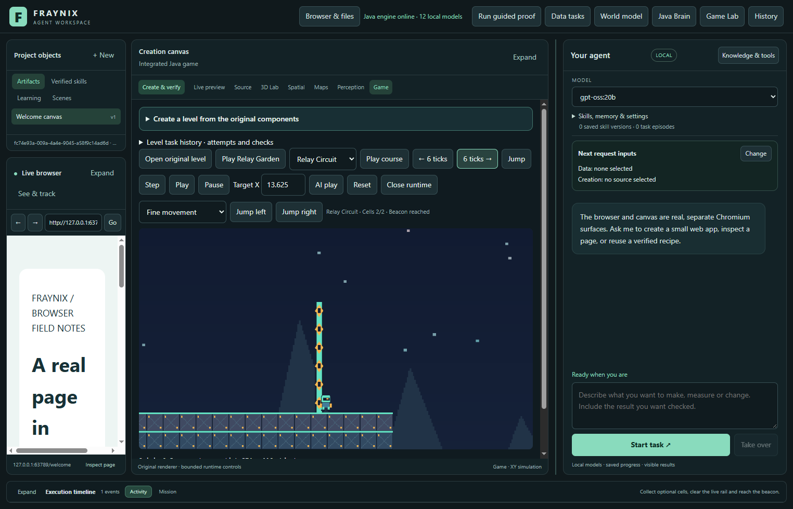
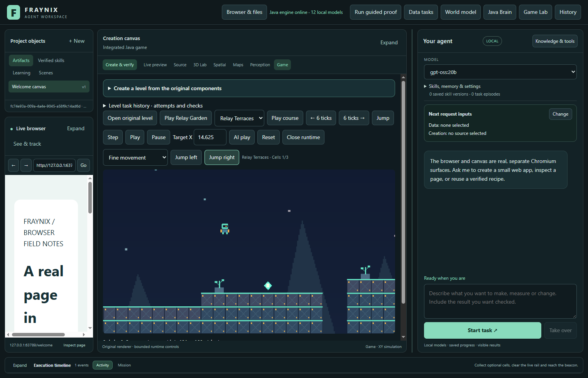
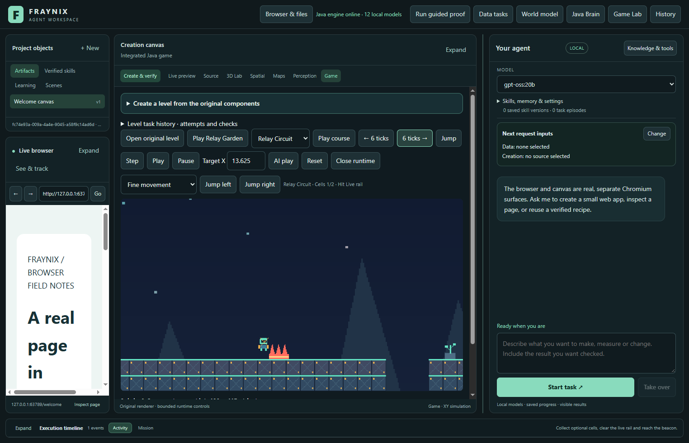
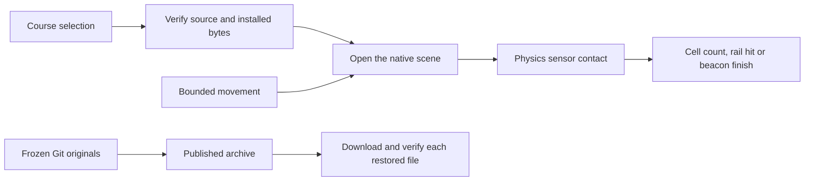

# Fraynix Agent Workspace — edition 168

**2026-11-18 · Relay Circuit, Relay Terraces and verified archive retrieval**

[Previous edition](README-167.md) · [Offline playthrough explorer](docs/readmes/168/index.html) · [Edition history](docs/readmes/INDEX.md) · [Architecture plan](docs/ARCHITECTURE_RENEWAL_PLAN.md)

## Play the new courses

Open **Game**, choose **Relay Circuit** or **Relay Terraces**, and click **Play course**. Use the arrow buttons to move. Choose **Fine movement** to line up a jump, then use **Jump right** or **Jump left**. Grab the bright cells, jump over the orange live rail, and reach the beacon. A rail hit ends the attempt and names the rail in the status row. **Reset** restores the starting position and all cells and hazards.

| Course | Layout | Pickups |
| --- | --- | --- |
| Relay Circuit | Flat deck, live rail and a 0.75-unit gap | Copper cell and Mint cell |
| Relay Terraces | Two deck rises, a 0.5-unit gap, high rail and a drop to the last deck | Lower, Midway and Return cells |







Screenshots are from the actual Java/Electron app on 2026-11-18. The [screenshot explorer](docs/readmes/168/index.html) also shows the narrower layout and recorded traces.

## What Java verifies

The generator builds both layouts directly from tile coordinates and draws the cell and rail atlas in Java. Both courses share the original Relay Garden robot, tiles, landscape and synthesized audio. The source and installed copies must match the selected manifest before the engine opens a course. Reset also requires the selected manifest to match the one used at launch. The Game Lab accepts known course IDs. Its access and active-task checks apply to the new route.

Cells and rails use JBox2D sensor fixtures. Touching a cell records its stable entity ID and simulation tick, removes it from the scene and increments the displayed count. Touching a rail records a separate event and calls the existing loss behavior. Beacon contact determines completion. The cell count is optional.

The legacy course opens by default. **Play Relay Garden** still opens the edition 167 course. The two new courses start in isolated game projects. Their contact history belongs to the current attempt and reset starts a fresh attempt.

## What passed

123 root Java tests, 20 selected workspace Java tests, 181 desktop tests and 10 archive tests passed. The workspace selection covers Game Lab, reference import, durable level tasks and route boundaries.

| Visible app test | Finish tick | Cells collected | Existing AI result |
| --- | ---: | ---: | --- |
| Relay Circuit | 374 | 2/2 | Hit Live rail |
| Relay Terraces | 402 | 3/3 | Hit High rail |

The visible-control tests drove both courses to the beacon and checked the recorded cell names. The native tests also checked both loss paths and reset. Reopening preserves the original robot ID, and the app restart test loaded Terraces with its original starting state. The app refused an unknown course and an unexpected replacement path while retaining the current session. The asset test refused a changed installed atlas and a missing source level.

The app trial’s first build check refused an older installed workspace package timestamp after a root-engine resource change. Repacking the workspace files cleared that check without changing application source. The logs retain the refusal and the successful package check.

The 60 compiled player, controller and physics classes and all 19 original Relay Garden files matched the edition 167 receipt. At the initial CI check, edition 167 had passed hosted archive and documentation checks and was still compiling and testing. See the [edition 167 workflow](https://github.com/eyeoverthink/Fraynix-Agent-Workspace/actions/runs/44278566429).

[Verification summary](docs/readmes/168/verification.json) · [Source inventory](docs/readmes/168/file-inventory.json) · [Controller identity check](docs/readmes/168/controller-identity.json)

## Archive retrieval

Edition 162 provided **74 frozen files** totaling **7,854,492 bytes**. The archive is **3,187,321 bytes** and was restored against the pinned original Git blobs. An additional copy on a second local volume restored the same bytes. Missing and corrupt providers were refused. The GitHub asset was downloaded and its nested historical batch was restored and compared with Git again. Original Git history is retained.

[Published evidence archive](https://github.com/eyeoverthink/Fraynix-Agent-Workspace/releases/download/evidence-168/evidence168.zip) · [Download and hash manifest](docs/readmes/168/original-evidence.json) · [Restoration receipt](docs/readmes/168/archive-download.json)

To download and verify the complete evidence asset into a new file:

```powershell
python scripts/evidence_archive.py download --manifest docs/readmes/168/original-evidence.json --archive evidence168-local.zip
```

## Build and inspect

Use JDK 21, `gradlew.bat prepareGameRuntime115 :workspace-engine:installDist`, and `npm ci` then `npm start` in `workspace-desktop`. Existing long checkout paths require Git long-path support on Windows. To regenerate the expansion into a new directory from the original shared media:

```powershell
gradlew.bat generateRelayCourses -PrelayCoursesOutput=build/my-relay-courses
```



## Next

Expose the rails and cells as typed observations for a course-aware AI trial. Compare that controller against these measured playthroughs before adopting it. Continue original content and archive migration, then validate a small install with licensed assets and a working first-run task.
