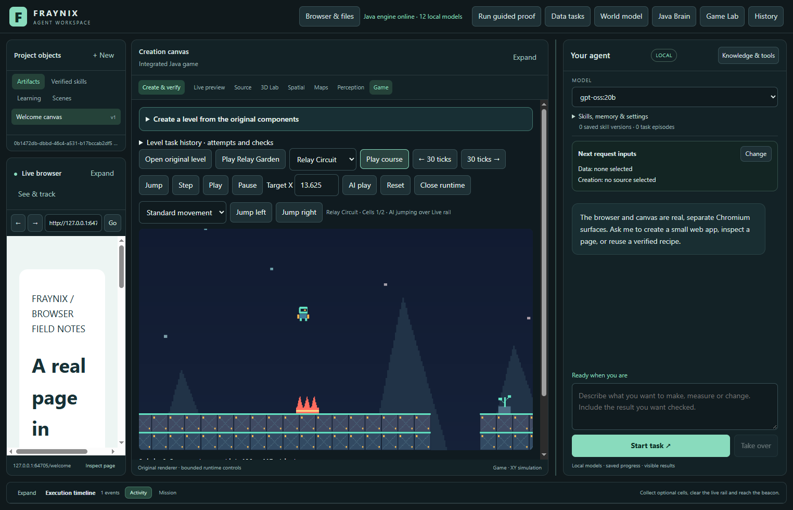
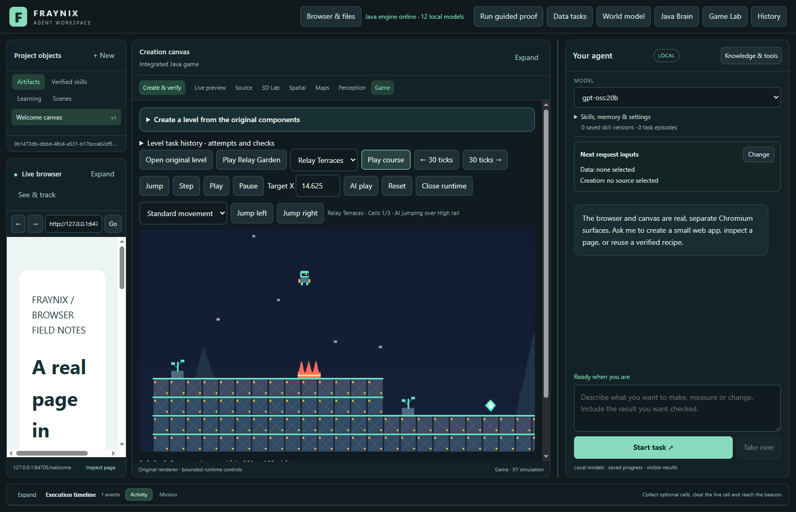
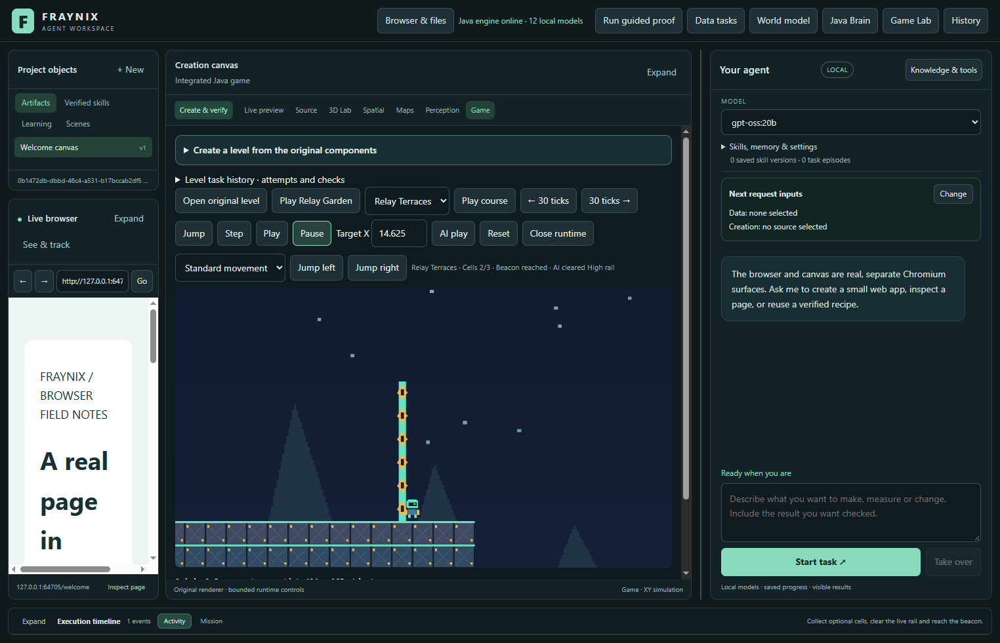
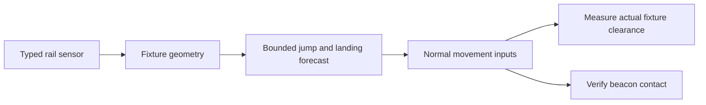

# Fraynix Agent Workspace — edition 169

**2026-11-18 · AI detects and clears rails in the original Relay courses**

[Previous edition](README-168.md) · [Offline rail and trajectory explorer](docs/readmes/169/index.html) · [Edition history](docs/readmes/INDEX.md) · [Architecture plan](docs/ARCHITECTURE_RENEWAL_PLAN.md)

## Run it

Open **Game**, choose **Relay Circuit** or **Relay Terraces**, click **Play course**, then click **AI play**. The status above the viewport shows when the AI is jumping over the rail, when it has cleared it, and when the robot reaches the beacon. **Reset** clears the attempt and restores the source level.







These screenshots are from the integrated Java/Electron Game Lab. The jump images use bounded AI steps so the crossing can be inspected in a still frame. The finish images use the visible **AI play** button.

## What changed in Java

Original courses mark their hazardous rails with a typed contact component. Java reads the actual JBox2D sensor fixture and its bounds. It checks the robot's direction, movement, immediate headroom and the rail ahead. A jump forecast uses a 90-tick window and looks for clearance across the fixture and a supported landing. If the forecast refuses a jump, the robot can slow its approach instead of committing to the jump.

The controller still sends horizontal and jump inputs through the existing input lease. During a crossing, it records the robot's actual fixture clearance on each overlapping tick. A crossing is recorded only after the robot passes the rail with positive measured clearance. A separate native beacon contact determines whether the course was completed. Manual rail contact still triggers a loss.

Relay Garden and the inherited course use their existing controller behavior. The new guard is scoped to verified original courses that have rails. The original 24 content files match their edition 168 bytes, and 59 previously tracked compiled controller and physics classes match. [Source and compiled identity checks](docs/readmes/169/controller-identity.json)

## Measured outcomes

Edition 168's comparison comes from the exact app receipt recovered from its published archive. The new values come from the same course content.

| Course | Edition 168 AI | Edition 169 bounded AI | Edition 169 visible AI Play | Forecast / measured clearance |
| --- | --- | --- | --- | --- |
| Relay Circuit | Hit Live rail at tick 121 | Beacon reached by tick 372 | Beacon reached by tick 373 | 0.680 / 0.666 |
| Relay Terraces | Hit High rail at tick 259 | Beacon reached by tick 402 | Beacon reached by tick 400 | 0.679 / 0.665 |

Clearance is the minimum distance from the bottom of the live player fixture to the top of the rail fixture during horizontal overlap. Values are in game units. Each successful crossing includes its fixture ID, launch and exit ticks, and the count of actual overlapping samples. Terraces finished with two of its three optional cells.

125 root Java tests, 21 selected workspace Java tests, 181 desktop tests and 10 archive-verification tests passed. The workspace selection includes original courses, legacy reference reconstruction, durable level tasks and server boundaries.

Forecast tests include a translated rail, the reverse direction, a late approach, an oversized hazard and an unsupported landing. The app test checks both courses, reset, cold reopening and the original Game Lab defaults. The forecast uses a bounded Java motor calculation and local game state.

## CI and evidence

The first CI check found a timeout in the edition 168 chat integration test while it waited for the local NDJSON stream. The archived test report identifies the wait site. The test fixture now serves explicitly typed NDJSON, closes the response, uses a dedicated executor and reports the operation and frame count on timeout. The test still checks response content, request hash, completion frames, context settings and saved evidence. [Edition 168 CI run](https://github.com/eyeoverthink/Fraynix-Agent-Workspace/actions/runs/44289743337)

[Actual test results](docs/readmes/169/verification.json) · [Recovered edition 168 comparison](docs/readmes/169/baseline.json) · [Evidence archive manifest](docs/readmes/169/original-evidence.json) · [Source inventory](docs/readmes/169/file-inventory.json)

To retrieve the raw app trials, the prior exact comparison and the test logs, choose a new output path and run:

```powershell
python scripts/evidence_archive.py download --manifest docs/readmes/169/original-evidence.json --archive evidence169-local.zip
```

## Build and inspect

Use JDK 21. Run `gradlew.bat prepareGameRuntime115 :workspace-engine:installDist` from the checkout, then `npm ci` and `npm start` from `workspace-desktop`.



## Next

Test pairs of rails and shifted approach speeds in new original courses. Reuse verified crossing receipts in durable playtesting and compare the tradeoff between optional pickups and the safer route.
