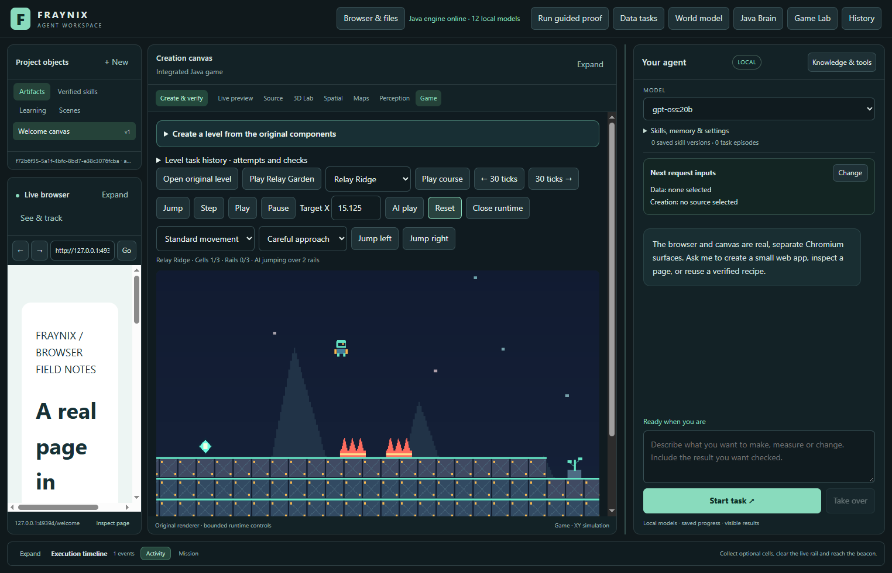
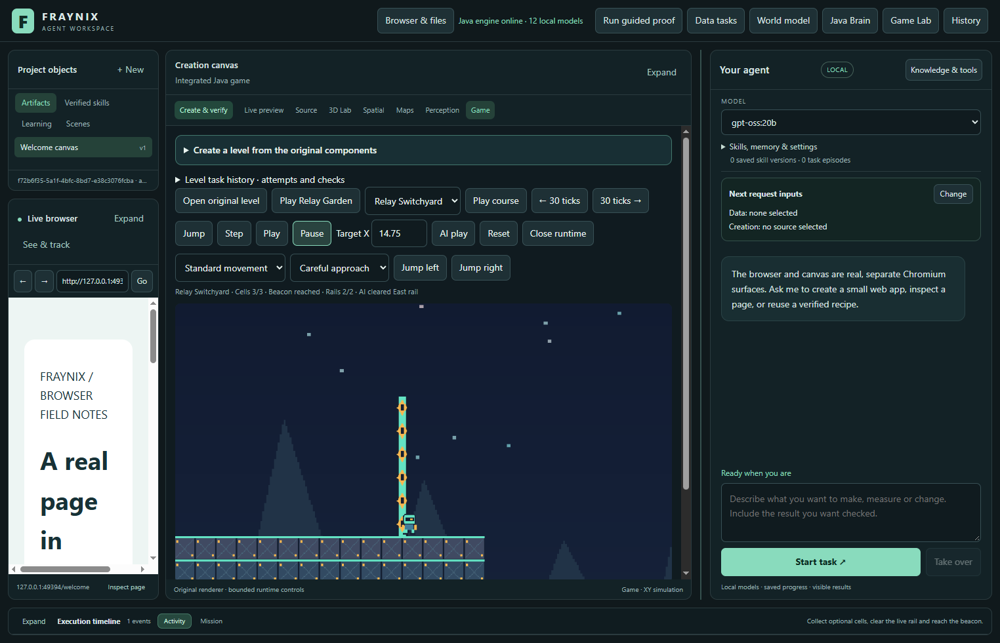
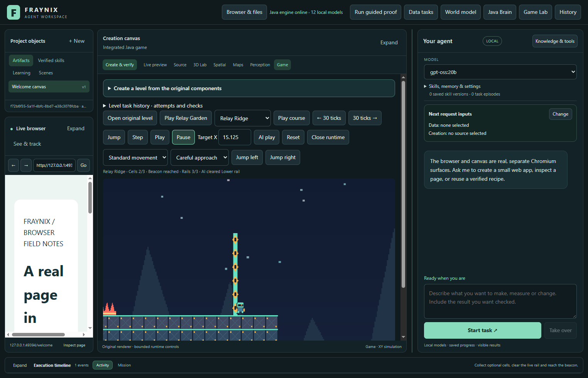
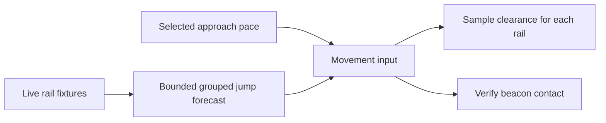

# Fraynix Agent Workspace — edition 170

**2026-11-18 · Two original courses and five rail fixtures tested at three approach paces**

[Previous edition](README-169.md) · [Offline course and pace explorer](docs/readmes/170/index.html) · [Edition history](docs/readmes/INDEX.md) · [Architecture plan](docs/ARCHITECTURE_RENEWAL_PLAN.md)

## Play the new courses

Open **Game** and choose **Relay Switchyard** or **Relay Ridge**, then click **Play course**. Select **Normal**, **Steady**, or **Careful approach** and click **AI play**. The status row shows the number of verified rails and the beacon outcome. Manual controls and **Reset** work on both courses.

- **Relay Switchyard** has two spaced rails and a gap near the finish.
- **Relay Ridge** has two rails on a raised deck, then a third rail on a lower deck. The AI can clear the raised pair with one jump and verify each rail independently.







These screenshots come from the integrated Java/Electron Game Lab. The paired jump was captured during bounded stepping. The finish captures used the visible **AI play** button.

## How the crossings are verified

Java reads the live rail sensor bounds and forecasts how far the robot can travel in one jump. A flight can include multiple rails. The forecast checks each rail and a supported landing. The pace control uses ordinary movement inputs to adjust the robot's speed before and during a rail jump. The player physics and collision fixtures remain authoritative.

The crossing receipt records the rail's persistent ID, measured launch and entry speed, overlap ticks, and minimum observed clearance. The new courses require more than 0.035 game units of measured clearance for each rail. Completion also requires separate contact with the course beacon. A rail hit still ends the attempt.

The first native set reached both beacons at all three paces, but Ridge's slowest run measured only 0.016 units at the second rail. That run failed the clearance check and remains in the evidence. The revised model adds a 0.10-unit forecast reserve on the new courses, controls speed through the grouped jump, and moves the second Ridge rail 0.125 game units closer. The final layout is held fixed across all pace comparisons.

## Measured outcomes

All six final native runs and all six visible AI Play runs reached their beacons. Each set independently recorded **15 successful per-rail crossings**.

Each cell below is **measured entry speed / minimum clearance** from the visible app trials. Speed uses game units per second, and clearance uses game units.

| Course and rail | Normal | Steady | Careful |
| --- | ---: | ---: | ---: |
| Relay Switchyard · West rail | 2.100 / 0.666 | 1.903 / 0.886 | 1.815 / 0.676 |
| Relay Switchyard · East rail | 2.100 / 0.665 | 1.912 / 0.888 | 1.752 / 0.678 |
| Relay Ridge · First ridge rail | 2.100 / 0.614 | 1.968 / 0.869 | 1.463 / 0.666 |
| Relay Ridge · Second ridge rail | 2.100 / 0.513 | 1.948 / 0.118 | 1.783 / 0.118 |
| Relay Ridge · Lower rail | 2.100 / 0.665 | 1.922 / 0.885 | 1.812 / 0.674 |

The Ridge pair shares a launch tick, with separate overlap intervals and clearance measurements. The raw receipts retain actual horizontal speed at launch and entry. Edition 169's exact bounded crossing measurements and finish ticks for Circuit and Terraces were reproduced. The 24 existing original content files and 59 previously tracked controller and physics classes matched their published bytes.

125 root Java tests, 22 selected workspace Java tests, 181 desktop tests and 10 archive tests passed. The workspace selection covers both trial sets, previous courses, reference reconstruction, durable level tasks and route boundaries.

## CI and evidence

The first CI check found edition 169's archive and documentation steps passed, with the hosted build still running. The checks above reflect edition 170's local execution and the verified app trials. [Edition 169 CI](https://github.com/eyeoverthink/Fraynix-Agent-Workspace/actions/runs/44299337463)

[Verification summary](docs/readmes/170/verification.json) · [Existing-course regression](docs/readmes/170/baseline.json) · [Source inventory](docs/readmes/170/file-inventory.json) · [Evidence manifest](docs/readmes/170/original-evidence.json)

To download the raw final trials, earlier below-margin run, and the regression logs into a new file:

```powershell
python scripts/evidence_archive.py download --manifest docs/readmes/170/original-evidence.json --archive evidence170-local.zip
```

## Build and inspect

Use JDK 21 and run `gradlew.bat prepareGameRuntime115 :workspace-engine:installDist`. In `workspace-desktop`, run `npm ci` followed by `npm start`. Regenerate all original Relay layouts into a new directory with `gradlew.bat generateRelayCourses -PrelayCoursesOutput=build/my-relay-courses`.



## Next

Carry the per-rail evidence into durable playtesting. Test new combinations of rail spacing, terrain, and arrival speed before allowing a verified procedure to be reused.
