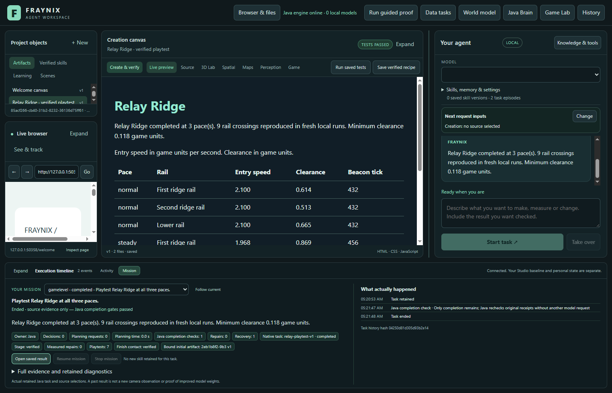
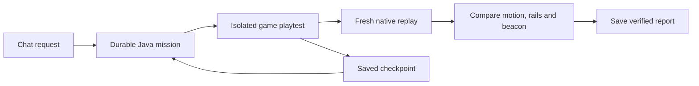

# Fraynix Agent Workspace · Edition 171

[Edition 170 and its original courses](README-170.md) · [Interactive offline guide](docs/readmes/171/index.html) · [Edition history](docs/readmes/INDEX.md)

Fraynix can now accept a Relay playtest in chat, run it locally, independently replay it and turn the measurements into a report. The Java mission survives an interruption. The desktop displays the current stage and enables recovery.



## Run the mission

1. Open Fraynix, then **Game Lab**. Choose **Relay Ridge** or **Relay Switchyard**.
2. Open the course, choose **Prepare offline playtest**, then click **Start task**. You can also type **Playtest Relay Ridge at all three paces.** or **Verify Relay Switchyard at careful pace.** Normal, steady and careful are supported individually.
3. Use **Mission** to see progress. After an interruption, choose **Resume mission**. Completed trial pairs retain their original records.
4. Choose **Open saved result**. The canvas opens a report with the measured rail crossings and the associated JSON.

After installing the documented Java and desktop dependencies, launch from PowerShell with the app’s offline browser setting and model discovery disabled:

```powershell
.\gradlew.bat --offline prepareGameRuntime115 :workspace-engine:installDist
$env:FRAYNIX_WORKSPACE_OFFLINE = '1'
$env:FRAYNIX_WORKSPACE_NO_MODELS = '1'
$env:FRAYNIX_WORKSPACE_PERSISTENT = '0'
npm --prefix workspace-desktop start
```

The last setting starts a fresh Java process for this launch, so it picks up the flags. Use a separate `FRAYNIX_WORKSPACE_PROJECT` when testing alongside a running workspace. Initial dependency installation can require a connection. The offline browser setting applies to the application’s browser requests. This mission itself makes zero model calls.

## How it works



The runner checks the original fixture manifest and installed game archive identities. It uses the selected course’s actual collision geometry. Each crossing must have measured positive entry speed, at least five overlap samples and clearance greater than 0.035 game units. The robot must reach the actual beacon alive. A fresh run uses a distinct session and must reproduce the bounded motion trace and all crossing measurements. The backend verifies source and evidence when you open the saved mission result.

The procedure allows at most 864 ticks per trial and stores up to 24 local playtests per project. Recovery starts an unfinished trial from tick zero. Stored results remain tied to the course bytes and game engine used to produce them. If those change, the older evidence can still be inspected and the verifier requires a fresh run for the new build.

## What the tests showed

125 root Java tests, 9 focused workspace Java tests, 181 desktop tests and 10 archive tests passed. The desktop integration used a new isolated test project.

| Course | Paces tested | Original rail clearances | Fresh replays | Minimum clearance |
| --- | --- | ---: | ---: | ---: |
| Relay Ridge | Normal, steady, careful | 9 | 3 | 0.118 |
| Relay Switchyard | Careful | 2 | 1 | 0.676 |

The desktop completed 4 primary trials and 4 fresh replays with 11 measured rail clearances across the four course and pace combinations. The two chat missions made zero model calls. The Ridge test took 55.1 seconds in this run, including an abrupt Java process stop, app restart and explicit resume. The two completed trials were preserved. The unfinished attempt was retained as interrupted and rerun in a fresh session. A later cold restart reopened the report. The app passed three rendered report checks, and the Java test refused a deliberately altered evidence file.

[Interrupted mission](docs/readmes/171/relay-mission-resume.png) · [Completed mission](docs/readmes/171/relay-mission-completed.png) · [Machine-readable outcomes](docs/readmes/171/verification.json) · [Original evidence manifest](docs/readmes/171/original-evidence.json)

## Where the offline agent should go next

Game Lab gives the agent a place to enact ideas, observe cause and effect and retain a replay. The same design can support worlds outside the game. Java owns state, constraints and execution. Optional local models can propose a sequence. Independent verifiers retain the authority to accept results.

The next demonstration should start from a local browser page, extract a versioned observation, run an experiment in a world and produce a working report. Test changed inputs and a forced interruption between domains. After that, qualify reusable procedures on unfamiliar tasks and compare the cost of reuse with a fresh plan. In parallel with product work, get the installation size down and make the first verified mission easy to run on a fresh machine.

[Implementation and acceptance gates](docs/publication171/plan.md) · [Design and continuity notes](docs/PROJECT_MEMORY.md) · [Evidence release](https://github.com/eyeoverthink/Fraynix-Agent-Workspace/releases/tag/evidence-171)
