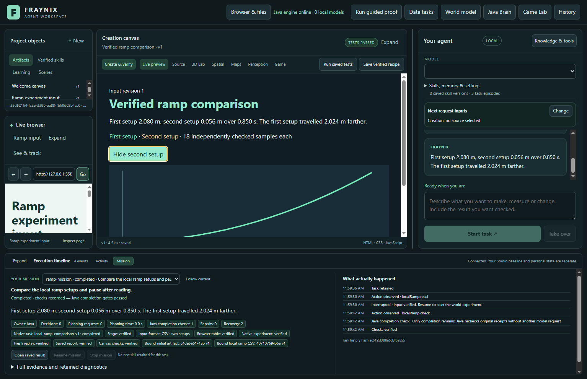
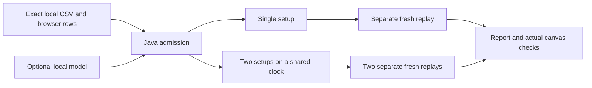

# Fraynix Agent Workspace · Edition 174

[Edition 173 and CSV input](README-173.md) · [Offline routing and motion guide](docs/readmes/174/index.html) · [Edition history](docs/readmes/INDEX.md)

Fraynix now offers two verified local ramp procedures. **First setup** produces one trajectory and an independent replay. **Compare both setups** measures two trajectories on the same clock, independently replays each one and reports the signed difference in travel.



## Use the new comparison

1. Open **Live browser → Ramp input**. Import a UTF-8 CSV with either one or two setups. To compare, give both rows the same duration.
2. In **Report**, choose **Compare both setups**, then **Save page and prepare chat → Start task**. The direct chat command is **Compare the local ramp setups.**
3. To let a local model choose the procedure, select a model and use **Plan a local ramp task:** followed by your request. For example, ask which setup travels farther on the saved timeline. Java binds the input and owns every verification step.
4. After an interruption, choose **Mission → Resume mission**. The paired report lets you hide or show the second trace and download measurements, original inputs and the verified evidence.

```csv
angle_deg,friction,gravity_mps2,mass_kg,duration_s
38,0.04,9.81,1.2,0.85
18,0.31,9.81,1.2,0.85
```

A one-row input can still run the single experiment. Comparisons require the second setup. A model can ask for clarification when the desired outcome is unclear or the source is incomplete. When you explicitly ask for a comparison with one setup, Java asks for the second setup before calling a model.

## What is verified



Browser rows must match the pinned source revision. Each simulated setup has its own source identity and native session. The paired verifier checks all four session IDs, both traces at 240 Hz and their retained samples, the shared clock and the signed difference. The artifact is regenerated from the checked data. Chromium must show the correct measurements and exercise the actual second-trace control before completion.

## Desktop and local-model results

| Expected result | Correct choices | Verified completion or clarification |
| --- | ---: | --- |
| First setup | 2/2 | Two verified single-setup artifacts |
| Compare both | 2/2 | Two verified paired artifacts |
| Clarification | 2/2 | The model asked about the undecided request. Java asked for the missing setup. |

gpt-oss:20b selected both procedures and asked for clarification on five fresh requests. Java asked for a missing setup on the sixth without calling the model. The paired report compared 0.056 m and 2.080 m on the same clock, with 18 matched replay samples per setup. The direct route finished with zero model calls. Reversing the CSV row order reversed the sign of the measured difference. Both original native sessions and both replays were retained after an abrupt Java stop before canvas verification. A separate model-selected comparison resumed with model discovery disabled and made no additional model call. On the same paired source, the direct comparison took 2.17 s. The two model-routed comparisons took 53.45 s and 55.22 s. Each used one model call. Java detected the missing setup in 0.42 s with zero model calls. These are complete task timings with CPU-only planning on this machine. The initial GPT-OSS run got five of six choices right. It asked for clarification on the ambiguous request, then proposed comparing a single-row source. Java blocked it before simulation. The first Llama 3.2 trial stopped after its third request, when it chose a single run for a comparison. That mismatch was also blocked. The release checks source availability before a model call when the comparison is explicit. Both initial failures remain in the evidence bundle.

125 root Java tests, 59 focused workspace Java tests, 181 desktop tests and 10 archive tests passed. The checks cover swapped native traces, mismatched duration, missing input, route admission and the previous archived report.

[Paired inputs](docs/readmes/174/paired-ramp-input.png) · [Recovered checkpoint](docs/readmes/174/paired-ramp-checkpoint.png) · [Model-selected comparison](docs/readmes/174/paired-ramp-model-routing.png) · [Missing-input clarification](docs/readmes/174/paired-ramp-missing-input.png) · [Verification receipts](docs/readmes/174/verification.json) · [Original test evidence](https://github.com/eyeoverthink/Fraynix-Agent-Workspace/releases/tag/evidence-174)

## Next

Expand the held-out requests to multiple domains and measure when local model routing earns its cost. Use the same typed admission, recovery and evidence gates. [Implementation and acceptance gates](docs/publication174/plan.md)
