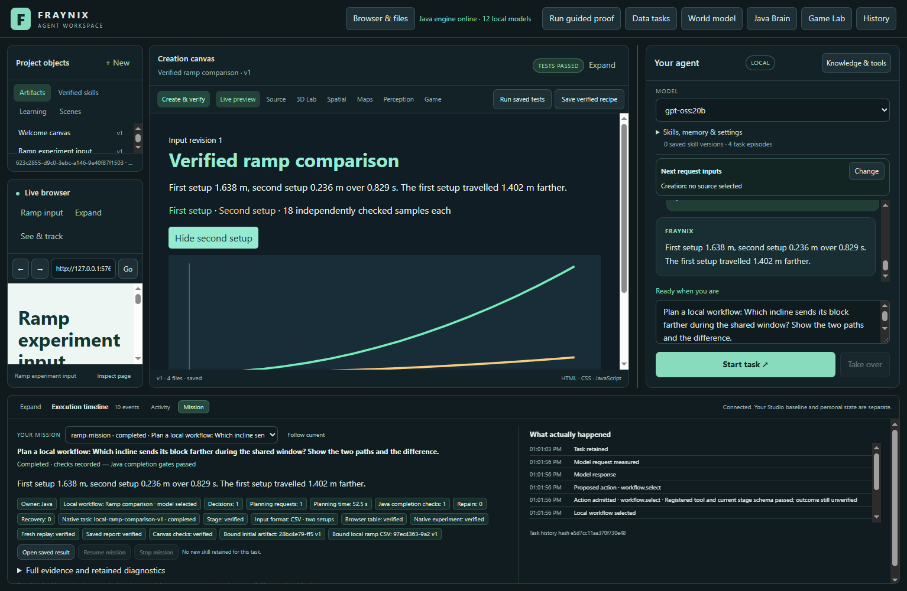

# Fraynix Agent Workspace · Edition 175

[Edition 174](README-174.md) · [Interactive offline guide](docs/readmes/175/index.html) · [Full edition history](docs/readmes/INDEX.md)

Both routes produced verified results in five paired trials. gpt-oss:20b chose the correct procedure in every pair. Model selection alone took 51.50 s to 55.38 s on this CPU-only setup. The named command was faster in all four physics and analysis pairs.

## Choose how to start

1. Open **Chat**. For physics, open a saved two-setup **Ramp input** in the browser. For analysis, select a motion dataset in **Data tasks**. For a standalone app, select an installed local model to generate the content.
2. Use `Plan a local workflow: <request>` to have the model choose between the three procedures. Use `Run local workflow ramp: <request>`, `Run local workflow analysis: <request>`, or `Run local workflow creation: <request>` to name one directly.
3. Open **Mission** to see the selected procedure, model-selection time, progress and saved result. Supply the missing information in a new chat request when Mission asks for clarification.

The planner returns a procedure identifier or asks a question. Java seals the briefing and source identities before asking the model. Physics reuses the verified paired comparison. Analysis uses the existing Java-owned input-driven summary. Standalone creation uses the existing worker to agree on observable checks before generating an app. Java retains the choice and keeps the original native, source and canvas checks in charge of completion. The selector handles one of these three outcomes per request.

## What the model added

| Case | Named command | Model-selected | Selection alone |
| --- | ---: | ---: | ---: |
| Paired ramps A | 2.32 s | 54.92 s | 52.54 s |
| Paired ramps B | 2.61 s | 58.40 s | 55.38 s |
| Delfys recording | 5.69 s | 57.11 s | 51.60 s |
| Synthetic reversal | 5.67 s | 57.90 s | 51.82 s |
| Workshop tally | 399.74 s | 228.98 s | 51.50 s |

The desktop ran both routes for each request with matched inputs and alternate ordering for the two physics and two analysis pairs. Time starts at Chat submission and ends when Java records a terminal outcome. Production checks are included. Preparing the inputs, taking screenshots and repeating independent study checks are outside the measured interval. The creation pair generated separate drafts, so its total-to-total change includes generation variability. The selection span is measured independently.

- **Paired ramps A.** Both checked comparisons matched every retained sample. Second minus first was -1.402 m.
- **Paired ramps B.** Both checked comparisons matched every retained sample. Second minus first was +0.566 m.
- **Delfys recording.** Both checked reports agreed over 49 rows. Travel was 0.776 m. The checks found 0 gap flags and 0 speed flags.
- **Synthetic reversal.** Both checked reports agreed over 5 rows. Travel was 0.160 m. The checks found 1 gap flag and 1 speed flag.
- **Workshop tally.** Two separately generated apps passed the same 9 independent steps. The direct run used 4 creation requests and the model-routed run used 2, including any creation retries. Route selection is counted separately.

The ambiguous request returned a clarification in 51.39 s. A missing source took 0.31 s through the named analysis command and 51.30 s through selection. Both stopped before a child started. A separate model-selected analysis resumed after an abrupt Java stop with model discovery disabled. The same source and selection remained bound and the model-call count stayed at one through the verified result. An Edition 174 report reopened against the same original receipts.

## Decision

Keep named commands for known tasks. Model selection showed that it can interpret several ways of asking and tell a comparison, an analysis and a standalone app apart. On this machine that convenience cost one full local inference. This small study measures latency and completed outcomes on the supplied tasks. The user's time saved, broader routing accuracy and timing on other hardware remain open.

125 root Java tests, 84 focused workspace Java tests, 181 desktop tests and 10 archive tests passed.

## Desktop screenshots and evidence

- [Verified report from the Delfys recording](docs/readmes/175/routing-data-a.png)
- [Second paired ramp report](docs/readmes/175/routing-ramp-b.png)
- [Synthetic reversal and flagged intervals](docs/readmes/175/routing-data-b.png)
- [Generated Workshop tally after live checks](docs/readmes/175/routing-creation.png)
- [Clarification in Mission](docs/readmes/175/routing-clarification.png)
- [Saved motion-analysis selection before process stop](docs/readmes/175/routing-restart.png)

[Verification summary](docs/readmes/175/verification.json) · [Original test evidence](https://github.com/eyeoverthink/Fraynix-Agent-Workspace/releases/tag/evidence-175) · [Implementation and next gates](docs/publication175/plan.md)
