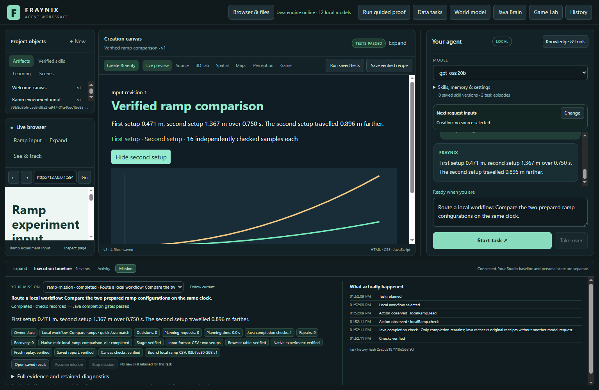

# Fraynix Agent Workspace · Edition 176

[Edition 175](README-175.md) · [Interactive offline guide](docs/readmes/176/index.html) · [Full edition history](docs/readmes/INDEX.md)

Quick routing finished the matched ramp and analysis jobs in 2.32 s and 5.12 s with zero selection calls. On the same inputs Plan took 82.52 s and 63.52 s. An uncertain suggestion waited for confirmation and kept its original inputs across restart.

## Use Quick and Review

1. Open a saved paired ramp input or select a motion dataset. To generate a standalone app, select a local model for content generation.
2. In Chat try `Route a local workflow: Compare the two prepared ramp configurations on the same clock.` or `Route a local workflow: Analyse my selected motion recording for total travel.`
3. When **Mission** offers a suggestion, review the selected procedure and saved input. Click its **Confirm** button to run it, or **Stop mission** to decline. If the app asks a question, submit a new request with the missing information.

Quick routing checks the complete briefing against a small, versioned set of forms. Requests that fall outside those forms can use an installed model to suggest one existing workflow. The suggestion is retained before a worker starts. Java holds the source, confirmation and original verifier receipts. `Plan a local workflow:` and named commands retain their Edition 175 behavior.

## Complete verified task time

| Matched job | Quick | Plan | Model selection in Plan |
| --- | ---: | ---: | ---: |
| Paired ramps | 2.32 s | 82.52 s | 79.94 s |
| Motion summary | 5.12 s | 63.52 s | 58.25 s |

Both branches used the same original inputs and independent verifiers. The ramps matched at every retained sample. The analysis kept the stated 0.12 s gap limit and 0.6 m/s speed limit and matched independently computed travel and quality flags. Times begin at Chat submission and include production checks. The model ran on CPU. Inputs, screenshots and extra study checks are outside those spans.

Quick selected a new tally app with zero routing calls. The content worker made 2 local generation requests. The resulting app passed 9 independent steps for adding, resetting and adding again. Its full time was 177.27 s. This single creation result measures the working path. The paired timing comparison covers ramp and analysis.

## When the request needs review

- The missing-data question returned in 0.28 s with zero selection calls. Five offline requests covering compound work, a quotation, negation, a conditional and a request to email the result asked for clarification without starting work.
- A proposed ramp comparison was declined before execution. An undecided request returned a question without proposing a child.
- A less direct data request produced a suggestion in 56.76 s. Ordinary Resume refused it. After an abrupt stop and a restart with models disabled, one explicit confirmation completed the verified analysis in 5.42 s. The app used the original dataset even after a different dataset was selected. The selection call count stayed at one, and a second confirmation was refused.

The interaction count is one Chat submission for a known workflow and one additional confirmation for a suggestion. That count covers actions that authorize work. Reading, navigating and user time saved were outside this study. The offline checks exercised deliberately limited wording. Compound requests still need to be broken into supported workflows.

125 root Java tests, 86 focused workspace Java tests, 181 desktop tests and 10 archive tests passed. An Edition 175 report reopened and matched its retained receipts.

## Screenshots and original results

- [Quick analysis with the original rows and quality flags](docs/readmes/176/quick-analysis.png)
- [A newly generated tally after real control checks](docs/readmes/176/quick-creation.png)
- [Suggested analysis waiting for explicit confirmation](docs/readmes/176/review-pending.png)
- [Confirmed analysis after restart with its original dataset](docs/readmes/176/review-confirmed.png)
- [Offline compound request asks for one result](docs/readmes/176/compound-clarification.png)

[Verification summary](docs/readmes/176/verification.json) · [Original test evidence](https://github.com/eyeoverthink/Fraynix-Agent-Workspace/releases/tag/evidence-176) · [Implementation and next gates](docs/publication176/plan.md)
