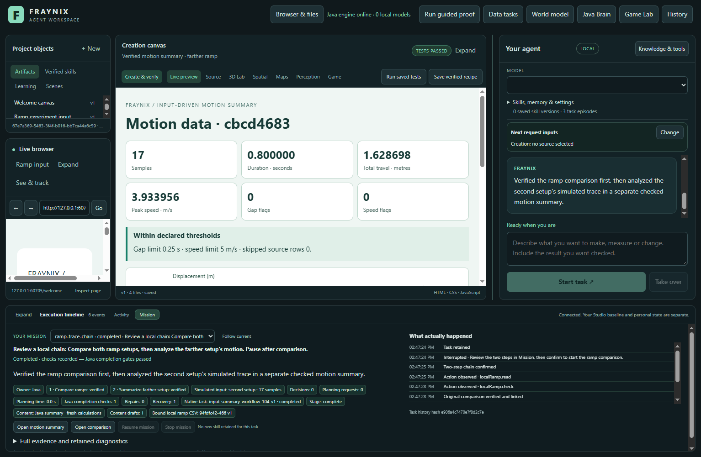

# Fraynix Agent Workspace · Edition 177

[Edition 176](README-176.md) · [Interactive offline trace guide](docs/readmes/177/index.html) · [Full edition history](docs/readmes/INDEX.md)

One confirmation starts two verified procedures. Fraynix compares the paired ramps, then passes all 17 original samples from the farther setup into the motion summary. The test carried 1.629 m of simulated travel through a full Java restart and retained both checks.

## Run the chain

1. Open **Live browser → Ramp input** and import a two-row CSV. Use the same duration for both setups.
2. In **Report**, choose **Compare, then summarize the farther setup**. To inspect the first result before continuing, select **Pause after the verified comparison**.
3. Choose **Save page and prepare chat** or **Use saved page**, then **Start task**. In **Mission**, select **Confirm two-step chain**. Confirming authorizes the comparison followed by the motion summary.
4. If you requested a pause, review the verified comparison and select **Resume mission**. When the chain completes, open either report from Mission.

The matching Chat request is `Review a local chain: Compare both ramp setups, then analyze the farther setup's motion.` Add `Pause after comparison.` for the checkpoint.

## Verification on both sides of the handoff

The first procedure checks the pinned browser input, separate Bullet replays and the actual canvas report. Java saves the report identity, winning native trace hash and exact derived CSV in the parent task journal. It rereads the original comparison before it creates the dataset and starts the summary. Stable dataset and workflow IDs let an interrupted write reopen under the same identity.

The second procedure takes elapsed seconds and signed downhill displacement in metres from the original simulated samples. It runs the existing motion summary, independently checks the displayed values and retains its own report and audit. The parent verifies both reports and their shared trace again at completion and in History.

## Observed outcomes

| Trial | First verified result | What happened next |
| --- | --- | --- |
| Forced restart | First setup 0.395 m, second 1.629 m | The second setup supplied 17 rows. Java resumed the original trace and verified 1.629 m of travel. |
| Automatic handoff | The same setups were supplied in reverse order. | One confirmation carried the first setup's trace into the summary. Its CSV matched the restarted trial byte for byte. |
| Changed first report | A later report revision was deliberately introduced after the checkpoint. | Java refused the handoff before creating a dataset or starting the summary. |
| Tie | The verified comparison found equal travel within its existing replay tolerance. | Java asked for setups with different travel. No summary started. |

The restart trial kept its first native sessions and saved report. After archiving and reopening, History reverified both receipts and the original link. Both successful chains used zero model calls. The fixture measured simulated motion in one registered two-step chain.

125 root Java tests, 88 focused workspace Java tests, 181 desktop tests and 10 archive tests passed. The Edition 176 report also reopened against its original receipts.

## Screenshots and original evidence

- [Review both steps before authorizing work](docs/readmes/177/chain-review.png)
- [First report verified before step two exists](docs/readmes/177/chain-first-verified.png)
- [An edited first report blocks the handoff](docs/readmes/177/chain-refused.png)

[Verification summary](docs/readmes/177/verification.json) · [Original test evidence](https://github.com/eyeoverthink/Fraynix-Agent-Workspace/releases/tag/evidence-177) · [Implementation and next gates](docs/publication177/plan.md)
