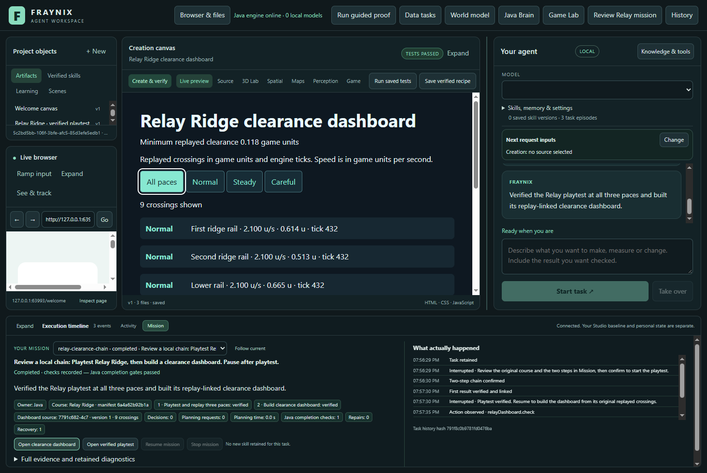

# Fraynix Agent Workspace · Edition 178

[Edition 177](README-177.md) · [Offline walkthrough](docs/readmes/178/index.html) · [Full edition history](docs/readmes/INDEX.md)

Fraynix replays a Relay course at three paces, then builds a filterable clearance dashboard from the verified game measurements. One Mission review authorizes both steps. This is the second registered offline chain alongside the ramp-to-motion workflow.

## Run the Relay chain

1. Select **Review Relay mission** in the workspace header and choose **Ridge** or **Switchyard**.
2. Choose **Prepare in Chat** and **Start task**. In Mission, check the course manifest and the two steps, then select **Confirm two-step chain**.
3. If you enabled **Pause after the verified playtest**, open the original report at the checkpoint and select **Resume mission** when ready. Mission can open both results after completion.
4. In the dashboard, filter by pace, download the crossing CSV or open its source receipt. The CSV retains game units and engine ticks. The report shows the original playtest's artifact ID and version.

The equivalent Chat request is `Review a local chain: Playtest Relay Ridge, then build a clearance dashboard.`
Use `Switchyard` for the other course and append `Pause after playtest.` for the checkpoint.

## Results

| Course | Fresh replays | Verified crossings | Minimum clearance in game units | Chromium checks |
| --- | ---: | ---: | ---: | ---: |
| Relay Ridge | 3 | 9 | 0.118 | 24 |
| Relay Switchyard | 3 | 6 | 0.665 | 21 |

Ridge resumed after abrupt Java termination with its six original sessions and the same report. Switchyard completed automatically from one confirmation. Both used zero model calls. A later revision of the source playtest blocked dashboard creation, and a later revision of the completed dashboard blocked proof verification.

The shared Java review logic enforces approval and a recorded handoff. The native game verifier establishes actual course contacts, rail clearances and matching replays before Java derives an export. The dashboard verifier checks the displayed values, version and filters in Chromium. History reconstructs the original evidence link before opening the dashboard. The original Edition 177 ramp chain also reopened against its exact existing receipts.

125 root Java tests, 90 focused workspace Java tests, 181 desktop tests and 10 archive tests passed. These are game simulation measurements from the two built-in courses.

## Screenshots and evidence

- [Course and both procedures awaiting confirmation](docs/readmes/178/relay-review.png)
- [The original playtest report at the restart checkpoint](docs/readmes/178/relay-first-verified.png)
- [The changed source stops the chain before dashboard creation](docs/readmes/178/relay-refused.png)

[Verification summary](docs/readmes/178/verification.json) · [Download original test evidence](https://github.com/eyeoverthink/Fraynix-Agent-Workspace/releases/tag/evidence-178) · [Implementation and next phase](docs/publication178/plan.md)
