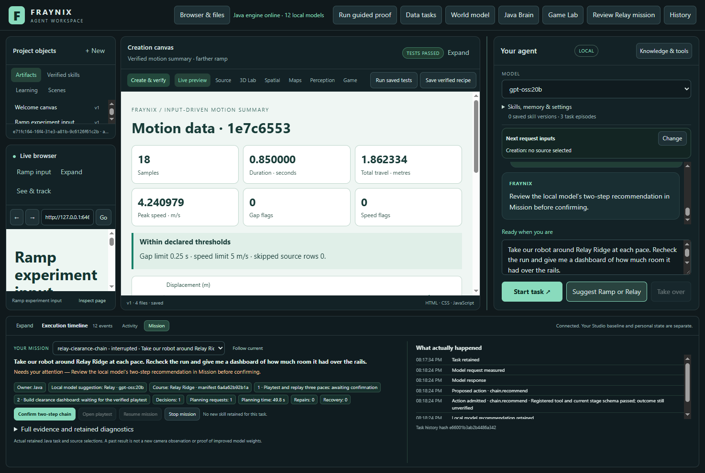

# Fraynix Agent Workspace · Edition 179

[Edition 178](README-178.md) · [Offline walkthrough](docs/readmes/179/index.html) · [Full edition history](docs/readmes/INDEX.md)

Fraynix can recommend a reviewed Ramp or Relay workflow from ordinary language. gpt-oss:20b matched 8 of 8 predeclared choices. Java required approval before either chain ran and independently checked the original native and rendered results.

## Use plain language

1. Choose an installed model in Chat. For Ramp, first open a saved two-setup page through **Live browser → Ramp input**. For Relay, name **Relay Ridge** or **Relay Switchyard** in your request.
2. Describe the result you want and select **Suggest Ramp or Relay**. For example, ask “Which slope sends its block farther, and how did that block move?”
3. In **Mission**, review the suggested workflow and its bound source. Choose **Confirm two-step chain** to execute or **Stop mission** to decline. If the task asks for a missing input or a clearer goal, submit a new recommendation.
4. Use **Open motion summary** or **Open clearance dashboard** after verification. History can reopen the original checked artifact later.

## What the model decided

| Trial | Expected | Suggested | Java disposition | Model time |
| --- | --- | --- | --- | ---: |
| ramp | Ramp | Ramp | confirmed and verified | 51.0 s |
| ridge | Relay | Relay | confirmed and verified | 49.8 s |
| ambiguous | Clarify | Clarify | clarified without execution | 68.8 s |
| switchyard | Relay | Relay | declined without execution | 49.7 s |
| missing-ramp | Ramp | Ramp | clarified without execution | 50.5 s |
| out-of-menu | Clarify | Clarify | clarified without execution | 48.7 s |
| missing-course | Relay | Relay | clarified without execution | 49.5 s |
| revised-ramp | Ramp | Ramp | revised source refused | 50.5 s |

The model call took 48.7–68.8 s on this CPU-only installation (median 50.1 s). These eight requests test this model and configuration. Baseline direct commands remain available without inference.

The confirmed Ramp chain retained the original browser source even after another valid ramp page was opened. The confirmed Relay chain retained the suggestion and source after a hard Java stop, then finished after explicit approval with model discovery disabled. Both newly archived results reopened and verified, and the original Edition 178 Relay archive matched its existing receipts.

## What Java owns

The local model has one typed recommendation function. Java checks prerequisites, fixes the reviewed plan and records approval before creating a child. It then applies the existing source, native replay, report and Chromium checks. Mission can show a suggestion and a clarification without claiming either workflow ran.

125 root Java tests, 92 focused workspace Java tests, 181 desktop tests and 10 archive tests passed. The pilot's first harness read the wrong field in the provider receipt. Its log and original response are included alongside the corrected study.

## Screenshots and evidence

- [Ramp recommendation before approval](docs/readmes/179/ramp-review.png)
- [Verified Ramp motion summary from the pinned source](docs/readmes/179/ramp-verified.png)
- [Verified Relay dashboard after restart with discovery disabled](docs/readmes/179/relay-verified.png)
- [Java asks which workflow the user wants](docs/readmes/179/ambiguous.png)

[Verification and case text](docs/readmes/179/verification.json) · [Original test evidence](https://github.com/eyeoverthink/Fraynix-Agent-Workspace/releases/tag/evidence-179) · [Implementation and next phase](docs/publication179/plan.md)
