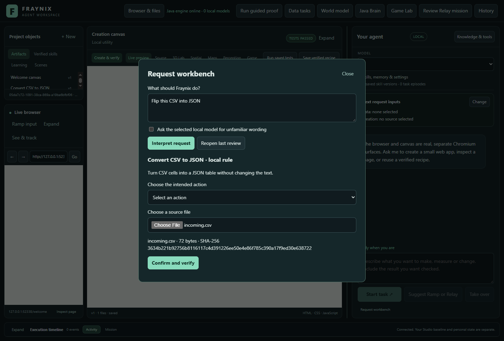

# Fraynix Agent Workspace · Edition 180

[Edition 179](README-179.md) · [Offline walkthrough](docs/readmes/180/index.html) · [Full edition history](docs/readmes/INDEX.md)

Fraynix can turn everyday requests into reviewed local work, learn a confirmed phrase, convert tables in both directions, inspect original file bytes and pass creation briefs to the Canvas.

## Try it

1. Open **Request workbench** below Chat. Examples include “Flip this CSV into JSON”, “Convertis ce JSON en CSV stp”, “Convierte este CSV a JSON” and “Show me the bytes”.
2. Select **Interpret request**. A local rule can handle familiar wording. Allow the selected local model to suggest an action when needed. Pick the intended action yourself if the suggestion needs correction.
3. Attach the exact input for file work, review its hash, then select **Confirm and verify**. Open the result or save a checked output to project exports.
4. Select **Remember this wording** after a verified file result. Fraynix can recognize that phrase again. Each new run still needs a source and confirmation.
5. For a creation request, select **Review in Creation Canvas**. Fraynix carries the original brief into the existing tool builder, where you can review the source and behavior checks before building.

## What passed

The CSV → JSON → CSV trial preserved both rows, column order, leading zeros, Unicode, multiline quoted text and an empty cell. The native file inspection matched the SHA-256 and every observed byte of the controlled sample. A changed review hash and an unsupported JSON numeric mapping were refused. After a hard Java restart with models disabled, the verified result reopened and the taught phrase resolved without inference.

The app and utility briefs reached the Creation Canvas intact. The creation worker rejected the first model response because it lacked a native tool call. The next response produced the utility, and Chromium verified Start → Add → Reset. The original Edition 179 Ramp and Relay proofs also reopened.

| Installed model | Correct suggestions | Returned native calls | Median returned time |
| --- | ---: | ---: | ---: |
| gpt-oss:20b | 4/4 | 4 | 51.2 s |
| gemma4:latest | 4/4 | 4 | 75.4 s |

The paired study used the same four retained requests for slang, Spanish, French and ambiguity. These are interpretation trials. Completing a workflow still needs explicit review. The time is wall clock from Interpret to the saved suggestion. 125 root Java tests, 95 focused workspace Java tests, 181 desktop tests and 10 archive tests passed. The final layout was tested again with byte-identical engine builds. The study and the final screenshots are both retained.

## Conversion and inspection scope

The current exchange preserves string-valued tables in UTF-8 CSV and JSON. Flat JSON records need matching keys and string values. File reviews accept up to 64 KiB. The inspector reports the full hash and a signature hint, with a 64-byte preview. See the plan for typed tables, behavior-checked source conversion and read-only parsing of documented binary formats.

## Screenshots and evidence

- [A converted JSON file with the verified source receipt](docs/readmes/180/round-trip-output.png)
- [The selected file as offsets, hex, decimals and bits](docs/readmes/180/byte-inspection.png)
- [The taught phrase recognized after restart](docs/readmes/180/remembered-language.png)
- [A generated offline counter with passing browser checks](docs/readmes/180/created-tool.png)

[Verification and model cases](docs/readmes/180/verification.json) · [Original test evidence](https://github.com/eyeoverthink/Fraynix-Agent-Workspace/releases/tag/evidence-180) · [Implementation plan and sources](docs/publication180/plan.md)
