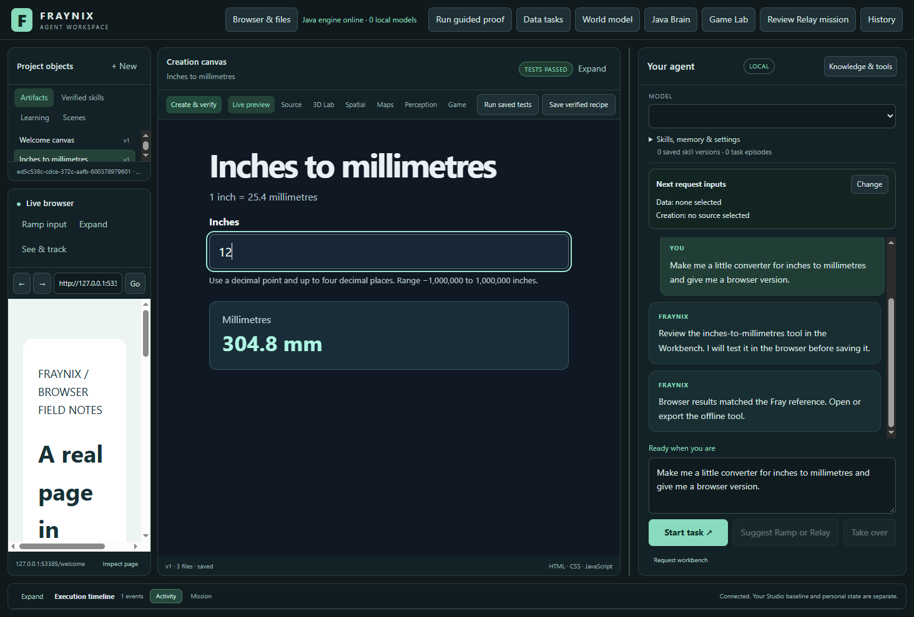
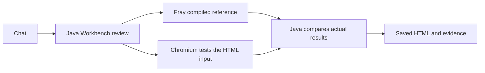

# Fraynix Agent Workspace · Edition 181

[Edition 180](README-180.md) · [Offline walkthrough](docs/readmes/181/index.html) · [Full edition history](docs/readmes/INDEX.md)

Ask for an inches-to-millimetres browser tool in Chat. Fraynix offers a review, then checks the offline HTML tool in Chromium against the Java reference from the existing Fray compiler.

## Try it

1. In **Chat**, enter “Make me a little converter for inches to millimetres and give me a browser version.” Select **Start task**.
2. Review the proposed tool. Select **Build and verify in browser**. Java saves the result after checking the Chromium observations.
3. In **Creation Canvas**, enter a signed decimal number of inches. The result updates as you type. For example, 12 inches displays 304.8 mm.
4. In **Request workbench**, reopen the last review. **Export output** saves a single HTML file that runs from disk. **Remember this wording** keeps the confirmed phrase for future reviews.

[Chat approval screenshot](docs/readmes/181/chat-review.png) · [Original Chromium receipt](docs/readmes/181/browser-receipt.json)

## How verification works

Java reads the constant from the original Fray compiler's bytecode for **inches × 25.4**. The browser uses integer decimal arithmetic. Chromium exercised the actual input and visible result. Java compared the observations with the reference and bound the proof to the saved HTML. The workbench rereads that proof when opening or exporting the result.

The tool accepts magnitudes up to 1,000,000 inches with up to four decimal places. The receipt includes the approved Fray source, its compiler revision, bytecode, HTML hash and the browser results. This edition supports one registered Fray program. The existing Workbench remains available for other file and creation requests.

## Results on November 19, 2026

The real desktop run opened the review from Chat with model discovery disabled. It passed **23 Chromium checks across 12 scenarios**. The installed app reopened the same artifact after a fresh Java process started. The exported HTML reported **9.525 mm for 0.375 inches** when opened directly from disk. A remembered phrase still opened a new review. Java regression tests also rejected an incorrect browser reading, a stale approval and a changed saved artifact.

| Input in inches | Java expected | Chromium observed |
| --- | --- | --- |
| 1 | 25.4 mm | 25.4 mm |
| 0 | 0 mm | 0 mm |
| -2.5 | -63.5 mm | -63.5 mm |
| 0.125 | 3.175 mm | 3.175 mm |
| 1.2345 | 31.3563 mm | 31.3563 mm |
| 999999.9999 | 25399999.99746 mm | 25399999.99746 mm |
| 1000000 | 25400000 mm | 25400000 mm |
| -1000000 | -25400000 mm | -25400000 mm |
| +0002.0001 | 50.80254 mm | 50.80254 mm |
| 1e3 | Enter a decimal within the stated range. | Enter a decimal within the stated range. |
| 1000000.0001 | Enter a decimal within the stated range. | Enter a decimal within the stated range. |
| Blank | Enter a measurement. | Enter a measurement. |

125 root Java tests, 38 focused Java workspace tests, 181 desktop tests and 10 evidence archive tests passed. The initial integration attempts exposed a filename restriction in artifact storage. The revised Fray source filename passes through the same artifact checks.

[Full verification record](docs/readmes/181/verification.json) · [Implementation plan and next acceptance checks](docs/publication181/plan.md)
