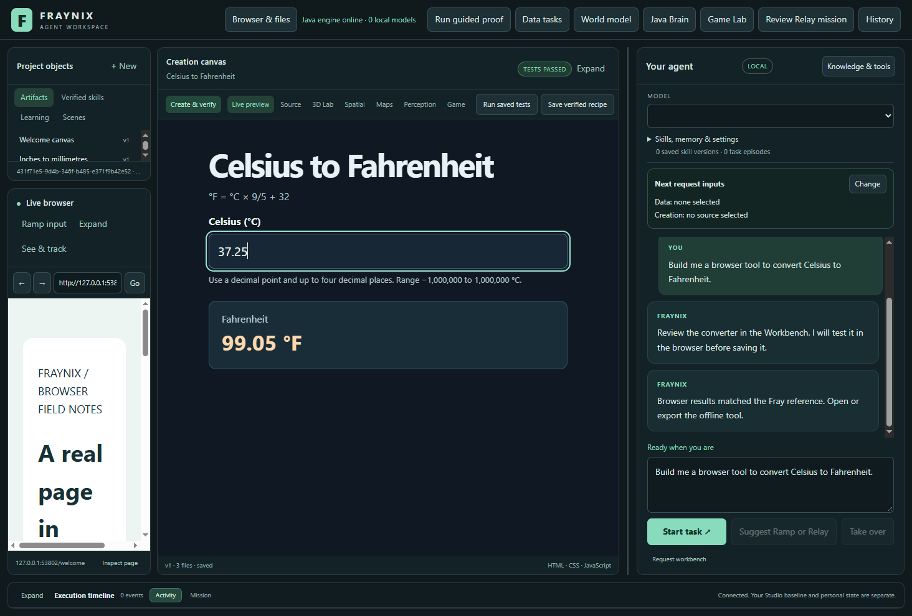

# Fraynix Agent Workspace · Edition 182

[Edition 181](README-181.md) · [Offline walkthrough](docs/readmes/182/index.html) · [Full edition history](docs/readmes/INDEX.md)

Ask for a Celsius-to-Fahrenheit browser tool in Chat. The Workbench checks the offline tool in Chromium against the original Fray program running in Java.

## Try it

1. In **Chat**, enter “Build me a browser tool to convert Celsius to Fahrenheit.” Select **Start task**.
2. Review the action in **Request workbench**, then select **Build and verify in browser**.
3. In **Creation Canvas**, enter a Celsius value. The answer updates as you type. Try **37.25 °C**, which displays **99.05 °F**.
4. Reopen the last review to export a single HTML file or remember the wording for a later review.

[Real approval screenshot](docs/readmes/182/chat-review.png) · [Original Chromium receipt](docs/readmes/182/browser-receipt.json)

## From Chat to evidence

The original FraynixBoot compiler produces the load, multiply, divide, add, and return instructions for **celsius × 9 ÷ 5 + 32**. The same bounded Java reader runs the two registered converter programs. The browser independently calculates Fahrenheit with scaled integers and shows up to five decimal places. The Java gate checks the selected HTML hash and the observed inputs and outputs before it saves the artifact.

The temperature tool accepts signed decimals up to 1,000,000 in magnitude with up to four decimal places. For example, you can enter .05 or -40. The single-file export runs locally with all its controls and styles embedded.

## Results on November 19, 2026

With model discovery disabled, the desktop passed **23 Chromium checks across 12 scenarios**. The original inches-to-millimetres receipt reopened and matched its saved Edition 181 proof before and after restarting Java. The temperature tool also reopened with the original proof. Its exported file converted **12.125 °C to 53.825 °F** directly from disk. Java rejected a preview hash and a browser trace from the other converter when offered for a temperature review.

| Input in °C | Java expected | Chromium observed |
| --- | --- | --- |
| 20 | 68 °F | 68 °F |
| 0 | 32 °F | 32 °F |
| 100 | 212 °F | 212 °F |
| -40 | -40 °F | -40 °F |
| -273.15 | -459.67 °F | -459.67 °F |
| 37.25 | 99.05 °F | 99.05 °F |
| -17.7778 | -0.00004 °F | -0.00004 °F |
| .05 | 32.09 °F | 32.09 °F |
| +999999.9999 | 1800031.99982 °F | 1800031.99982 °F |
| 1000000.0001 | Enter a decimal within the stated range. | Enter a decimal within the stated range. |
| 1,5 | Enter a decimal within the stated range. | Enter a decimal within the stated range. |
| Blank | Enter a measurement. | Enter a measurement. |

Eight additional browser cases used fixed expected results outside the saved verification suite.

| Input in °C | Observed result |
| --- | --- |
| 12.125 | 53.825 °F |
| -17.7777 | 0.00014 °F |
| -11.125 | 11.975 °F |
| 41.7 | 107.06 °F |
| -1000000 | -1799968 °F |
| 1000000 | 1800032 °F |
| 1e3 | Enter a decimal within the stated range. |
| + | Enter a decimal within the stated range. |

125 root Java tests, 41 focused Java workspace tests, 181 desktop tests and 10 evidence archive tests passed.

[Full verification record](docs/readmes/182/verification.json) · [Implementation plan and next acceptance checks](docs/publication182/plan.md)
