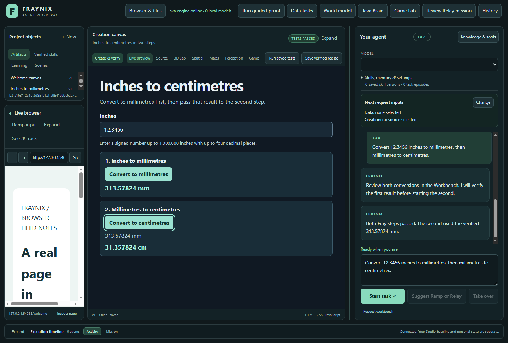

# Fraynix Agent Workspace · Edition 183

[Edition 182](README-182.md) · [Offline walkthrough](docs/readmes/183/index.html) · [Full edition history](docs/readmes/INDEX.md)

One Chat request converts inches to millimetres and then centimetres. Java verifies the intermediate value and its unit before the browser starts the second step.

## Try it

1. In **Chat**, enter “Convert 12.3456 inches to millimetres, then millimetres to centimetres.” Select **Start task**.
2. Review the starting measurement and both stages. Select **Verify both conversions**.
3. The verified tool opens in **Creation Canvas**. Select **Convert to millimetres**, then **Convert to centimetres** to try it again. The tool shows the exact intermediate alongside the answer.
4. Reopen the review to export the tool as one offline HTML file or remember the request wording.

[Approval screenshot](docs/readmes/183/chat-review.png) · [Refused handoffs screenshot](docs/readmes/183/rejected-handoffs.png)

## How the handoff works

The first Fray program multiplies inches by 25.4. The second divides millimetres by ten. Java validates the actual browser observations and passes the first verified decimal with its unit. Each stage has five Chromium checks. The browser calculates both results with scaled integers. Editing the input clears the results and locks the second button until the new millimetres are ready.

The accepted route is inches → millimetres → centimetres, with signed values up to 1,000,000 inches and up to four decimal places. The intermediate can carry five decimals and the final result six.

## Results on November 19, 2026

The approved input **12.3456 in** passed through **313.57824 mm** to **31.357824 cm**. Two real Chat requests tried to hand millimetres to a Celsius or inches input. Java rejected both before creating a review or artifact. Regression tests also rejected an early second step, a rounded intermediate and an altered unit in the evidence.

The first-stage receipt survived a Java store reopen in a recovery test. The completed chain and the exact Edition 181 and 182 receipts reopened after restarting the desktop app. The exported HTML converted **7.125 in to 18.0975 cm** directly from disk.

| New input in inches | Observed intermediate | Observed final result |
| --- | --- | --- |
| 0 | 0 mm | 0 cm |
| -3.25 | -82.55 mm | -8.255 cm |
| 0.0001 | 0.00254 mm | 0.000254 cm |
| -0.0001 | -0.00254 mm | -0.000254 cm |
| 999999.9999 | 25399999.99746 mm | 2539999.999746 cm |
| -1000000 | -25400000 mm | -2540000 cm |

125 root Java tests, 43 focused Java workspace tests, 181 desktop tests and 10 evidence archive tests passed.

[Original Chromium receipt](docs/readmes/183/browser-receipt.json) · [Full verification record](docs/readmes/183/verification.json) · [Implementation plan](docs/publication183/plan.md)
