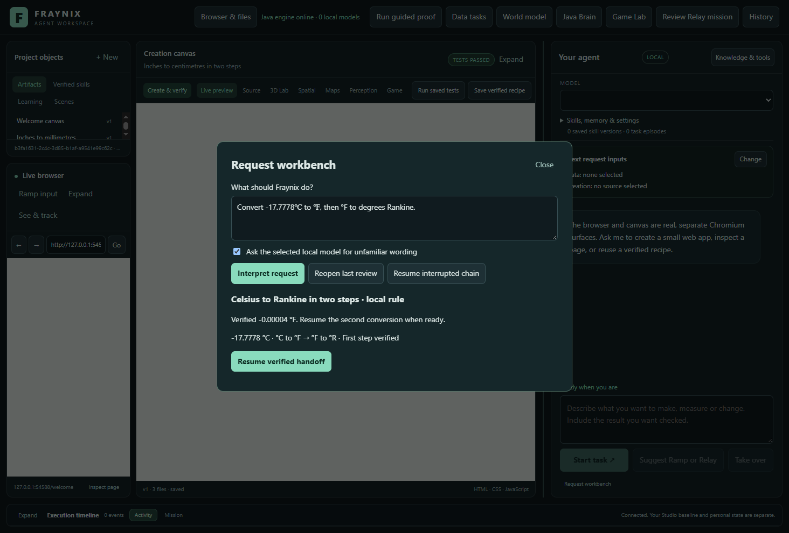

# Fraynix Agent Workspace · Edition 184

[Edition 183](README-183.md) · [Offline walkthrough](docs/readmes/184/index.html) · [Full edition history](docs/readmes/INDEX.md)

Convert Celsius to Fahrenheit and then Rankine in one Chat request. The Workbench can save the verified intermediate and resume it after the desktop stops.

## Try it

1. In **Chat**, enter “Convert -17.7778℃ to ℉, then °F to degrees Rankine.” Select **Start task**.
2. Review the signed value and three units. Select **Verify both conversions**. Enable **Pause after the first verified conversion** to stop at the handoff.
3. After restarting the app, open **Request workbench** and select **Resume interrupted chain**. Confirm **Resume verified handoff**.
4. Open the verified converter in **Creation Canvas** or export it as a single offline HTML file.

[Completed chain](docs/readmes/184/verified-temperature-chain.png) · [Refusals seen in Chat](docs/readmes/184/alias-refusals.png)

## What gets checked

The temperature chain accepts Celsius, centigrade, degree names, abbreviations and symbols such as ℃ and ℉. The Java planner checks that the receiving step expects the same unit. It refuses a Fahrenheit result offered to a millimetre or kelvin input before it creates a review. Both independent browser calculations use scaled integers and Java checks them against the original Fray programs.

The exact intermediate, including its sign and unit, is stored before the second step runs. On recovery the browser rebuilds its first result and Java compares it with the original saved observations before releasing the second step. The tool accepts temperatures from −273.15 to 1,000,000 °C with up to four decimal places.

## Verification on November 19, 2026

The test forcibly stopped the desktop and its Java process tree with **−0.00004 °F** verified and the second stage pending. A new desktop process reopened the same project. Its recovery control found the saved handoff from disk even after the browser’s last-review pointer was cleared. Java retained the original receipt and verified the final **459.66996 °R**. The file export produced **558.72 °R** for **37.25 °C** directly from disk.

Both stages passed five Chromium checks each. Two incompatible units were refused, two alternate prompt spellings produced the same typed plan, and all three earlier edition receipts reopened. The browser also cleared stale intermediates on input changes and refused a value below absolute zero.

| New input in °C | Observed Fahrenheit | Observed Rankine |
| --- | --- | --- |
| -273.15 | -459.67 °F | 0 °R |
| -40 | -40 °F | 419.67 °R |
| 0 | 32 °F | 491.67 °R |
| 37.25 | 99.05 °F | 558.72 °R |
| 100 | 212 °F | 671.67 °R |
| 0.0001 | 32.00018 °F | 491.67018 °R |

125 root Java tests, 45 focused Java workspace tests, 181 desktop tests and 10 evidence archive tests passed.

[Original browser receipt](docs/readmes/184/browser-receipt.json) · [Full verification record](docs/readmes/184/verification.json) · [Implementation plan](docs/publication184/plan.md)
