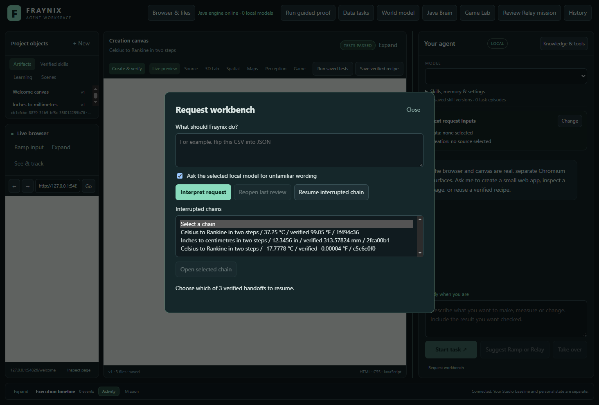
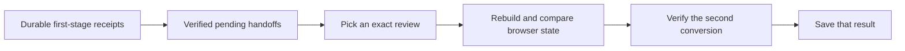

# Fraynix Agent Workspace · Edition 185

[Edition 184](README-184.md) · [Offline walkthrough](docs/readmes/185/index.html) · [Full edition history](docs/readmes/INDEX.md)

The Workbench lists saved Fray handoffs by input and verified value. Choose which chain to resume when several are pending after a desktop restart.

## Try it

1. In **Chat**, start an inches-to-centimetres or Celsius-to-Rankine chain. Enable **Pause after the first verified conversion** before confirming. Repeat with another request.
2. After starting the desktop again, open **Request workbench** and select **Resume interrupted chain**.
3. Select a row and **Open selected chain**. The chooser shows the starting value, the verified intermediate, and the review identifier.
4. Select **Resume verified handoff**. Java checks the exact review and original browser observations before releasing the next conversion. Repeat for the remaining rows.

[First selected result](docs/readmes/185/selected-length.png) · [All saved handoffs resolved](docs/readmes/185/all-resolved.png)

## How selection and verification work

Java checks that the selected review is still pending and repeats the comparisons for its own saved quantity and unit. A completed review leaves the chooser. A draft with no verified intermediate stays available through normal review. If only one verified handoff is pending, the recovery button opens it directly.

## Local verification on November 19, 2026

The desktop and Java process tree stopped with three persisted handoffs. After restarting the same project, the test reopened the **middle** review first. The other two saved review files stayed byte-identical until explicitly selected. Each run retained its original first-stage receipt and passed ten browser checks. Java refused both a handoff from another unit and a different value from a review with the correct unit. All four historical Edition 181–184 proofs reopened.

| Starting input | Saved intermediate | Verified result | Rebuild | Second stage and save |
| --- | --- | --- | ---: | ---: |
| 12.3456 in | 313.57824 mm | 31.357824 cm | 193 ms | 360 ms |
| -17.7778 °C | -0.00004 °F | 459.66996 °R | 195 ms | 364 ms |
| 37.25 °C | 99.05 °F | 558.72 °R | 181 ms | 363 ms |

Rebuild includes loading and hashing the reviewed HTML, Chromium’s five first-stage checks, and Java’s comparison with the original receipt. Second-stage timing ends when Java saves the artifact. These are single local samples for the listed tasks.

125 root Java tests, 46 focused Java workspace tests, 181 desktop tests and 10 evidence archive tests passed. GitHub Actions credits were unavailable. This release was validated locally.

[Browser receipt for the first recovered chain](docs/readmes/185/browser-receipt.json) · [Full measurements and verification](docs/readmes/185/verification.json) · [Implementation plan](docs/publication185/plan.md)
