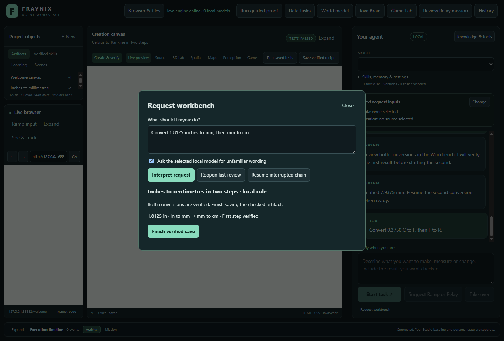
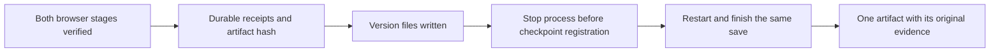

# Fraynix Agent Workspace · Edition 186

[Edition 185](README-185.md) · [Offline walkthrough](docs/readmes/186/index.html) · [Full edition history](docs/readmes/INDEX.md)

Fraynix can finish saving a Fray artifact after the desktop stops during the write. Java restores the exact review and verifies both retained browser receipts before publishing the result.

## Recover a save

1. If Fraynix stops after verifying both conversions, restart the desktop and open **Request workbench**.
2. Select **Resume interrupted chain** and choose the review marked **ready to save**.
3. Select **Finish verified save**. Java rechecks the stored observations, the original HTML, and the expected artifact before saving. The result opens in **Creation Canvas**.

[Chooser with 60 pending reviews](docs/readmes/186/large-chooser.png) · [Recovered artifact screenshot](docs/readmes/186/recovered-artifact.png)

## What the interruption test did

The test held the world checkpoint writer lock, waited until all three version files existed and confirmed that the registered checkpoint still matched its original bytes. It forcibly stopped the isolated desktop and Java processes at that boundary. After restart the review still had both original five-check receipts and no published artifact. Recovery preserved the stranded files and finalized one version-one artifact under the same ID. It opened the final artifact directly, with no browser preview replay. The selected result was **4.60375 cm** and the neighboring review stayed byte-identical.

Separate Java coverage exercised the later boundary where the artifact and its browser receipt were already written. Recovery retained the receipt and artifact ID. A changed expected artifact hash was refused. The archived Edition 181–185 proofs also reopened.

## Chooser on November 19, 2026

| Verified pending chains | Runs | Median click-to-ready | Slowest sample |
| ---: | ---: | ---: | ---: |
| 3 | 7 | 52 ms | 102 ms |
| 24 | 7 | 46 ms | 88 ms |
| 60 | 7 | 53 ms | 264 ms |

All pending rows came from real browser-verified first stages across both Fray recipes. The timing includes the UI click, Java listing and verification, transport and rendering. These measurements are from one local Windows run. The forced-stop test left 59 siblings pending after completing the selected save.

125 root Java tests, 47 focused Java workspace tests, 181 desktop tests and 10 evidence archive tests passed. Validation ran locally.

[Original ten-step browser receipt](docs/readmes/186/browser-receipt.json) · [Full measurements and verification](docs/readmes/186/verification.json) · [Implementation plan](docs/publication186/plan.md)
