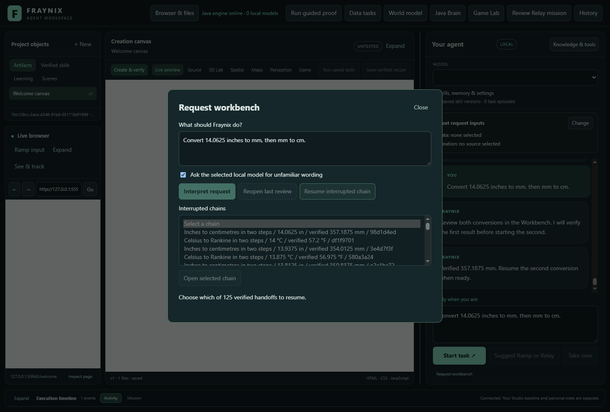
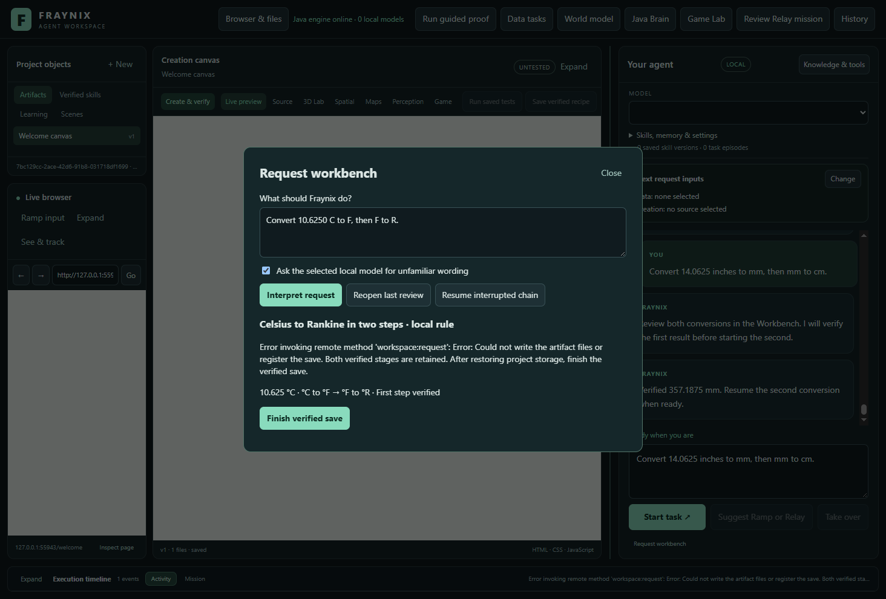
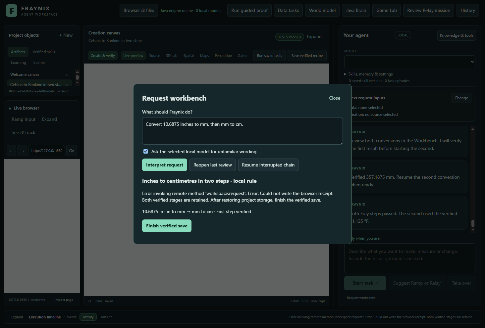

# Fraynix Agent Workspace · Edition 187

[Edition 186](README-186.md) · [Offline walkthrough](docs/readmes/187/index.html) · [Full edition history](docs/readmes/INDEX.md)

The Workbench can retry a verified Fray save after project storage rejects an artifact or browser receipt write. Java uses the original review, evidence and artifact ID to finish the save.

## Finish a verified save

When the Workbench reports a storage error, restore write access to the project and select **Finish verified save**. If you restarted the desktop, open **Request workbench**, choose **Resume interrupted chain**, and select the original review. Java verifies the retained browser receipts and expected artifact contents before it reports completion. The result opens in **Creation Canvas**.

## Real write failures and verified recovery

| Blocked write | State after the failure | Recovery observed |
| --- | --- | --- |
| Artifact destination | Both five-check browser receipts retained and checkpoint bytes unchanged | Restart completed one version-one artifact under the original ID |
| Browser receipt destination | Version-one artifact registered and completion refused while the receipt was absent | Same-session retry recorded the receipt on the same artifact bytes and ID |

The test occupied each destination with a regular file in an isolated Windows project. The operating system rejected directory creation during the normal save. Both retries opened the final artifact directly, with zero browser preview replays. The verification endpoint refused both incomplete writes and accepted the results after recovery.

## Pending bank and local measurements

The 128-review limit was reached with 125 browser-verified pending chains across both recipes and three unapproved drafts. Java refused an extra draft and the chooser showed only the 125 resumable chains. After both saves, 123 chains were still pending and all 126 other review files were byte-identical.

| Verified pending chains | Samples | Median click-to-ready | Slowest sample |
| ---: | ---: | ---: | ---: |
| 125 | 7 | 62 ms | 160 ms |

These timings include the UI action, Java listing, transport, rendering and the automation wait in one local run. The desktop also reopened archived proofs from Editions 181–186. 125 root Java tests, 48 focused Java workspace tests, 181 desktop tests and 10 evidence archive tests passed. Validation ran locally.

[Recovered ten-check browser receipt](docs/readmes/187/browser-receipt.json) · [Full measurements and verification](docs/readmes/187/verification.json) · [Implementation plan](docs/publication187/plan.md)
