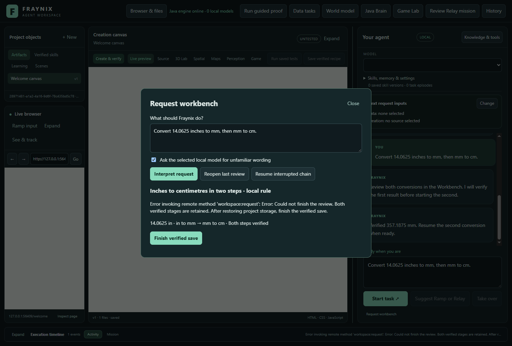
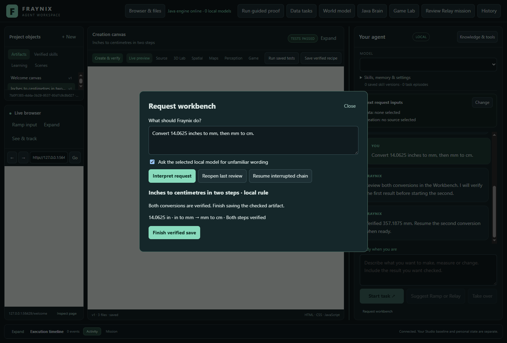
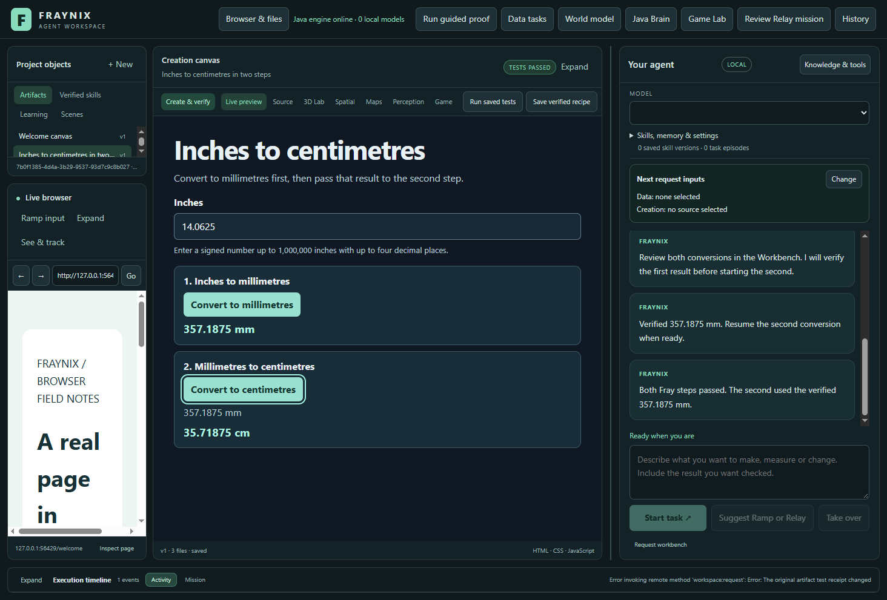

# Fraynix Agent Workspace · Edition 188

[Edition 187](README-187.md) · [Offline walkthrough](docs/readmes/188/index.html) · [Full edition history](docs/readmes/INDEX.md)

Fraynix can finish a Fray review after storage rejects the final write, even when the artifact and its browser receipt were already saved. Completed chain verification checks the current receipt on disk.

## Recover the final review write

Restore write access to the project. In the Workbench, select **Finish verified save**. After a desktop restart, open **Request workbench**, select **Resume interrupted chain**, and open the row marked **ready to save**. Both verified steps stay attached to the review. Java checks the original artifact and matching on-disk browser receipt before it publishes the completed review.

## What passed locally

| Check | Result |
| --- | --- |
| Windows denies the final review replacement | Original review bytes survive while the artifact and receipt are already present |
| Desktop restarts and retries the save | Same version-one artifact and byte-identical receipt, with zero preview replays |
| Wrong browser result in the stored receipt | Recovery and completed verification both refuse it |
| Completed receipt missing | Verification refuses completion until the original receipt is restored |

The test used the 128-review limit with 125 browser-verified pending chains and three unapproved drafts. The run finished one selected review. All 127 other review files were byte-identical and 124 verified chains stayed pending. Both published Edition 187 recovery proofs also reopened. 125 root Java tests, 49 focused Java workspace tests, 181 desktop tests and 10 evidence archive tests passed.

[Original ten-check browser receipt](docs/readmes/188/browser-receipt.json) · [Verification results](docs/readmes/188/verification.json) · [Implementation plan](docs/publication188/plan.md)
