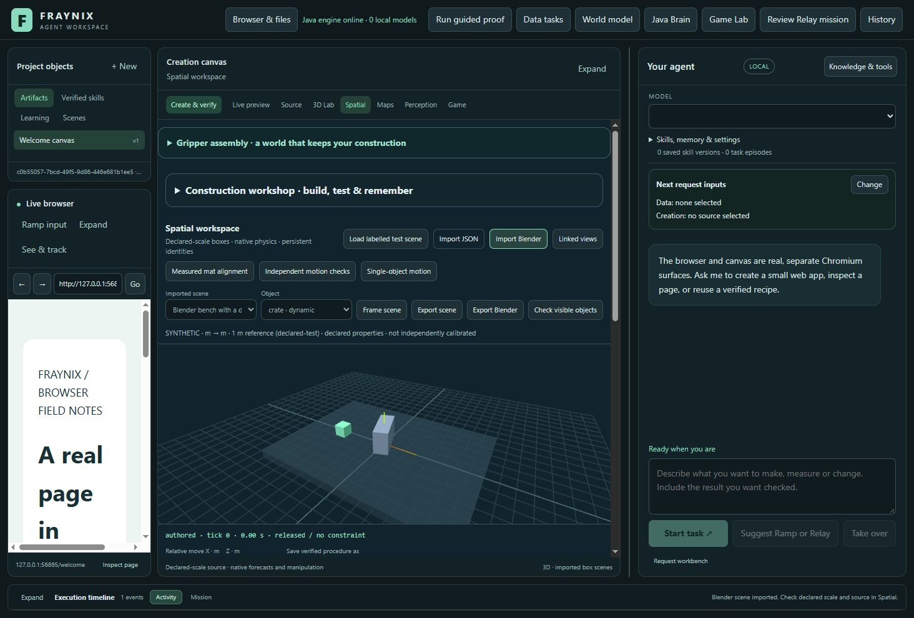
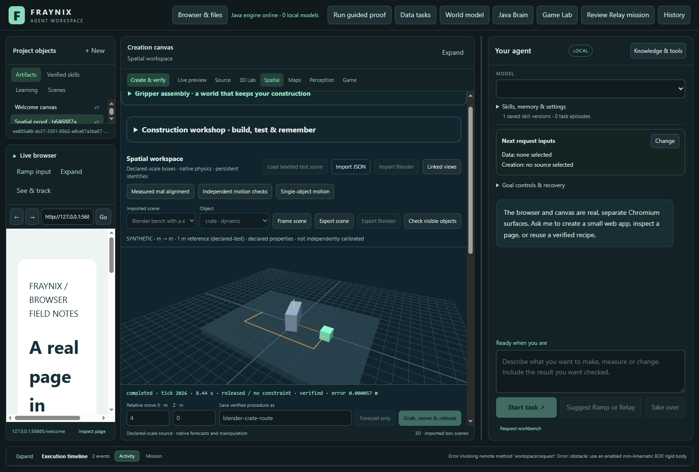
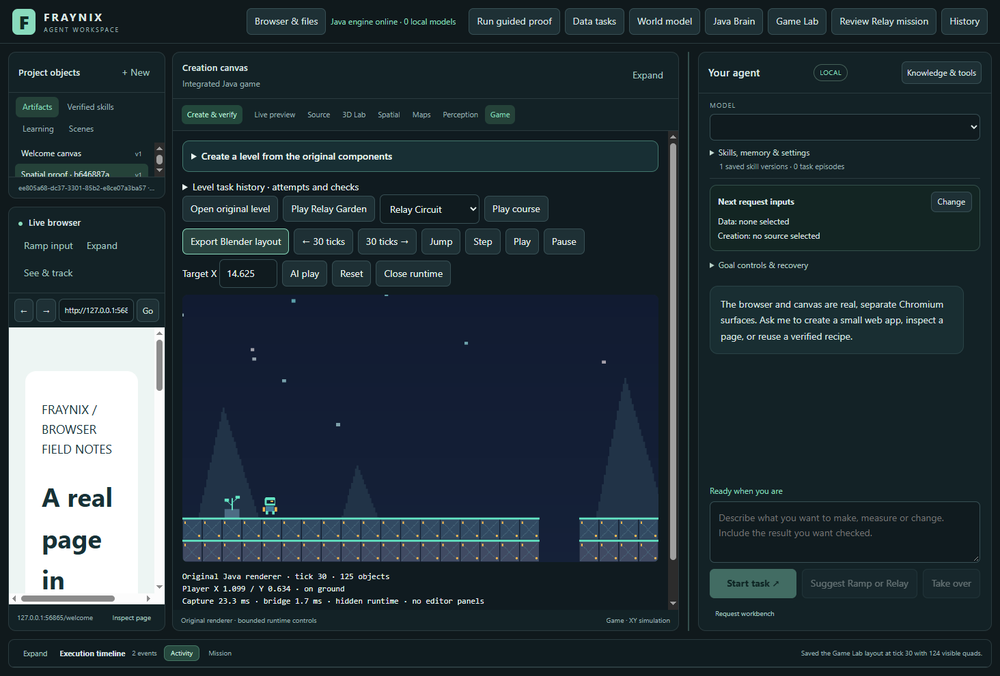

# Fraynix Agent Workspace · Edition 189

[Edition 188](README-188.md) · [Offline walkthrough](docs/readmes/189/index.html) · [Full edition history](docs/readmes/INDEX.md)

Import a Blender rigid-box scene into Spatial, test it with native physics, and export an editable .blend. Export a paused Game Lab frame with named objects and its original Java snapshot.

## Try the Blender bench

1. Download the [editable bench fixture](docs/readmes/189/authored-bench.blend).
2. Open **Spatial → Import Blender** and select the fixture. Fraynix uses your installed Blender. Set FRAYNIX_BLENDER to the full executable path when it is installed in a custom location.
3. Check the one-metre reference and select **Movable crate**. Use **Forecast only** or **Grab, move & release**. A verified run retains its native trace and browser-checked report and can save a reusable procedure.
4. Use **Export Blender** to save an editable copy of the authored scene to a new filename.

For your own scene, set Blender to Metric or Imperial units. Add empties named **Fraynix Scale A** and **Fraynix Scale B** at the reference endpoints. Add numeric **fraynix_known_length_m** and **fraynix_tolerance_m** custom properties to the scene. Use a static surface and at least one active rigid box. The import supports the shapes and settings in the [Spatial v1 contract and qualification plan](docs/publication189/plan.md). The scale check compares the stated length with the model. Independent camera or instrument validation is still pending.

## Take Game Lab geometry into Blender

Open **Game**, play a course, pause, then select **Export Blender layout**. The file contains planar meshes, stable source IDs and component metadata. The original Java snapshot is available in Blender's Text Editor as **Fraynix Game snapshot.json**. The layout retains game units and is intended for inspection and authoring. The export covers geometry and metadata. Use Game Lab to playtest levels.

## What passed

| Check | Result |
| --- | --- |
| Blender authoring round trip | Blender 5.3.0. Three source IDs preserved. Positions and dimensions matched within 0.000001 m. |
| Invalid imports | Mismatched scale and unsupported sphere collider refused. |
| Java physics | 254 aligned samples, one grab, one release and 8 browser report checks. The imported scene and verified procedure survived restart. |
| Game Lab export | 124 editable quads from 125 source entities at tick 30. Java accepted the original snapshot and refused a changed one. |

125 root Java tests, 31 focused Java workspace tests, 181 desktop tests and 10 evidence archive tests passed. Validation ran locally.

[Verification record](docs/readmes/189/verification.json) · [Implementation and follow-on plan](docs/publication189/plan.md) · [Earlier Blender source assessment](docs/publication161/blender161.md)
