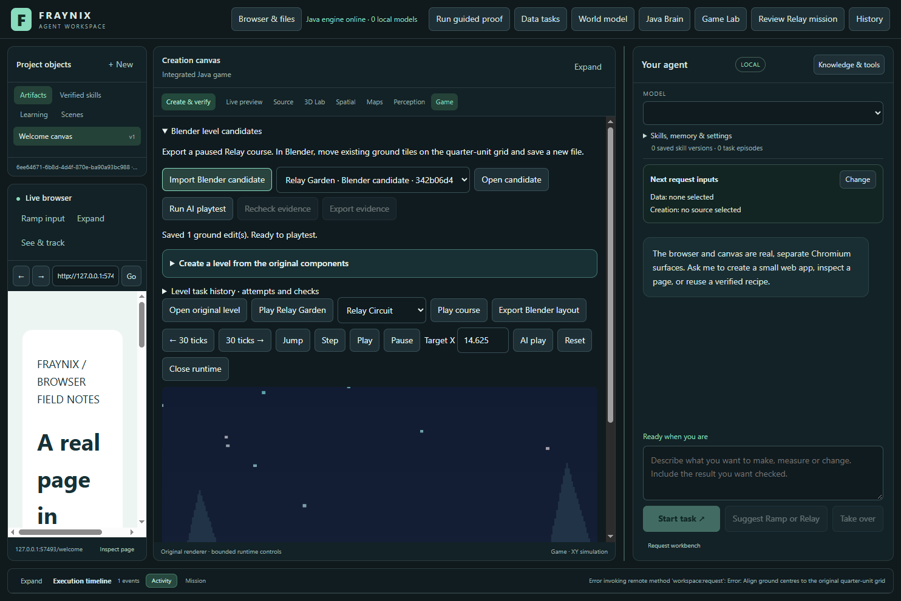
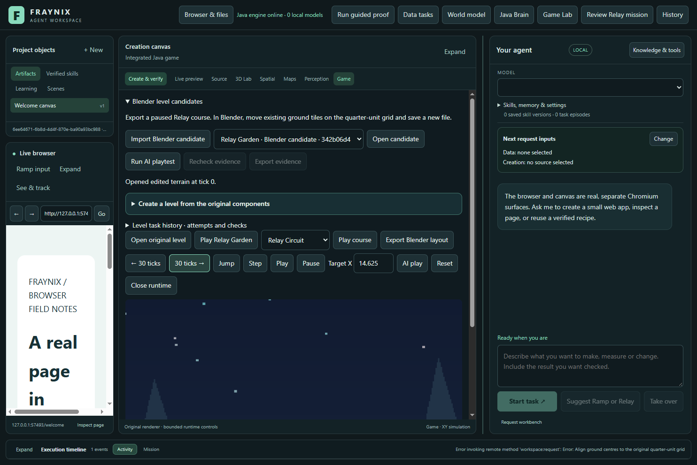
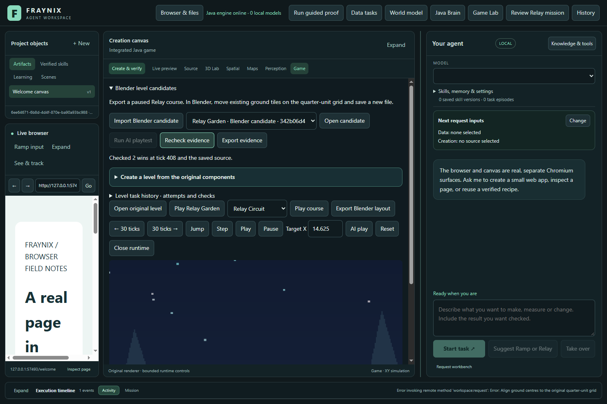

# Fraynix Agent Workspace · Edition 190

[Edition 189](README-189.md) · [Offline walkthrough](docs/readmes/190/index.html) · [Full edition history](docs/readmes/INDEX.md)

Move original Relay ground tiles in Blender, import a separate Game Lab candidate, and verify its playability with two fresh Java AI runs.

## Edit and play

1. In the **Game** tab, open an original Relay course and pause. Choose **Export Blender layout**.
2. In Blender Object Mode, move an existing ground tile. Blender X maps to Game Lab X and Blender Z maps to Game Lab Y. Move in increments of 0.25 and keep the tile in the game plane. Save a new .blend file.
3. In **Blender level candidates**, choose **Import Blender candidate**. For a quick trial, use the [edited Relay Garden sample](docs/readmes/190/edited-course.blend).
4. Select **Open candidate** to use ordinary controls, or **Run AI playtest** to let the Java controller try it. **Recheck evidence** audits the saved result and **Export evidence** saves the verified trace as JSON.

This first importer accepts translations of one to sixteen existing ground tiles. It checks positions against the original grid, source identities and start and finish clearance. Java rebuilds a separate level from the original course components.

## What the test demonstrated

The test moved one tile from (4.375, 0.125) to (4.625, 0.375), narrowing the top of the first Relay Garden gap. The native runtime loaded the edited tile at that position, and manual input advanced the player. Two fresh AI sessions reached the beacon at tick **408** with matching sampled motion. The interactive session stayed at tick 30 throughout the background playtests. The original course reopened at its original tile position.

A separate sixteen-tile edit opened as a candidate and failed its AI trial at tick **1728**. Its trace stayed on disk. The test also exercised a moved player, off-grid tile, changed snapshot, modified level file and modified finish image. Java rechecked the successful proof after the desktop restarted. 125 root Java tests, 25 focused Java workspace tests, 181 desktop tests and 10 evidence archive tests passed. Validation ran locally.

[Native beacon screenshot](docs/readmes/190/native-beacon.png) · [Full verified trace](docs/readmes/190/playtest-evidence.json) · [Verification summary](docs/readmes/190/verification.json) · [Implementation and qualification plan](docs/publication190/plan.md)
