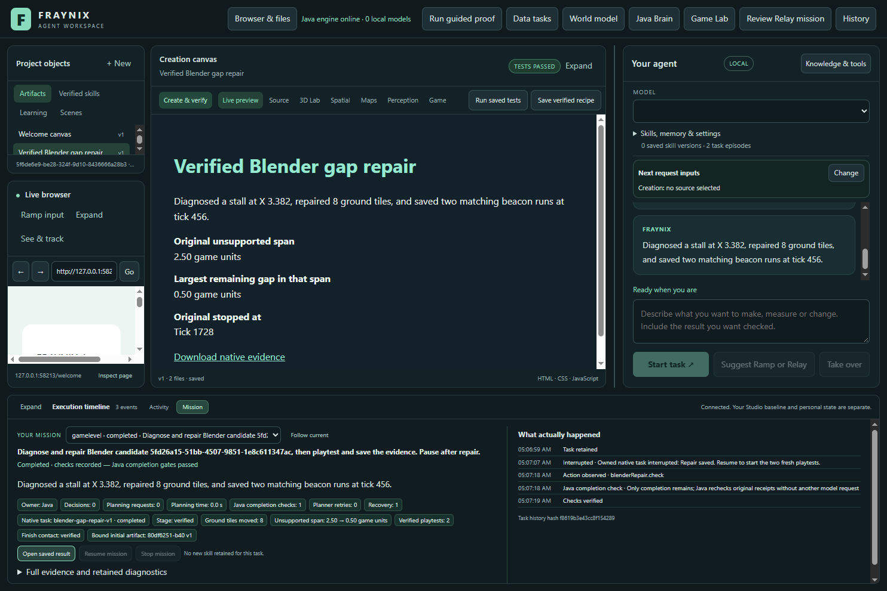
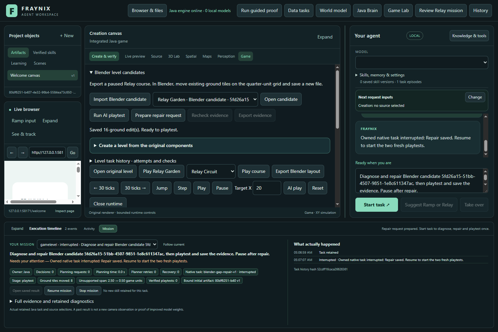
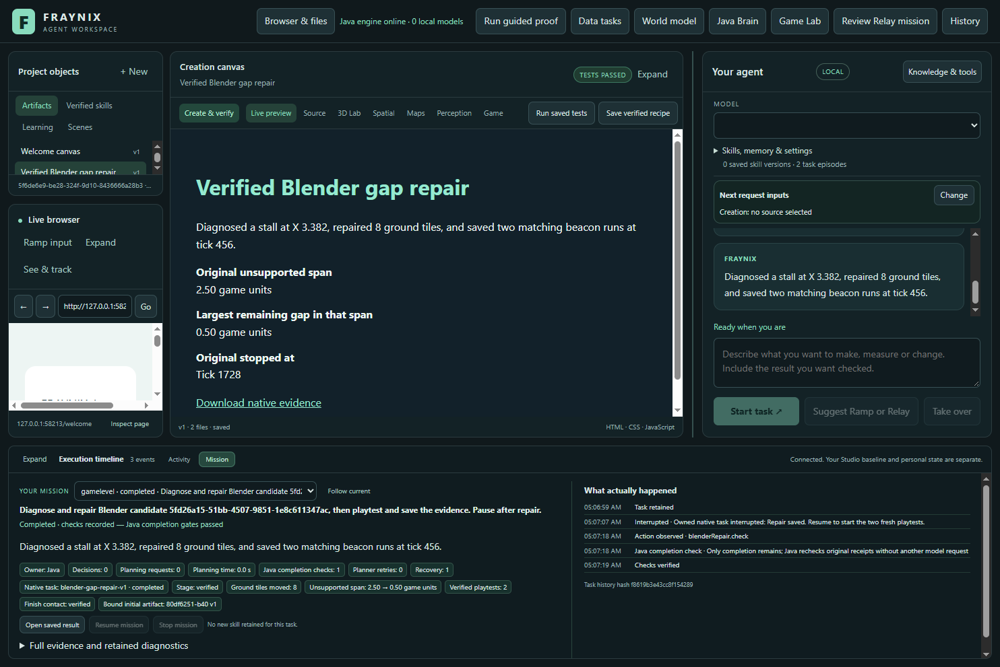

# Fraynix Agent Workspace · Edition 191

[Edition 190](README-190.md) · [Offline walkthrough](docs/readmes/191/index.html) · [Full edition history](docs/readmes/INDEX.md)

One durable Chat request runs the original Blender level, diagnoses the failed movement, repairs a separate candidate and saves two verified native playtests.

## Run it

1. Open **Game → Blender level candidates** and import the [wide-gap Blender sample](docs/readmes/191/wide-gap-course.blend).
2. Select **Prepare repair request**, then click **Start task** in Chat. The request names the selected candidate explicitly.
3. Follow the stages in **Mission**. The workflow runs a baseline when needed, diagnoses a supported failure pattern, builds one derived level, runs two fresh playtests and checks the saved report. Open **Open saved result** to view the diagnosis and download the native traces.

Add **Pause after repair.** to review the candidate before the playtests. **Resume** continues the saved request after a restart.

## What passed locally

The original Relay Garden variant reached tick **1728** with the robot grounded and stalled at **X 3.382**. Java checked the final eight native samples, then found a **2.50-unit** unsupported span immediately ahead. It reused eight raised ground tiles and reduced the largest remaining gap there to **0.50 units**.

Two fresh native sessions reached the beacon at tick **456** with matching sampled motion. The report passed three actual browser checks. A restart between repair and playtesting retained the same Chat and candidate IDs. A second request ran through automatically, reused the checked failed trace and produced an identical successful motion trace. Verification refused a modified original finish image and a modified browser receipt. The original Blender candidate file stayed byte-identical.

The current repair rule covers a grounded stall beside one unsupported span, using at most eight existing moved tiles. Java owns the diagnosis and bounded edit. 125 root Java tests, 53 focused Java workspace tests, 181 desktop tests and 10 evidence archive tests passed.

[Complete native evidence](docs/readmes/191/repair-evidence.json) · [Verification results](docs/readmes/191/verification.json) · [Implementation and local reproduction](docs/publication191/plan.md)
