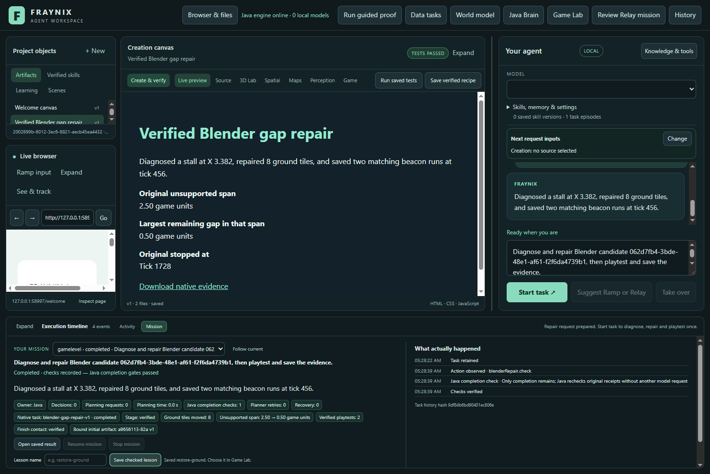
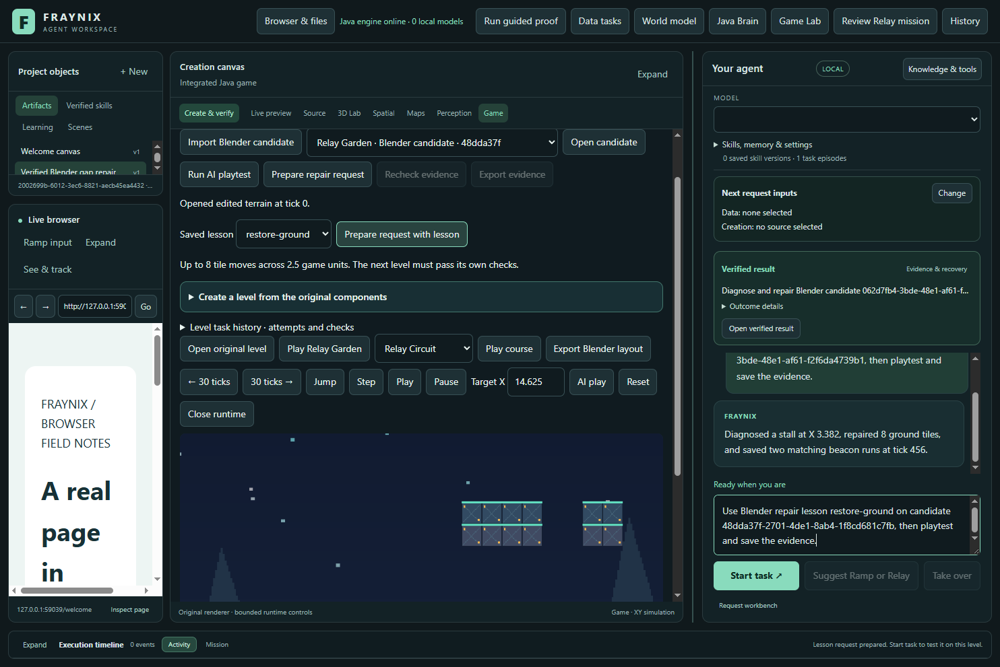
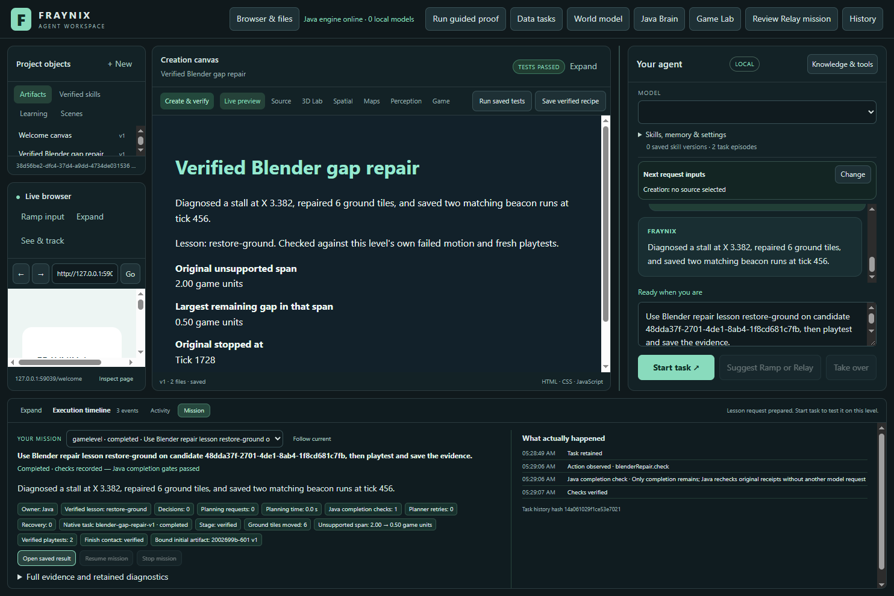

# Fraynix Agent Workspace · Edition 192

[Edition 191](README-191.md) · [Offline walkthrough](docs/readmes/192/index.html) · [Full edition history](docs/readmes/INDEX.md)

Save a verified Blender repair as a named lesson. Apply it to different terrain through Chat and require fresh playtests before accepting the result.

## Teach and apply

1. Import the [teaching level](docs/readmes/191/wide-gap-course.blend) through **Game → Blender level candidates**. Prepare and start its direct repair request.
2. After it passes, open **Mission**, give the example a short name such as `restore-ground` and choose **Save checked lesson**.
3. Import the [new test level](docs/readmes/192/narrower-gap-course.blend). Select the saved lesson, choose **Prepare request with lesson**, then start the Chat task.
4. Open **Mission → Open saved result**. The report includes the lesson used, the new gap measurements and a download with the new native traces.

## What passed

The teaching run repaired 8 ground tiles across a 2.50-unit gap. After restart, the new level stalled on a 2.00-unit gap. Java moved 6 tiles, leaving at most 0.50 units unsupported in that span. Two new native runs reached the beacon at tick 456. The saved report passed four Chromium checks.

The app refused premature teaching, reuse on the original level, teaching recursively from a reuse result, and a wider target beyond a smaller lesson's limit. It detected an altered lesson checkpoint and an altered teaching receipt. The imported test level stayed byte-identical.

The lesson stores the verified failure type, course layout and repair limits. Java derives new edits from each target's own failed motion. This edition supports grounded-stall gap repairs up to the example's observed limits. 125 root Java tests, 53 focused Java workspace tests, 181 desktop tests and 10 evidence archive tests passed locally.

[Native evidence](docs/readmes/192/repair-evidence.json) · [Verification results](docs/readmes/192/verification.json) · [Reproduction and next phase](docs/publication192/plan.md)
