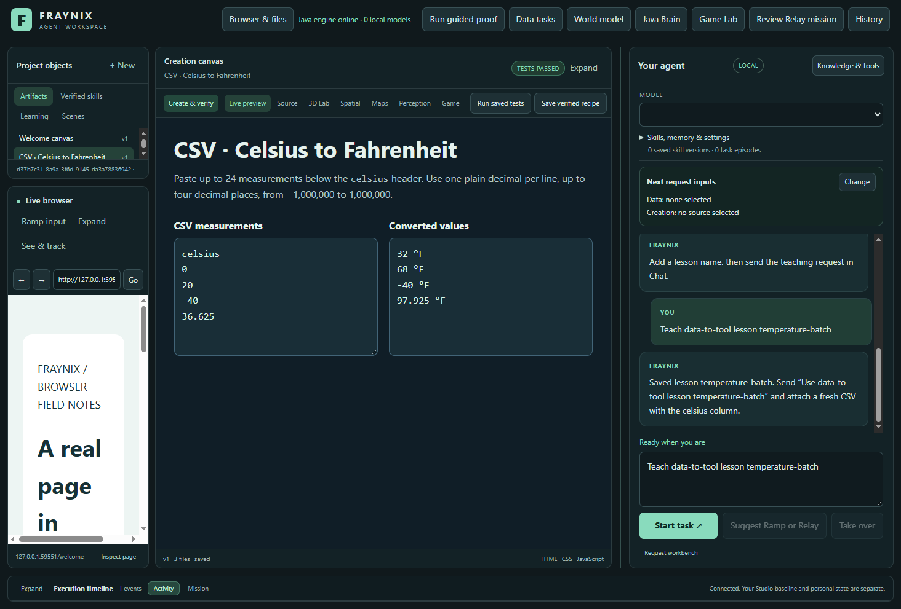
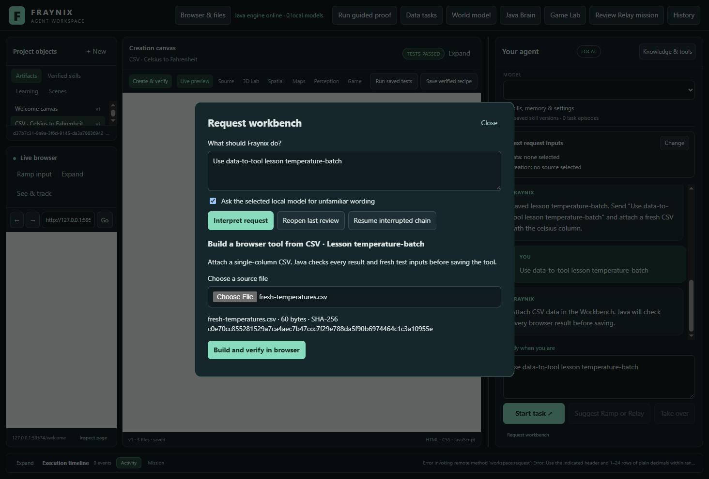
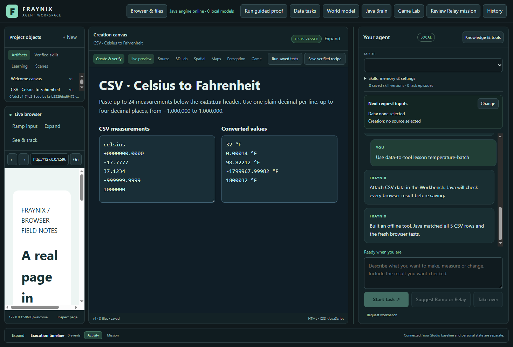

# Fraynix Agent Workspace · Edition 193

[Edition 192](README-192.md) · [Offline walkthrough](docs/readmes/193/index.html) · [Full edition history](docs/readmes/INDEX.md)

Teach a named CSV conversion lesson in Chat, attach fresh rows and build an offline browser tool. Java verifies the generated tool with both the input data and unseen measurements.

## Try it

1. Send `Build a data-to-tool converter from Celsius to Fahrenheit.` in Chat.
2. In the Workbench, attach a UTF-8 CSV with the header `celsius` and one decimal measurement per row. Choose **Build and verify in browser**.
3. Send `Teach data-to-tool lesson temperature-batch` to teach from the last verified original CSV tool. **Reopen last review** also offers **Prepare teaching request**.
4. Send `Use data-to-tool lesson temperature-batch`, attach new data and confirm. The new CSV must contain a measurement absent from the example.
5. Reopen the verified tool from the Workbench, or use **Save output to project** for a standalone HTML file. Paste new rows into the tool to convert them locally.

## What passed

After restart, the temperature lesson generated a new tool from 5 fresh CSV rows. Chromium matched Java on every row and 4 additional measurements. A separate 24-row inches tool passed the same gate. The desktop run included four restarts. One followed a real artifact-write failure. Fraynix finished the save from the original browser checks after storage was restored. The completed HTML also ran from a local file and converted two new values.

Java rejected an unverified teacher, a teaching attempt from a reuse result, the wrong column, out-of-range input and a copy of the teaching values with new formatting and row order. It also refused a browser receipt borrowed from the teacher and detected modifications to both receipts and the lesson checkpoint.

This edition supports single-column CSV batch tools for Celsius to Fahrenheit or inches to millimetres, with 1–24 decimal rows per file. 125 root Java tests, 62 focused Java workspace tests, 181 desktop tests and 10 evidence archive tests passed locally.

[Try the exported tool](docs/readmes/193/offline-converter.html) · [Browser receipt](docs/readmes/193/fresh-browser-receipt.json) · [Verification results](docs/readmes/193/verification.json) · [Implementation and reproduction](docs/publication193/plan.md)
