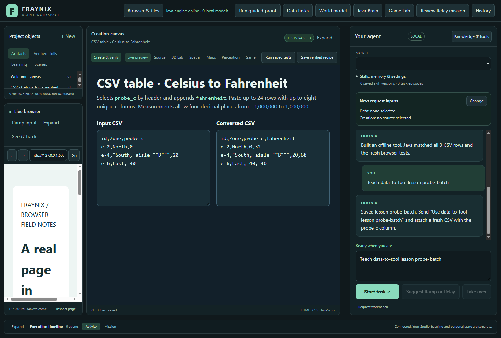
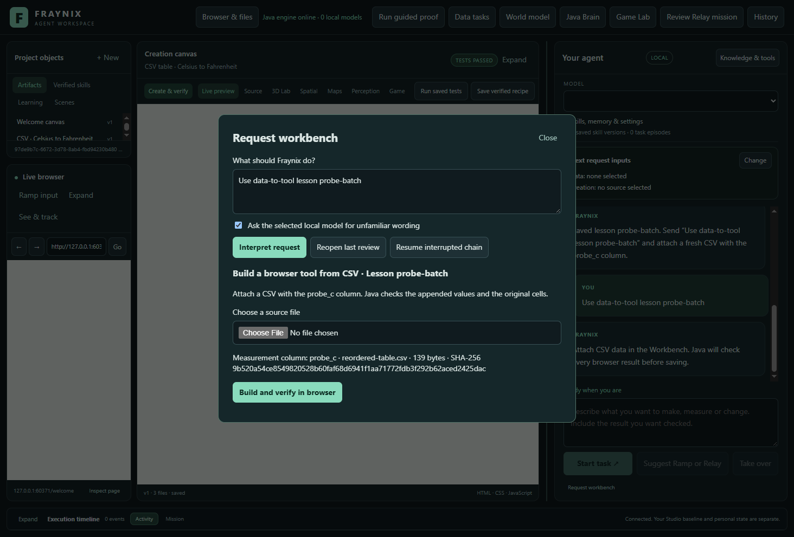
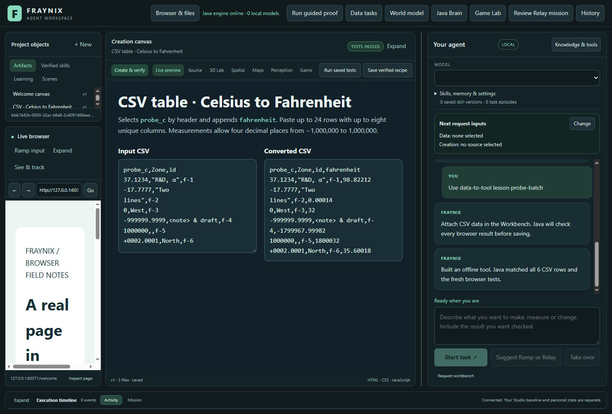

# Fraynix Agent Workspace · Edition 194

[Edition 193](README-193.md) · [Offline walkthrough](docs/readmes/194/index.html) · [Full edition history](docs/readmes/INDEX.md)

Choose a named measurement column in Chat and teach a conversion from its verified result. Reuse the lesson on reordered CSV and append the checked result without losing the other cells.

## Try it

1. Send `Build a data-to-tool converter from Celsius to Fahrenheit using column probe_c.` in Chat.
2. Attach a UTF-8 CSV with a `probe_c` header and any other unique headers. Choose **Build and verify in browser**.
3. Send `Teach data-to-tool lesson probe-batch`, then `Use data-to-tool lesson probe-batch`. Attach a fresh CSV. The column can move to a different position.
4. Reopen the verified tool or choose **Save output to project** for standalone HTML. Paste a table into the exported tool to append `fahrenheit` or `millimetres`.

## What passed

The temperature lesson converted 6 fresh rows when the measurement column moved from third to first. Java checked the full output table and the browser passed 16 checks. A separate eight-column inches tool converted 24 rows. Java and Chromium compared complete tables, including text with commas, quotes, embedded line breaks and Unicode. The app rejected missing and duplicate headers, uneven row widths, an output-column conflict and a file containing only the teaching example's values. The lesson, pending review and completed proof survived three separate restarts. The exported HTML converted a new row offline. Two verified edition 193 artifacts rechecked against their original evidence.

## Local timings

| Scenario | Rows × input columns | Attach and check | Build, save and verify |
| --- | ---: | ---: | ---: |
| Teaching example | 3 × 3 | 39 ms | 1453 ms |
| Reused lesson | 6 × 3 | 71 ms | 1552 ms |
| Width and row limit | 24 × 8 | 76 ms | 1453 ms |

Rechecking the completed lesson after restart took 30 ms. Each row reports one observed run on the development machine with synthetic inputs.

The workflow supports either registered conversion on 1–24 rows with up to eight input columns. The measured column name is case-sensitive. 125 root Java tests, 62 focused Java workspace tests, 181 desktop tests and 10 evidence archive tests passed locally.

[Run the offline example](docs/readmes/194/offline-table-tool.html) · [Browser receipt](docs/readmes/194/browser-receipt.json) · [Verification and timings](docs/readmes/194/verification.json) · [Implementation and reproduction](docs/publication194/plan.md)
