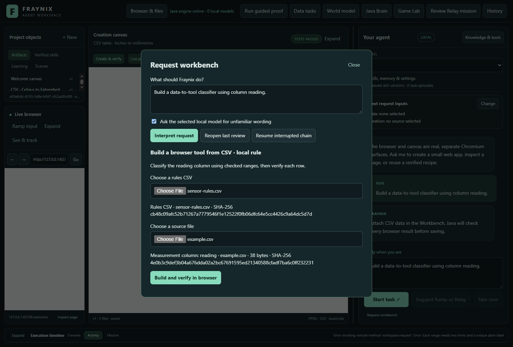
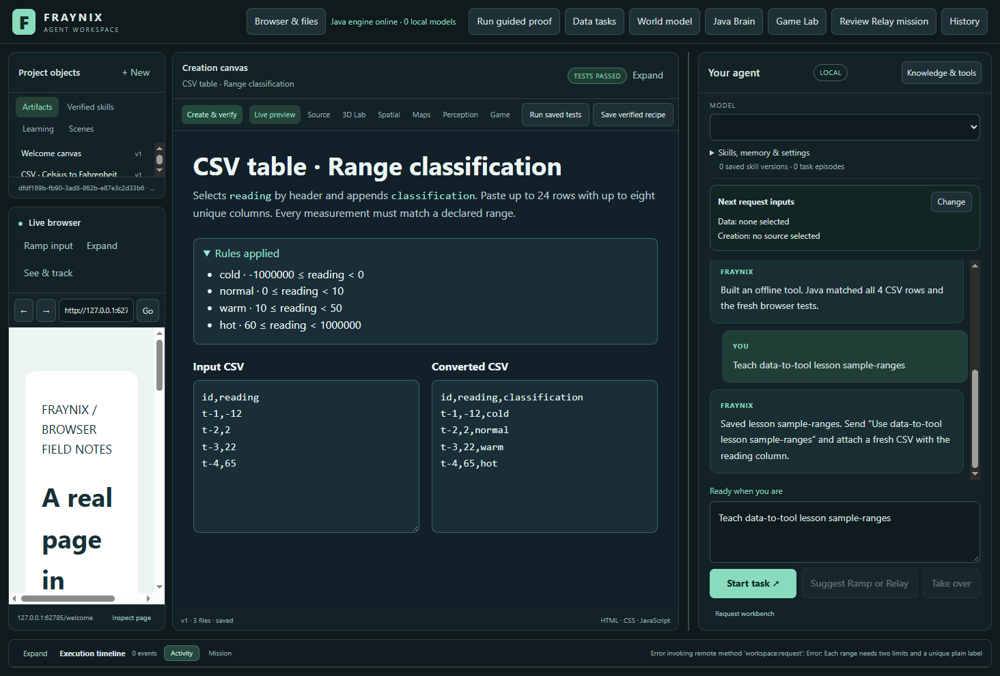
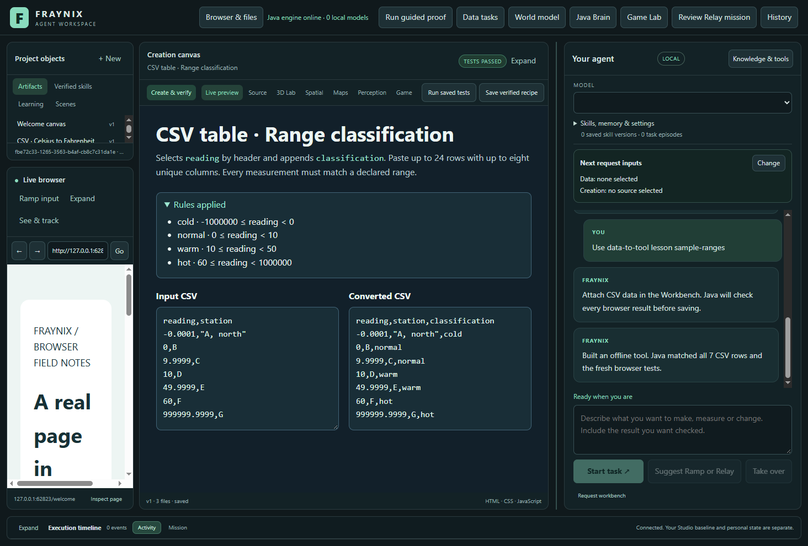

# Fraynix Agent Workspace · Edition 195

[Edition 194](README-194.md) · [Offline walkthrough](docs/readmes/195/index.html) · [Full edition history](docs/readmes/INDEX.md)

Teach a classifier from explicit CSV ranges, then reuse the checked rules on new measurements. Java checks every browser result, including unseen values and exact range boundaries.

## Try it

1. Send `Build a data-to-tool classifier using column reading.`
2. Attach a [rules CSV](docs/readmes/195/example-rules.csv). Its headers are `min_inclusive,max_exclusive,label`. Then attach a measurement CSV with a `reading` column and choose **Build and verify in browser**.
3. Send `Teach data-to-tool lesson sample-ranges` after the original verifies. The lesson keeps the exact rule file hash and the checked rule definitions.
4. Send `Use data-to-tool lesson sample-ranges` and attach fresh measurements. The browser tool appends `classification` and preserves the other cells. Use **Save output to project** to export it.

## What passed

The saved lesson classified 7 fresh rows using four ranges. Java compared the full output and the browser passed 20 checks, including both sides of shared boundaries and the first gap. A reading of `9.9999` was normal and `10` was warm. Values in an undeclared gap or at an exclusive upper boundary without a following rule were refused. Changing the original rule file invalidated the prior review. Reuse rejected a replacement rules upload and refused altered teaching evidence. A two-value example could build a tool, but Java refused to teach from it because no unseen valid measurement remained.

The verified lesson, the pending review and the completed proof survived three restarts. The exported HTML classified a new row on its own. Two edition 194 converters reverified against their original evidence.

The original four-row build took 1814 ms. The seven-row reuse took 2166 ms. Both observations include browser checks, save and Java verification on the development machine. 125 root Java tests, 62 focused Java workspace tests, 181 desktop tests and 10 evidence archive tests passed locally.

The rules are limited to two to six nonoverlapping numeric ranges with a fixed label per range. This edition produces and verifies labels.

[Run the offline classifier](docs/readmes/195/offline-classifier.html) · [Browser receipt](docs/readmes/195/browser-receipt.json) · [Verification](docs/readmes/195/verification.json) · [Implementation and next phase](docs/publication195/plan.md)
