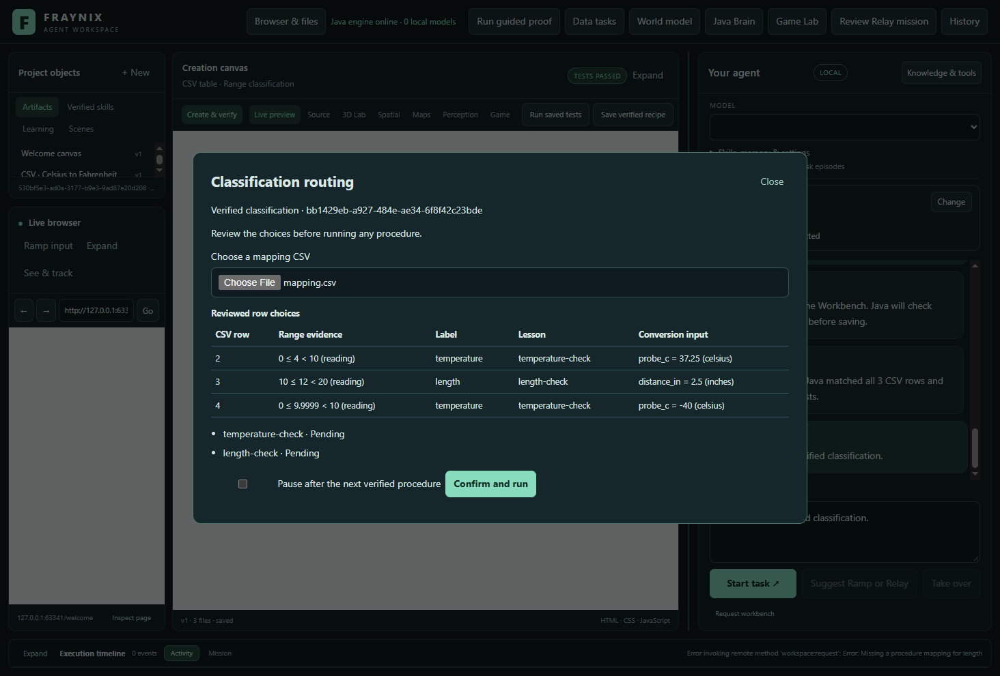
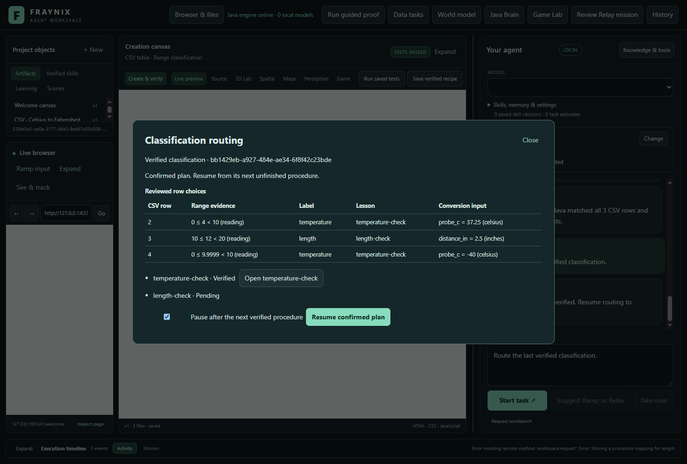
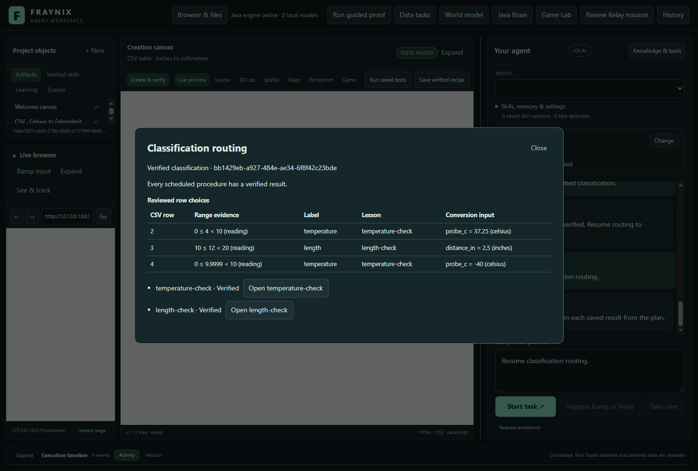

# Fraynix Agent Workspace · Edition 196

[Edition 195](README-195.md) · [Offline walkthrough](docs/readmes/196/index.html) · [Full edition history](docs/readmes/INDEX.md)

Attach a mapping from classification labels to verified conversion lessons. Review the reason and exact input for each choice, then approve the plan.

## Try it

1. Verify and teach two CSV conversion lessons. The example uses `temperature-check` for `probe_c` and `length-check` for `distance_in`.
2. Verify a range classifier on a CSV with the column to classify and the inputs required by the lessons. For the example, use a `reading` column and label the ranges `temperature` and `length`.
3. Send `Route the last verified classification.` Attach a [mapping CSV](docs/readmes/196/example-mapping.csv), review the choices and choose **Confirm and run**.
4. To stop between batches, choose **Pause after the next verified procedure**. Send `Resume classification routing.` after restart. Each completed batch has a button that opens its verified artifact.

## What passed

Three classified rows led to two confirmed conversion batches. After two restarts, Java finished the same plan with both original browser receipts. The temperature batch converted `37.25` and `−40` °C to `99.05` and `−40` °F. The length batch converted `2.5` inches to `63.5` millimetres. The second batch kept its ID after a restart before execution and kept its original artifact after a restart before the plan recorded completion.

Java refused a missing mapping, an unknown lesson, an unverified classifier, a stale approval and altered classifier or child receipts. The desktop created zero child reviews before approval and exactly two new verified artifacts afterward. Two edition 195 classifier artifacts also reverified.

This edition routes to saved Celsius-to-Fahrenheit and inches-to-millimetres lessons. Each approved batch produces its own artifact. 125 root Java tests, 62 focused Java workspace tests, 181 desktop tests and 10 evidence archive tests passed locally.

[Routing evidence](docs/readmes/196/routing-evidence.json) · [Verification results](docs/readmes/196/verification.json) · [Implementation and next phase](docs/publication196/plan.md)
