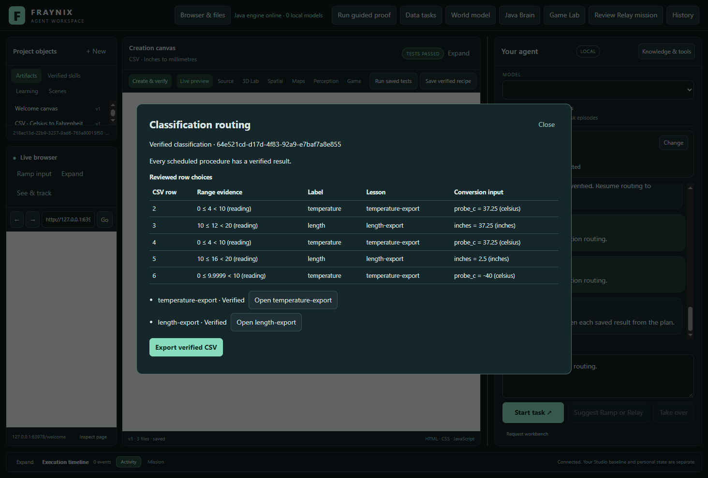
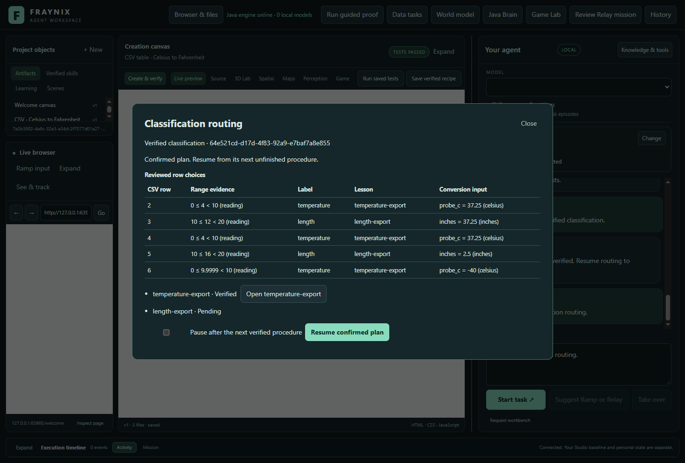
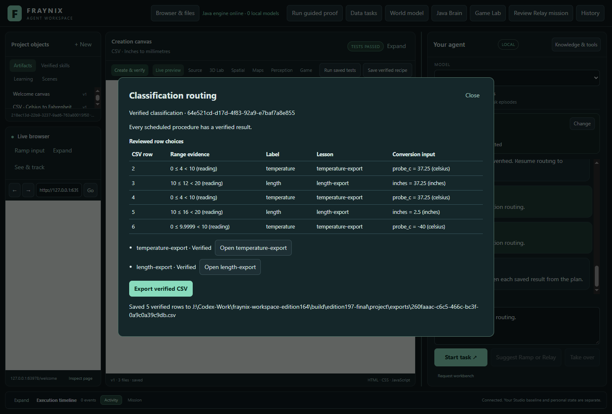

# Fraynix Agent Workspace · Edition 197

[Edition 196](README-196.md) · [Offline walkthrough](docs/readmes/197/index.html) · [Full edition history](docs/readmes/INDEX.md)

Export one CSV from a completed classification routing plan. It preserves source rows and duplicates, adds units to each result and records the verified sources.

## Export a plan

1. Complete a reviewed classification routing plan, or send `Resume classification routing.` to reopen the previous plan.
2. When every procedure verifies, choose **Export verified CSV**. The plan displays the local path.
3. The file retains the original cells and appends the logical CSV row number, classification, lesson, input column and value, converted value and both units. The supporting receipt includes the exact CSV hash, source classification and verified child artifacts.

## What passed

Five interleaved rows were exported in their original order. The same value, 37.25, produced 99.05 °F and 946.15 mm on the respective routes. An exact duplicate row appeared twice and kept two distinct row numbers. An existing `route_source_row` column kept its original values. The new columns used the `route_2_` prefix. The export also preserved a multiline quoted cell.

Three desktop restarts passed. The app refused export after one batch had completed and again when the last child had verified but its result was still pending acceptance into the plan. It refused altered classifier or child evidence. Once complete, the desktop saved a single CSV whose bytes matched Java's verified output. A repeated verification after restart produced byte-identical output. An edition 196 plan also exported through the same checks.

125 root Java tests, 66 focused Java workspace tests, 181 desktop tests and 10 evidence archive tests passed locally.

[Sample verified CSV](docs/readmes/197/verified-routed-results.csv) · [Export receipt](docs/readmes/197/export-receipt.json) · [Verification evidence](docs/readmes/197/verification.json) · [Implementation and reproduction](docs/publication197/plan.md)
